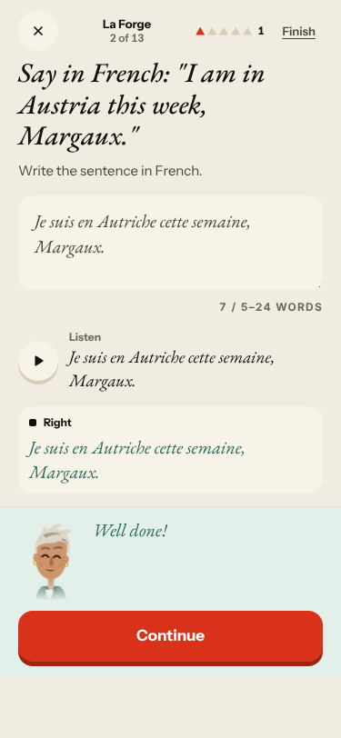
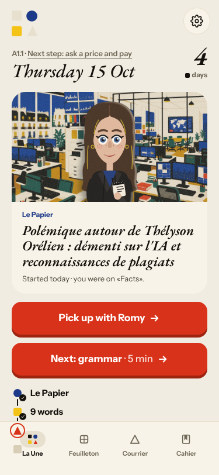
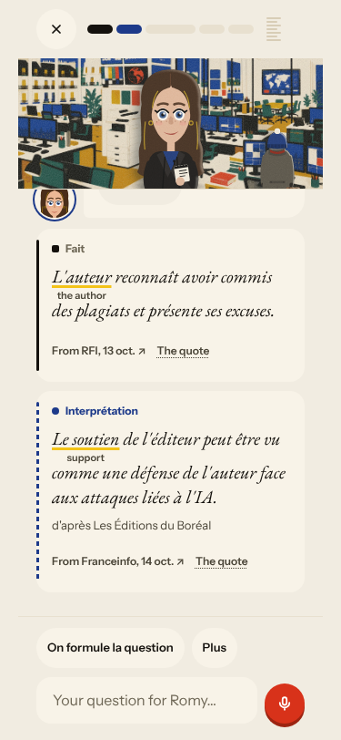
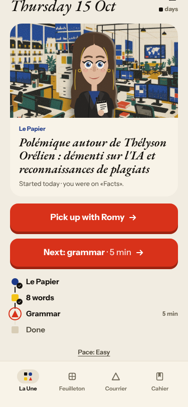
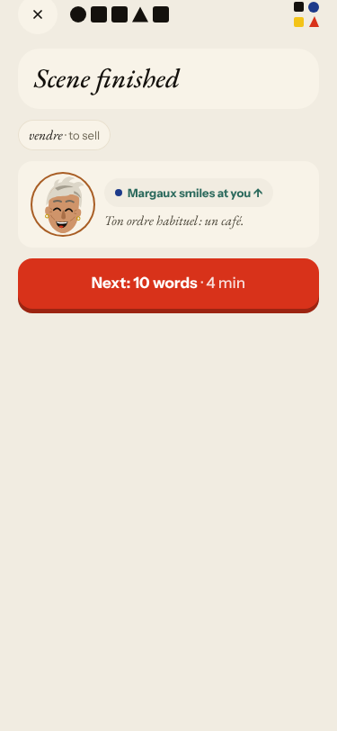
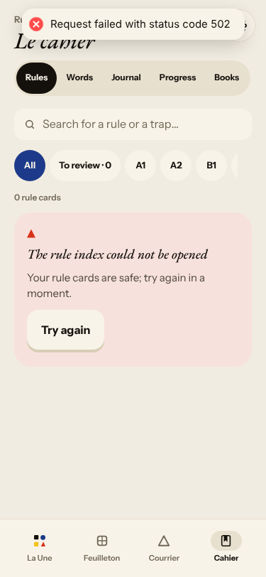
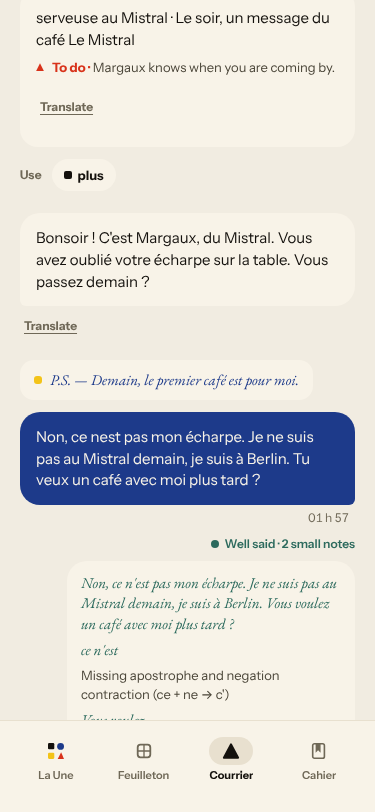
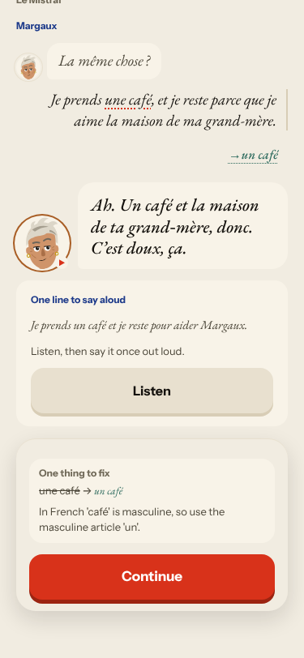
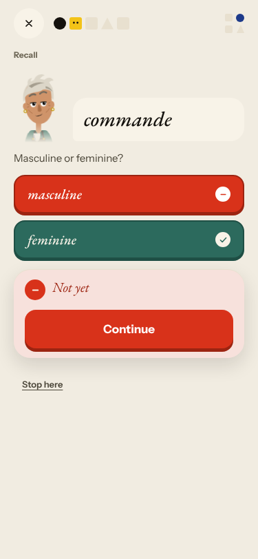

# Live walk · 15 Oct 2026

Production API (`atelier-api-3njh.onrender.com`), real model, test account at **A1.1**, streak day 4
(Home: «Nº 4 · La clé d'Odile»). Harness `explore:live` on main. Q19 n/a (cloud). First live report in
the repo, so the trend column is the last fake-provider walk (a1-de day 1/2, 14 Oct) for orientation only.

Played: scene (4 panels, one free-text reply), 2 word drills, Papier detour, 10 word cards,
La Forge (concepts 1 and 2, 5 items), Courrier (two replies incl. a «Non» and an off-script question), Cahier (Rules, Words, Journal with a written entry, Progress, Books).
**Not reached:** the end of the day. Grammar (La Forge from the plan) is a dead end (#148), so «Done» never unlocked.
The scene offered only **one** free-text turn, so the «Non» and off-script tests ran in the Papier and the Courrier.

## Scores

| # | question | live 15 Oct | 14 Oct fake (a1-de d2) |
|---|---|---|---|
| 1 | Where am I | 3 | 4 |
| 2 | What is at stake | 4 | 3 |
| 3 | What to do next | 2 | 2 |
| 4 | Scene reacts to my writing | 4 (scene, Courrier) / 2 (Papier ignores «Non») | fake |
| 5 | Story coherent | 3 | 2 |
| 6 | Characters consistent | 3 | 3 |
| 7 | Image, text, tone fit | 4 | 4 |
| 8 | Difficulty fits | 2 (Papier) | 3 |
| 9 | Feedback explained | 3 (Forge good, choice drill «Not yet», «je aime» missed) | 2 |
| 10 | Right answers accepted | 4 | 4 |
| 11 | French correct | 3 (glued gloss, «..») | 4 |
| 12 | Clear goal today | 3 | 4 |
| 13 | Grammar practised | 3 (rule, produce items fine; flow broken) | 4 |
| 14 | Earlier material returns | 4 (Words queue, Journal) | 4 |
| 15 | I produce French | 5 | 4 |
| 16 | Errors, dead ends | 1 (#148, 502) | 2 |
| 17 | Varied, fun | 4 | 3 |
| 18 | Fast enough | 4 (replies 8–15 s, Forge check ~10 s) | 4 |
| 19 | App only | n/a | n/a |
| 20 | Satisfying end | 1 (day not completable) | 3 |
| 21 | Would come back | 3 | 3 |
| 22 | Time vs promise | 2 (12 cards for 10 words, 13 Forge items for «5 min») | 3 |

Moved: Q4 is now judged (the scene reacts to the learner's actual words); Q15 up; Q16, Q20 down to 1.

## Findings, by root cause

### #143 day progress has no single source of truth
1. **High · #148 (new)** La Forge from the plan reopens on an answered card; Continue and Finish dead; day cannot reach Done.  
2. **Medium · #149 (new, queue:owner)** An unasked Le Papier follows the scene, replaces the Scene row in the plan, is far above A1.1, ignores a «Non», and its gloss is glued into the French («L'auteurthe author»).    
3. **Medium · #134 (seen again)** API 502 for ~3 min (`/health` too), Cahier shows graceful error cards. 

### #144 du / tu
4. **Medium · #144, #133 (seen again)** Margaux tutoie in the scene and vouvoie in the Courrier, and the correction rewrites «Tu veux» to «Vous voulez». 

### #145 scene state
5. **Medium · #145 (comment)** The scene reacts to what I wrote, and invents a line («pour aider Margaux», «t'aider pour ton départ»). Panel 3 also has Lila speaking while Margaux is at the bar (#147-ish). 

### #146 content and feedback
6. **Medium · #119, #86 (seen again)** «je aime» not corrected; choice drill says only «Not yet». 

Not filed: Journal header says «Le Mistral · with Camille» while the scene shown is «La lettre»; Courrier timestamps show 01 h 57 (UTC) — polish.

## Re-tests

#132, #114, #93: not reachable today (no Camille/Marin scene in this day). #133 and #134: seen again, commented. No issue closed.
