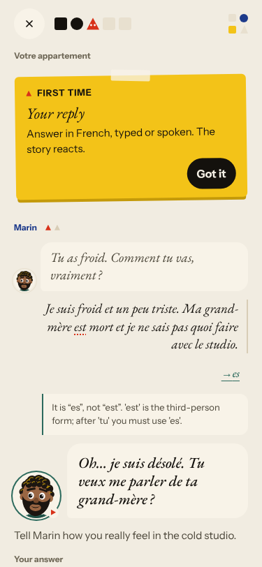
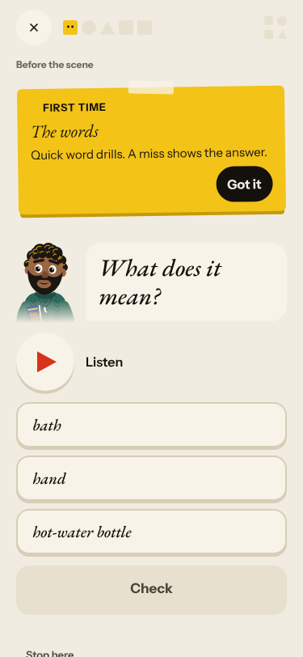
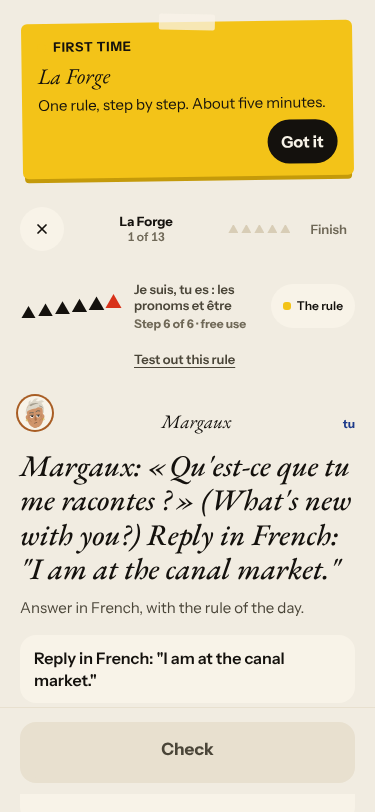
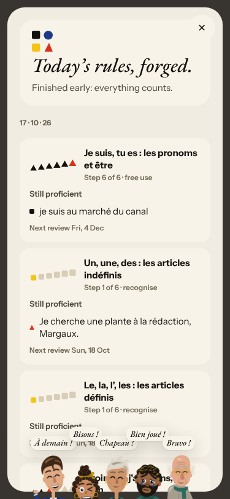
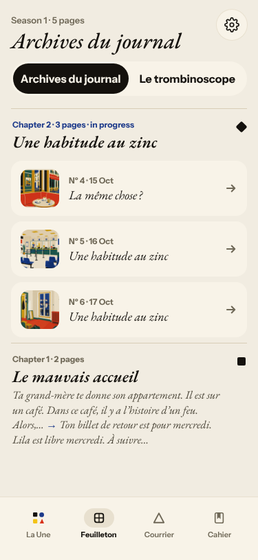
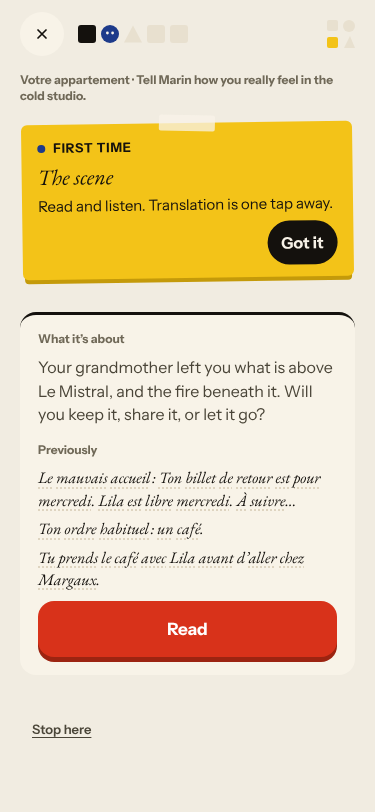
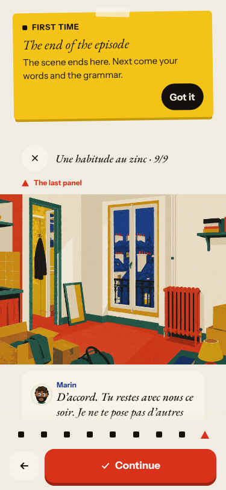
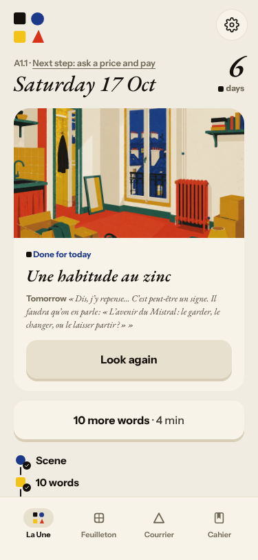
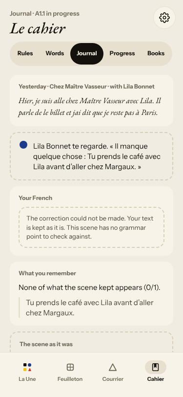
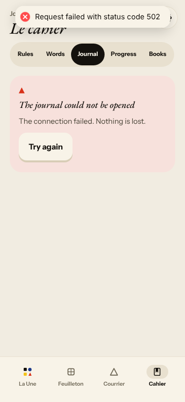

# Live walk · 17 Oct 2026

Production API (`atelier-api-3njh.onrender.com`), walk test account, real model, cloud session (`atelier-ops`),
Chromium at phone size, main at `origin/main`. Previous live walk: [16 Oct](2026-10-16.md) (on branch
`claude/live-walk-2026-10-16`; the link resolves once that report is on main).

**Account:** level A1.1, English chrome, streak 5 → 6 days. **Day played:** Nº 6 «Une habitude au zinc»
(Marin, Lila, Margaux): word drill (3 options, listen only), scene reader (4 panels), 3 free-text replies, 9 closing
panels, 1 recall drill, Lexique (8 cards), La Forge (5 items, finished early), Courrier (new letter from Lila, one
reply), Cahier (Words, Journal), Feuilleton.

Replies played: «Je suis froid … Ma grand-mère est mort …» (deliberate errors); a clear «Non, je ne veux pas parler»
plus an off-script «ton chat Pablo»; «Non. Je reste ici ce soir, avec la soupe et le chat.»; La Forge free use in
lowercase without period; a wrong «un plante»; a wrong «Needs fixing»; a Courrier reply with dropped apostrophe and
accents; a Journal entry with errors.

## Scores (`docs/ops/walk-rubric.md`)

Worst screen for per-screen questions.

| # | question | 17 Oct live | 16 Oct live | trend |
|---|---|---|---|---|
| 1 | Where am I | 3 | 4 | ↓ header place/goal disagree with scene (#194) |
| 2 | What is at stake | 4 | 4 | = |
| 3 | What to do next | 3 | 3 | = Forge opens at step 6, «Stop here?» needs two taps |
| 4 | Scene reacts to my writing | 5 | 4 | ↑ non respected, Pablo answered, closing panel used my decision |
| 5 | Story coherent | 3 | 3 | = same episode title twice |
| 6 | Characters consistent | 3 | 2 | ↑ (Margaux tu/vous remains, #144) |
| 7 | Image, text, tone fit | 3 | 2 | ↑ English recap in last panel remains |
| 8 | Difficulty fits | 4 | 4 | = |
| 9 | Feedback explained | 2 | 3 | ↓ wrong «es» correction (#193); choice drills 4, Courrier 4 |
| 10 | Right answers accepted | 4 | 1 | ↑ #166 fixed (#191) |
| 11 | French correct | 4 | 4 | = |
| 12 | Clear goal today | 3 | 3 | = words unrelated to the scene |
| 13 | Grammar practised | 3 | 3 | = rules hop, step 6 first |
| 14 | Earlier material returns | 4 | 4 | = |
| 15 | I produce French | 5 | 5 | = |
| 16 | Errors, dead ends | 2 | 3 | ↓ production 502 on Cahier and `/health` (#134) |
| 17 | Varied, fun | 4 | 4 | = |
| 18 | Fast enough | 3 | 3 | = story reply about 12–20 s |
| 19 | App only | n/a | n/a | |
| 20 | Satisfying end | 4 | 3 | ↑ the closing panel and hook follow what I decided |
| 21 | Would come back | 4 | 4 | = |
| 22 | Time vs promise | 3 | 3 | = «10 words» vs 8, «10 more words» after Done |

## Findings, ranked and grouped by root cause

**#146 content and feedback not driven by one concept (and #174)**
1. High · #193 · the scene correction says «es, not est» after «Ma grand-mère est mort» and misses «j'ai froid» and «morte». 
2. Seen again: #167 listen-only word drill ; #169 Forge opens at step 6 and «Still proficient» after a miss  ; #176 speaker line vs task, a plant «at the newsroom», an avoir item tagged «Wrong verb for age» on a suitcase sentence.
3. Evidence: word cards (plusieurs, maintenant, dernier, prochain, faire, trois, deuxième, être) have nothing to do with a scene about soup, socks and grief.

**#145 scene state**
4. Medium · #194 · Nº 5 and Nº 6 share the title «Une habitude au zinc»; the pre-scene header («Votre appartement · Tell Marin …») disagrees with the scene.  
5. Seen again: #168 English summary in the last panel ; #171 improved, stock line «Et on se quitte comme ça ?» returns.

**#143 day progress**
6. Seen again: «10 words» planned, 8 played, «Done for today» beside «10 more words» ; step counter 1, 2, 3, 5.

**#144 du/tu** — #170 Journal correction failed ; Margaux vous in Courrier and Forge recognise, tu elsewhere; «Essayer» untranslated.

**Owner / infra** — #134 production 502, now four walks in a row, and `/health` was 502 for about 3 minutes. 

## Re-tests

| issue | result |
|---|---|
| #166 lowercase, no period rejected (closed) | confirmed fixed, commented |
| #79 free text changes nothing | clearly improved again; stays open for #171 |
| #171 Lila reacts to a keyword | improved, stock line remains |
| #134 502 | seen again, `queue:owner` |
| #86 «Not yet» without explanation | choice drills now explain (un plante, Les pizzas…); word drill miss still bare (#167) |
| #87, #93, #94, #114, #117, #119, #132, #133 | not reachable today |

## Not filed
- Courrier timestamps show 01 h 56 (UTC) for a Berlin learner; already noted.
- Dictation cannot be played without audio in the cloud.
