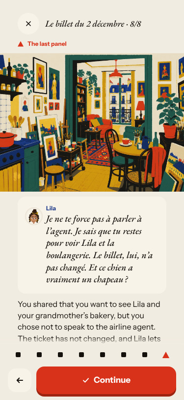
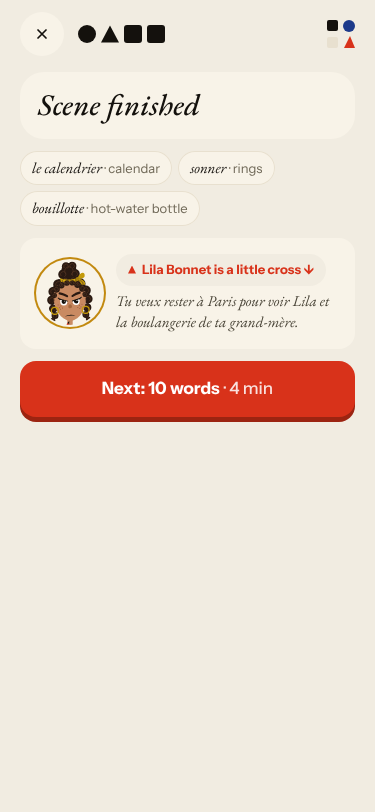
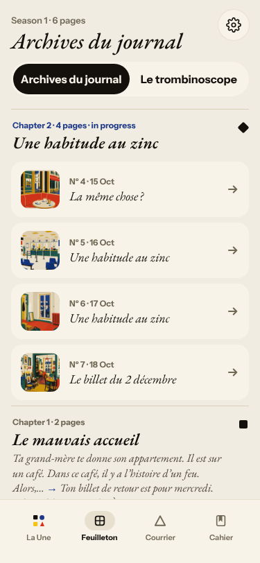
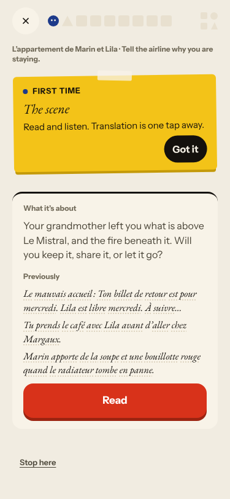
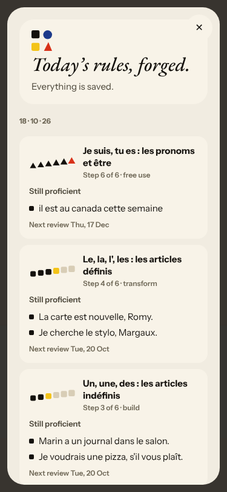
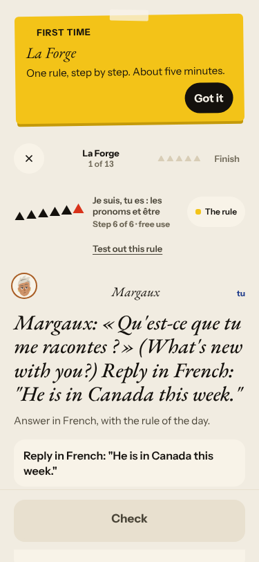
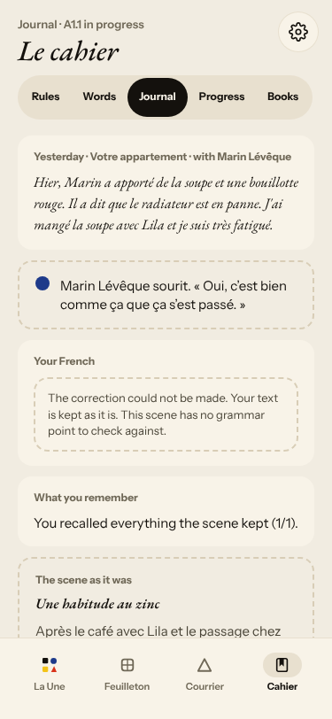
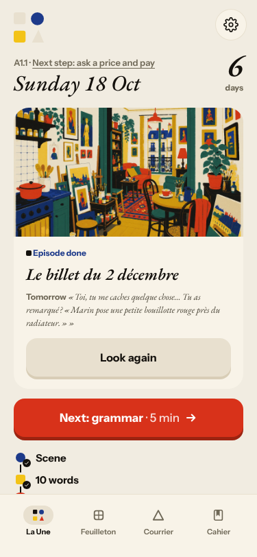
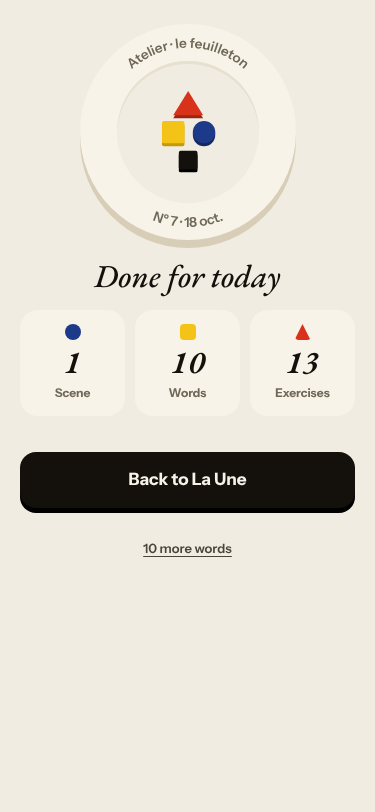
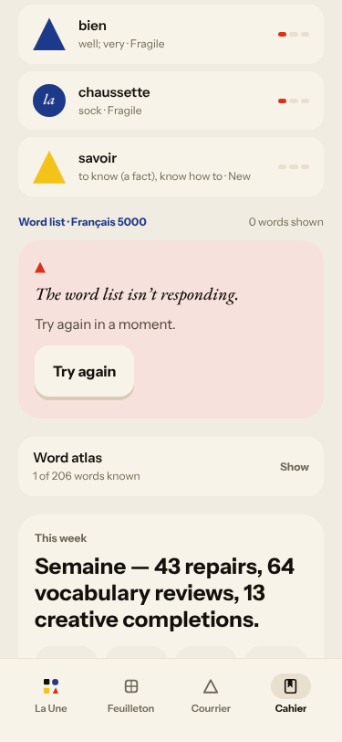

# Live walk · 18 Oct 2026

Production API (`atelier-api-3njh.onrender.com`), walk test account, real model, cloud session (`atelier-ops`),
Chromium at phone size, main at `da3433f9`. Previous live walk: [17 Oct](2026-10-17.md) (on branch
`claude/live-walk-2026-10-17`; the link resolves once that report is on main).

**Account:** level A1.1, English chrome, streak 6 → 7 days. **Day played:** Nº 7 «Le billet du 2 décembre» (Home calls it
«La clé d'Odile»; Lila, Marin): Guess/Listen/Check/Keep reader (audio only «played», no sound in the cloud), 2 free-text
replies, 8 closing panels, 8 recall drills (a miss returned once), Lexique (7 cards), La Forge (13 items, finished),
Courrier (new letter from Assistance Fibre, one reply), Cahier (Rules, Words, Journal), Feuilleton.

Replies played: «… voir ma amie Lila et le boulangerie de ma grand-mère» (deliberate errors); a clear
«Non, Lila. Je ne veux pas parler à l'agent» plus an off-script «un chien dans la rue avec un chapeau»; Forge free use in
lowercase without period; a wrong «Le tasse», «On sommeil», «Needs fixing» on a right sentence; a dictation without
accents; a Courrier reply with missing accents and «pas aussi»; a Journal entry.

## Scores (`docs/ops/walk-rubric.md`)

Worst screen for per-screen questions.

| # | question | 18 Oct live | 17 Oct live | trend |
|---|---|---|---|---|
| 1 | Where am I | 3 | 3 | = three names for one episode, header disagrees (#194) |
| 2 | What is at stake | 3 | 4 | ↓ the Guess question «does not settle it either way» |
| 3 | What to do next | 3 | 3 | = Forge opens at step 6, step counter 4 of 9 → 11 of 11 |
| 4 | Scene reacts to my writing | 5 | 5 | = «non» respected, dog answered, closing panel follows |
| 5 | Story coherent | 3 | 3 | = |
| 6 | Characters consistent | 2 | 3 | ↓ Lila says «voir Lila» about herself (#212) |
| 7 | Image, text, tone fit | 3 | 3 | = English recap in last panel (#168) |
| 8 | Difficulty fits | 4 | 4 | = |
| 9 | Feedback explained | 3 | 2 | ↑ Forge and drills explain; Courrier misses «pas aussi»; repair card contradicts itself (#213) |
| 10 | Right answers accepted | 5 | 4 | ↑ lowercase, no period, curly/straight apostrophe, accents all accepted |
| 11 | French correct | 4 | 4 | = |
| 12 | Clear goal today | 3 | 3 | = words unrelated to the scene |
| 13 | Grammar practised | 3 | 3 | = rules hop, step 6 first |
| 14 | Earlier material returns | 4 | 4 | = bouillotte, sonner come back in the Courrier |
| 15 | I produce French | 5 | 5 | = |
| 16 | Errors, dead ends | 2 | 2 | = Cahier word list «isn't responding» (#211); no 502 today |
| 17 | Varied, fun | 4 | 4 | = |
| 18 | Fast enough | 4 | 3 | ↑ story reply 3 s, Courrier 16 s |
| 19 | App only | n/a | n/a | |
| 20 | Satisfying end | 3 | 4 | ↓ tomorrow's hook is the stock bouillotte line, not the open ticket |
| 21 | Would come back | 4 | 4 | = |
| 22 | Time vs promise | 3 | 3 | = «10 words» promised, 7 played, «10 more words» after Done |

## Findings, ranked and grouped by root cause

**#145 scene state**
1. Medium · #212 (new) · Lila says «Je sais que tu restes pour voir Lila» and the finished card repeats it under «Lila is a little cross».  
2. Seen again: #194, three titles for Nº 7 and three identical for Nº 4–6  ; #168 English recap in the last panel; #171 stock hook for tomorrow.

**#146 content and feedback not driven by one concept**
3. Low · #213 (new) · Forge repair: «Not quite. The right sentence …» and «Well done!» together.
4. Seen again: #169  ; #176; #167 (listen-only drill, a miss now explains); word cards unrelated to the scene; Journal checks nothing when the scene has no grammar point .

**#143 day progress**
5. Seen again: «10 words» planned and «done», 7 played, «10 more words» after Done.  

**Not under a root cause**
6. High · #211 (new) · Cahier → Words: «The word list isn't responding», Try again does not help. 

## Re-tests

| issue | result |
|---|---|
| #166 lowercase, no period (closed) | still fixed |
| #170 Journal correction (closed by #182) | reason shown now, no correction, no retry; commented, left closed |
| #167 listen-only drill | improved (miss explains, returns once); listen-only remains |
| #171 Lila reacts to a keyword | meaning-level reaction today; stock hook remains |
| #79 free text changes nothing | clearly better; stays open for #171 |
| #134 502 | none today; `queue:owner` kept |
| #93, #114, #117, #119, #132, #133 | not reachable today |

## Not filed
- Courrier timestamps show UTC (01 h 56, 02 h 05).
- Dictation and Listen can only be «played» without sound in the cloud; Q19 n/a.
- Courrier correction missed «ne sonne pas aussi» (minor, in the #146 family).
