# Live walk · 19 Oct 2026

Production API (`atelier-api-3njh.onrender.com`), walk test account, real model, cloud session (`atelier-ops`),
Chromium at phone size, main at `b5d15055`. Previous live walk: [18 Oct](2026-10-18.md) (on branch
`claude/live-walk-2026-10-18`; the link resolves once that report is on main).

**Account:** level A1.1, English chrome, streak 7 → 8 days. **Day played:** Nº 8 «Gus et l'habitué» (Home calls it
«La clé d'Odile» before the scene; Marin, Gus): word drills first (listen-only word, gender, meaning, 2 misses), reader
(4 panels), 2 free-text replies, 8 closing panels, 5 recall drills, Lexique (10 cards, rated mixed), La Forge (13 items,
finished), Done, Courrier (Assistance Fibre, letter 2 of 2, two replies), Cahier (Rules, Words, Journal), Feuilleton.

Replies played: «Ça s'appelle le bouillotte, Marin. Elle est très chaude et j'aime la rouge.» (deliberate gender error);
a clear «Non, Marin, elle n'est pas pour moi. Mais est-ce que Gus a un bateau sur la lune ? Moi, je préfère les pommes
de terre.» (refusal plus off-script); Forge answers in lowercase without punctuation, «tu est bavarde ?», «une peinture»;
a dictation without accents and with a curly apostrophe; a Courrier reply with a missing accent and «Plusieurs jour»;
a Journal entry with «Lila est venu».

## Scores (`docs/ops/walk-rubric.md`)

Worst screen for per-screen questions.

| # | question | 19 Oct live | 18 Oct live | trend |
|---|---|---|---|---|
| 1 | Where am I | 3 | 3 | = Home «La clé d'Odile» before, «Gus et l'habitué» after (#194) |
| 2 | What is at stake | 4 | 3 | ↑ the scene card says «Will you keep it, share it, or let it go?» |
| 3 | What to do next | 3 | 3 | = first drill has no French word to read; Forge free-use prompt reads two ways (#167, #176) |
| 4 | Scene reacts to my writing | 5 | 5 | = gender slip corrected on the spot, «non» respected, boat on the moon answered |
| 5 | Story coherent | 3 | 3 | = two different tomorrow hooks (#237) |
| 6 | Characters consistent | 4 | 2 | ↑ nobody speaks about themselves in the third person today |
| 7 | Image, text, tone fit | 4 | 3 | ↑ panels match the text; closing summary now speaks to the learner |
| 8 | Difficulty fits | 4 | 4 | = |
| 9 | Feedback explained | 3 | 3 | = scene, Courrier and Forge reasons specific; contradicting banners remain (#213) |
| 10 | Right answers accepted | 2 | 5 | ↓ «une peinture» rejected (#235), «vendre» counted for «vendredi» (#236) |
| 11 | French correct | 4 | 4 | = |
| 12 | Clear goal today | 3 | 3 | = words are a frequency list, unrelated to the scene (#146) |
| 13 | Grammar practised | 3 | 3 | = four rules hop within one Forge (#169) |
| 14 | Earlier material returns | 4 | 4 | = «un plante», café, sonner return; Courrier asks for today's «bouillotte» |
| 15 | I produce French | 5 | 5 | = |
| 16 | Errors, dead ends | 3 | 2 | ↑ Cahier word list works, no 502; counters still disagree (#143) |
| 17 | Varied, fun | 4 | 4 | = |
| 18 | Fast enough | 3 | 4 | ↓ story reply 12–14 s, scene start 15 s, Courrier reply 18 s, Forge free use 12 s |
| 19 | App only | n/a | n/a | |
| 20 | Satisfying end | 3 | 3 | = Done screen has no question; Home and the card promise different ones (#237) |
| 21 | Would come back | 4 | 4 | = |
| 22 | Time vs promise | 3 | 3 | = «10 words» promised, review shows 0/10 → 10/12, Done says 14 words, «10 more words» after Done |

## Findings, ranked and grouped by root cause

**#174 a right answer is judged against one stored string**
1. High · #235 (new) · La Forge «Marin a ___ dans le salon» rejects «une peinture» and wants «un tableau», citing gender
   although the article was right. 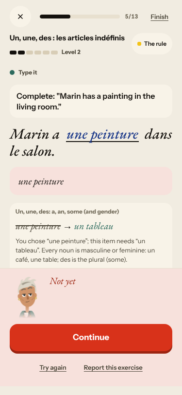

**#145 scene state**
2. Medium · #237 (new) · The «tomorrow» question is written twice: last panel and Home say «Qui était Odile…», the
   finished card and the Feuilleton say «Quel est ton ordre au Mistral…». 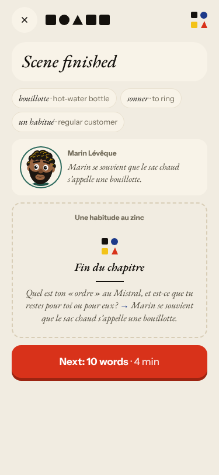
3. Seen again: #194, Home «La clé d'Odile» vs «Gus et l'habitué», Nº 5 and Nº 6 both «Une habitude au zinc».
   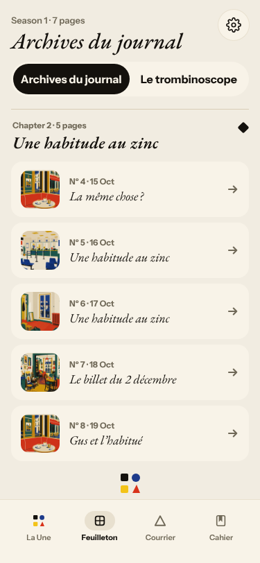

**#146 content and feedback not driven by one concept**
4. Low · #236 (new) · Courrier «words used» counts «vendre» for «vendredi». 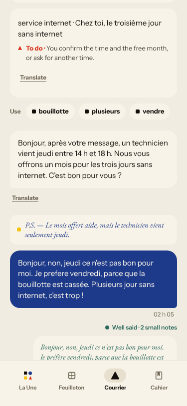
5. Seen again: #213 (Forge «Not quite» beside «Well done», «Right.» beside «Not yet»)
   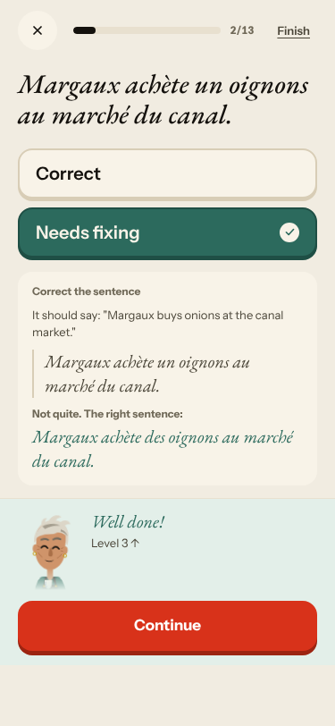 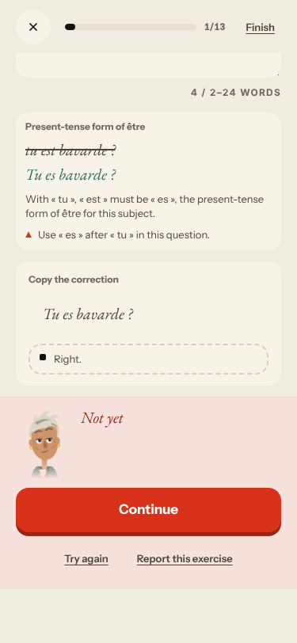;
   #176 (Margaux's line vs the task); #167 (listen-only word drill) 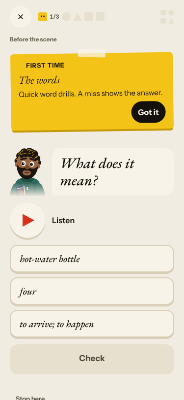;
   #169 (four rules in one Forge) 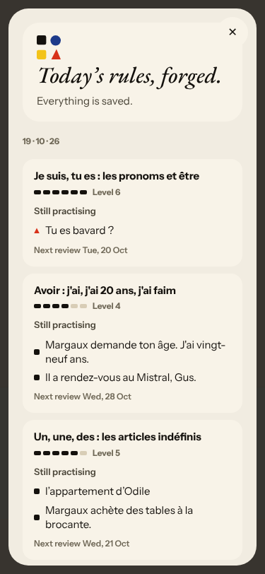; the Journal correction «could not be made»
   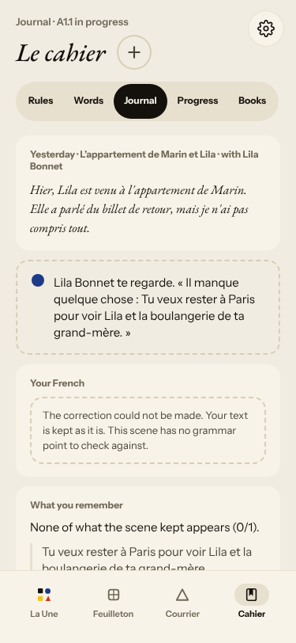; word cards unrelated to the scene.

**#143 day progress**
6. Seen again: Home «10 words» → «9 words» → review «0/10» → «10/12» → Done «14 words» → «10 more words».
   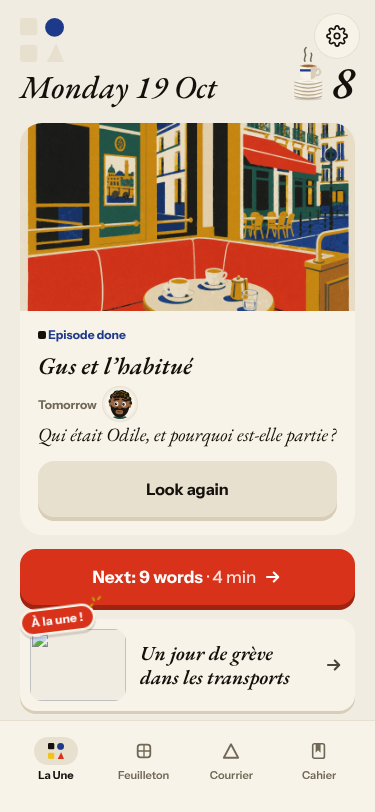 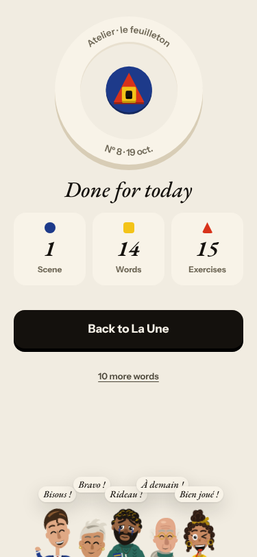

Good today, so the next walk can tell a regression: the scene reacts at meaning level (Q4 5)
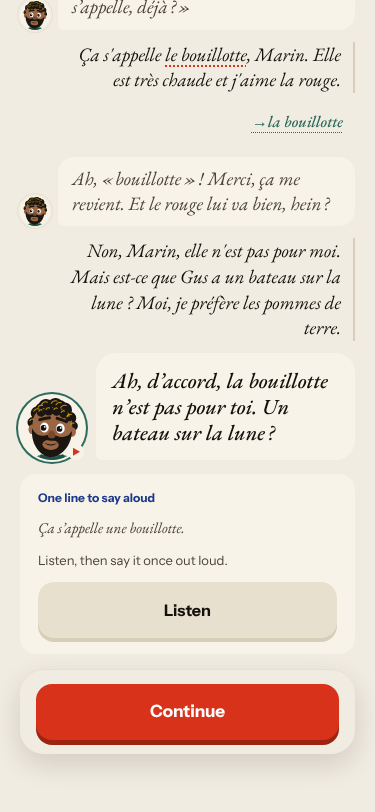; the new word → scene → recall → grammar order has a gapless counter;
the Cahier word list loads; Courrier corrections were exact («préfère», «Plusieurs jours»); lowercase, no period and a
curly apostrophe are accepted in La Forge and the dictation.

## Re-tests

| issue | result |
|---|---|
| #79 free text changes nothing | clearly better today; commented, stays open for #171 and #237 |
| #171 Lila reacts to a keyword | meaning-level reaction today; closing hook now disagrees with the card (#237) |
| #167 listen-only drill | still listen-only; commented |
| #169 Forge hops | opens at item 1 now, still four rules; commented |
| #194 titles | still two names for Nº 8, two identical for Nº 5 and Nº 6; commented |
| #213 contradicting verdicts | seen twice; commented |
| #176 Margaux's line vs task | seen again; commented |
| #143 counters | seen again; commented |
| #134 502 | none today; `queue:owner` kept |
| #168 English summary in the last panel | now a second-person English line («You gave Marin the word…»); left as is, not commented |
| #93, #114, #117, #119, #132, #133, #193, #212 | not reachable today |

## Not filed
- «Fix the mistake» in La Forge shows the old word struck through next to the new one; my first reading («LaLe») was the
  page text of `<s>La</s>Le`, so no bug. The Check button stays disabled until Enter or blur commits the
  fix; tapping Check may not blur on a phone (could not test here).
- «You wrote this earlier» and «Write what you said» recall items («un plante», «Romy, je suis quarante-cinq ans»,
  «l'appartement de Odile») come from the account's earlier answers; the card does not say when.
- Courrier «last message» prompt is cut with «…» mid-word; Courrier times show the browser's UTC.
- Dictation and Listen can only be «played» without sound in the cloud; Q19 n/a.
