# Live walk · 20 Oct 2026

Production API (`atelier-api-3njh.onrender.com`), walk test account, real model, cloud session (`atelier-ops`),
Chromium at phone size, main at `8e6695be`. Previous live walk: [19 Oct](2026-10-19.md) (on branch
`claude/live-walk-2026-10-19`; the link resolves once that report is on main).

**Account:** level A1.1, English chrome, streak 8 → 9 days. **Day played:** Nº 9 «Là-haut» (Home calls it «La clé d'Odile»
before the scene; Lila, Odile, Gus, Marin). Order today: scene reader (8 panels), 2 free-text replies, 8 closing panels,
rule «Numbers 0–69 and prices», 5 recall items, 9 word cards, La Forge (11 items, finished), Done, Courrier (2 replies),
Cahier (Rules, Words, Journal), Feuilleton. Whole walk about 11 minutes wall clock; story reply 13 s, Courrier reply 27 s.

Replies played: «Je ne sais pas beaucoup. Odile est parti parce que la restaurant était très difficile, je pense.»
(gender and article slips); «Non, je ne montre pas la photo à Gus. Mais est-ce que le gâteau est pour le chat de Marin ?
Moi, je préfère le fromage.» (clear «non» plus off-script); Forge: a capital «Quinze», a translation without accents,
a wrong rapid-fire tap, «Non, je ne suis pas aux États-Unis…»; Courrier: «Je vais sonné… je vend la bouillotte»
and a «non» reply; Journal: «Lila a rentré dans le café et elle mange un croissant».

## Scores (`docs/ops/walk-rubric.md`)

Worst screen for per-screen questions.

| # | question | 20 Oct live | 19 Oct live | trend |
|---|---|---|---|---|
| 1 | Where am I | 3 | 3 | = Home «La clé d'Odile» before, «Là-haut» after (#194) |
| 2 | What is at stake | 4 | 4 | = «Keep it, share it, or let it go?» |
| 3 | What to do next | 3 | 3 | = |
| 4 | Scene reacts to my writing | 4 | 5 | ↓ exchange 2 reacts well (non kept, cheese answered); exchange 1 is answered with an unrelated line (#254) |
| 5 | Story coherent | 2 | 3 | ↓ «Mercredi» then «Mardi», a jumbled last panel, a fragment as tomorrow's question (#254, #237) |
| 6 | Characters consistent | 3 | 4 | ↓ Lila speaks of «ma grand-mère» for the learner's (#253) |
| 7 | Image, text, tone fit | 4 | 4 | = |
| 8 | Difficulty fits | 4 | 4 | = |
| 9 | Feedback explained | 2 | 3 | ↓ the scene correction cites «tu» where there is none and misses the real errors (#193); Courrier and Forge corrections exact |
| 10 | Right answers accepted | 4 | 2 | ↑ capital letters, periods, variants accepted; missing accents are marked, with reasons |
| 11 | French correct | 4 | 4 | = «Qu'est-ce que tu me racontes ?» glossed «What's new with you?» (#176) |
| 12 | Clear goal today | 2 | 3 | ↓ rule is numbers and prices, scene is about Odile (#146) |
| 13 | Grammar practised | 3 | 3 | = four rules in one Forge (#169) |
| 14 | Earlier material returns | 4 | 4 | = «Je garde le appartement», sonner, vendre, bouillotte return |
| 15 | I produce French | 5 | 5 | = |
| 16 | Errors, dead ends | 3 | 3 | = «the corrector was unavailable» (#251), Journal «could not be made» (#252); counters (#143) |
| 17 | Varied, fun | 4 | 4 | = |
| 18 | Fast enough | 3 | 3 | = story reply 13 s, Courrier reply 27 s |
| 19 | App only | n/a | n/a | |
| 20 | Satisfying end | 2 | 3 | ↓ Done has no question; Home shows «Odile savait une chose sur Lila» as tomorrow |
| 21 | Would come back | 3 | 4 | ↓ the day's parts do not connect |
| 22 | Time vs promise | 3 | 3 | = «10 words» promised, 9 reviewed, Done says 10 and offers «10 more words» |

## Findings, ranked and grouped by root cause

**#250 free-text corrections are raw model output (new root cause)**
1. High · #193 seen again · «Odile est parti… la restaurant» is corrected with «With « tu », « est » must be « es »»; the
   real errors are not marked; the same card appears on «est-ce que». 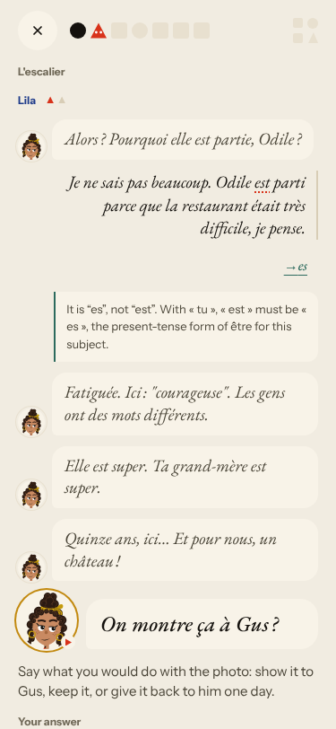
   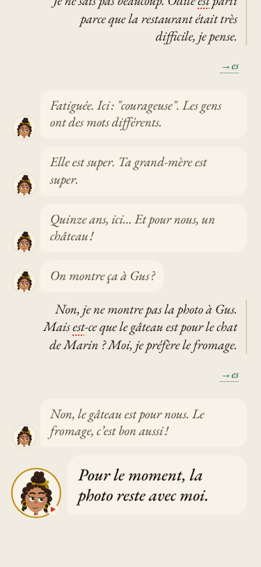
2. Medium · #251 (new) · Courrier: «Not corrected yet: the corrector was unavailable.» 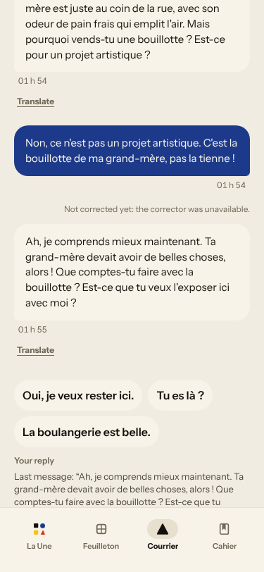
3. Medium · #252 (new) · Journal: «The correction could not be made»; memory check 0/1 though «bouillotte» is in the text.
   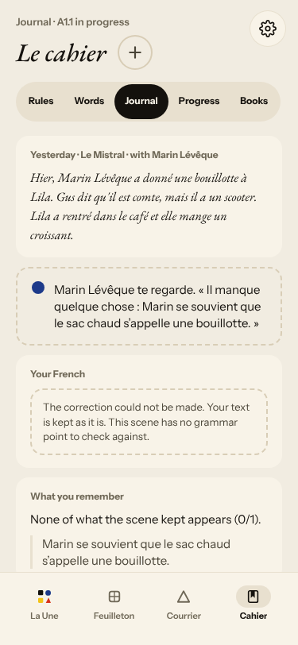

**#145 scene state**
4. Medium · #254 (new) · reply 1 gets «Fatiguée. Ici : «courageuse».»; closing panels: «Mercredi» → «Mardi», last panel a jumble.
   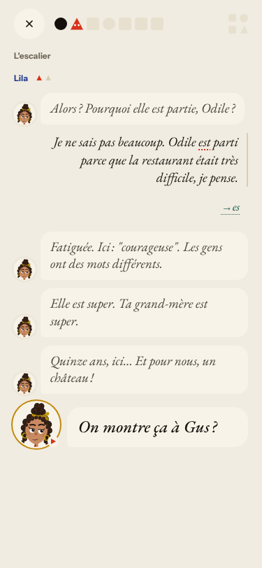 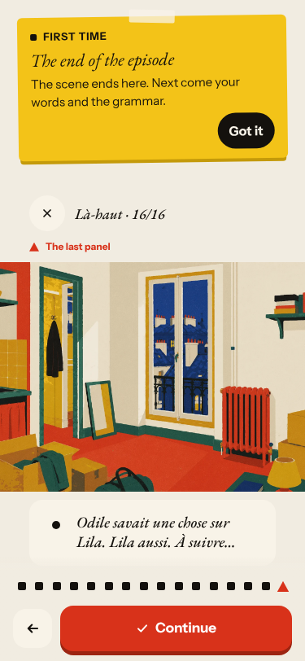
5. Medium · #237 seen again · three different tomorrow lines (Home before, last panel/Home after, Feuilleton).
   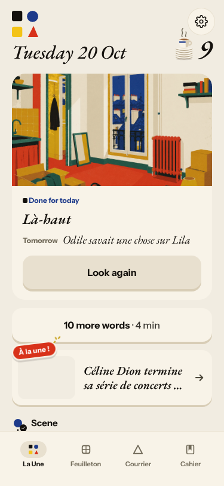 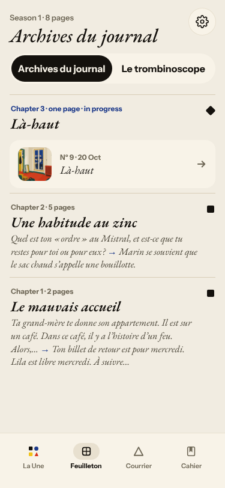
6. Seen again: #194 (Home «La clé d'Odile» vs «Là-haut») 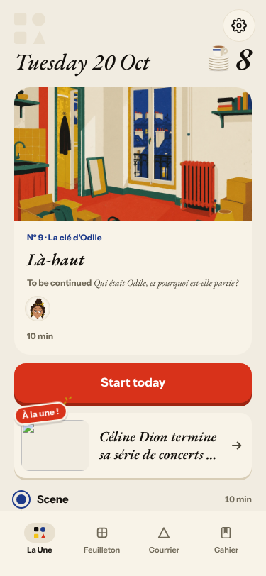

**#147 cast registry**
7. Medium · #253 (new) · Courrier: Lila says «la boulangerie de ma grand-mère» about the learner's grandmother.
   

**#146 content and feedback not driven by one concept**
8. Seen again: the rule (numbers), 9 frequency words and the Courrier words (bouillotte, sonner, vendre) have nothing to do with
   the Odile scene. 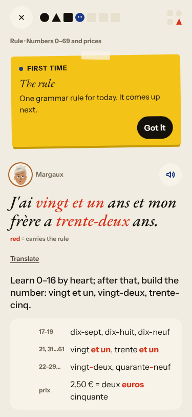 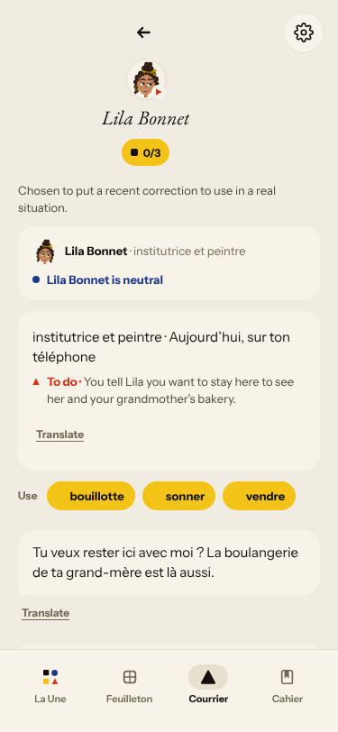
9. Seen again: #240 (a wrong tap shown as «En mai. → Un café et un croissant…») 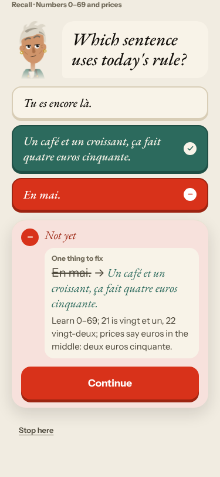;
   #176 (Margaux's line vs the task, wrong gloss) 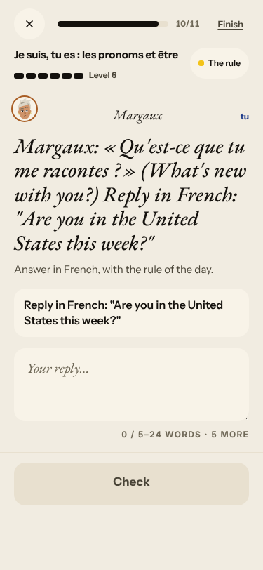 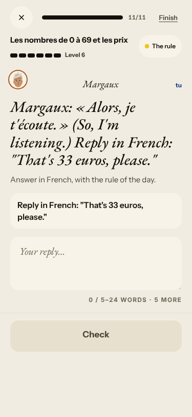;
   #169 (four rules) 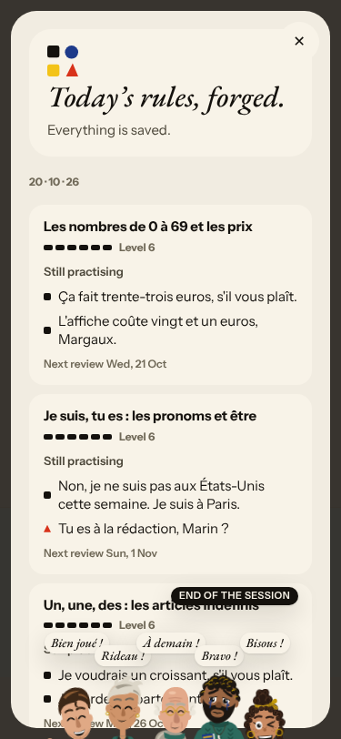.

**#143 day progress**
10. Seen again: «Step 5 of 7» → «5 of 8», «8 of 8 · Scene finished» before the words, review 0/9 → 9/12 → 9/9 against «10 words»,
    Done «10 words» and «10 more words». 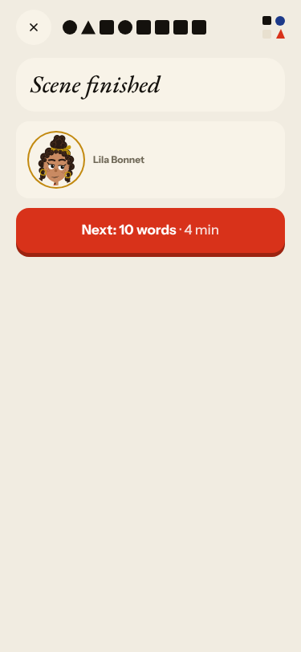 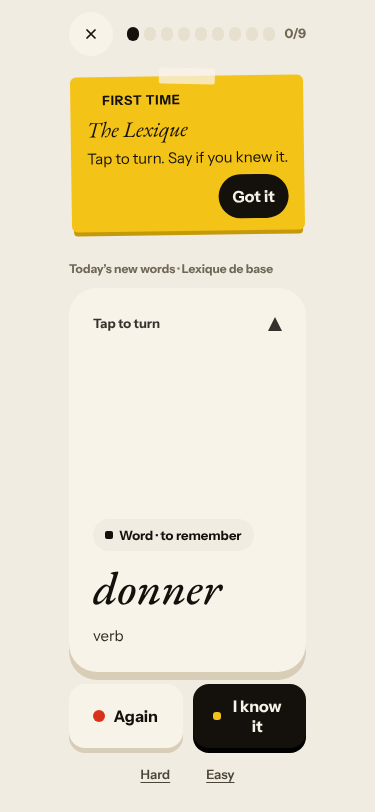
    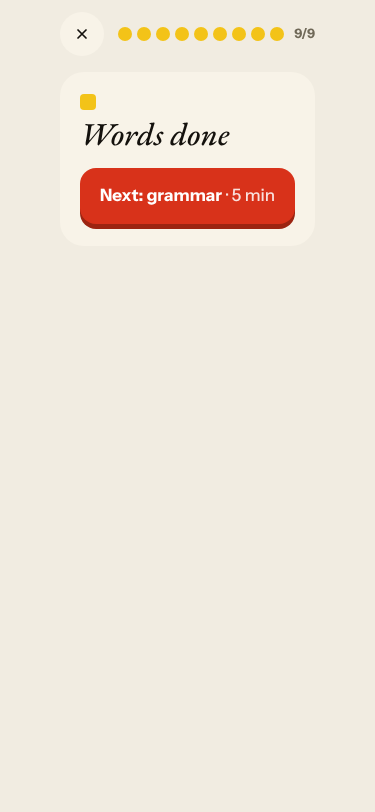 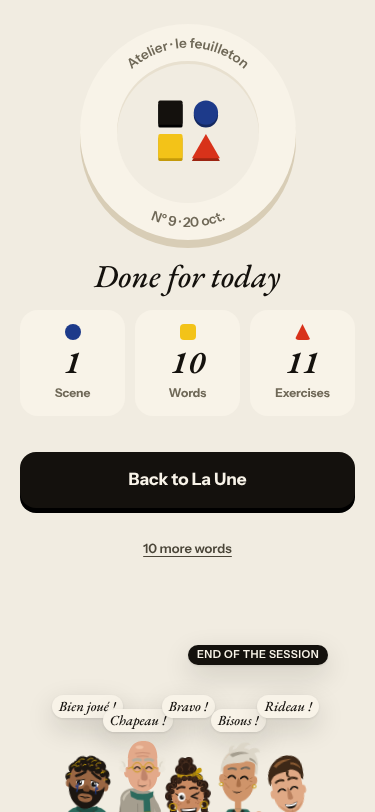

Good today: exchange 2 respected «non» and answered the cheese and the cake; Courrier reply 1 corrected «sonné» and «vend» exactly
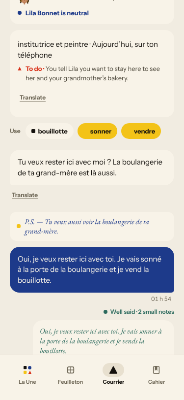; Forge free use named «a»/«rédaction» and «coûte» with the reason
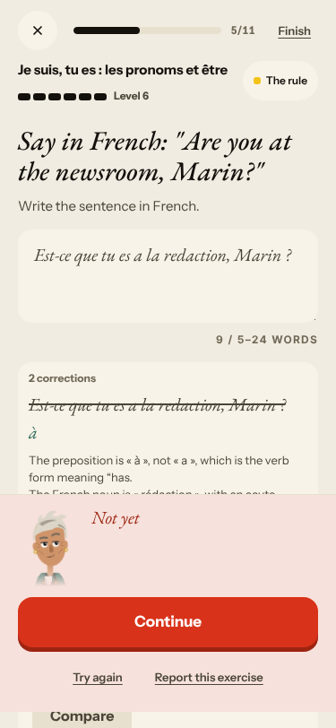; capitals and final periods are accepted; the Cahier word list loads.

## Re-tests

| issue | result |
|---|---|
| #193 wrong «es» correction | reproduced twice; commented, now child of #250 |
| #237 two tomorrow hooks | reproduced (three variants); commented |
| #240 recall miss as correction | reproduced; commented |
| #169 Forge hops | still four rules, opens at 1/11; commented |
| #176 Margaux's line vs task | reproduced twice; commented |
| #194 titles | reproduced; commented |
| #174 right answers | no rejection of a right answer today; commented |
| #213 contradicting verdicts | not seen today (Forge showed «Right» with «Well done!» only); not commented |
| #236 «vendre» for «vendredi» | not reachable (no «vendredi» in the reply) |
| #235 «une peinture» | not reachable today |
| #93, #114, #117, #119, #132, #133, #212 | not reachable today |

## Not filed
- Reader captions on silent panels are English («A moment of silence.»).
- The Forge level badge shows the new level before the verdict (noted on #143).
- Courrier times show the browser's UTC («01 h 54»). Dictation and audio can only be «played» silently here; Q19 n/a.
- «Fix the mistake» items render the old and new word together in the page text (`vingt-unvingt et un`), a text-layer artifact, not a bug.
