# Live walk · 21 Oct 2026

Production API (`atelier-api-3njh.onrender.com`), walk test account, real model, cloud session (`atelier-ops`), Chromium at phone
size, main at `origin/main` (harness `e2e/explore-live.mjs`). Previous live walk: [20 Oct](2026-10-20.md) (on branch
`claude/live-walk-2026-10-20`; the link resolves once that report is on main).

**Account:** level A1.1, English chrome, streak 9 → 10 days. **Day played:** Nº 10 (Home «La clé d'Odile» before the scene, header
«L'appartement d'Odile», reader «Là-haut»; Lila, Camille, Bastien, Marin). Order: scene reader (5 panels), three free-text replies
and a choice, 16-panel closing reader, rule «Il y a», 5 recall items, word cards (29–32), La Forge (12 items, finished), Done, Courrier
(2 replies), Cahier (Rules, Words, Journal with a Journal entry and a «one week later» reply), Feuilleton. About 19 minutes of wall clock
(01:47–02:07 UTC), story reply 4–10 s, Courrier reply 6–10 s, Forge verdict 6–10 s.

Replies played: «Je garde la cuisine, parce que Odile aimait cuisiner. Je ne veux pas vendre les meubles, il sont très beau.»; «Non, je ne
garde pas la photo de Odile. Mais est-ce que Bastien aime les chats ? Moi, je préfère le fromage.» (clear «non» plus off-script);
«Je reste trois jours… Je suis très fatigué, le voyage été long.» then «Trois jours. Je dois parler avec le notaire demain.»; choice «Pas
encore». Forge: «Je suis architect», «Ils est au café», «Il n y a…», a capital «Il y a», a lowercase sentence without accents, two wrong
rapid-fire taps, «vingt et un chambres» with a deliberate «Non, je ne sais pas». Courrier: «Je vais vendre la bouillotte de Odile, mais
non, je ne vends pas le café… j ai sonner…» and «Non, Gus est en vacances…». Journal: «la escalier», «un clé».

## Scores (`docs/ops/walk-rubric.md`)

Worst screen for per-screen questions.

| # | question | 21 Oct live | 20 Oct live | trend |
|---|---|---|---|---|
| 1 | Where am I | 3 | 3 | = five names for one day (#194); Lila enters mid-scene |
| 2 | What is at stake | 4 | 4 | = «Keep it, share it, or let it go?» |
| 3 | What to do next | 3 | 3 | = the «say aloud» line is the other button (#264) |
| 4 | Scene reacts to my writing | 3 | 4 | ↓ content is picked up, «non» kept, cat answered; but two questions are asked again (#262) |
| 5 | Story coherent | 3 | 2 | ↑ no jumbled panel today; planning notes in a caption (#263), re-asks |
| 6 | Characters consistent | 2 | 3 | ↓ Lila is architect and teacher-painter (#265), Lila answers in Margaux's item and invents Paul (#266) |
| 7 | Image, text, tone fit | 4 | 4 | = |
| 8 | Difficulty fits | 3 | 4 | ↓ Courrier replies read like office mail (#117), Forge numbers items at level 6 |
| 9 | Feedback explained | 2 | 2 | = scene correction «Je suis → J'ai» is wrong (#193); Forge and Courrier corrections exact with reasons |
| 10 | Right answers accepted | 4 | 4 | = lowercase, no accents, capital and reordered tiles accepted; «Right.» next to «Not yet» (#213) |
| 11 | French correct | 4 | 4 | = prompts that read wrong are filed under #267 |
| 12 | Clear goal today | 3 | 2 | ↑ the rule «Il y a» is in the scene and in the recall items |
| 13 | Grammar practised | 3 | 3 | = four rules in one Forge (#169) |
| 14 | Earlier material returns | 4 | 4 | = yesterday's words come back in the review and the Courrier |
| 15 | I produce French | 5 | 5 | = |
| 16 | Errors, dead ends | 3 | 3 | = counters (#143), «Right»/«Not yet» (#213) |
| 17 | Varied, fun | 4 | 4 | = |
| 18 | Fast enough | 4 | 3 | ↑ replies in 4–10 s |
| 19 | App only | n/a | n/a | |
| 20 | Satisfying end | 2 | 2 | = Done has no question; Home «Tomorrow: Odile» (#237) |
| 21 | Would come back | 3 | 3 | = |
| 22 | Time vs promise | 2 | 3 | ↓ «10 words» promised, 29–32 cards reviewed, Done says 32 and offers «10 more words» |

## Findings, ranked and grouped by root cause

**#145 the scene has no state of what the learner said and what is established**
1. Medium · #262 (new) · Camille and Lila acknowledge the answer and ask the same question again («Pardon ? Qu'est-ce que vous gardez, ici ?»,
   «Je demande : combien de temps tu restes ?» after «trois jours»). 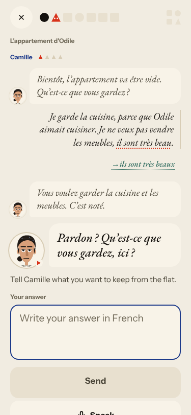
   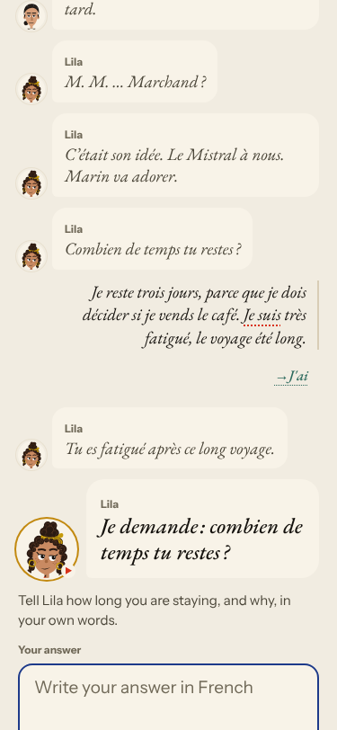
2. Medium · #263 (new) · reader caption prints planning notes «…le petit Augustin (!) Marin — il dira oui en pleurant…».
   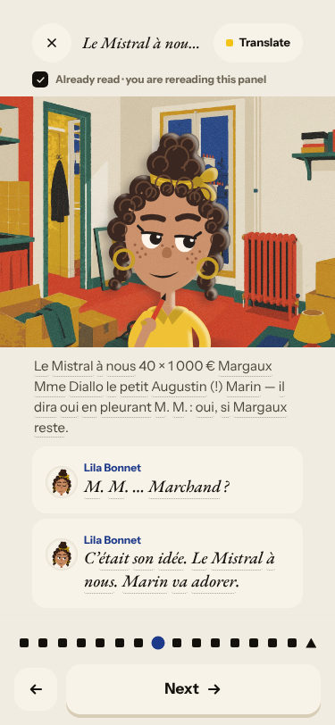
3. Medium · #264 (new) · after «Pas encore», «One line to say aloud» is «Donner une clé à Lila»; Camille answers Lila's choice.
   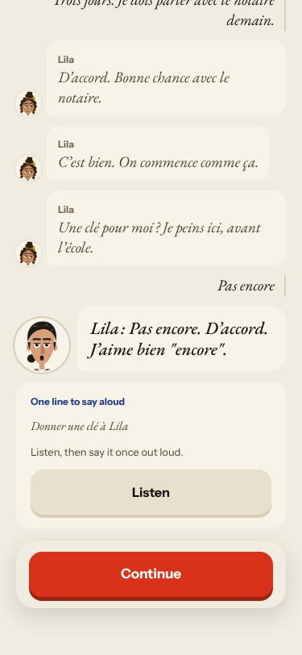
4. Medium · #266 (new) · Forge item 12: Lila answers Margaux's item with «Ils … Paul adore l'histoire» for «Il est en Angleterre».
   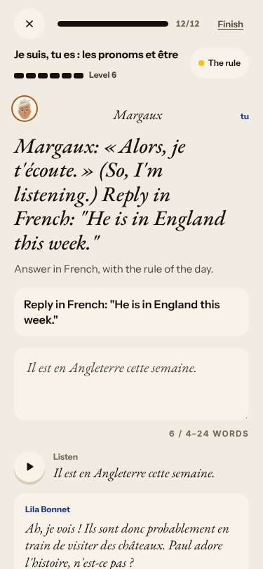
5. Medium · #269 (new) · Feuilleton chapter 1 and 3 share a blurb cut at «Alors,… →»; Nº 10 is titled with the series name.
   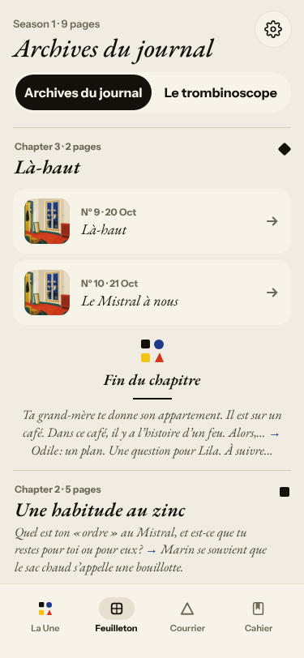
6. Low · #268 (new) · «A moment of silence.» in English; the reply is replayed before the question. 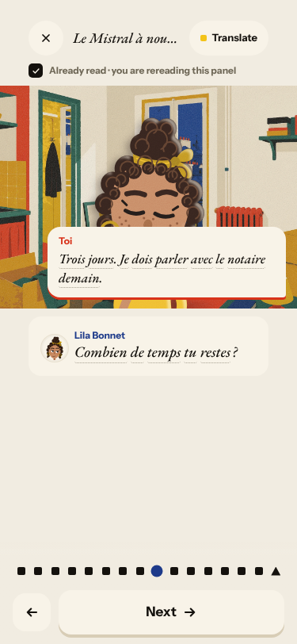
7. Seen again: #237 (last panel «Elle part ou elle reste ? Odile : un plan…», Home «Tomorrow: Odile», Journal hook) 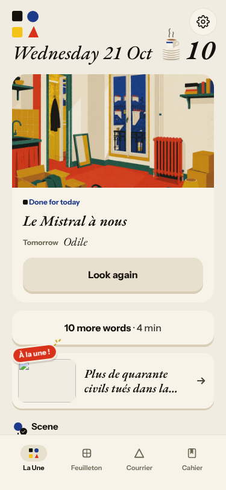;
   #194 (five names for one day).

**#250 free-text corrections are raw model output**
8. High · #193 seen again · «Je suis très fatigué, le voyage été long.» is corrected «Je suis → J'ai» and «a été» is not marked.
   
9. Seen again: #252 (Journal memory check 0/1 against the previous «À suivre…» hook) 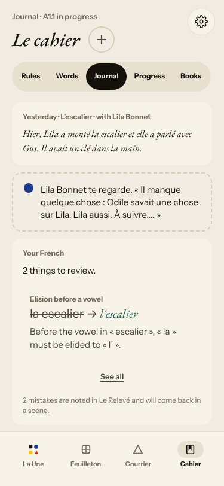.

**#147 cast registry**
10. Medium · #265 (new) · Lila «Architecte» in the scene, «institutrice et peintre» in the Courrier, «avant l'école».
    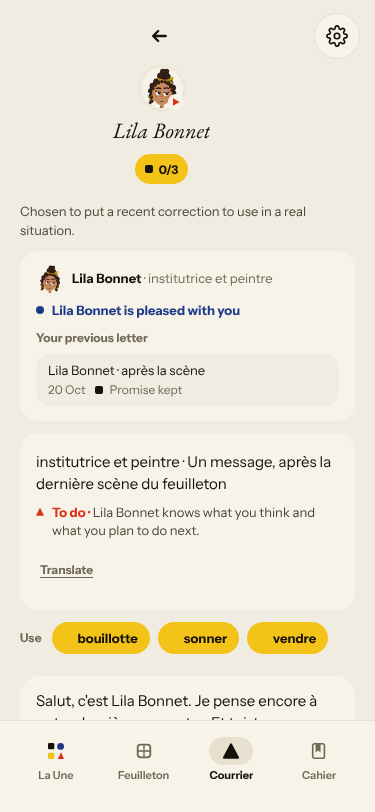 Also M. Marchand vs Camille Marchand, Margaux unintroduced, «Paul et Julie» (noted on #147).

**#146 content and feedback not driven by one concept**
11. Medium · #267 (new) · Forge prompts: «la vendeuse vous demande combien coûtent les deux livres», badge «tu» over «Votre amie vous demande».
    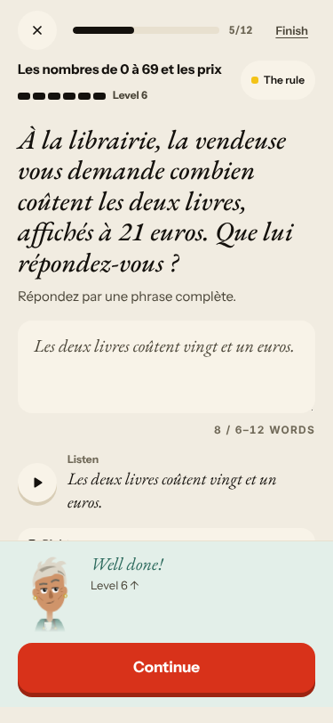 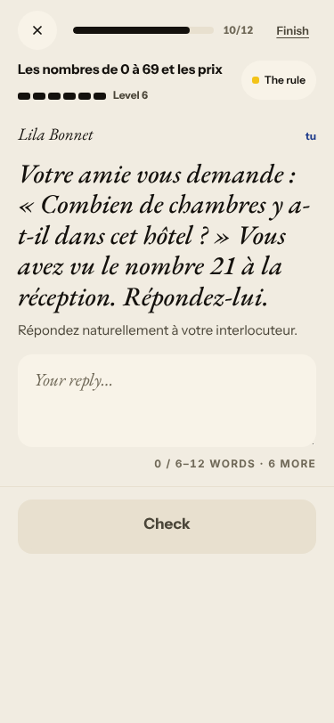
12. Seen again: #169 (four rules, 12 items) 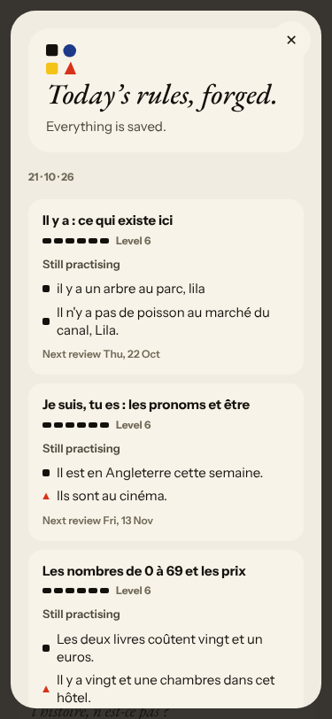; #213 (Right + Not yet) 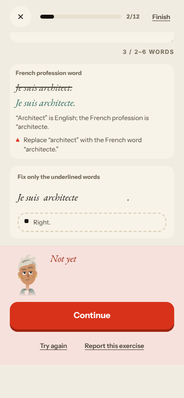;
    #240 (recall miss as correction) 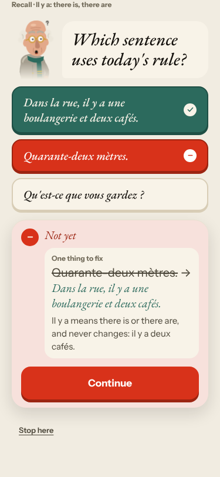; #176 (the line above the task does not lead to it);
    #117 (Lila's Courrier French far above A1.1) 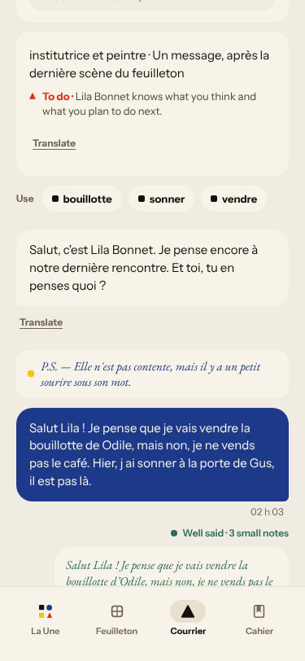; Courrier words are yesterday's, unrelated to the scene.

**#143 day progress**
13. Seen again: «Step 1 of 7» → «5 of 8», exchange «1 of 3» → «2 of 4», «8 of 8 · Scene finished» before the words, review 0/29 → 32 → 29 against «10 words»,
    Done «32 Words» + «10 more words». 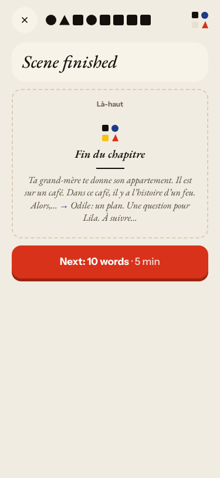 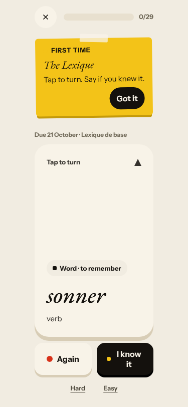
    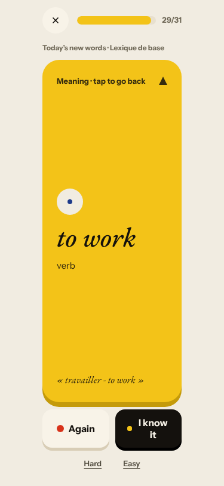 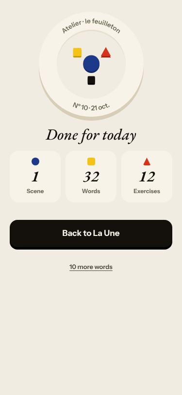

Good today: Camille corrected «il sont très beau» → «ils sont très beaux»; «non» kept («Vous avez raison. On revient plus tard.») and the cat question
answered; Forge corrections with reasons (architect → architecte, est → sont, un → une chambres, n y → n'y; «Non, je ne sais pas» contradicting
the task named) 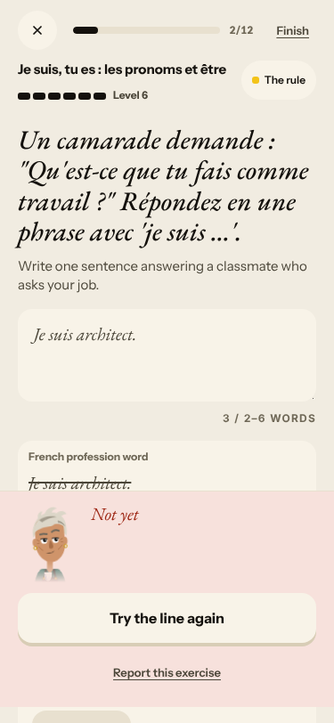; Courrier corrections exact (d'Odile, sonné, j'ai); the rule «Il y a» is in the scene and
the recall items use scene lines; lowercase, accent-less and reordered answers accepted; the Journal flagged «la escalier».

## Re-tests

| issue | result |
|---|---|
| #193 wrong «es»/«ai» correction | reproduced in a new form; commented |
| #213 contradicting verdicts | reproduced twice; commented |
| #240 recall miss as correction | reproduced; commented |
| #169 Forge hops | reproduced (four rules, 12 items); commented |
| #237, #194 tomorrow hook, titles | reproduced; commented |
| #143 counters | reproduced; commented |
| #176 line vs task | reproduced; commented |
| #252 Journal | correction works; memory check 0/1 remains; commented |
| #251 corrector unavailable | not reproduced; commented |
| #254, #253 | not reproduced; commented |
| #174 right answers | no wrong rejection; commented |
| #132 «non» ignored | not reproduced (non kept); noted on #145 |
| #117 Courrier above A1 | reproduced; commented |
| #236, #235, #212, #93, #114, #119, #133 | not reachable today |

## Not filed
- Every tutorial card shows «FIRST TIME» on day 10: the cloud browser starts with empty local storage, not a product bug.
- In «Find the mistake» the Check button stays disabled after typing the fix until Enter commits it, then an «Undo» appears. May be a harness artifact (`fill` fires no key events); check on the phone.
- The Forge level badge shows the new level before the verdict (noted on #143).
- Dictation and audio only «played» silently here; Q19 n/a.
