# Live walk · 22 Oct 2026

Production API (`atelier-api-3njh.onrender.com`) with the real model, walk test account (`beginner`, **A1.1**,
Cahier: 206 concepts, 6 practising, 0 held), **day 10** («Nº 11 · Les légendes d'Odile», episode «Lila et la boîte»).
Main at the commit of the `explore:live` harness, Chromium at 375×812, one real day. Played: Guess/Listen/Check/Keep,
two free replies (one with «cest», one clear «non» plus an off-script pizza request), recall drills (3 correct, 2 deliberate
misses), 21 word cards, La Forge (7 items, 3 deliberate misses), Courrier letter (4 turns), Cahier (Rules, Journal),
Feuilleton, Settings. No earlier live report is on main (the 19 Oct report lives on its own branch), so the trend column is the
«live 19 Oct» column of [walks/2026-10-19.md](../walks/2026-10-19.md).

## Scores (rubric `docs/ops/walk-rubric.md`)

| # | question | live 22 Oct | live 19 Oct |
|---|---|---|---|
| 1 | Where am I | 3 | 3 |
| 2 | What is at stake | 4 | 4 |
| 3 | What to do next | 3 | 3 |
| 4 | Scene reacts to my writing | 4 | 5 |
| 5 | Story coherent | 3 | 3 |
| 6 | Characters consistent | 2 | 4 |
| 7 | Image, text, tone fit | 3 | 4 |
| 8 | Difficulty fits | 3 | 4 |
| 9 | Feedback explained | 2 | 3 |
| 10 | Right answers accepted | 4 | 2 |
| 11 | French correct | 3 | 4 |
| 12 | Clear goal today | 3 | 3 |
| 13 | Grammar practised | 3 | 3 |
| 14 | Earlier material returns | 4 | 4 |
| 15 | I produce French | 5 | 5 |
| 16 | Errors, dead ends | 2 | 3 |
| 17 | Varied, fun | 4 | 4 |
| 18 | Fast enough | 3 | 3 |
| 19 | App only | n/a | n/a |
| 20 | Satisfying end | 3 | 3 |
| 21 | Would come back | 4 | 4 |
| 22 | Time vs promise | 3 | 3 |

**Moved up:** Q10 (2 → 4): lower-case, no full stop and a corrected part alone were accepted everywhere I tried.
**Moved down:** Q6 (4 → 2), Q9 (3 → 2), Q16 (3 → 2), Q4 (5 → 4), Q7, Q8, Q11 by one.

**Story reactivity (the point of this walk): works.** With the real model the scene took up my «non, je ne pense pas que ce
soit Marin» («Ah, pas Marin, alors») and the pizza request, and the closing panel said «D'accord, pas Marin… allons en partager
une» with an English gloss «You ruled out Marin». The Courrier also reacted: it offered size 40 after I wrote 38, then fixed it
when I objected. The failures are in the scripted material around the reply (say-aloud line, hook, journal) and in the drills.

## Findings, by root cause

### #250 corrections are raw model output
1. **High · #193 (again)** The first reply («Je pense que cest Marin. Il est le grand chef, non ? …») got «→ sont … plural subject « ils »» with no «ils» in the sentence; «cest» was not mentioned. The second reply got a correct «cest → c'est». 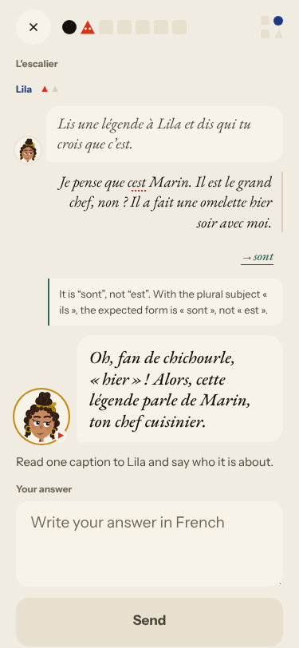

### #145 the scene has no state of what is established
2. **Medium · #277 (new)** The guess question «How does it end?» is about a scene that has no ending; Check says «neither guess is wrong».
3. **Medium · #264 (again)** After my «non», «One line to say aloud» reads «C'est Marin, je pense.» 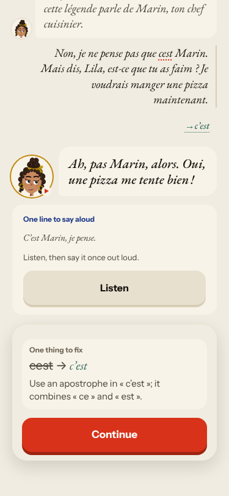
4. **Medium · #237 (again)** The hook quotes a line I never wrote and says «de Odile». 
5. **High · #252 (again, worse)** The Journal grades memory against the next-episode teaser: 0/1, «À suivre….». 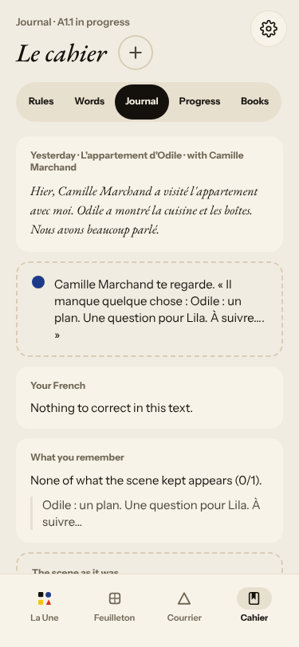
6. **Medium · #212 (again)** Lila says «Lis une légende à Lila».

### #146 content and feedback not driven by one concept
7. **High · #281 (new)** Forge level rises on a miss (5 → 6), recap shows Level 6 «Still practising» for all rules, session ends at 7/12 on its own. 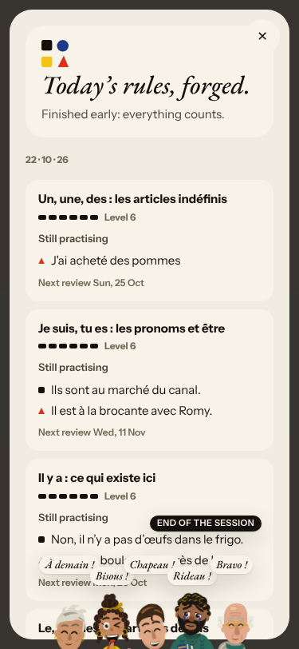 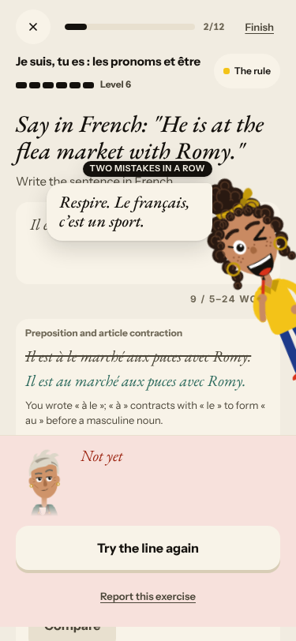
8. **Medium · #278 (new)** Repair card is a bare «Sommer». 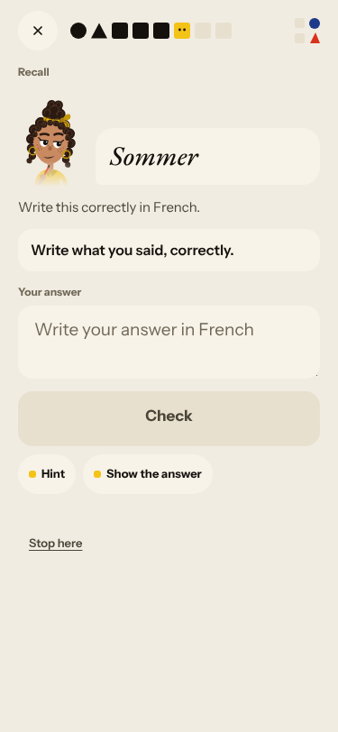
9. **Medium · #280 (new)** New words (onze, douze, garçon, répondre…) are unrelated to the scene.
10. **Medium · #267 (again)** Forge: «Lila Bonnet» over «Colleague: …», vous text under a tu badge, duplicated «Reply in French:». 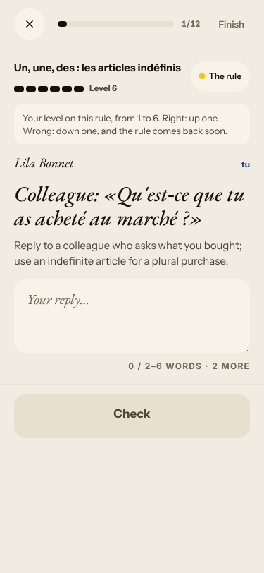 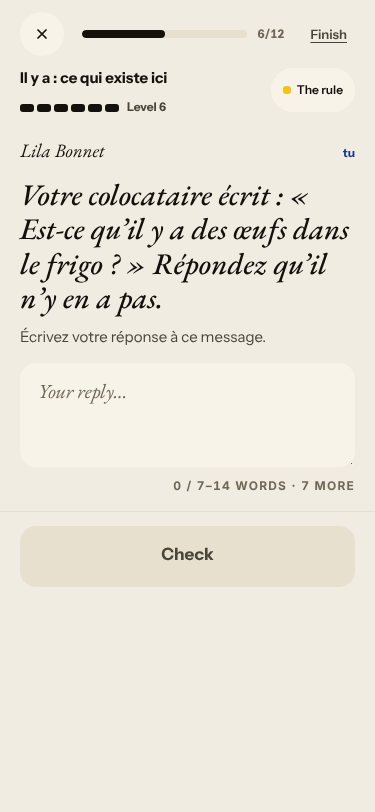 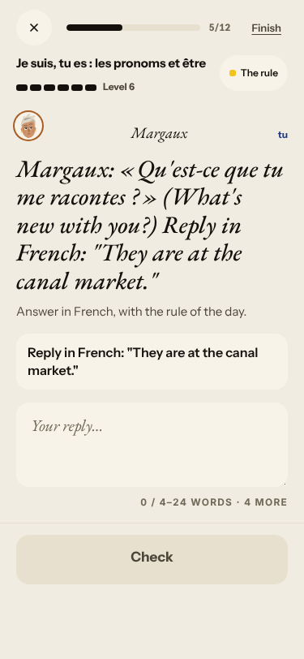
11. **Medium · #167 (again)** Audio-only word drills never show the French word.

### #143 the day's progress has no single source of truth
12. **High · #279 (new)** «10 words · 4 min» opens at 0/21, first card «yes». 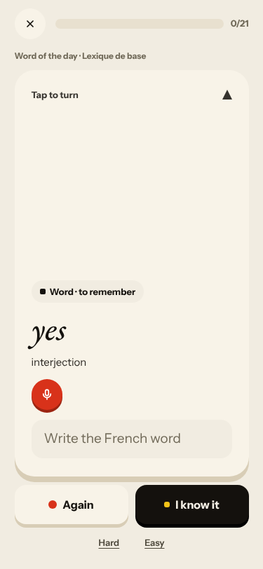
13. **Medium · #276 (new)** «Read the scene» in the Guess step does nothing.
14. Seen again (on #143): counters grow («Step 1 of 7» → 9; reader «5/5» → «8/8»); the day ends on the Forge recap without a Done step. 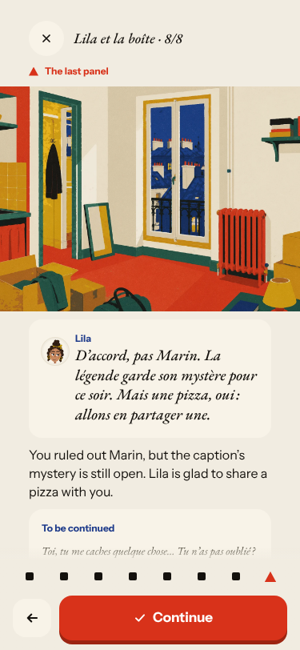 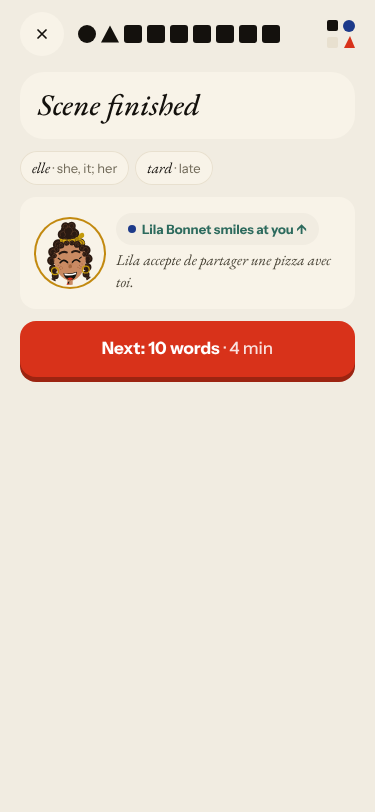

### Layout, no root cause
15. **Medium · #282 (new)** Forge miss: bubble over prompt, «Compare» behind the sheet, fix field longer than the instruction.
16. **Medium · #283 (new)** Broken image on the À la une card. 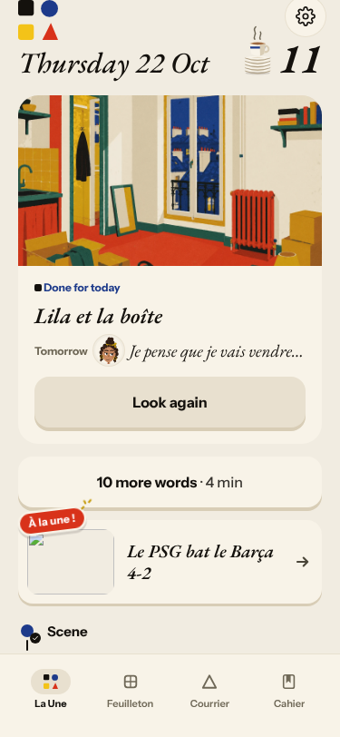

### #147 cast, #117, #268
- Margaux, «colocataire» Lila and «Boutique Anaïs» are outside the cast (#147). Courrier mixes vous and «ta taille» (#117). Feuilleton chapters 1 and 3 share one cut blurb (#268). 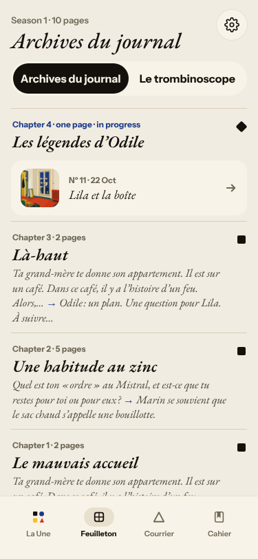

Not filed: Journal «One week later» clears with no feedback after Reply (low, noted in #252); the Courrier «to ring» word was never used and the letter still counted «1/1 goals».

## Re-tests

| issue | result |
|---|---|
| #167 first word drill listen-only | reproduced |
| #193 / #250 wrong correction | reproduced (intermittent) |
| #252 Journal 0/1 | reproduced |
| #268 Feuilleton duplicate blurb | reproduced |
| #264 say-aloud line | reproduced, new variant |
| #237 two different «tomorrow» questions | the two agreed today; the hook quotes unsaid words |
| #212 Lila names herself | reproduced |
| #149 unasked Le Papier takes the plan | not reproduced: À la une stays a separate card |
| #169 «Still proficient» after a miss | not reproduced: «Still practising»; the other #169 symptoms (ends early, mixed rules) remain |

Nothing closed: no fix is visible in production yet.

## Queue after triage

New: #276 #279 #281 #282 #283 `queue:ready`/`lane:code`; #277 `queue:ready`/`lane:story`; #278 `queue:ready`/`lane:code`;
#280 `queue:owner`. Each has a **Done when** in its body.
