# Live walk · 23 Oct 2026

Production API (`atelier-api-3njh.onrender.com`) with the real model, walk test account (**A1.1**, Cahier 206 concepts,
7 rules practising, 0 held), **day 11** («Nº 12 · La clé d'Odile», episode «Marin et le plan d'Odile»). Main at the commit
of the `explore:live` harness, Chromium at 375×812, one real day. Played: rule, 2 recall drills (1 deliberate miss), scene
reader (4 panels), one free reply with a clear «non» and two real slips, closing panel, 13 word cards, La Forge (13 items,
5 misses on purpose or by the app), Done, Home, a new Courrier letter (one off-script reply), Cahier (Rules, Journal),
Feuilleton and Trombinoscope. The scene allowed only one reply, so the off-script test went into the Courrier. Previous
report: [live 22 Oct](https://github.com/Pechst1/ConversationalLanguageLearning/blob/claude/live-walk-2026-10-22/docs/ops/live-walks/2026-10-22.md) (not on main).

## Scores (rubric `docs/ops/walk-rubric.md`)

| # | question | live 23 Oct | live 22 Oct |
|---|---|---|---|
| 1 | Where am I | 3 | 3 |
| 2 | What is at stake | 4 | 4 |
| 3 | What to do next | 3 | 3 |
| 4 | Scene reacts to my writing | 4 | 4 |
| 5 | Story coherent | 3 | 3 |
| 6 | Characters consistent | 3 | 2 |
| 7 | Image, text, tone fit | 3 | 3 |
| 8 | Difficulty fits | 3 | 3 |
| 9 | Feedback explained | 2 | 2 |
| 10 | Right answers accepted | 2 | 4 |
| 11 | French correct | 3 | 3 |
| 12 | Clear goal today | 3 | 3 |
| 13 | Grammar practised | 3 | 3 |
| 14 | Earlier material returns | 4 | 4 |
| 15 | I produce French | 5 | 5 |
| 16 | Errors, dead ends | 2 | 2 |
| 17 | Varied, fun | 4 | 4 |
| 18 | Fast enough | 3 | 3 |
| 19 | App only | n/a | n/a |
| 20 | Satisfying end | 3 | 3 |
| 21 | Would come back | 4 | 4 |
| 22 | Time vs promise | 3 | 3 |

**Moved up:** Q6 (2 → 3): no «Lila Bonnet» over «Colleague» today; Margaux still isn't in the cast.
**Moved down:** Q10 (4 → 2): three correct Forge answers were rejected (#295, #296, #297).

**Story reactivity: works again.** Marin took up my «Non, vous ne pouvez pas…» («D'accord. Je ne touche pas au plan»), the
closing panel said he keeps the plan closed, and Margaux in La Forge answered my sentence about the canal market in
character. Today the scripted material around the reply was less wrong than on 22 Oct, but the correction was wrong again.

## Findings, by root cause

### #174 a right answer is judged against one stored string
1. **High · #295 (new)** «They help Marin» rejects «ils aident» (only «Elles»); «You have dinner at Le Mistral» rejects «tu dînes», then Continue shows an author note («the prompt gives no subject…») and still «Not yet».
   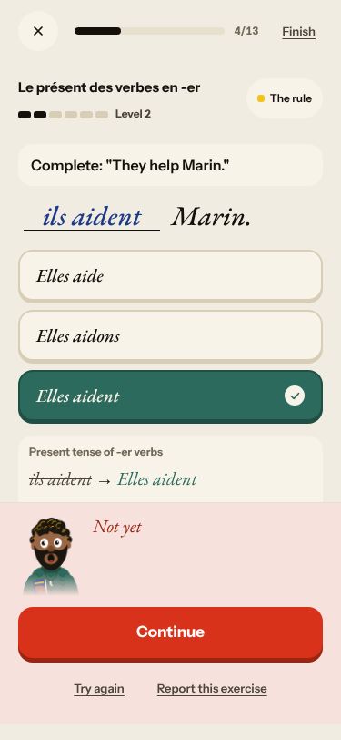 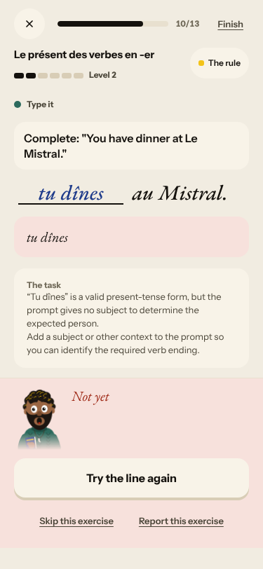
2. **High · #296 (new)** A tile build expects the prompt's context sentence («Marin demande ton âge. J'ai quarante et un ans.»), so the correct «J'ai quarante et un ans.» is «Not yet». 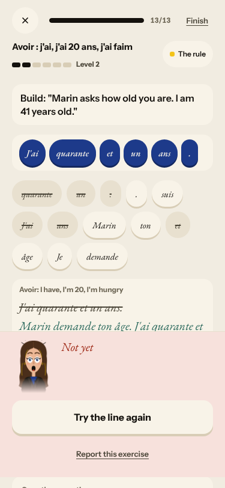
3. **Medium · #297 (new)** «gus a un telephone dans le salon» is labelled «Word order — the words are right, but not in this order.» 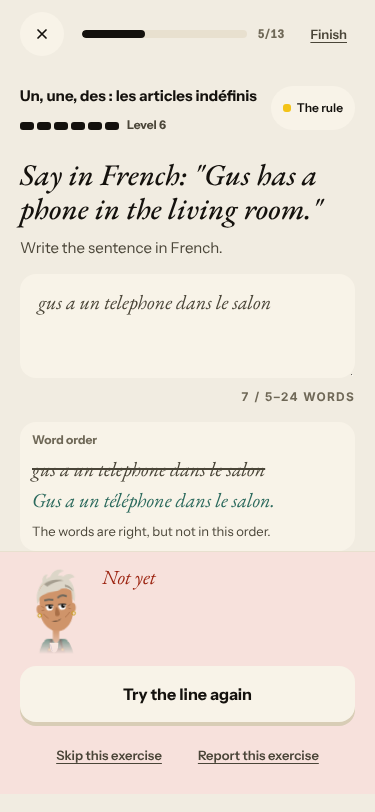

### #250 corrections are raw model output
4. **High · #193 (again)** My reply got «est → sont … plural subject « ils »» with no «ils»; «utilisé» and «a»/«à» were not mentioned. 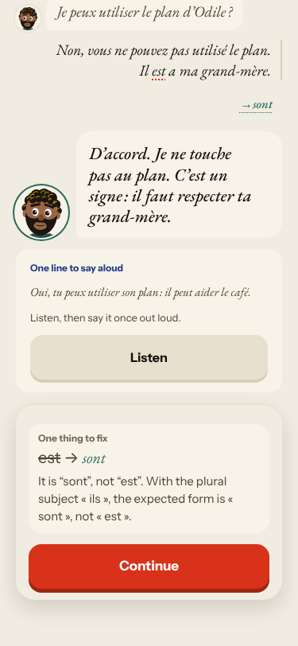

### #146 content and feedback not driven by one concept
5. **Medium · #239 (again)** The placeholder «auxiliary or stem + the ending or participle this unit teaches.» ends every Forge miss. 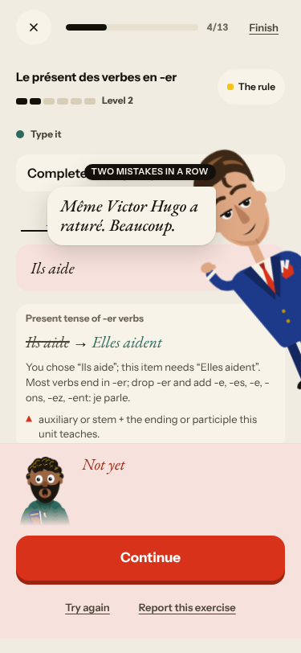
6. **High · #252 (again)** Journal: 0/1 against the pizza line although I described the box and the photos; «The correction could not be made». 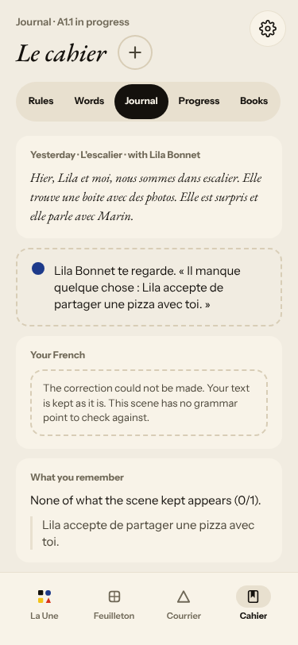
7. **Medium · #280 (again)** The day's words (architecte, tard, détester, travailler, page, photo…) come from the base list.

### #145 the scene has no state of what is established
8. **Medium · #264 (again)** After my «non», «One line to say aloud» reads «Oui, tu peux utiliser son plan». Marin says «tu» to my «vous».

### #143 the day's progress has no single source of truth
9. **High · #279 (again)** «10 words · 4 min» opens at 0/13; Home says «5 words — done»; Done says 13; «10 more words» follows Done. 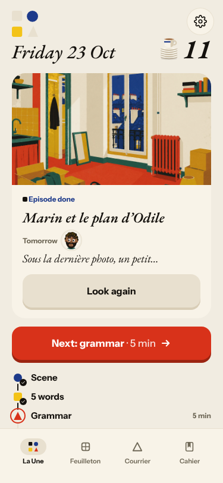
10. **Medium · #143 (again)** «Step 6 of 6 · Scene finished» comes before the words and grammar; the rule check is headed «The words · Quick word drills».
11. **High · #281 (again)** Level bar full (Level 6) on a miss; recap lists Level 6 rules as «Still practising». 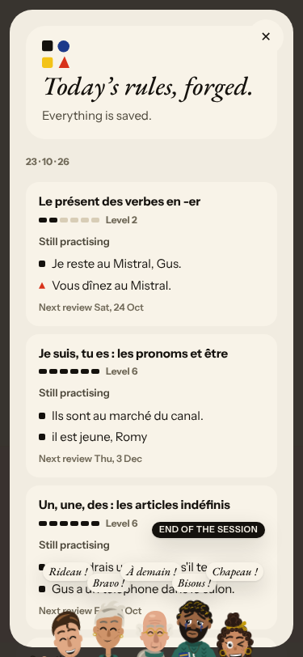

### #147 cast registry
12. **Medium · #298 (new)** Trombinoscope prints the author's bible («NOT a couple», «from T2 on; it is Odile's idea before it is his»). 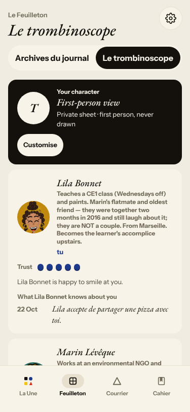
13. **Medium · #267 (again)** Margaux (not in the cast) asks the Forge item; the instruction is printed twice. 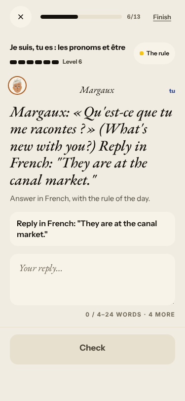

### Layout, no root cause
14. **Medium · #283 (again)** Broken image on the À la une card. 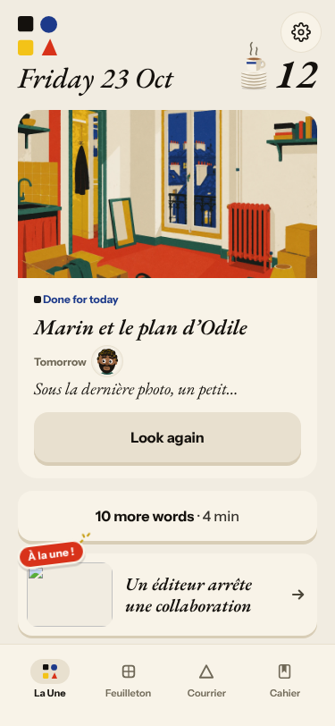
15. **Medium · #268 (again)** Feuilleton chapters 1 and 3 share one cut blurb. 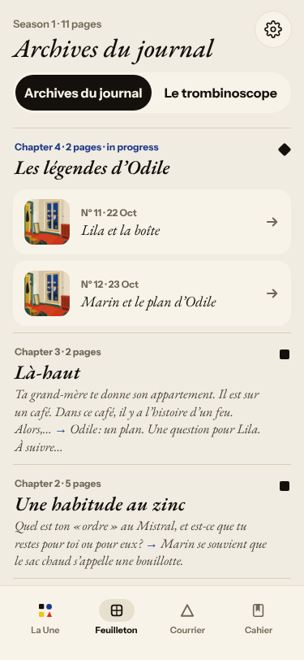

Seen, not filed: the new Courrier letter mixes «vous pouvez» with «ta porte» (#117, 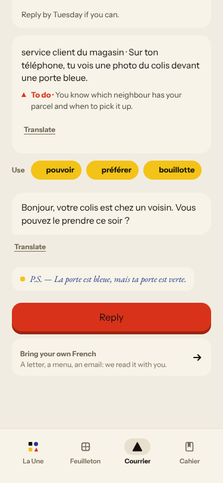) and,
after my off-script reply («mon chat aime les colis»), asked for an address and a tracking number (#114); it ended «Partly 0/1»
after one exchange although it said «Letter 1 of 2». The reader's speaker label «Augustin « Gus » de Roncourt» is still two names (#217).

## Re-tests

| issue | result |
|---|---|
| #193 / #250 wrong correction | reproduced |
| #252 Journal 0/1 | reproduced |
| #264 say-aloud contradicts «non» | reproduced |
| #268 Feuilleton duplicate blurb | reproduced |
| #283 broken À la une image | reproduced |
| #279 words counts | reproduced (new numbers) |
| #281 level up on a miss | reproduced |
| #267 Forge Margaux | reproduced |
| #239 placeholder reason | reproduced |
| #153/#143 end of day | the day now has a Done step and Home shows «Done for today»; «10 more words» follows it |

Nothing closed: no fix is visible in production yet.

## Queue after triage

New: #295 #296 `queue:ready`/`lane:code`/`size:M`/`size:S`; #297 #298 `queue:ready`/`lane:code`/`size:S`. Each has a **Done when** comment.
Commented: #193 #264 #252 #239 #283 #268 #279 #281 #267 #143 #174 #147.
