# Live walk · 24 Oct 2026

Production API (`atelier-api-3njh.onrender.com`) with the real model, walk test account (**A1.1**, Cahier 206 concepts,
7 rules practising, 0 held), **day 12** (Home «Nº 13 · La clé d'Odile»; the day's scene turned out to be a re-read of
«Le Mistral à nous»). Main at `72e4571f` (the `explore:live` harness is on main), Chromium at 375×812, one real day.
Played: reader (5 panels), scene with 4 free replies (a deliberate slip-filled one, a clear «non» with an off-script
cat and photos, a corrected one, a «Pas encore» choice), closing panel, 9 recall items (2 misses), 26 word cards,
La Forge (13 items, 3 misses on purpose), Done, Home, a Courrier letter (a «non» and an off-script cat), Cahier (Rules,
Journal with a week-later question and yesterday's scene), Feuilleton and Trombinoscope. Previous report:
[live 23 Oct](https://github.com/Pechst1/ConversationalLanguageLearning/blob/claude/live-walk-2026-10-23/docs/ops/live-walks/2026-10-23.md)
(not on main).

## Scores (rubric `docs/ops/walk-rubric.md`)

| # | question | live 24 Oct | live 23 Oct |
|---|---|---|---|
| 1 | Where am I | 3 | 3 |
| 2 | What is at stake | 3 | 4 |
| 3 | What to do next | 3 | 3 |
| 4 | Scene reacts to my writing | 3 | 4 |
| 5 | Story coherent | 2 | 3 |
| 6 | Characters consistent | 3 | 3 |
| 7 | Image, text, tone fit | 3 | 3 |
| 8 | Difficulty fits | 3 | 3 |
| 9 | Feedback explained | 2 | 2 |
| 10 | Right answers accepted | 4 | 2 |
| 11 | French correct | 3 | 3 |
| 12 | Clear goal today | 3 | 3 |
| 13 | Grammar practised | 4 | 3 |
| 14 | Earlier material returns | 4 | 4 |
| 15 | I produce French | 5 | 5 |
| 16 | Errors, dead ends | 3 | 2 |
| 17 | Varied, fun | 4 | 4 |
| 18 | Fast enough | 3 | 3 |
| 19 | App only | n/a | n/a |
| 20 | Satisfying end | 3 | 3 |
| 21 | Would come back | 4 | 4 |
| 22 | Time vs promise | 2 | 3 |

**Moved up:** Q10 (2 → 4): in La Forge «Tu es au marché du canal ?» for «Are you…», a curly «j’ai», and a build of the corrected
sentence were all accepted; no right answer was rejected. Q13 (3 → 4): 13 Forge items on three rules, with item-specific
reasons. Q16 (2 → 3): no dead end; the Journal now gives a correct correction.
**Moved down:** Q5 (3 → 2): an unintroduced «M. Marchand», Camille speaking Lila's lines, panel 1 re-introducing Lila.
Q2, Q4 (4 → 3): the scene repeated a question I had answered and cut to a stored closing. Q22 (3 → 2): 12 words promised,
26 given, 30 reported.

**Story reactivity: mixed.** Camille took the «non» («Vous avez raison. On revient plus tard.») but twice answered a full
reply by repeating her question (#262), and the closing panel was the stored «Odile : un plan…» whatever I wrote. In
the Courrier the service reacted to the cat («compliqué avec votre chat») and then asked for an address it said it
already had (#114). Margaux in La Forge reacted to «Je voudrais une baguette» in character. The Journal's correction
(«je ne était → je n'étais») was right; the scene's chip «→ sont» was not (#250).

## Findings, by root cause

### #145 the scene has no state of what the learner said and what is established
1. **Medium · #313 (new)** Camille's lines are prefixed «Lila : …» and she speaks Lila's question. 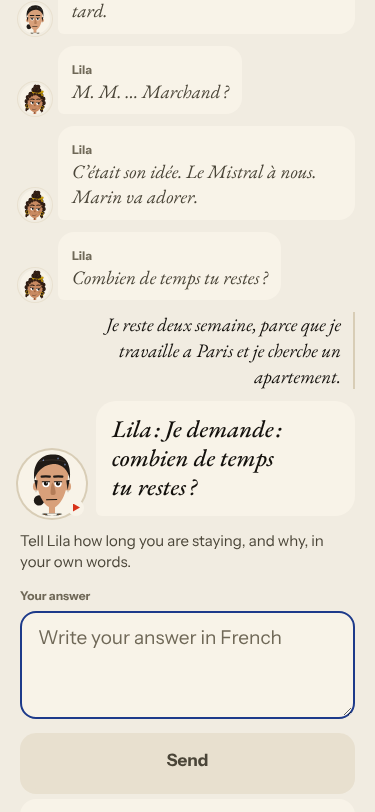
2. **Medium · #315 (new)** «M. Marchand» and «son idée» appear with no referent; the «decision» about the key has one button. 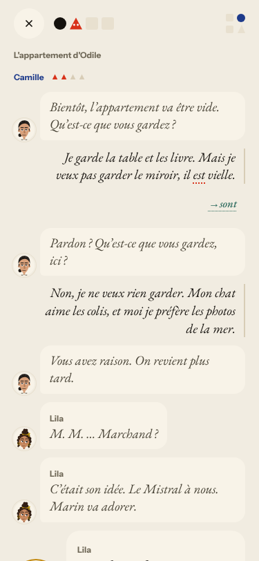 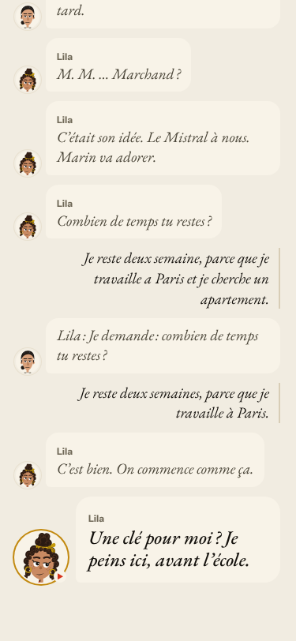
3. **Medium · #262 (again)** «Pardon ? Qu'est-ce que vous gardez, ici ?» after a full answer; the exchange counter grows 3 → 4 → 5. 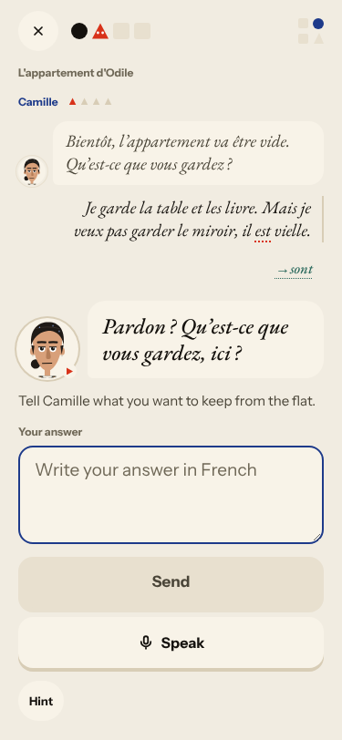

### #250 corrections are raw model output
4. **High · #250 (again)** The scene's correction chip reads «→ sont», with no source word and wrong; three real slips were not mentioned. The Cahier Journal's correction was right.

### #143 the day's progress has no single source of truth
5. **Medium · #314 (new)** Re-read day: Nº 12 twice (Home says Nº 13), the learner is told «The story did not move on today» only at the last panel. 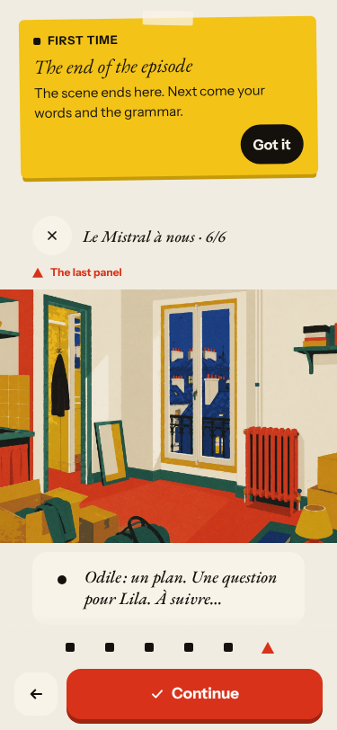 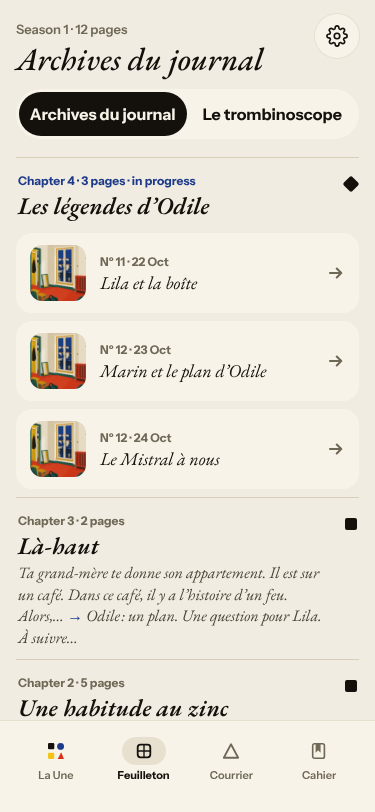
6. **High · #279 (again)** «12 words» → «Next: 26 words» → «30 words — done» → «10 more words» after Done; recall counters grow under «Step 10 of 10». 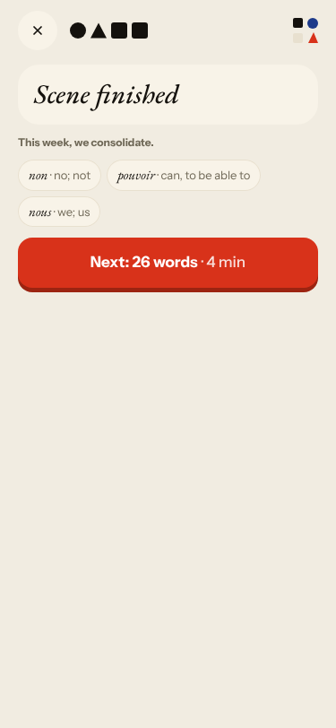
7. **High · #281 (again)** Level 6 «Still practising» in the recap, next review in 4 weeks. 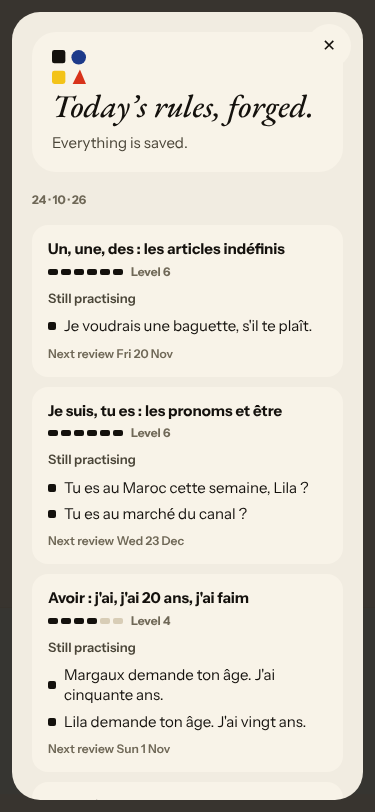

### #146 content and feedback not driven by one concept
8. **Medium · #278 (again)** «le appartement — Write what you said» and «You wrote this earlier: Romy, je suis quarante-cinq ans» are not mine. 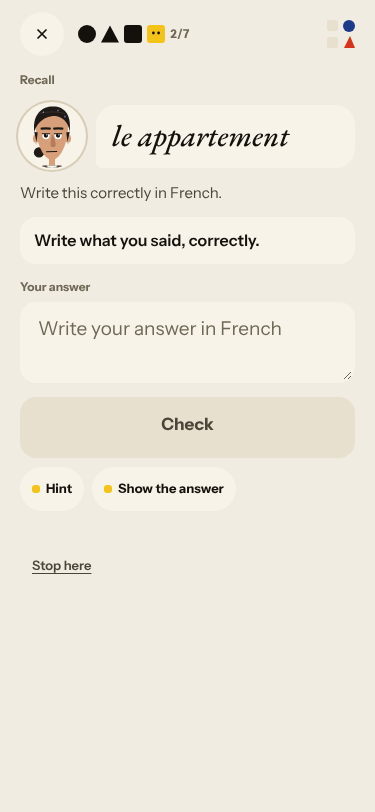 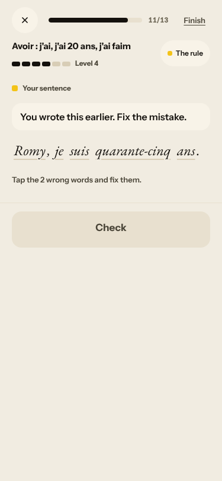
9. **Medium · #280 (again)** All 26 words are from the base list. 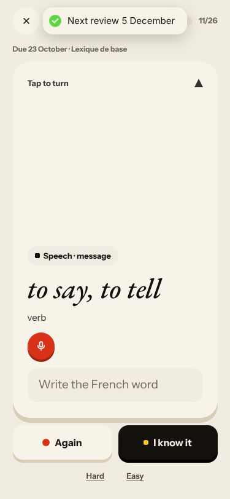

### #147 cast registry
10. **Medium · #267 (again)** Marin answers a line meant for Lila and speaks bible facts early; Margaux is not in the cast. 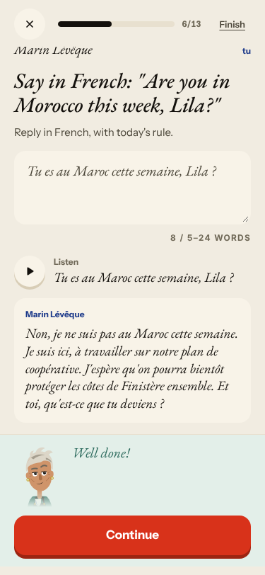
11. **Medium · #265 (again)** Lila «Architecte» in panel 1 vs «teaches a CE1 class and paints» in the Trombinoscope.
12. **Medium · #298 (again)** The Trombinoscope prints «NOT a couple» and «from T2 on». 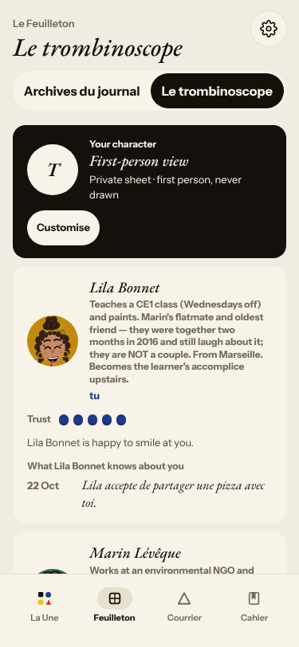

### Layout and Courrier, no root cause
13. **Medium · #283 (again)** Broken image on the À la une card. 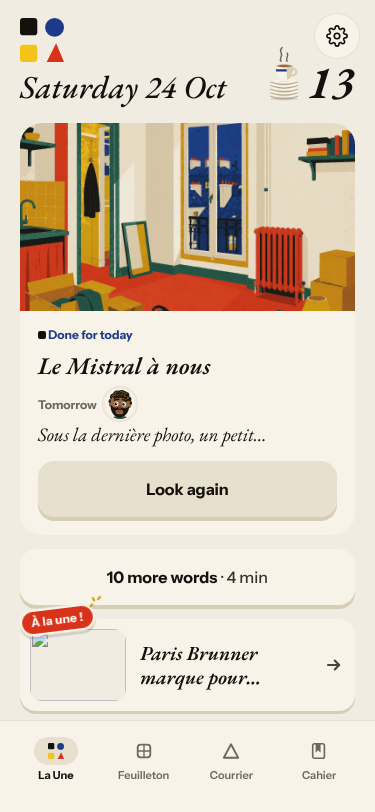
14. **Medium · #268 (again)** Feuilleton chapters 1 and 3 share one cut blurb.
15. **High · #114 (again)** The Courrier letter says it has an address, asks for it, then for a tracking number; ends «Partly · 0/1 words». 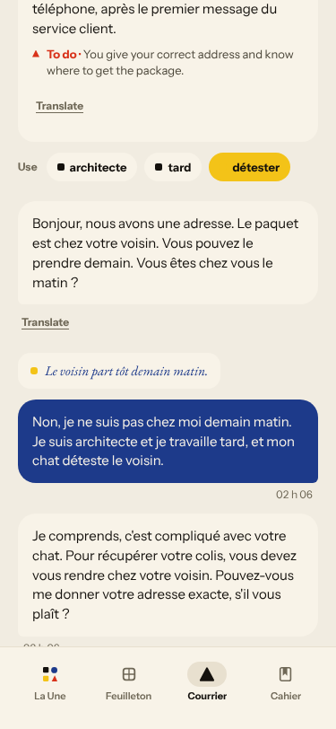 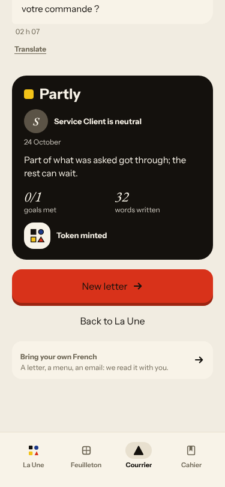
16. **Low · #316 (new)** Courrier bubbles are stamped in UTC («02 h 06» at 04:06 Berlin).

Seen, not filed: in the Forge «fix the 2 wrong words» item, a tapped word shows no highlight until its field opens (low; first I
thought deleting a word was impossible, which was my timing, not the app). The Cahier Journal worked as intended: a
week-later question, a one-sentence correction, «You recalled everything (1/1)»
([screenshot](2026-10-24/journal-feedback-good.png)).

## Re-tests

| issue | result |
|---|---|
| #262 scene repeats a question | reproduced (twice) |
| #250 correction is raw model output | reproduced in the scene, not in the Journal |
| #265 Lila's job | reproduced |
| #267 Forge cast | reproduced |
| #278 repair drill claims authorship | reproduced (two shapes) |
| #279 word counts | reproduced (new numbers) |
| #280 base-list words | reproduced |
| #281 level 6 «Still practising» | reproduced |
| #283 À la une image | reproduced |
| #268 Feuilleton blurb | reproduced |
| #298 Trombinoscope notes | reproduced |
| #114 Courrier address and tracking number | reproduced |
| #239 placeholder reason | not reproduced today (reasons were item-specific); left open |
| #264 say-aloud line contradicts the «non» | not reproduced: the day's line was «Pas encore», the one button I chose |
| #168 English summary on the last panel | not seen today (the last panel was French); not enough to close |

Nothing closed: a not-reproduced result on a different day's content is not a fix.

## Queue after triage

New: #313 `queue:ready`/`lane:story`/`size:S`; #314 `queue:ready`/`lane:code`/`size:S`; #315 `queue:ready`/`lane:story`/`size:S`;
#316 `queue:ready`/`lane:code`/`size:S`. Each has a **Done when** comment. Commented on (labels unchanged: they carry
`queue:pr` or `queue:owner` from earlier nights): #262 #250 #265 #278 #267 #114 #279 #281 #280 #283 #268 #298, and the root causes
#143 #145 #146 #147. No new root cause: every new finding fits #143, #145 or #147.
