# Live walk · 25 Oct 2026

Production API (`atelier-api-3njh.onrender.com`) with the real model, walk test account (**A1.1**, Cahier 206 concepts, 7 rules
practising, 0 held), **day 13** (Home «Nº 13 · La clé d'Odile»; the scene played was «L'appartement s'ouvre»). Main at `72e4571f`,
Chromium at 375×812, one real day. Played: reader (4 panels), scene with 2 free replies (a slip-filled one, a clear «non» with an
off-script cat), closing panel (8/8), 9 recall items, 7 word cards, La Forge (13 items: 5 free-text, 8 other, 3 misses on purpose),
Done, Home, two Courrier letters (the second with a «non» and an off-script cat), Cahier (Rules, Journal), Feuilleton.
Previous report: live 24 Oct (branch `claude/live-walk-2026-10-24`, not on main).

**The day's headline: the model-backed checks did not work.** All 5 free-text La Forge checks ended «The second check stopped», the
Courrier and Journal said «No corrections found» for plain slips, and Agent Moreau gave the same stock line twice. Filed as root
cause #333. Scores for corrections (Q9) and Q4 for the Courrier are therefore low for a reason that may be today's model path, not
the usual prompt quality; the next night will show which.

## Scores (rubric `docs/ops/walk-rubric.md`)

| # | question | live 25 Oct | live 24 Oct |
|---|---|---|---|
| 1 | Where am I | 3 | 3 |
| 2 | What is at stake | 3 | 3 |
| 3 | What to do next | 3 | 3 |
| 4 | Scene reacts to my writing | 2 | 3 |
| 5 | Story coherent | 3 | 2 |
| 6 | Characters consistent | 3 | 3 |
| 7 | Image, text, tone fit | 3 | 3 |
| 8 | Difficulty fits | 3 | 3 |
| 9 | Feedback explained | 2 | 2 |
| 10 | Right answers accepted | 3 | 4 |
| 11 | French correct | 3 | 3 |
| 12 | Clear goal today | 3 | 3 |
| 13 | Grammar practised | 3 | 4 |
| 14 | Earlier material returns | 4 | 4 |
| 15 | I produce French | 4 | 5 |
| 16 | Errors, dead ends | 2 | 3 |
| 17 | Varied, fun | 4 | 4 |
| 18 | Fast enough | 2 | 3 |
| 19 | App only | n/a | n/a |
| 20 | Satisfying end | 3 | 3 |
| 21 | Would come back | 4 | 4 |
| 22 | Time vs promise | 2 | 2 |

**Moved down:** Q4 (3 → 2): «Oui. Bon appétit !» to a clear «non», and the Courrier's stock reply twice. Q16 (3 → 2) and Q18
(3 → 2): five Forge checks that fail after ~15 s, a «New letter» that shows nothing for ~20 s. Q10 (4 → 3): «lal' huile» accepted
(lowercase and accent-free variants were accepted). Q13 (4 → 3), Q15 (5 → 4): five of 13 Forge items, the production ones, never
got a result. **Moved up:** Q5 (2 → 3): no unintroduced character today.
Q22 stays 2: Home promised 8 words, then 7, then «11 words — done», then «10 more words».

**Story reactivity: poor today.** Lila answered the «non» with «Oui. Bon appétit !» and a full reply with the question she had
already asked; the scene ended after two exchanges on a stored closing («Jeudi, deux amis ont une question») whatever I wrote.

## Findings, by root cause

### #333 a failed model call is shown as a result (new root cause)
1. **High · #334 (new)** Every free-text Forge item: «Answer saved, not checked yet. The second check stopped.», level already up. 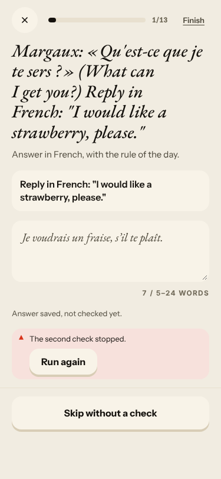 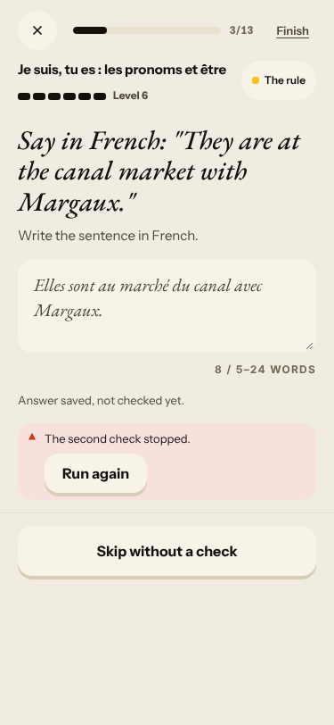
2. **High · #114 (again, new shape)** Courrier «Pas de train»: the same stock reply twice, «No corrections found» for «Je pas ai beaucoup bagages», «Partly · neutral» and a token. 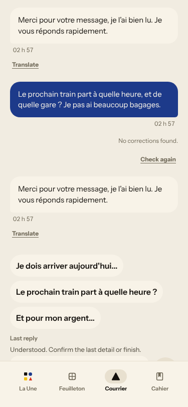 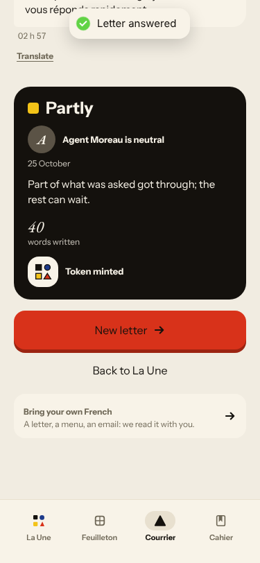
3. **High · #250 (again)** The scene's chip «→ sont» (no source word); the Journal's «No corrections found» for «je ne était». 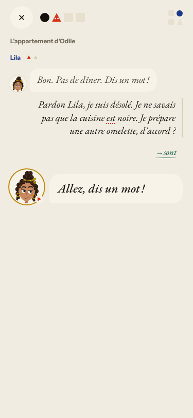

### #145 the scene has no state of what the learner said
4. **Medium · #132 (again)** «Oui. Bon appétit !» to «Non, je ne veux pas manger…». 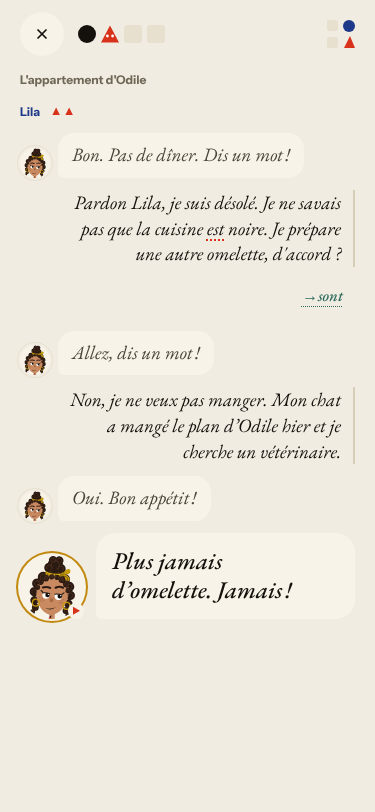
5. **Medium · #262 (again)** «Allez, dis un mot !» after a full reply. Closing panel stored, not about the cat or the non. 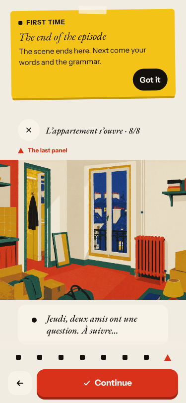
6. **Medium · #336 (new)** The Journal prints «Today, we re-read. Tell Camille what you want to keep from the flat.» (English) inside Camille's quote and scores recall against it. 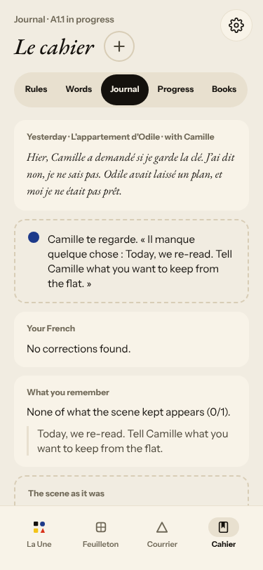

### #143 the day's progress has no single source of truth
7. **High · #279 (again)** 8 → 7 → 11 → 10 more words; recall counters 3/8 → 3/9 → 5/10 → 9/11; «Step 11 of 11 · Every step is done» before words and Forge. 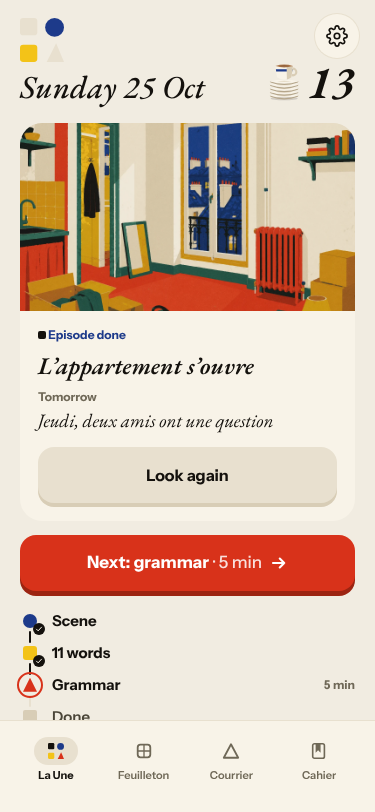 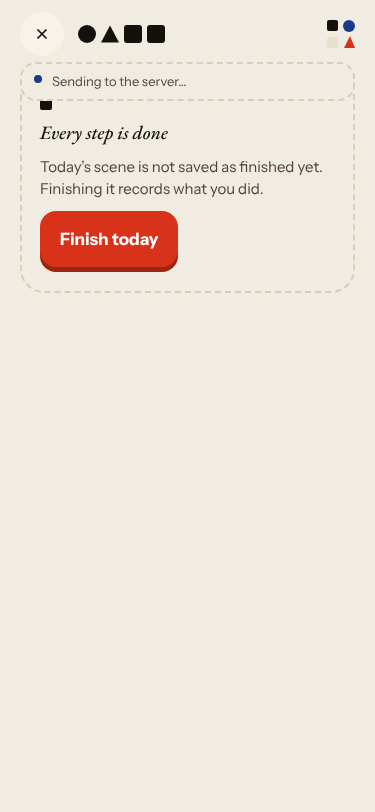 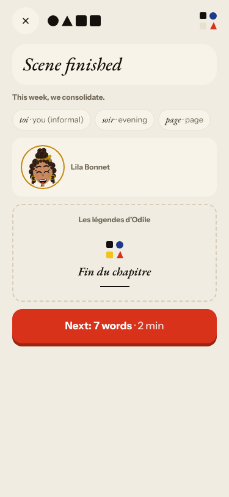 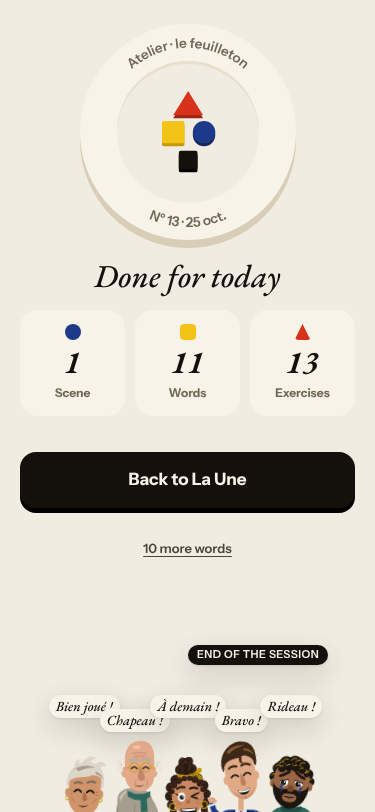
8. **Medium · #314 (again)** Feuilleton lists Nº 12 twice. 
9. **Medium · #337 (new)** «New letter» shows nothing for ~20 s; the Journal's week-later «Reply» vanishes without a result.

### #174 a right answer is judged against one stored string
10. **High · #335 (new)** «Margaux aime lal' huile d'olive.» → «Well done! Level 5 ↑». 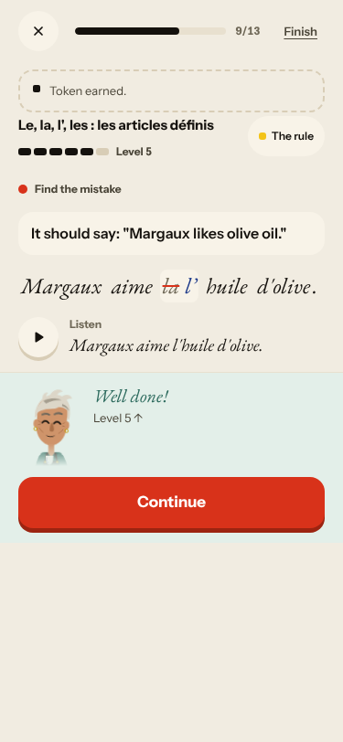

### #146 content and feedback not driven by one concept
11. **Medium · #278, #167, #280, #281 (again)** Recall «Je suis plombier non» / «J'ai suis cinquante ans» are not mine; «hotel → page. «page» means «page».»; 7 base-list words; recap Level 6 «Still practising» and lines in the recap that I did not write. 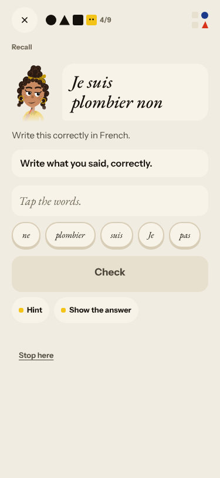 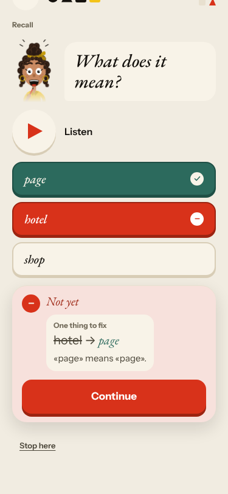 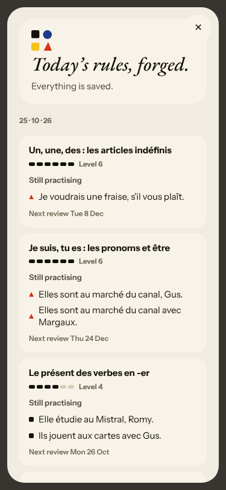

### No root cause
12. **Low · #269 (again)** «A moment of silence.» in English in the reader. **Low · #316 (again)** Courrier times in UTC.

Seen, not filed: Forge «Find the mistake» opens its fix field pre-filled with the wrong word, so typing appends (part of #335).
Rapid fire gave no feedback until the end of four items, then showed every correction at once (good). Choice-miss reasons were
item-specific («Ils reste → Ils restent», #239 not reproduced). Lowercase, no-accent and curly-apostrophe answers were accepted
in the typed-gap and dictation items.

## Re-tests

| issue | result |
|---|---|
| #262, #132 scene ignores the reply | reproduced |
| #250 corrections raw | reproduced (chip «→ sont») |
| #278, #279, #280, #281, #167 | reproduced |
| #314, #269, #316, #114 | reproduced |
| #239 placeholder reason | not reproduced (item-specific reasons) |

Nothing closed: a not-reproduced result on one day's content is not a fix.

## Queue after triage
New: #333 `queue:owner`/`lane:code`/`size:M` (root cause); #334 `queue:ready`/`lane:code`/`size:S`; #335 `queue:ready`/`lane:code`/`size:S`;
#336 `queue:ready`/`lane:story`/`size:S`; #337 `queue:ready`/`lane:code`/`size:S`. Each has a **Done when**. Commented on (labels unchanged):
#250 #262 #132 #279 #281 #278 #167 #314 #269 #316 #114, and the root causes #143 #145 #146 #174.
