# Live walk · 26 Oct 2026

Production API (`atelier-api-3njh.onrender.com`) with the real model, walk test account (**A1.1**, English chrome, Cahier 206
concepts, 7 rules practising, 0 held, streak 14 → 15), **day 14**: Home «Nº 14 · La clé d'Odile» before the scene, «Deux promesses»
after (Gus, an employee, Lila's SMS). Main at `72e4571f`, Chromium at 375×812. Previous report: live 25 Oct (branch
`claude/live-walk-2026-10-25`, not on main yet).

Played: reader (5 panels), **one** free scene reply (a clear «non» with «une bon offre»), closing panels (8/8), rule (être), 11 recall
items (tiles, dictations, listen-only meaning), 12 word cards, La Forge (6 items, 4 free-text/other answers, finished early), Done,
Courrier (Lila, an off-script cat question and two slips), Cahier (Rules, Words, Journal with a «venu» slip), Feuilleton.
The scene allowed only one free reply, so the off-script reply went into the Courrier.

**Headline: the same night-after-night outage as 25 Oct (root cause #333).** Every free-text La Forge check stopped («The second
check stopped», 3 of 3 free-text items) and the level and review date moved anyway; the Courrier said «No corrections found» for two
clear slips and Lila answered with a stock line; the scene's single reply came back in ~1 s (12–14 s with the model on 19 Oct) with a
correction that explains a plural «ils» that is not in my sentence. The Journal's model correction (`venu → venue`) was exact, so the
corrector itself is not down everywhere.

## Scores (`docs/ops/walk-rubric.md`)

Worst screen for per-screen questions.

| # | question | 26 Oct live | 25 Oct live | trend |
|---|---|---|---|---|
| 1 | Where am I | 3 | 3 | = Home «La clé d'Odile» vs «Deux promesses» after (#194) |
| 2 | What is at stake | 4 | 3 | ↑ «Tell Gus if you promise not to sell to Solvel» is concrete |
| 3 | What to do next | 3 | 3 | = listen-only drills (#167); Forge dead-ends on a stopped check |
| 4 | Scene reacts to my writing | 2 | 2 | = «non» answered with «Un oui, c'est un oui», Lila's letter reply is stock |
| 5 | Story coherent | 3 | 3 | = SMS referent only in the reader; hooks differ on Home and in the Feuilleton |
| 6 | Characters consistent | 4 | 3 | ↑ |
| 7 | Image, text, tone fit | 4 | 3 | ↑ panels fit; «A moment of silence.» still English (#269) |
| 8 | Difficulty fits | 4 | 3 | ↑ Journal still asks A1.1 for 2–4 French sentences, in French |
| 9 | Feedback explained | 2 | 2 | = wrong scene correction, «No corrections found», unchecked Forge |
| 10 | Right answers accepted | 3 | 3 | = accent-less dictation accepted «with help»; a Forge tile build shown «Not yet» with my intended sentence (unverified) |
| 11 | French correct | 4 | 3 | ↑ |
| 12 | Clear goal today | 3 | 3 | = words are a frequency list (#280) |
| 13 | Grammar practised | 2 | 3 | ↓ être taught, Forge opened on «un, une, des» and its checks did not run |
| 14 | Earlier material returns | 4 | 4 | = «bouillotte», «sonner» in the Cahier, due cards in Lexique |
| 15 | I produce French | 4 | 4 | = |
| 16 | Errors, dead ends | 2 | 2 | = second check stopped on every free-text item (#334) |
| 17 | Varied, fun | 4 | 4 | = |
| 18 | Fast enough | 4 | 2 | ↑ nothing waited long, but the scene's 1 s reply suggests the model was not called |
| 19 | App only | n/a | n/a | |
| 20 | Satisfying end | 3 | 3 | = Done has no question; Done says 1 scene, 15 words, 5 exercises |
| 21 | Would come back | 3 | 4 | ↓ a learner who writes real French is not corrected today |
| 22 | Time vs promise | 3 | 2 | ↑ «10 min» promised; counters still disagree (#143) |

## Findings, ranked and grouped by root cause

**#333 a failed or empty model call is shown as a result**
1. **High · #334 (seen again)** La Forge free-text checks all stop; the recap then credits «Level 6 · Still practising» with next reviews
   on 23 Nov and 8 Dec for answers that were never checked. 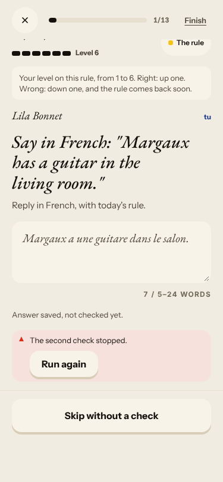
   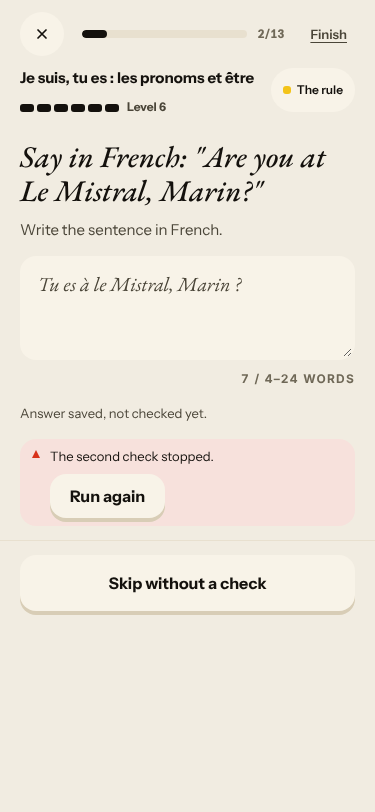 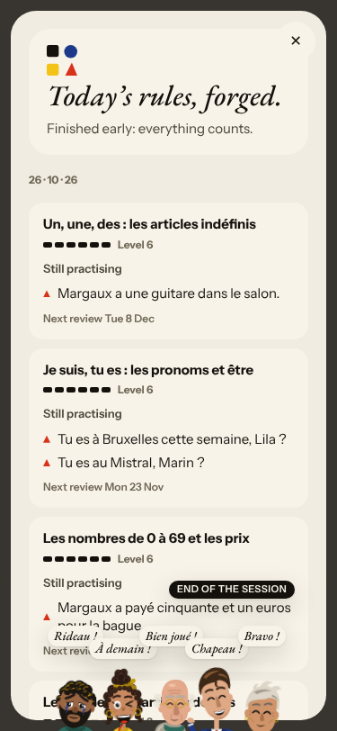 (also #281)
2. **High · #333 (seen again)** Courrier: «No corrections found.» for «a la scène» (missing à) and «j ai»; Lila replies «Merci pour
   ton message, je l'ai bien lu. Je te réponds vite.» to a question about cats. 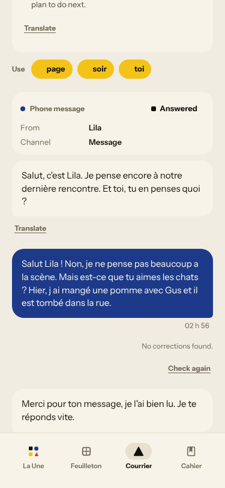

**#250 free-text corrections are raw model output**
3. **High · #250 (seen again)** Scene correction `est → sont` with «the plural subject « ils »» for «Solvel est une bon offre»; the real slip
   (`une bon`) is not mentioned. It matches today's rule (être, ils sont), not the sentence. 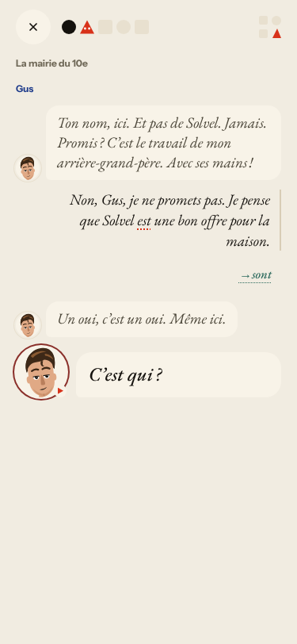

**#145 the scene has no state of what the learner said**
4. **Medium · #132 / #79 (seen again)** «Non, Gus, je ne promets pas…» is answered «Un oui, c'est un oui. Même ici.»; «C'est qui ?»
   follows with the SMS visible only in the reader. Only one free reply exists on this day.

**#146 content and feedback not driven by one concept**
5. **Medium · #169 (seen again)** The rule is être; Forge opens on «un, une, des», then être, numbers, articles définis.
   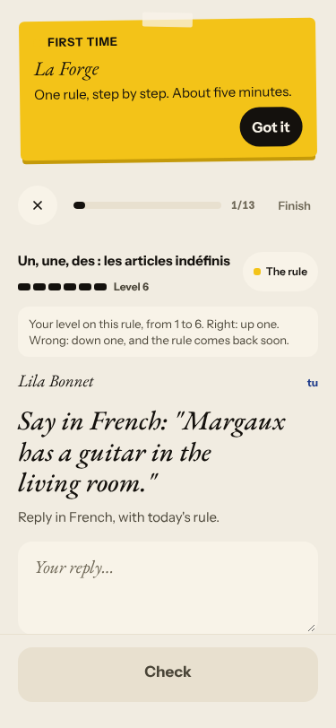 Words (#280) are «soir, toi, order, letter, seven…».
6. **Medium · #336 (seen again)** Journal «What you remember»: «None of what the scene kept appears (0/1)» where the kept fact is the
   hook «Jeudi, deux amis ont une question. À suivre…». 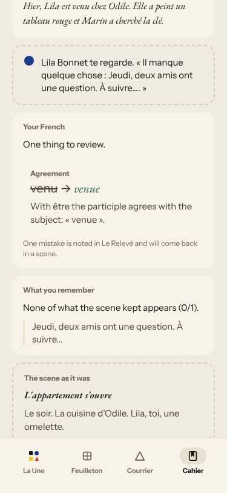
7. **Medium · #167 (seen again)** Two meaning drills are listen-only, no French on screen. 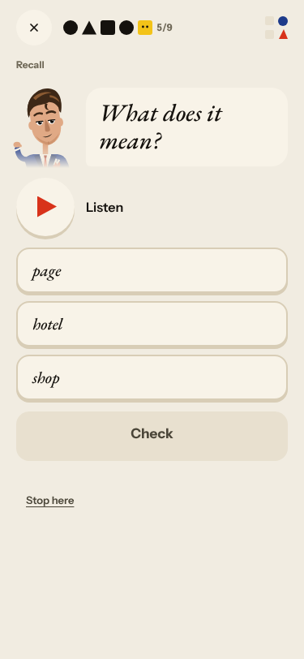

**#143 day progress**
8. **Medium · #143 / #279 (seen again)** Home «13 words», Lexique 0/12, day plan «15 words — done»; the recall counter grows (3/8 → 3/9 → 8/11)
   and shows «Step 12 of 12» for the last six items; Done shows «5 exercises» and «10 more words». 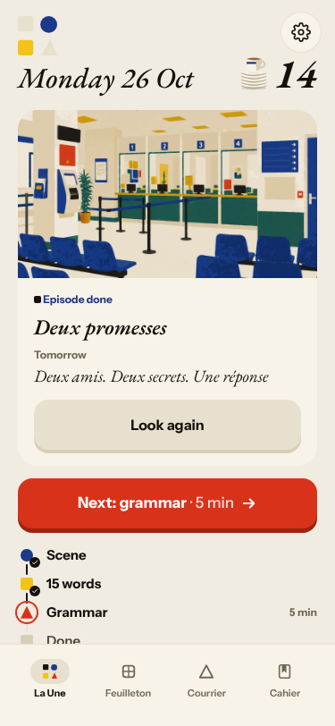
   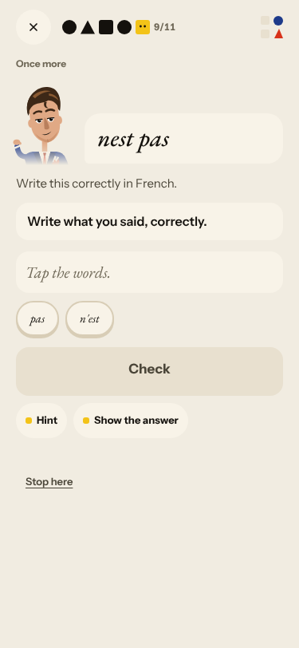 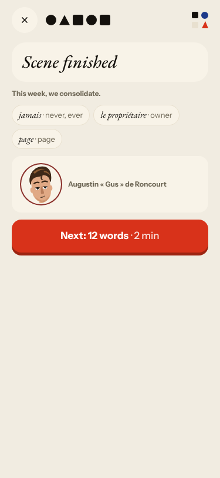 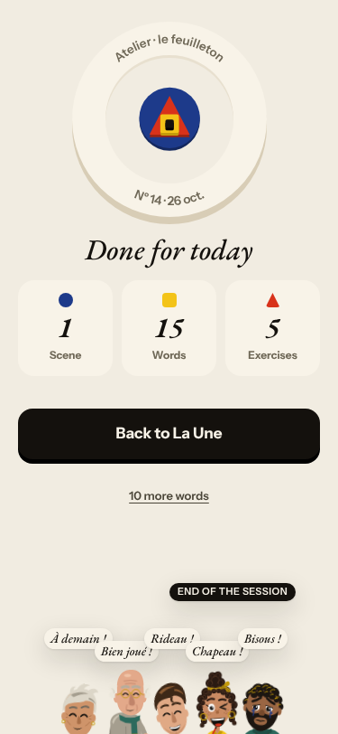

**Others (seen again)**: «A moment of silence.» (#269); Feuilleton chapters 1 and 3 print the same pitch (#268)
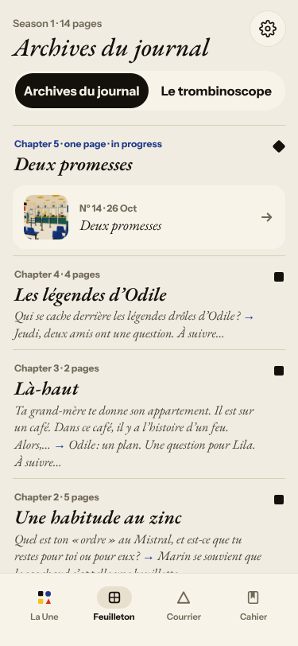; a Forge tile miss shows the right sentence but not what I built (unverified, not filed:
may be a tap order of mine) 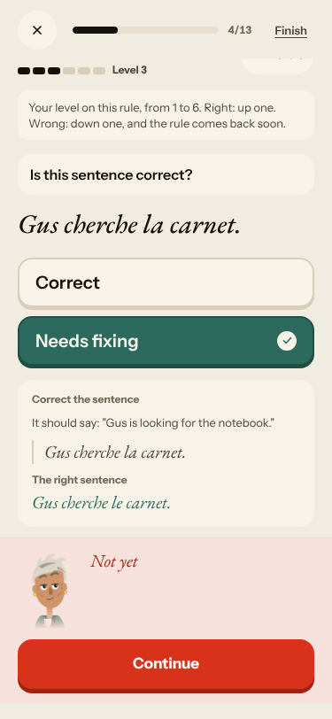.

No new issues: every finding matches an open issue; comments carry today's evidence.

## Re-tests

| issue | result |
|---|---|
| #334 Forge second check | reproduced, 3 of 3 free-text answers; commented |
| #333 root cause | reproduced in Courrier; commented |
| #250 raw corrections | reproduced in the scene; commented |
| #132 ignored «non» | reproduced in the scene (different wording); commented |
| #336 Journal recall against the hook | reproduced; commented |
| #167, #169, #143, #269, #268 | reproduced; commented |
| #337 Journal «Reply» silent | not seen: the Journal answered within ~20 s |
| #134 502 | none today |
| #93, #114, #119, #133, #282, #283, #298, #316 | not reached today |
