# Live walk · 27 Oct 2026

Production API (`atelier-api-3njh.onrender.com`) with the real model, walk test account (**A1.1**, English chrome, Cahier 206
concepts, 7 rules practising, 0 held, streak 15 → 16), **day 15**: Home «Nº 15 · La clé d'Odile» before the scene, «Deux promesses»
after (Marin, Gus; Margaux and Lila appear in the closing panels). Main at `72e4571f` (unchanged since 26 Oct), Chromium at
375×812, cloud session `atelier-ops`. Previous report: live 26 Oct (branch `claude/live-walk-2026-10-26`, not on main yet).

Played: reader (5 panels), scene with **four** free replies (a clear «non» with `la appartement`, an off-script cat question, a plain
request to Gus, a closing line), closing panels (14/14), 16 word cards (mixed ratings), La Forge (2 items, one free-text, one repair;
left with «Finish»), Done, Courrier (reply with «non» and three slips), Cahier (Rules, Journal «One week later» reply), Feuilleton.
No rule step came before La Forge today. The Journal's logbook field could not be reached with the control API's `type` (it
fills the first field), so the logbook entry was not tested.

**Headline:** the outage of 25–26 Oct (root cause #333) is still there: the one free-text Forge item stopped, the Courrier
answered with a stock line and caught only one of three slips, the Journal reply was silent. New today: a **Forge repair item whose
reference line is garbled** («Im war au Mistral» → target «Im est au Mistral») rejects the correct «Je suis au Mistral, Marin.»
and has no way forward (#348); and a scene exchange that pastes the whole earlier thread into one bubble (#349). The scene
now reacts at goal level (it moved on to «Convince Gus») but not to what I wrote: «non» answered «Merci. Merci.», the cat ignored.

## Scores (`docs/ops/walk-rubric.md`)

Worst screen for per-screen questions.

| # | question | 27 Oct live | 26 Oct live | trend |
|---|---|---|---|---|
| 1 | Where am I | 3 | 3 | = Home «La clé d'Odile» vs «Deux promesses» (#194) |
| 2 | What is at stake | 4 | 4 | = «Tell Marin if you will sell the flat to the co-op and say so at the party» |
| 3 | What to do next | 3 | 3 | = Forge dead end (#348); no rule step before the Forge |
| 4 | Scene reacts to my writing | 2 | 2 | = «non» → «Merci. Merci.»; cat → «C'est une fête.»; Courrier stock reply |
| 5 | Story coherent | 3 | 3 | = echo block, Margaux and Lila arrive uninvited (#349, #147) |
| 6 | Characters consistent | 3 | 4 | ↓ Gus's line in Marin's bubble; Gus tu in scene, vous in Courrier (#350) |
| 7 | Image, text, tone fit | 4 | 4 | = «A moment of silence.» still English (#269) |
| 8 | Difficulty fits | 4 | 4 | = Journal still asks A1.1 for 2–4 French sentences |
| 9 | Feedback explained | 2 | 2 | = `est → sont` for a sentence without a plural (#250); Forge «You wrote «je»; here it is «im»» |
| 10 | Right answers accepted | 1 | 3 | ↓ «Je suis au Mistral, Marin.» rejected (#348) |
| 11 | French correct | 3 | 4 | ↓ the app prints «Im est au Mistral, Marin.» as the right line and as my line in the recap |
| 12 | Clear goal today | 3 | 3 | = words «page, coûter, soir, toi» unrelated to the scene (#280) |
| 13 | Grammar practised | 2 | 2 | = no rule step; Forge opened on «un, une, des» at level 6, then être; 4 rules in the recap (#169) |
| 14 | Earlier material returns | 4 | 4 | = due cards in the Lexique (Due 26/27 Oct), the Forge repair reuses an earlier answer |
| 15 | I produce French | 4 | 4 | = |
| 16 | Errors, dead ends | 1 | 2 | ↓ Forge item with no way forward, stopped check, silent Journal reply |
| 17 | Varied, fun | 4 | 4 | = |
| 18 | Fast enough | 3 | 4 | ↓ Courrier reply ~15 s, Journal reply silent after ~20 s, Forge «Run again» 15 s without result |
| 19 | App only | n/a | n/a | |
| 20 | Satisfying end | 3 | 3 | = Done has no question; hook «Deux promesses…» vs Home «Deux amis. Deux secrets. Une réponse» |
| 21 | Would come back | 3 | 3 | = |
| 22 | Time vs promise | 3 | 3 | = Home 14 words, scene card 16, Done 18 + «10 more words» (#143) |

## Findings, ranked and grouped by root cause

**#174 a right answer is judged against one stored string**
1. **High · #348 (new)** La Forge «Fix the mistake» is built from the account's earlier answer «Im war au Mistral, Marin.»; the target is
   «Im est au Mistral, Marin.»; a correct «Je suis au Mistral, Marin.» is «Not yet» twice, «Try the line again» loops, the recap shows
   «Im est au Mistral» as my line. 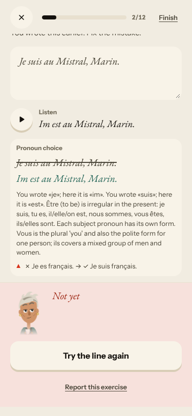 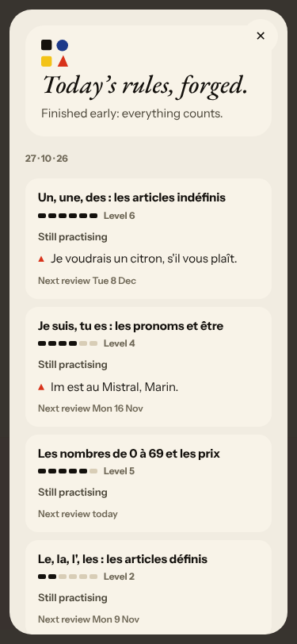

**#333 a failed or empty model call is shown as a result**
2. **High · #334 (seen again)** The only free-text Forge item ends «The second check stopped»; «Run again» does not recover; the recap
   credits Level 6 and a review on 8 Dec for the unchecked line. 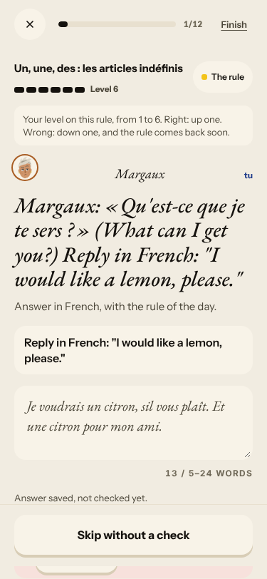
3. **High · #333 (seen again)** Courrier: `un → une idée` caught, `a → à` and `jai` not; Gus replies with a stock «Merci pour votre
   message…». 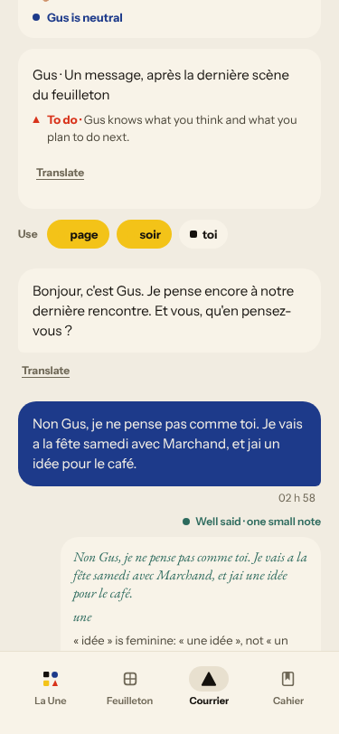
4. **Medium · #337 (seen again)** The Journal «One week later» reply gives no feedback (intermittent; 26 Oct answered).
   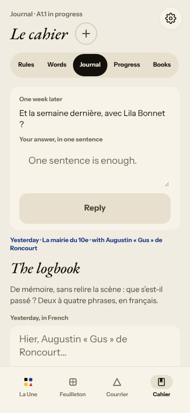

**#250 free-text corrections are raw model output**
5. **High · #250 (seen again)** `est → sont` («With the plural subject « ils »») for a sentence without a plural.
   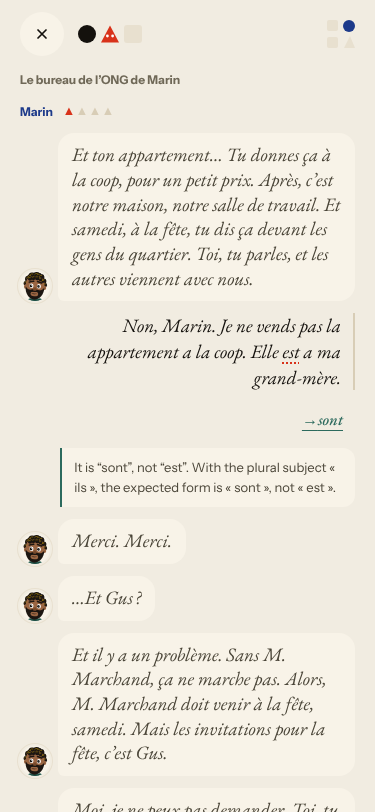

**#145 the scene has no state of what the learner said**
6. **Medium · #349 (new)** A Marin bubble repeats the whole earlier thread, cut at «Gus : Marcha»; Gus's line comes in Marin's bubble
   with a «Gus :» prefix (also #313). 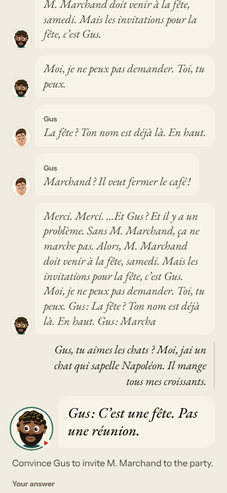 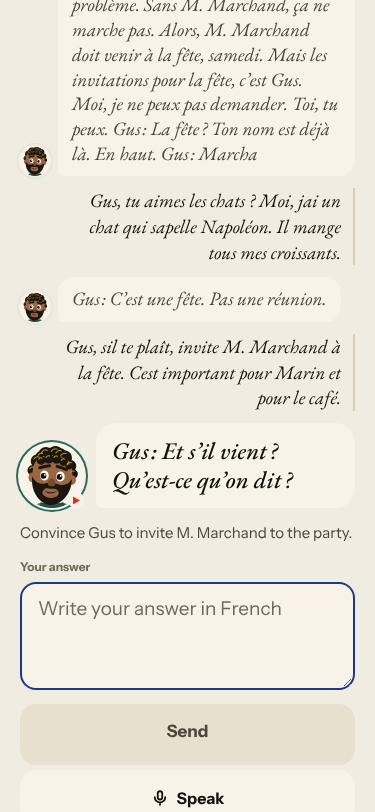
7. **High · #132 / #79 (seen again)** «Non» → «Merci. Merci.»; the cat is not answered; the last reply is answered «Pour elle.» / «Bon.».
8. **Medium · #268 (seen again)** Feuilleton chapters 3 and 5 print one pitch; Nº 14 and Nº 15 are both «Deux promesses».
   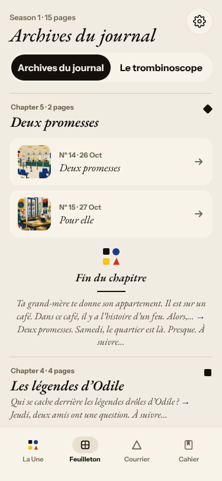

**#147 the cast is not one registry**
9. **Medium · #350 (new)** Gus says tu in the scene and «Et vous, qu'en pensez-vous ?» in the Courrier. Margaux and Lila arrive in
   the closing panels without introduction (noted on #147).

**#146 content and feedback not driven by one concept**
10. **Medium · #169 / #280 (seen again)** No rule step; Forge opens on «un, une, des» (level 6), then être; words «page, coûter, soir,
    toi» are unrelated to the scene.

**#143 day progress**
11. **Medium · #143 (seen again)** Home «14 words», scene card «16 words», Done «18 words», «10 more words».
    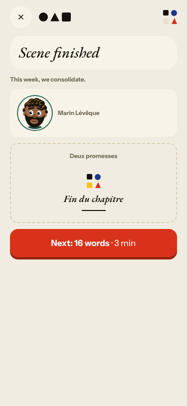 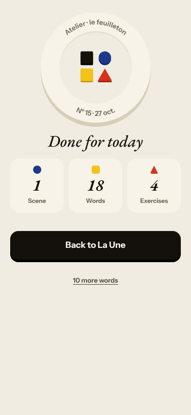

**Not filed**
- The scene reacts at goal level now: after the third reply it moved to the party and Margaux/Lila; judged as «goal moves, text ignored».
- Settings opened once by my own misclick on the Journal page (control API index); nothing changed.
- A first card flip clicked «Open the story of …» when I used the wrong index; the story sheet is fine and closes with Esc.

## Re-tests

| issue | result |
|---|---|
| #334 Forge second check | reproduced (1 of 1 free-text item); #340 not merged; commented |
| #333 root cause | reproduced in the Courrier; commented |
| #250 raw corrections | reproduced in the scene; commented |
| #132, #79 ignored «non», tangent | reproduced; commented |
| #337 Journal «Reply» silent | reproduced (not on 26 Oct); commented |
| #143, #168/#169, #268, #280, #313, #147, #145, #174 | reproduced or children added; commented |
| #134 502 | none today |
| #93, #114, #119, #133, #282, #283, #298, #316 | not reached today |

## Queue after triage

Filed today: #348 (`queue:ready` `lane:code` `size:M`), #349 (`queue:ready` `lane:story` `size:S`), #350 (`queue:ready` `lane:story` `size:S`),
each with a **Done when:** in its body. Every issue commented on starts its comment with **Done when:**.
