# Live walk · 28 Oct 2026 · production, real model

Run by the scheduled cloud routine (`explore:live` from main, Chromium at phone size) against `atelier-api-3njh.onrender.com`
with the walk test account. Account: **A1.1, day 16** (Home chip showed 16, then 17 after the words; «17 days in a row»).
Day 16 is a re-read of «Pour elle» (Marin's office, Gus, Lila, Margaux); the rule rotated through «on = nous», «être» and «-er».
Played: scene (4 free replies incl. a clear «non» and an off-script one), rule, 2 recall items, 9 word cards, La Forge 12/12
(tile/choice/type/find-the-mistake/free-text), Done, Courrier (read + one reply), Cahier (Rules, Journal, Words).
Not completed: the Journal's own-words entry (the harness could not reach the second field; the one skip I pressed is the Journal's «Skip this scene»).
Q19 is n/a (cloud). Previous live report on main: none in `docs/ops/live-walks/`; compared with the 19 Oct live column in `docs/ops/walks/TREND.md`.

## Scores

| # | question | live 28 Oct | live 19 Oct | trend |
|---|---|---|---|---|
| 1 | Where am I | 3 | 3 | = |
| 2 | What is at stake | 3 | 4 | ↓ |
| 3 | What to do next | 3 | 3 | = |
| 4 | Scene reacts to my writing | 2 | 5 | ↓↓ |
| 5 | Story coherent | 2 | 3 | ↓ |
| 6 | Characters consistent | 2 | 4 | ↓ |
| 7 | Image, text, tone fit | 4 | 4 | = |
| 8 | Difficulty fits | 4 | 4 | = |
| 9 | Feedback explained | 1 | 3 | ↓↓ |
| 10 | Right answers accepted | 1 | 2 | ↓ |
| 11 | French correct | 3 | 4 | ↓ |
| 12 | Clear goal today | 3 | 3 | = |
| 13 | Grammar practised | 3 | 3 | = |
| 14 | Earlier material returns | 3 | 4 | ↓ |
| 15 | I produce French | 3 | 5 | ↓↓ |
| 16 | Errors, dead ends | 1 | 3 | ↓↓ |
| 17 | Varied, fun | 4 | 4 | = |
| 18 | Fast enough | 3 | 3 | = |
| 19 | App only | n/a | n/a | |
| 20 | Satisfying end | 2 | 3 | ↓ |
| 21 | Would come back | 3 | 4 | ↓ |
| 22 | Time vs promise | 3 | 3 | = |

Every 1 or 2 has a finding below. Q4 is not a clean 2: in the scene Gus did answer my argument («Et s'il vient ? Qu'est-ce qu'on dit ?»),
but a clear «non» was met with «Merci. Merci.» and the Courrier replies are canned.

## Findings, by root cause

### #333 a failed or empty model call is shown as a result
1. **High · #334 (seen again)** Every free-text La Forge item ends «Answer saved, not checked yet. The second check stopped.», 4 of 4 today
   (also on «Run again»; no 5xx in the browser). Level and rule keep moving. 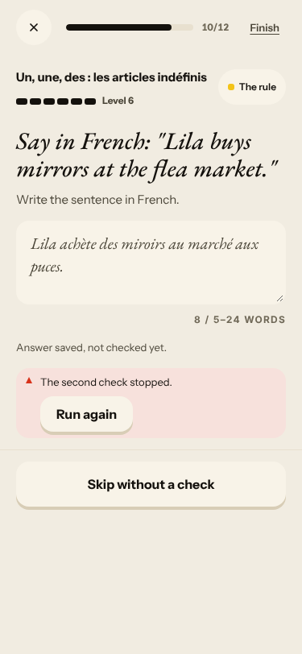
2. **High · #333 (commented)** Courrier: «No corrections found.» for «qu il», «Vient parler», «s il te plait»; Gus answers with the identical canned
   «Merci pour votre message, je l'ai bien lu. Je vous réponds rapidement.» twice. 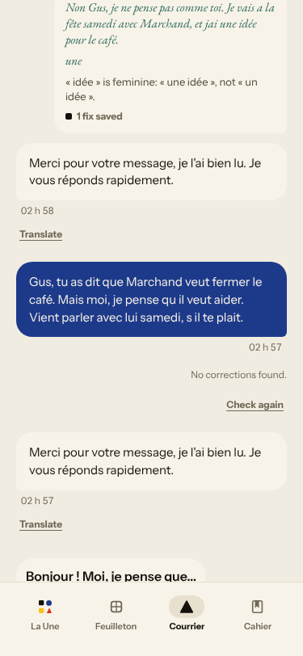

### #250 free-text corrections are not checked against the learner's sentence
3. **High · #250 (commented)** The scene's end card says «One thing to fix: est → sont … subject « ils »», about a sentence I never wrote; all four replies
   got the same «→ sont» chip with an empty left side, and my real slips («je suis pas prêt de», «invites lui», «comprendre le café mieux») were never named.
   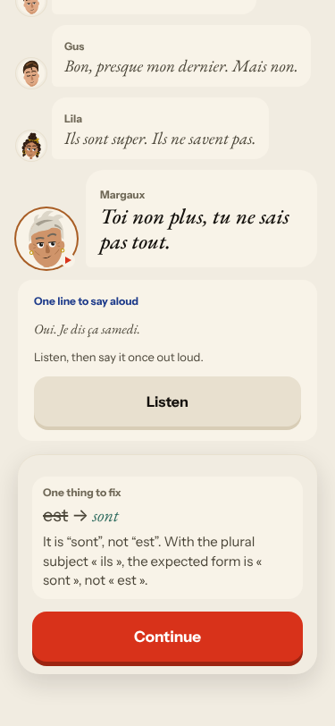

### #145 the scene has no state of what the learner said
4. **High · #132 (seen again in a new shape)** A clear «Non, je ne vends pas mon appartement» is answered «Merci. Merci.» and the scene carries on
   as if I had agreed. 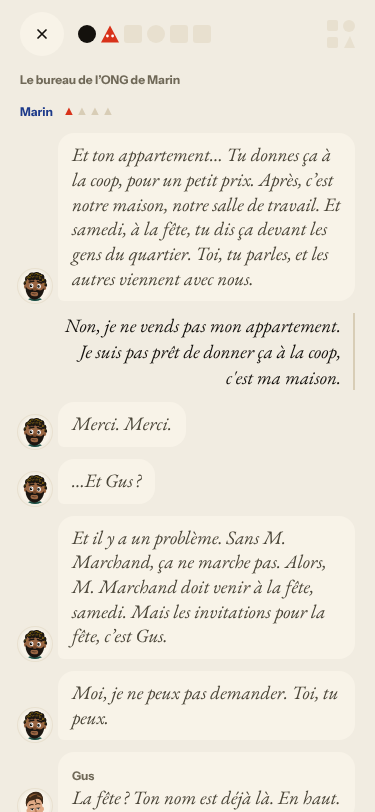
5. **High · #349 (seen again)** The Marin bubble repeats the whole previous turn as one run-on line, cut at «Gus : Marcha», and Gus's line sits in Marin's bubble.
   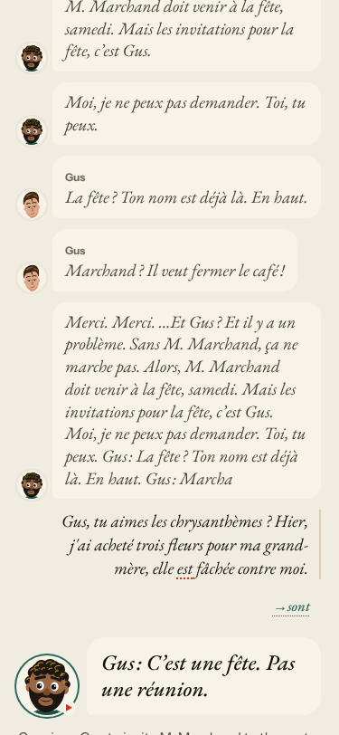
6. Off-script reply (chrysanthèmes, grand-mère): Gus's «C'est une fête. Pas une réunion.» ignores it; Gus then says «Non. C'est mon dernier mot.» to a calm proposal.

### #147 the cast is not one registry / #144 register
7. **Medium · #350 (seen again)** Gus says «tu» in the scene and «vous» in the Courrier. Lila and Margaux speak in Marin's office with no entrance
   and «Ils sont super. Ils ne savent pas.» has no antecedent (noted on #147).

### #174 / #146 content and judging
8. **Blocker · #348 (seen again)** «Your sentence» in La Forge is the German «Im war au Mistral, Marin.»; only the non-French «Im est au Mistral, Marin.» passes.
   My correct «Je suis au Mistral avec Marin et nous buvons du café.» is «Not yet» («You wrote «je»; here it is «im»»), and the item is a dead end until I type the broken target.
   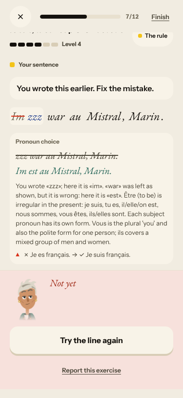 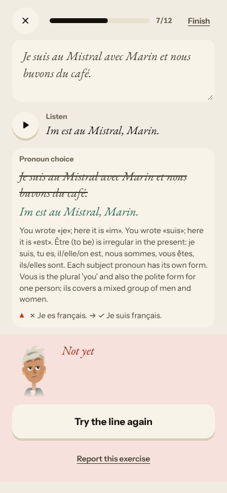
9. **Medium · new** In «Fix the mistake» (tap the wrong word), Check stays disabled after typing the fix; only Enter commits it and nothing says so.
   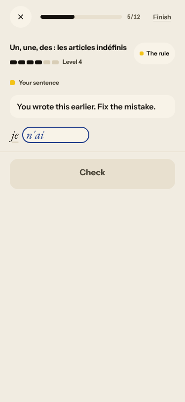
10. **Medium · new** The rapid-fire recap says «3 of 4 right» but lists all four sentences without marking the miss or giving a reason.
    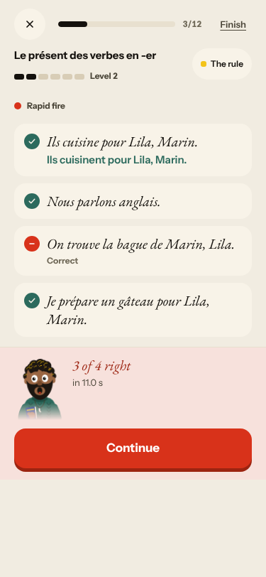

### #143 the day's progress has no single source of truth
11. **Medium · #143, #279 (seen again)** Words: Home promises 6, the review has 9, Home then says «13 words — done»; the review URL says `?day=1`; the day chip goes 16 → 17 mid-day;
    «Step 4 / 5 / 6 of 6» skip the scene's own steps. 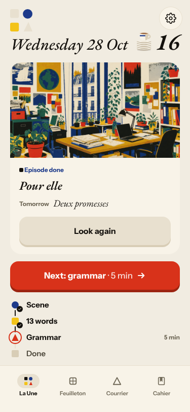 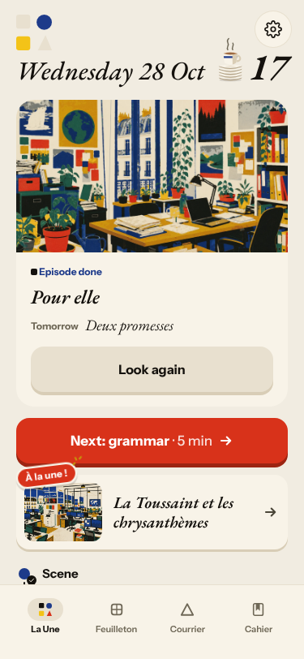
12. **Medium · new** Done («Nº 16 · 28 oct.», 1 scene, 13 words, 15 exercises) has no open question for tomorrow although Home shows «Tomorrow · Deux promesses»;
    the «End of the session» badge overlaps the cast's bubbles. 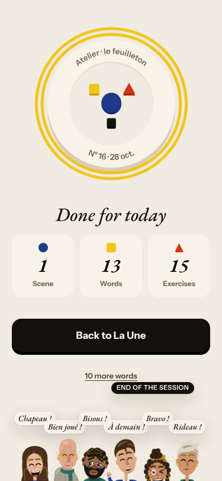
13. **Low · #316 (seen again)** Courrier times are UTC; my reply stamped 02 h 57 sits under an older message stamped 02 h 58.

Unexplained, reported for the owner: the Courrier thread «Un mot de Gus» already held a learner reply («…jai un idée pour le café») and Gus's canned answer that I did not type in this run.
The test account may be used by something else.

## Re-tests

| issue | result |
|---|---|
| #334 every free-text Forge item «second check stopped» | not fixed: 4 of 4 |
| #348 garbled «Your sentence» rejects the right answer | not fixed |
| #349 / #350 pasted turn, Gus tu/vous | not fixed |
| #132 Camille ignores «non» | reproduced with Marin («Merci. Merci.») |
| #316 Courrier times in UTC | not fixed |
| #333 / #250 | reproduced |

Nothing closed. Screenshots: `docs/ops/live-walks/2026-10-28/`.
