# Live walk · 29 Oct 2026 · production, real model

Run by the scheduled cloud routine (`explore:live` from main `30032065`, Chromium at phone size) against `atelier-api-3njh.onrender.com`
with the walk test account. Account: **A1.1, day 17** (Home chip 17, «Nº 16 · La clé d'Odile», this week «we consolidate»).
Played: scene «Lila écrit les cartes» (guess, listen, 2 free replies: one off-script with deliberate mistakes, one clear «non»), 8 recall drills
(one miss on purpose), 18 word cards, La Forge 13/13 (free text, find-the-mistake, tiles, type-it, one miss in each of five kinds), Done,
Courrier (one reply), Cahier (Rules, Words, Journal, Progress). Not played: Feuilleton, the Journal's own entry.
Q19 is n/a (cloud). Previous live report: [28 Oct](https://github.com/Pechst1/ConversationalLanguageLearning/blob/claude/live-walk-2026-10-28/docs/ops/live-walks/2026-10-28.md) (branch, not on main).

## Scores

| # | question | live 29 Oct | live 28 Oct | trend |
|---|---|---|---|---|
| 1 | Where am I | 3 | 3 | = |
| 2 | What is at stake | 3 | 3 | = |
| 3 | What to do next | 3 | 3 | = |
| 4 | Scene reacts to my writing | 4 | 2 | ↑↑ |
| 5 | Story coherent | 3 | 2 | ↑ |
| 6 | Characters consistent | 2 | 2 | = |
| 7 | Image, text, tone fit | 4 | 4 | = |
| 8 | Difficulty fits | 4 | 4 | = |
| 9 | Feedback explained | 3 | 1 | ↑↑ |
| 10 | Right answers accepted | 2 | 1 | ↑ |
| 11 | French correct | 3 | 3 | = |
| 12 | Clear goal today | 3 | 3 | = |
| 13 | Grammar practised | 4 | 3 | ↑ |
| 14 | Earlier material returns | 3 | 3 | = |
| 15 | I produce French | 4 | 3 | ↑ |
| 16 | Errors, dead ends | 2 | 1 | ↑ |
| 17 | Varied, fun | 4 | 4 | = |
| 18 | Fast enough | 3 | 3 | = |
| 19 | App only | n/a | n/a | |
| 20 | Satisfying end | 2 | 2 | = |
| 21 | Would come back | 3 | 3 | = |
| 22 | Time vs promise | 3 | 3 | = |

Best night so far on Q4, Q9 and Q16. Scene replies, La Forge corrections and the Courrier correction were mostly specific to my own sentences:
the elision, plural and gender slips in La Forge were all named correctly; Lila answered a clear «non» («D'accord, pas ton nom. Le nom de ta grand-mère, c'est plus doux.»)
and the closing panel kept my grandmother's name. **#334 did not reproduce: 0 of 7 free-text items ended «second check stopped»** (4 of 4 last night).
Every 1 or 2 has a finding below.

## Findings, by root cause

### #250 free-text corrections are not checked against the learner's sentence
1. **High · #250 (again)** First scene reply «Ecris: mon chat est tres grand. Lila, tu a un chat aussi ?» gets the chip «→ sont», explained as
   «With the plural subject « ils », the expected form is « sont », not « est »»: there is no «ils» in my sentence, «mon chat est» is singular and right.
   The real slips («Ecris:», «tres», «tu a») are not named. 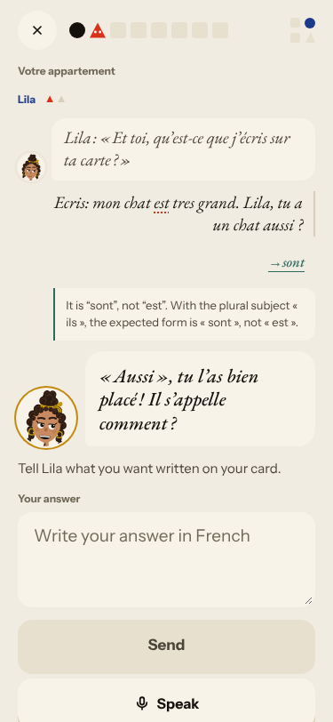
2. **Medium · new (#369)** Courrier correction explains «aujourdhui → aujourd'hui» as «an apostrophe and an accent on «hui»»; «hui» has no accent.
   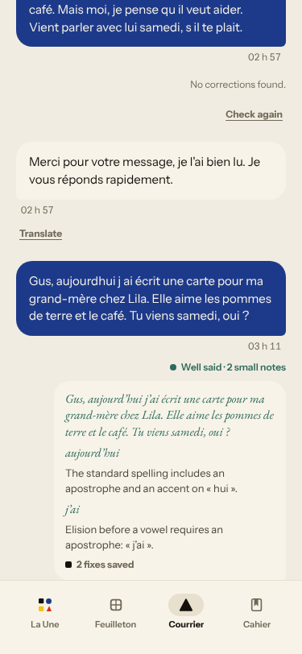

### #145 the scene has no state of what the learner said
3. **Positive · #132 (not reproduced)** «Non, je ne veux pas ecrire mon nom…» was heard and used: Lila agreed and the last panel names my grandmother.
   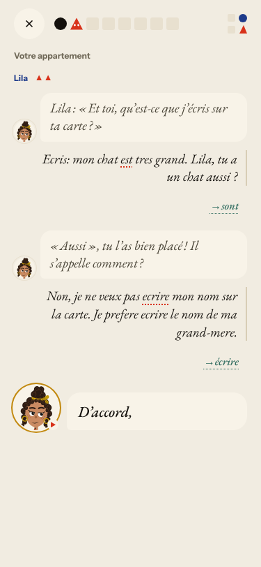 The off-script question «Lila, tu a un chat aussi ?» was not answered («Il s'appelle comment ?» about my cat), no state of «Lila's own cat».
4. **Medium · #277 / #276 (again)** The guess step asks «How does it end?» for a scene that ends on Lila's open question; the result is «The scene does not settle it either way, so neither guess is wrong.»
   «Read the scene» did nothing on first press; «Check my guess» stays disabled until the 50 s audio ends.

### #147 the cast is not one registry / #144 register
5. **Medium · #265 (again)** In La Forge Lila says «j'ai récemment commencé à peindre des petits tableaux pour ma classe» (painter and teacher; she writes cards at a wall of photos) and invents «la fête de ce soir», «le jardin».
6. **Medium · #350 / #267 (again)** Gus says «Et vous, qu'en pensez-vous ?» and «votre grand-mère» in the Courrier after tu in the scene; La Forge prompt «Votre ami vous écrit : « Combien coûte le sandwich ? »» sits under a **tu** badge.
   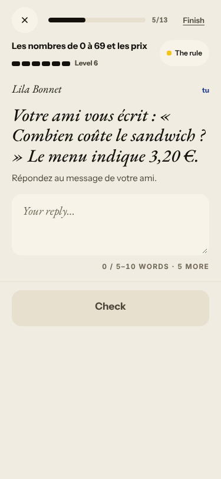

### #174 / #146 content and judging
7. **High · #348 (again, dead end)** «Your sentence · You wrote this earlier» is «Im war au Mistral, Marin.» (I never wrote it). My fix «suis» is rejected («here it is « est »»), the retry greys out «Im», only «Im est» passes.
   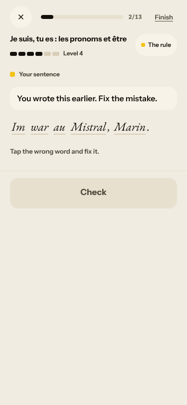 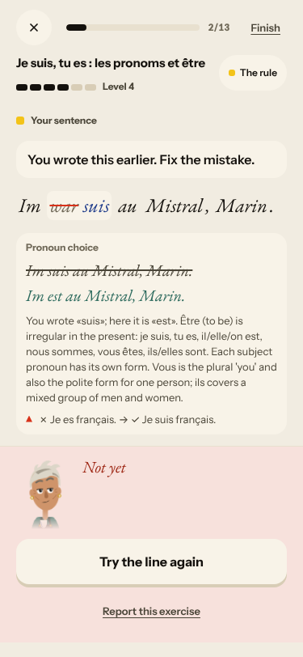
8. **Medium · #357 (again)** After typing the fix, Check stays disabled; Enter commits. 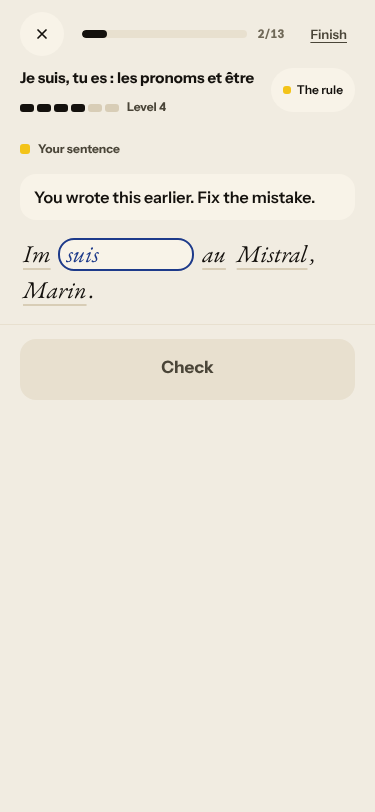

### #143 the day's progress has no single source of truth
9. **High · #279 / #143 (again)** Home promises «16 words»; the scene's last card says «Next: 18 words»; Home afterwards says «24 words — done»; Done says «24 Words»; Courrier asks «1/3 words used»; the review runs on `?day=1`;
   the scene's steps read «Step 7 of 8» at 4/7, then «Step 8 of 8» for five more screens. 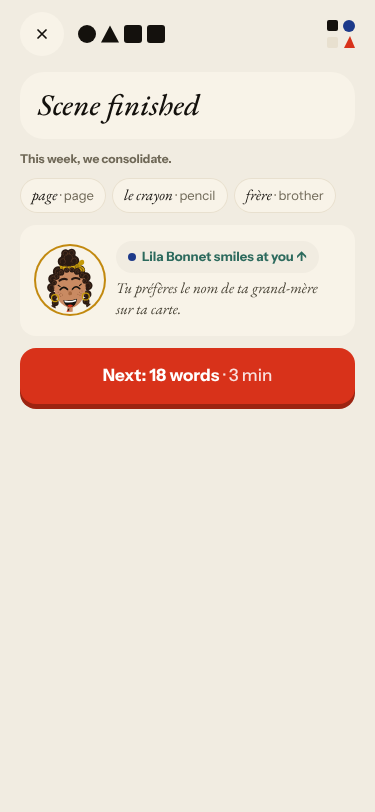
10. **High · #281 (again)** A «Not yet» on the numbers item (started at Level 5) shows Level 6 beside the miss. 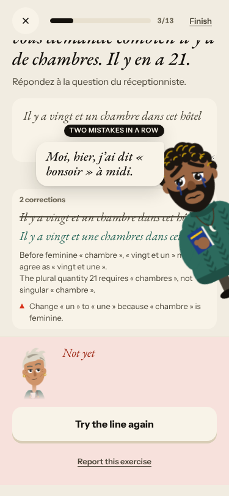
11. **Medium · new (#370)** The forged-rules sheet shows «J'ai acheté des pommes» as my kept line (I wrote «des pommes de terre») beside a red triangle, and the level bars read Level 6 for every rule. 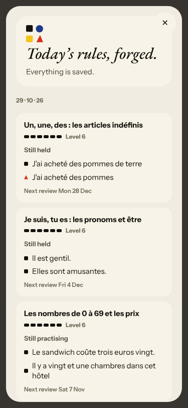
12. **Medium · #359 (again)** Done («Nº 16 · 29 oct.», 1 scene, 24 words, 17 exercises) ends with counts and no open question, although the last panel set one («Toi, tu me caches quelque chose…», Home «Tomorrow · Une carte bleue reste sous…»). 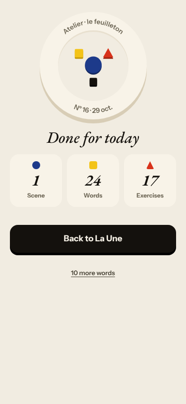
13. **Low · #316 (again)** The Courrier reply stamped «03 h 11» was sent at 04:11 Berlin; the thread still holds last night's two replies and Gus's identical canned «Merci pour votre message…» (02 h 57/58), so «New letter» offers nothing new.

## Re-tests

| issue | result |
|---|---|
| #334 free-text La Forge «second check stopped» | **not reproduced**, 0 of 7; left open one more night |
| #132 Camille/Lila ignore «non» | not reproduced: the «non» was used |
| #348 garbled «Your sentence» | not fixed |
| #357, #359, #279/#143, #281, #350, #267, #265, #276, #277, #316, #250 | reproduced |
| #333 «No corrections found» in the Courrier | not reproduced: two real fixes saved |

Nothing closed. Screenshots: `docs/ops/live-walks/2026-10-29/`.
