# Live walk · 30 Oct 2026 · production, real model

Run by the scheduled cloud routine (`explore:live` from main, Chromium at phone size) against `atelier-api-3njh.onrender.com` with the walk test account.
Account: **A1.1, day 18** (Home chip 18, «Nº 17 · La clé d'Odile», this week «we consolidate»; Home chip 19 after Done).
Played: pre-scene drills (build the sentence, two rules, a word), the scene «Lila écoute ton appel» (4 panels, one free reply), 4 recall drills plus 2 repeats (one miss on purpose),
7 word cards (one «Again», one typed), La Forge 15/15 (free text ×5, tiles ×2, type-it ×3, judgement, rapid fire, find-the-mistake ×2, choice; misses on purpose in four kinds), Done,
Courrier (one reply with a clear «non» and an off-script remark), Cahier (Rules, Words, Journal, Progress). Not played: Feuilleton, the Journal's own entry.
Q19 is n/a (cloud). Previous live report: [29 Oct](https://github.com/Pechst1/ConversationalLanguageLearning/blob/claude/live-walk-2026-10-29/docs/ops/live-walks/2026-10-29.md) (branch, not on main).
The harness needed `npm ci` first (`three` was missing from `node_modules`); nothing else changed.

## Scores

| # | question | live 30 Oct | live 29 Oct | trend |
|---|---|---|---|---|
| 1 | Where am I | 3 | 3 | = |
| 2 | What is at stake | 3 | 3 | = |
| 3 | What to do next | 3 | 3 | = |
| 4 | Scene reacts to my writing | 2 | 4 | ↓↓ |
| 5 | Story coherent | 2 | 3 | ↓ |
| 6 | Characters consistent | 2 | 2 | = |
| 7 | Image, text, tone fit | 4 | 4 | = |
| 8 | Difficulty fits | 4 | 4 | = |
| 9 | Feedback explained | 2 | 3 | ↓ |
| 10 | Right answers accepted | 2 | 2 | = |
| 11 | French correct | 3 | 3 | = |
| 12 | Clear goal today | 2 | 3 | ↓ |
| 13 | Grammar practised | 4 | 4 | = |
| 14 | Earlier material returns | 3 | 3 | = |
| 15 | I produce French | 4 | 4 | = |
| 16 | Errors, dead ends | 3 | 2 | ↑ |
| 17 | Varied, fun | 4 | 4 | = |
| 18 | Fast enough | 3 | 3 | = |
| 19 | App only | n/a | n/a | |
| 20 | Satisfying end | 2 | 2 | = |
| 21 | Would come back | 3 | 3 | = |
| 22 | Time vs promise | 2 | 3 | ↓ |

A worse night than 29 Oct on the story side, a better one on the drills. The scene took **one** reply and closed, so the «non» and off-script tests could not run in the scene;
they ran in the Courrier, where Gus heard the «non» and answered it. La Forge's own corrections were accurate on all five free-text items (#334 did not reproduce: 0 of 5 «second check stopped»),
and the Courrier's three fixes were right. The scene's correction was wrong on a right word. Q9 is the worst screen (the scene), Q22 is 2 because the day promised 10 min + 2 min + 5 min and
La Forge ran 15 items. Every 1 or 2 has a finding below.

## Findings, by root cause

### #145 the scene has no state of what the learner said and what is established
1. **High · new #378** The scene allows one reply. After «Je veux retourner le deux decembre, parce que je suis fatigue de Berlin. Mais j ai peur de le restaurant.» Lila says «Deux, oui, je le note dans ma tête. Et ce restaurant te fait peur ?» and the scene closes («Lila doit partir», 7 of 7). Her question cannot be answered. The hook is «Tu n'as pas oublié ? « Je serai chez moi après quatorze heures. »», a quoted line nobody said, and it reappears on Home as «Tomorrow». The three panel questions (group buying, a photo at the café, then the return date) are unrelated. 
2. **Medium · new #379** «One line to say aloud» is «Je rentre le 19 décembre, parce que je reste pour la fête.»: my date and reason replaced. 
3. **Positive** Lila did use my words («Deux», «restaurant»), which is more than a script would. The Courrier heard a clear «Non, je ne veux pas parler à Lila. Elle ne parle pas, tu te souviens ?»: Gus: «Je comprends que Lila ne soit pas facile à aborder…», then offered another way (#132 left open; the scene could not be tested). The off-script remark about my cat was ignored. 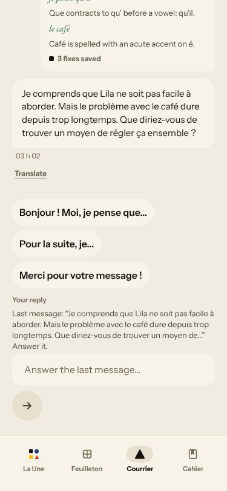

### #250 free-text corrections are not checked against the learner's sentence
4. **High · #93 / #250 (again)** The scene's chip «suis → est» («this subject requires «est»») marks a correct «je suis» wrong; «decembre», «fatigue», «j ai», «de le restaurant» are not named. The Courrier and La Forge were accurate tonight. 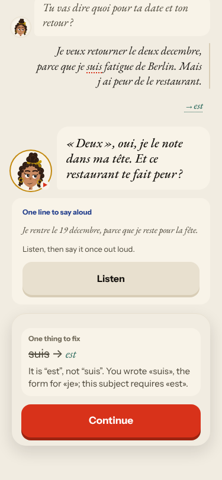

### #174 a right answer is judged against one stored string / #146 content
5. **High · new #380** «We prefer Le Mistral, Lila.» rejects a correct «Nous préférons» (the item wants «On préfère»; the hint is the generic -er rule). «They look for the post office» rejects «le bureau de poste» (wants «la poste»). 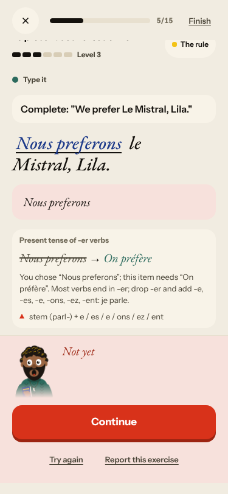 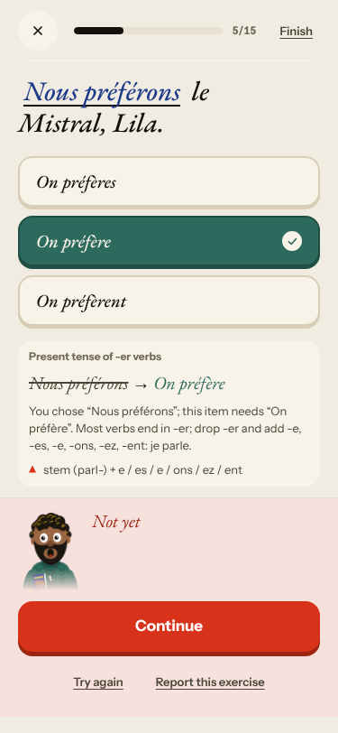 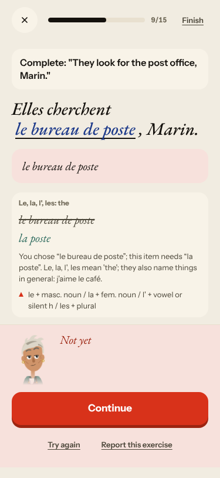
6. **Medium · #146 (again)** The scene pre-taught «Il y a» and «On = we», used neither, and La Forge practised four other rules; Q12 is 2. The first recall drill is listen-only (**#167 again**): no French on the screen. 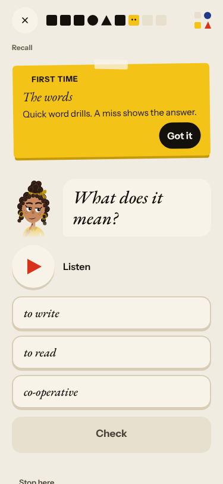
7. **High · #348 (new shape)** «Your sentence · You wrote this earlier» is «Ils cherchent le bague, Gus.», which I never wrote. 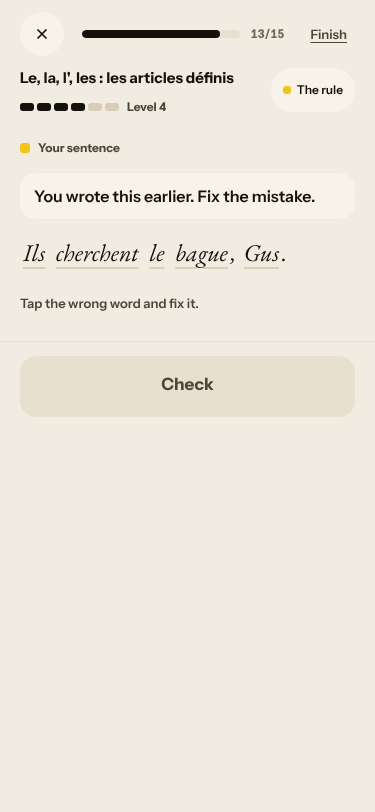

### #143 the day's progress has no single source of truth
8. **Medium · new #381** After the repair is accepted: «Line fixed» above a red «Not yet» banner; the right word «une tomate» is red too. 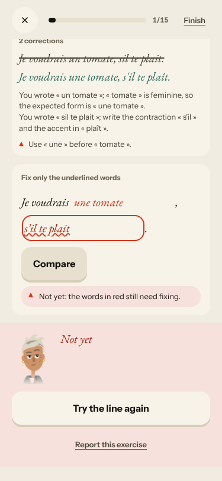 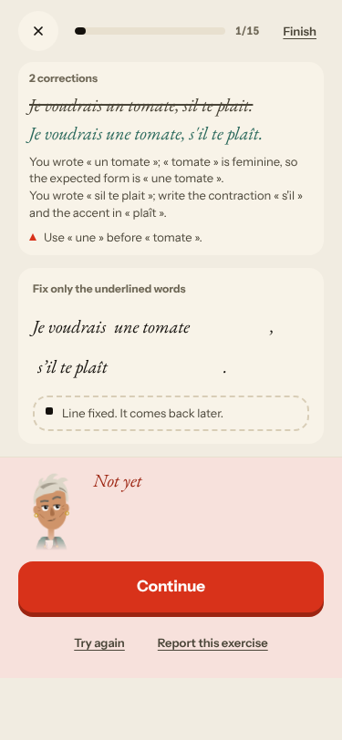
9. **Medium · new #382** Home shows a «Choose» card (Monter sur le toit / Répéter avec Gus et Marin / Goûter les canapés de Marin) that follows from nothing in the scene and stays all day. 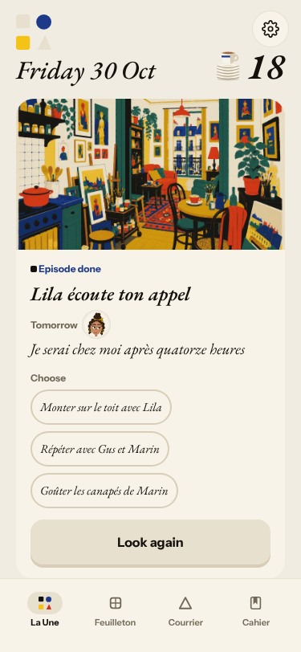
10. **High · #279 (again)** 7 words promised, 12 done, «10 more words» on Done; `?day=1` on the review; «Step 9 of 9» on five screens. 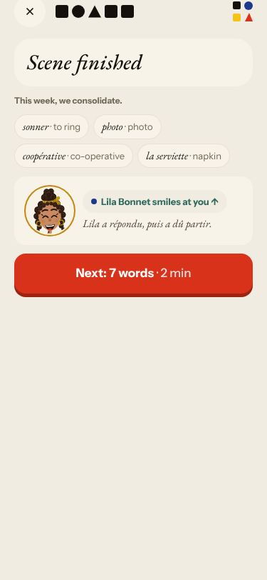
11. **High · #281 (again)** «Level 6» beside a miss (item 14); a miss at Level 3 stayed at 3. 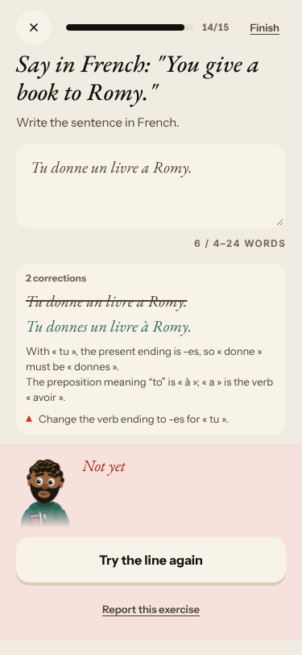
12. **Medium · #370 / #359 (again)** The forged-rules sheet shows «s'il vous plaît» as my kept line and Level 6 for every rule; Done has counts and no hook. 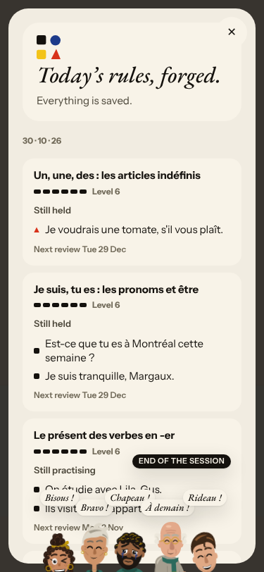 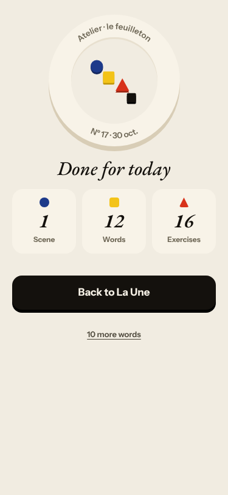
13. **Medium · #357 (again)** Check stays disabled after typing a fix. 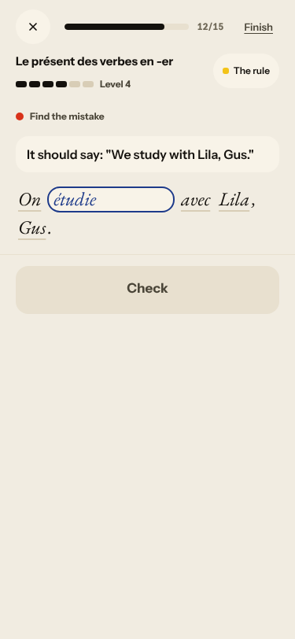

### #144 register / #147 cast
14. **Medium · #350 / #265 (again)** Gus «Et vous, qu'en pensez-vous ?» and vous all through the Courrier; Lila «préparer mes cours pour mes petits élèves»; La Forge sentences with «Romy», «Margaux», «Elles cherchent le clé, Marin.».
15. **Low · #316 (again)** The Courrier stamps «03 h 02» for 04:02 Berlin and opens last night's mission again. 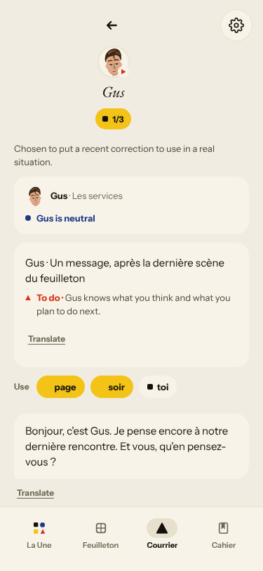

No new root-cause issue: every new finding fits #145, #174 or #143.

## Re-tests

| issue | result |
|---|---|
| #334 free-text La Forge «second check stopped» | **not reproduced**, 0 of 5 (second night); left open |
| #333 «No corrections found» in the Courrier | not reproduced: three real fixes saved |
| #132 ignores «non» | scene not testable (#378); Courrier heard it; left open |
| #358 rapid-fire recap | partly improved (the miss is marked), no reason given; left open |
| #93, #250, #167, #279, #281, #348, #357, #359, #370, #350, #265, #316, #146, #174 | reproduced |

Nothing closed. Existing issues keep their `queue:pr` labels (a PR is already open for them); the five new issues are `queue:ready` with a **Done when:** comment each.
Screenshots: `docs/ops/live-walks/2026-10-30/`.
