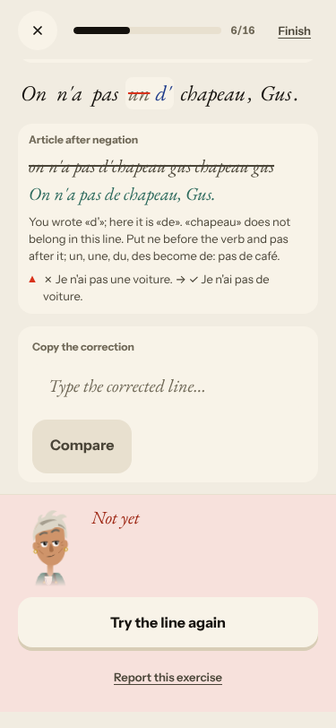
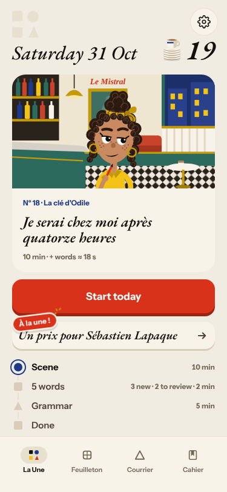
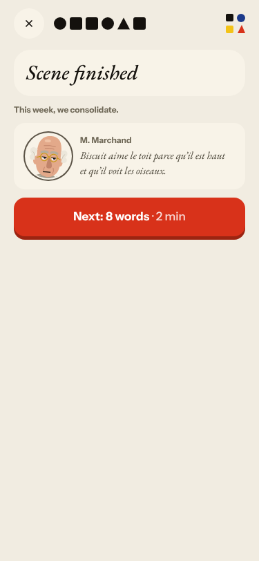
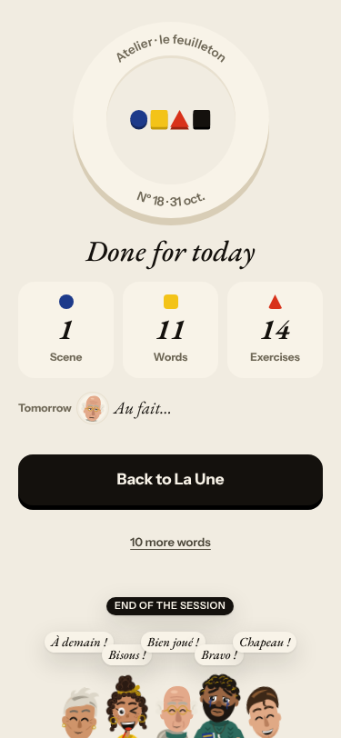
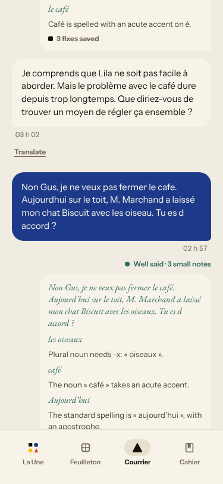
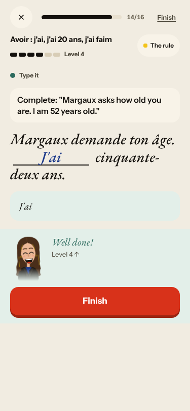
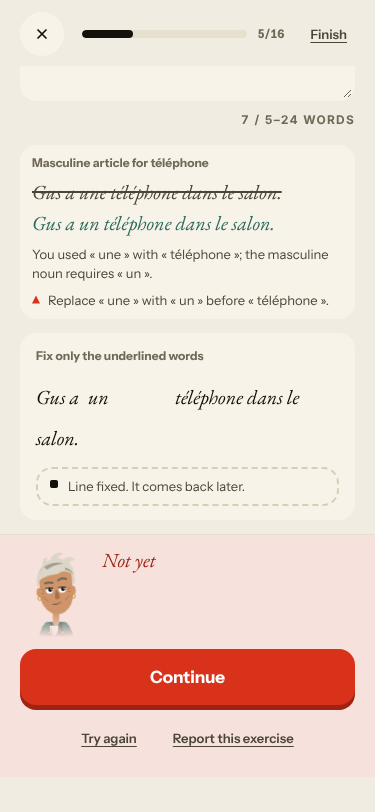
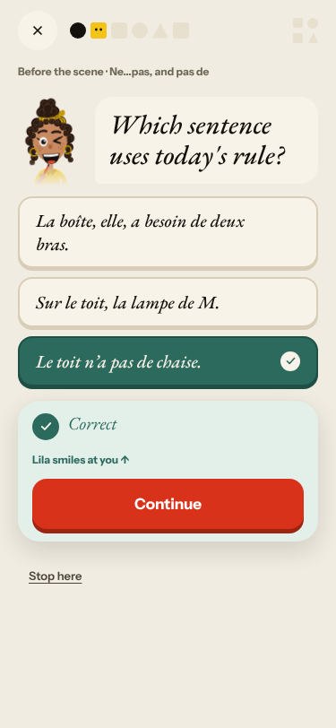
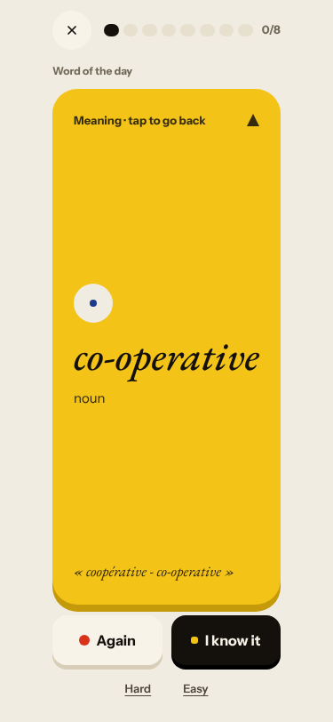
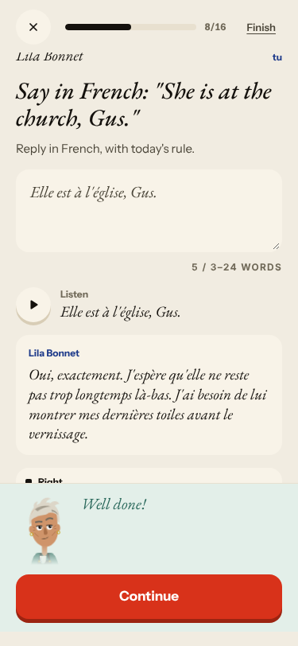

# Live walk · 31 Oct 2026 · production, real model

Run by the scheduled cloud routine (`explore:live` from main, Chromium at phone size) against `atelier-api-3njh.onrender.com` with the walk test account.
Account: **A1.1, day 19** (Home chip 19, «Nº 18 · La clé d'Odile», this week «we consolidate»; chip 20 after the words step).
Played: pre-scene rule card and two drills (today's rule «Ne…pas, and pas de»), the scene «Lila et le toit» (4 panels, **three** free replies, a closing panel written from them), 8 word cards (one «Again»),
La Forge 14 of «16» (free text ×6, tiles ×2, type-it ×2, find-the-mistake ×2, reply ×2, rapid fire, choice; misses on purpose: «je suis trente-sept ans», «vous avons», «une téléphone», «d'» for «de», «du riz», missing circumflex), Done,
Courrier (one reply with a clear «non» and the day's roof/cat), Cahier (Rules, Words, Journal, Progress). Not played: Feuilleton, the Journal's own entry, the «Take the test» after La Forge.
Q19 is n/a (cloud). Previous live report: [30 Oct](https://github.com/Pechst1/ConversationalLanguageLearning/blob/claude/live-walk-2026-10-30/docs/ops/live-walks/2026-10-30.md) (branch, not on main).
Setup: `npm ci` first; `WALK_CHROMIUM=/opt/pw-browsers/chromium`. Whole day took about 11 minutes of wall-clock at walk speed.

## Scores

| # | question | live 31 Oct | live 30 Oct | trend |
|---|---|---|---|---|
| 1 | Where am I | 3 | 3 | = |
| 2 | What is at stake | 3 | 3 | = |
| 3 | What to do next | 3 | 3 | = |
| 4 | Scene reacts to my writing | 4 | 2 | ↑↑ |
| 5 | Story coherent | 3 | 2 | ↑ |
| 6 | Characters consistent | 2 | 2 | = |
| 7 | Image, text, tone fit | 4 | 4 | = |
| 8 | Difficulty fits | 4 | 4 | = |
| 9 | Feedback explained | 3 | 2 | ↑ |
| 10 | Right answers accepted | 4 | 2 | ↑↑ |
| 11 | French correct | 3 | 3 | = |
| 12 | Clear goal today | 4 | 2 | ↑↑ |
| 13 | Grammar practised | 4 | 4 | = |
| 14 | Earlier material returns | 4 | 3 | ↑ |
| 15 | I produce French | 5 | 4 | ↑ |
| 16 | Errors, dead ends | 3 | 3 | = |
| 17 | Varied, fun | 4 | 4 | = |
| 18 | Fast enough | 3 | 3 | = |
| 19 | App only | n/a | n/a | |
| 20 | Satisfying end | 2 | 2 | = |
| 21 | Would come back | 3 | 3 | = |
| 22 | Time vs promise | 3 | 2 | ↑ |

The best night on the story side since the walk began. The scene took three exchanges, Marchand took the «non» and the invented cat Biscuit on board, and the closing panel and the scene summary used my words.
Every free-text correction in the scene and La Forge was right (nous laissez → laisser, que il → qu'il, une téléphone → un, plait → plaît, du riz → de riz), «Nous ne buvons pas d'eau» and «Elles cherchent…» were accepted as variants.
The scene generation took about 20 s (Q18 stays 3). The day still ends flat (Q20): «Tomorrow · Au fait…» with no question, and counts that disagree. Q6 is 2 for Lila's job changing; Q20 is 2 for the hook and the numbers.

## Findings, by root cause

### #250 free-text corrections are not checked against the learner's sentence
1. **High · new #395** «Find the mistake» miss sheet: the struck-through «you wrote» line is «on n'a pas d'chapeau gus chapeau gus», and the text says «chapeau does not belong in this line». 

### #143 the day's progress has no single source of truth
2. **Medium · new #396 (after #279 closed on 30 Oct)** Words: Home «5», button «8», Home after «10», Done «11»; day chip 19 → 20 before the grammar step is done; panels «5/5» become «9/9».   
3. **Medium · new #397 (#316 again)** The Courrier reopens an old thread, with UTC stamps in no order, and «No corrections found» on «Vient parler avec lui samedi, s il te plait.» (child of #333). Gus replied in «vous». 
4. **Medium · #169 (again)** La Forge counter says «of 16», ends at 14 with a «Finish» button. 
5. **Medium · #382 (again)** The «Choose» card on Home has nothing to do with the roof scene.
6. **Low · #381 (again)** «Line fixed» above a red «Not yet». 

### #146 concept-driven content and feedback
7. **Low · new #398** Distractor «Sur le toit, la lampe de M.»; word cards with «« lampe - lamp »» as the example.  
8. **Positive** Today's rule «Ne…pas et pas de» was taught, drilled before the scene and forged; rules from earlier days (être, articles, avoir) returned in La Forge; the Journal asked about «la semaine dernière» (Q14). The scene's own task used none of the rule.

### #147 cast registry / #144 register
9. **Medium · #147 (comment)** Lila is a painter in a La Forge reply item («mes dernières toiles avant le vernissage»); earlier walks had her teach. 
10. **Medium · #350 / #265 (again)** Gus in the Courrier: «Que pouvons-nous faire…», vous. La Forge: «tu» to Margaux the waiter, «Vous avons» as a rapid-fire sentence.

New root cause: none; every new finding fits #250, #143, #146 or #333.

## Re-tests

| issue | result |
|---|---|
| #378 scene allows one reply | **not reproduced**: three exchanges and a closing panel built from the replies; left open (one night) |
| #132 ignores «non» | not reproduced in the scene or the Courrier; left open |
| #334 / #333 «No corrections found» | reproduced once (#397) |
| #279 words promise (closed 30 Oct) | still 5 / 8 / 10 / 11 on production (#396); the fix may not be deployed |
| #316 UTC stamps (closed) | stamps still UTC (#397) |
| #167 listen-only first drill | not seen tonight (first recall drills were not played) |
| #250, #381, #382, #169, #147, #143, #146, #333 | commented |

Nothing closed. The four new issues (#395, #396, #397, #398) are `queue:ready` with a **Done when:** comment each.
Screenshots: `docs/ops/live-walks/2026-10-31/`.
