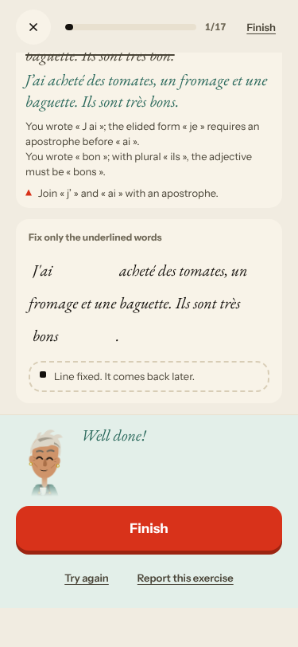
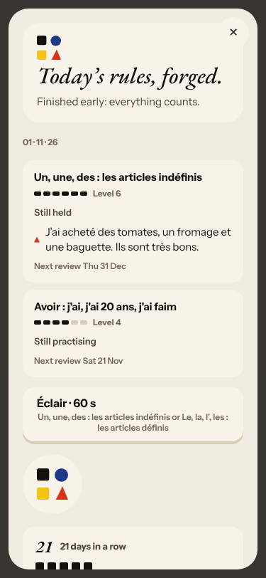
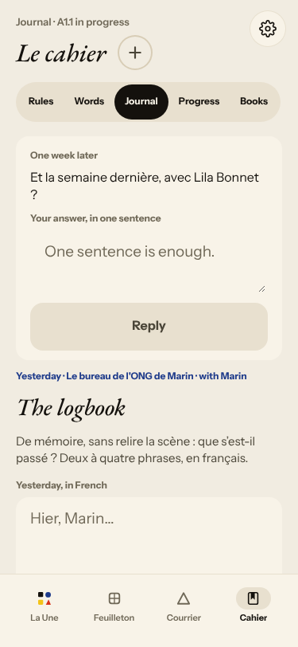
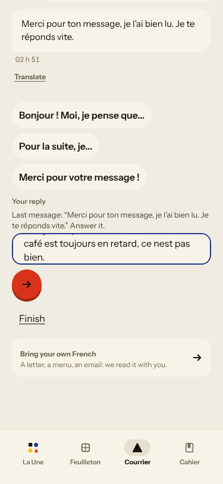
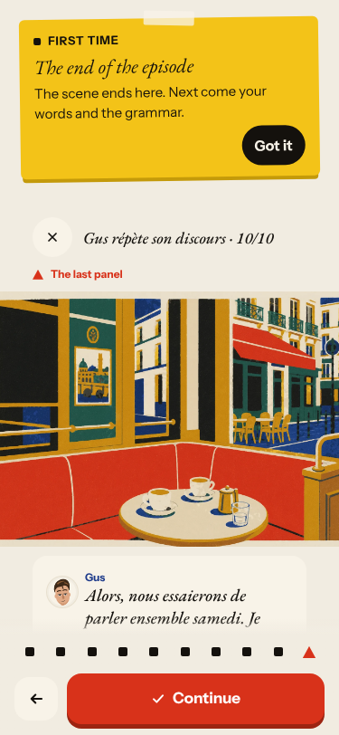
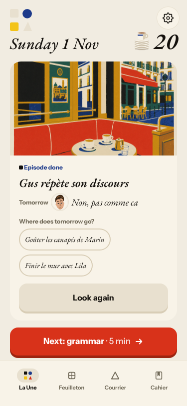
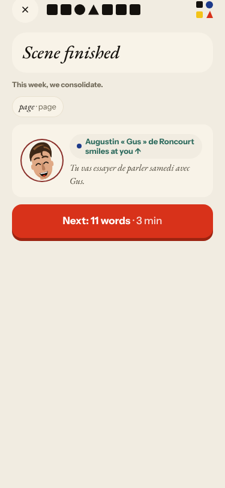
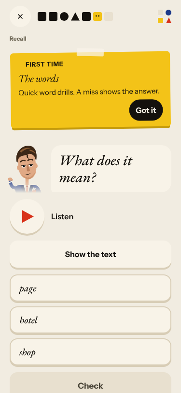

# Live walk · 1 Nov 2026 · production, real model

Run by the scheduled cloud routine (`explore:live` from main, Chromium at phone size) against `atelier-api-3njh.onrender.com` with the walk test account.
Account: **A1.1, day 20 → 21** (Home chip 20, «Nº 19 · La clé d'Odile» on the Home header, scene «Gus répète son discours»; chip 21 after La Forge).
Played: pre-scene rule step (1 «correct this sentence» drill, 1 masculine/feminine), the scene (4 panels, **four** free replies: a mistake «Je suis peur un peu», a clear «Non, finalement je ne parle pas samedi…», an off-script question about Odile's key, a «Non, pas comme ca» answer), the closing panel, 3 recall drills (one miss on purpose: «canapé» feminine), 11 word cards (Again / Hard / Easy mixed), La Forge **1 of 17** (see #443), Done, Courrier (a reply with a mistake), Cahier (Rules, Words, Journal with an entry, Progress glanced), Feuilleton.
Q19 is n/a (cloud). Previous live report: [31 Oct](2026-10-31.md).
Setup: `npm ci` was already done; `WALK_CHROMIUM` not needed (Playwright found `/opt/pw-browsers/chromium`). The first-run «FIRST TIME» tips show on every screen: each walk is a fresh browser, so not a finding.

## Scores

| # | question | live 1 Nov | live 31 Oct | trend |
|---|---|---|---|---|
| 1 | Where am I | 3 | 3 | = |
| 2 | What is at stake | 3 | 3 | = |
| 3 | What to do next | 2 | 3 | ↓ |
| 4 | Scene reacts to my writing | 3 | 4 | ↓ |
| 5 | Story coherent | 3 | 3 | = |
| 6 | Characters consistent | 2 | 2 | = |
| 7 | Image, text, tone fit | 4 | 4 | = |
| 8 | Difficulty fits | 3 | 4 | ↓ |
| 9 | Feedback explained | 4 | 3 | ↑ |
| 10 | Right answers accepted | 4 | 4 | = |
| 11 | French correct | 4 | 3 | ↑ |
| 12 | Clear goal today | 3 | 4 | ↓ |
| 13 | Grammar practised | 2 | 4 | ↓↓ |
| 14 | Earlier material returns | 3 | 4 | ↓ |
| 15 | I produce French | 5 | 5 | = |
| 16 | Errors, dead ends | 3 | 3 | = |
| 17 | Varied, fun | 4 | 4 | = |
| 18 | Fast enough | 3 | 3 | = |
| 19 | App only | n/a | n/a | |
| 20 | Satisfying end | 3 | 2 | ↑ |
| 21 | Would come back | 3 | 3 | = |
| 22 | Time vs promise | 3 | 3 | = |

Q3 is 2 for La Forge after a repaired line (only «Finish»). Q4 is 5 in the scene and 2 in the Courrier (canned reply), 3 as the worst-screen compromise. Q13 is 2 because the day's rule «Avoir» was drilled twice before the scene and never forged: La Forge opened on «Un, une, des» and I could not go past item 1.

The scene is the strongest part again. Gus took the mistake («Je suis peur un peu» → «J'ai un peu peur», then «Qu'est-ce qui te fait un peu peur ?»), the clear «non» («Ah, je suis déçu, mais je comprends. Ton chat aime quoi à la maison ?») and the off-script question («La clé d'Odile ? Non, je ne sais pas.») each with a different line, and used my cat. Replies took about 7 s; the closing panel took 20–60 s («What happens next is being written…», 5 of 5 turned into 10 of 10). Every correction in La Forge and the Journal was right and explained. The day then ends with a hook that quotes my reply with its typo as a «promise» and a «Tomorrow» title cut from it.

## Findings, by root cause

### #143 the day's progress has no single source of truth
1. **Medium · new #443** La Forge opens on «Un, une, des» Level 6 (today's rule is Avoir), and after one repaired line the only button is «Finish», which ends the séance at 1 of 17; Done then says «1 Exercises».  
2. **Medium · new #444** The Journal asks about «Yesterday · Le bureau de l'ONG de Marin»; yesterday's episode was «Lila et le toit». 
3. **Medium · #397 (again)** The Courrier reopens the long «Un mot de Gus» thread with earlier nights' replies, time-of-day stamps with no date and out of order. 
4. **Low · #194 (again)** «Exchange 3 of 3» then a fourth reply is allowed; «5 of 5» becomes «10 of 10».

### #145 the scene has no state of what was established
5. **Medium · new #445** The hook quotes my uncorrected reply as a «promise», and «Tomorrow» shows the title «Non, pas comme ca».  
6. **Positive · #378 / #171 partly improved** The scene stays open for four replies and reacts to a mistake, a «non» and an off-script question. The «on se quitte comme ça ?» line shows up again after the off-script reply.

### #333 a failed or empty model call is shown as a result
7. **Medium · #333 / #397 (again)** Gus's Courrier reply to a good message is the stock «Merci pour ton message, je l'ai bien lu. Je te réponds vite.»; the letter closes «Promise kept».

### #250 free-text corrections are not checked against the learner's sentence
8. **Medium · #250 (again)** Scene reply 3 («cheminee», «ou», «cle d Odile») got no correction; reply 2 and 4 got one each.

### #146 concept-driven content and feedback
9. **Low · #398 (again in kind)** The scene-finished card lists one chip «page · page»; the day's 11 words come from the base list (#280). 
10. **Low · #167 (partly fixed)** The listen-only drill has «Show the text» now, but «page» with the options «hotel» and «shop» is a cognate and tests nothing. 

### #144 register (child #196)
11. **Medium · #196 (again)** La Forge: «Votre ami vous écrit… Répondez à votre ami…»; Courrier: Gus «Et vous, qu'en pensez-vous ?» and the chip «Merci pour votre message !» next to «Merci pour ton message» in the same thread.

## Re-tests

- #381: «Not yet» banner after «Line fixed» is gone (green «Well done!»); the second half («a correct word drawn in red») needs a line with one right and one wrong word. Left open (commented).
- #167: «Show the text» exists now; drill still trivial. Left open.
- #378: scene stays open for four replies; hook still wrong. Left open.
- #194: titles unique, header matches; counters still jump. Left open.
- #119 (elision never reaching the l' rule): the Cahier map shows «Le, la, l', les» still listed in Éclair pairs; not re-testable in one day.
- #114, #133, #93, #171 need a Courrier letter of the right kind or a second day; not reached today.
- Nothing was clearly fixed, so nothing was closed.

## Scripted walk

Not run (live walk only).
