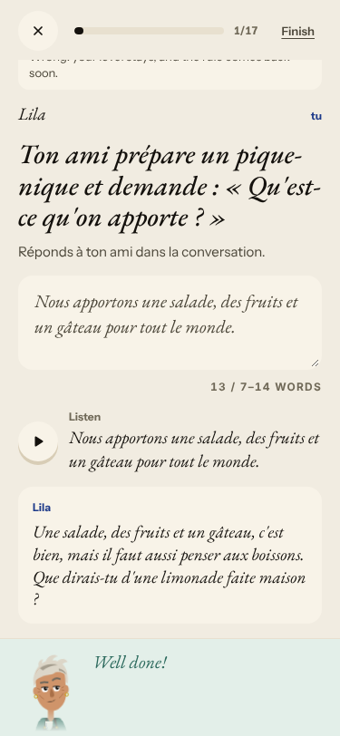
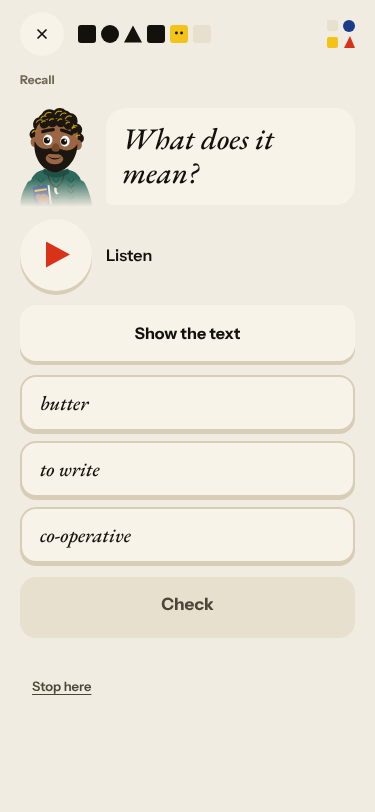
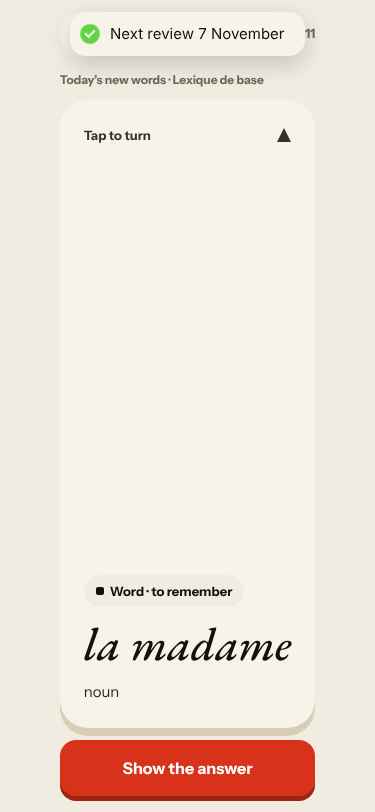
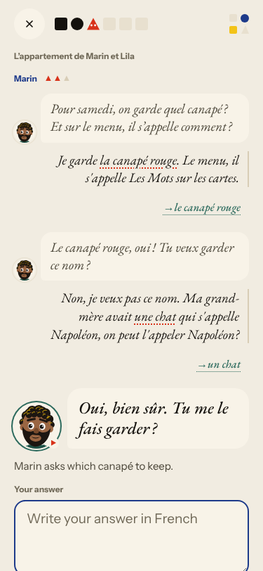
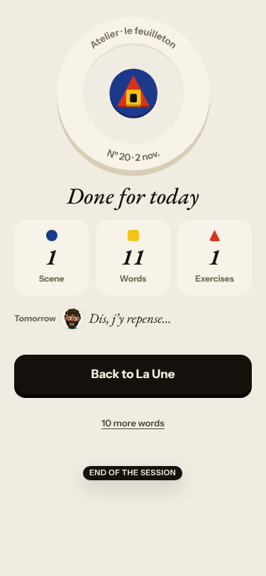
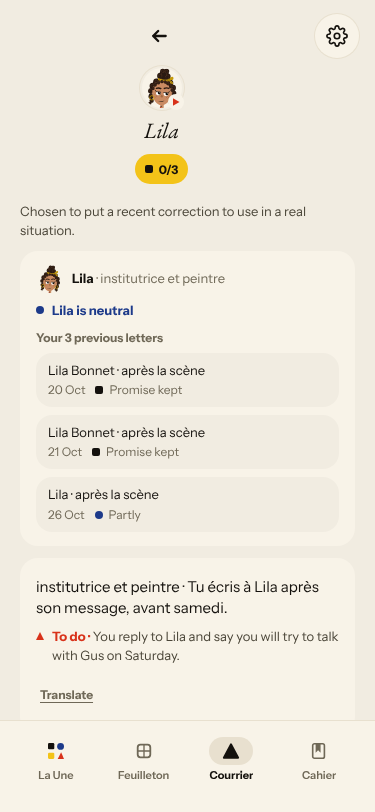
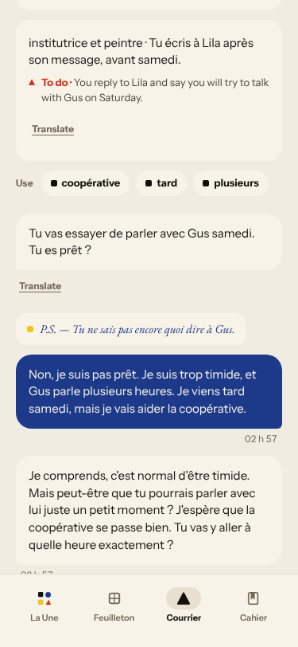

# Live walk · 2 Nov 2026 · production, real model

Run by the scheduled cloud routine (`explore:live` from main, Chromium at phone size) against `atelier-api-3njh.onrender.com` with the walk test account.
Account: **A1.1, day 21** (Home chip 21, «Nº 20 · La clé d'Odile», «On va goûter les canapés de Marin», this week «we consolidate»; chip 22 after a reload at the end).
Played: pre-scene rule card and one drill (today's rule «Ne…pas, and pas de»), the scene «L'appartement de Marin et Lila» (4 panels, **four** free replies, a closing panel written from them), two recall drills, La Forge (**one** item of «17»), 11 word cards (two «Again», one «Hard», two «Easy»), Done, Courrier (two replies, one with a clear «non»), Cahier (Rules, Journal opened; Words and Progress not opened).
Not played: Feuilleton, the Journal's own entry, the «Take the test» after La Forge. Q19 is n/a (cloud).
Previous live report: 31 Oct (on main; 1 Nov's live walk is on branch `claude/live-walk-2026-11-01`). Compared with 31 Oct below.
Setup: `npm ci`, then `npm run explore:live` without `WALK_CHROMIUM` (Playwright found its own build). Whole day about 14 minutes of wall-clock at walk speed. Scene replies came back within 25 s (not timed more precisely).

## Scores

| # | question | live 2 Nov | live 31 Oct | trend |
|---|---|---|---|---|
| 1 | Where am I | 3 | 3 | = |
| 2 | What is at stake | 3 | 3 | = |
| 3 | What to do next | 3 | 3 | = |
| 4 | Scene reacts to my writing | 4 | 4 | = |
| 5 | Story coherent | 3 | 3 | = |
| 6 | Characters consistent | 3 | 2 | ↑ |
| 7 | Image, text, tone fit | 4 | 4 | = |
| 8 | Difficulty fits | 4 | 4 | = |
| 9 | Feedback explained | 4 | 3 | ↑ |
| 10 | Right answers accepted | 4 | 4 | = |
| 11 | French correct | 3 | 3 | = |
| 12 | Clear goal today | 3 | 4 | ↓ |
| 13 | Grammar practised | 2 | 4 | ↓↓ |
| 14 | Earlier material returns | 4 | 4 | = |
| 15 | I produce French | 5 | 5 | = |
| 16 | Errors, dead ends | 3 | 3 | = |
| 17 | Varied, fun | 4 | 4 | = |
| 18 | Fast enough | 3 | 3 | = |
| 19 | App only | n/a | n/a | |
| 20 | Satisfying end | 2 | 2 | = |
| 21 | Would come back | 3 | 3 | = |
| 22 | Time vs promise | 3 | 3 | = |

The scene side holds: Marin took a clear «non» and an invented cat (Napoléon) on board, answered my side questions («tu as faim ?», «tu aimes les pâtes ?») and the closing panel was written from my words. Corrections were right («la canapé → le canapé», «une chat → un chat»).
The grammar side dropped: the day's rule («Ne…pas, and pas de») got one drill before the scene, and La Forge — the «5 min» grammar step — opened on a different rule («Un, une, des») and ended after **one** item with a counter promising 17 (Q13 2, Q12 3, Q3 3).
The day still ends flat (Q20 2): «Tomorrow · Dis, j'y repense…», no question. Q6 3: Lila is «institutrice et peintre» in the Courrier and was not contradicted tonight; Marin stayed Marin.

## Findings, by root cause

### #146 the day's content and feedback are not driven by one concept
1. **Medium · #443 (again, now sharper)** La Forge opens on «Un, une, des» (Level 6) instead of today's rule «Ne…pas / pas de», and after one correct free-text item the only button is «Finish»: «Finished early», Done counts «1 Exercises». 
2. **Low · #167 (again)** First recall drills are listen-only; the French word hides behind «Show the text». 
3. **Low · #398 (comment)** Word cards: «la madame» (not a dictionary form), «la chaussette» with the English «sock» as its example, no example on three others. 

### #145 the scene has no state of what the learner said and what is established
4. **Medium · new #467** Marin answers «on peut l'appeler Napoléon ?» with «Tu me le fais garder ?»; the exchange total grows «of 3» → «of 4»; the summary says «Napoléon donne son nom au canapé du menu». 
5. **Medium · new #466 (after #359 closed)** The Done screen and Home end on the fragment «Dis, j'y repense…», no open question. 

### #143 the day's progress has no single source of truth
6. **Medium · #443 / #143 (comment)** Forge counter «1/17» ends at 1; chip 21 → 22 after a reload; the end sheet says «22 days in a row». Word counts agreed tonight (11 / 11 / 11).

### #333 / #250 corrections and failed calls
7. **Medium · #397 (again)** The Courrier reopens the old thread «Parler samedi avec Gus» (letters of 20, 21, 26 Oct) and stamps are UTC (02 h 57 at 03:57 Berlin). No «No corrections found» tonight.  
8. **Not filed** The scene correction did not flag «une chat qui s'appelle Napoléon» tense (grand-mère «avait … qui s'appelle») or the dropped «ne» in «je veux pas»; for A1.1 both are acceptable to leave. «Promise kept» in the Courrier after a first «non» was fair, since the second reply said «je vais essayer».

New root cause: none; every finding fits #146, #145, #143 or #333.

## Re-tests

| issue | result |
|---|---|
| #378 scene allows one reply | **not reproduced** (second night in a row): four exchanges and a closing panel from the replies; left open (see #467) |
| #132 ignores «non» | not reproduced in the scene or the Courrier; left open |
| #334 / #333 «No corrections found» | not seen tonight |
| #279 / #396 words promise | Home 11, button 11, Done 11: consistent tonight; left to the owner to close #396 |
| #316 UTC stamps (closed) | stamps still UTC (#397) |
| #167 listen-only first drill | reproduced |
| #444 Journal asks about the wrong scene | Journal asked about «Yesterday · Le Mistral · with Gus», plausible for Nº 19; one night, left open |
| #443, #167, #397, #398, #378, #143, #145 | commented |

Nothing closed. Two new issues (#466, #467), both `queue:ready` with a **Done when:** comment each.
Screenshots: `docs/ops/live-walks/2026-11-02/`.
