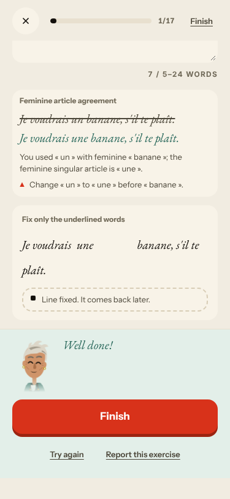
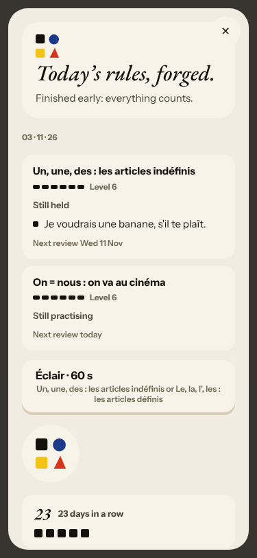
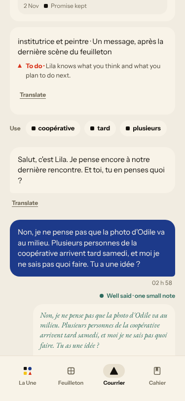
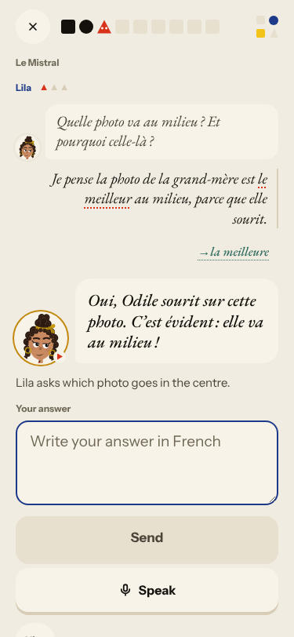
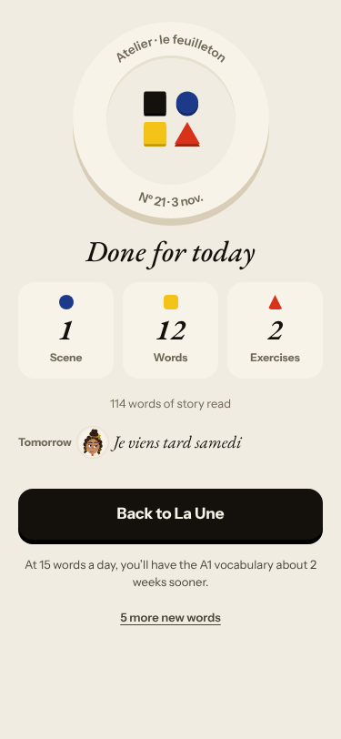
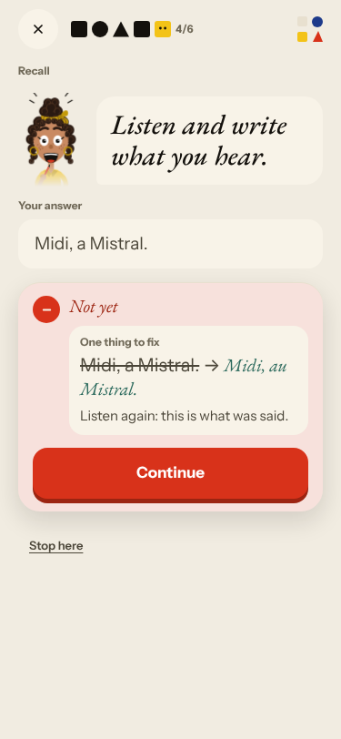

# Live walk · 3 Nov 2026 · production, real model

Run by the scheduled cloud routine (`explore:live` from main, Chromium at phone size) against `atelier-api-3njh.onrender.com` with the walk test account.
Account: **A1.1, day 22** (Home chip 22, «Nº 21 · La clé d'Odile», chip 23 after La Forge; this week «we consolidate»). Today's rule: «Le présent des verbes en -er».
Played: one pre-scene drill on today's rule, the scene «Lila et le mur d'Odile» (4 panels, **four** free replies: a mistake, a clear «non», an off-script question, then the closing panel written from them), 4 recall drills (one dictation missed, one choice missed), La Forge **1 of 17** (see #443), 12 word cards (mixed grades), Done, Courrier (a reply with a clear «non» and a mistake), Cahier (Rules, Words, Journal with an entry, Progress), Feuilleton.
Q19 n/a (cloud). Previous live report: [2 Nov](2026-11-02.md) (PR #468, not merged when this ran). Screenshots below are the ones that score 2 or less; the full set stayed in the run's output folder.
Setup: `npm run explore:live`, bundle build about 4 min, no `WALK_CHROMIUM` needed. Scene replies 7–15 s, closing panel under 25 s, Courrier reply about 15 s.

## Scores

| # | question | live 3 Nov | live 2 Nov | trend |
|---|---|---|---|---|
| 1 | Where am I | 3 | 3 | = |
| 2 | What is at stake | 3 | 3 | = |
| 3 | What to do next | 2 | 3 | ↓ |
| 4 | Scene reacts to my writing | 5 | 4 | ↑ |
| 5 | Story coherent | 3 | 3 | = |
| 6 | Characters consistent | 3 | 3 | = |
| 7 | Image, text, tone fit | 4 | 4 | = |
| 8 | Difficulty fits | 4 | 4 | = |
| 9 | Feedback explained | 3 | 4 | ↓ |
| 10 | Right answers accepted | 4 | 4 | = |
| 11 | French correct | 4 | 3 | ↑ |
| 12 | Clear goal today | 3 | 3 | = |
| 13 | Grammar practised | 2 | 2 | = |
| 14 | Earlier material returns | 3 | 4 | ↓ |
| 15 | I produce French | 5 | 5 | = |
| 16 | Errors, dead ends | 2 | 3 | ↓ |
| 17 | Varied, fun | 4 | 4 | = |
| 18 | Fast enough | 3 | 3 | = |
| 19 | App only | n/a | n/a | |
| 20 | Satisfying end | 3 | 2 | ↑ |
| 21 | Would come back | 3 | 3 | = |
| 22 | Time vs promise | 3 | 3 | = |

Q3 and Q16 are 2 for La Forge: after a repaired line the only ways on are «Finish» and «Try again» (same item), and the counter stays 1/17. Q13 is 2 for the third night in a row: today's rule («-er verbs») got one drill before the scene and no rule card; La Forge forged «Un, une, des». Q9 is 3 because the dictation miss «a Mistral → au Mistral» gives no reason and the scene correction caught one of four slips.

The scene is the strongest part again, and better than before: Lila answered the mistake, the clear «non» («Ah, Napoléon au milieu ! Pourquoi cette photo ?») and the off-script question («Je ne sais pas qui c'est»), and the closing panel kept the photo aside *because of* my «non» («J'entends que tu préfères Napoléon au milieu, mais je garde la photo de côté…») and the end card quotes it («Tu préfères la photo de Napoléon au milieu»). The Courrier reply was specific and its correction right («Tu a → Tu as»), La Forge's was right and explained («un banane → une banane»). Q20 is 3: Lila's closing line is a real hook («Toi, tu me caches quelque chose…»), but Done shows the fragment «Je viens tard samedi», a quote from an earlier night.

## Findings, by root cause

### #143 the day's progress has no single source of truth
1. **Medium · #443 (again)** La Forge opens on «Un, une, des» Level 6, not today's rule; after the repaired line only «Finish» / «Try again» (same item); «Finished early»; Done counts «2 Exercises» after about ten drills.  
2. **Medium · #444 (again)** The Journal asks about «Yesterday · Le Mistral · with Gus» («Gus répète son discours», 1 Nov), yesterday's scene was «L'appartement de Marin et Lila».
3. **Low · #143 (comment)** The recall counter grows while playing (4/6 → 5/6 → 5/7 → 6/7 → 7/7).
4. **Medium · #397 (again)** Courrier stamps are UTC («02 h 58» at 03:58 Berlin) and the verdict says «Partly, goals 1/2» after 3/3 words and a fix. 

### #145 the scene has no state of what was established
5. **Medium · new #500** The caption under the input stays «Lila asks which photo goes in the centre.» through all four exchanges. 
6. **Medium · #445 (again, two more places)** «One line to say aloud» is my uncorrected sentence; Done's «Tomorrow» and Lila's hook quote a promise from an earlier night. 
7. **Medium · #466 (again)** Done ends on a fragment, no question.
8. **Positive · #378 / #171 / #132 not reproduced** The scene took four replies, a clear «non» and an off-script question.

### #250 free-text corrections not checked against the learner's sentence
9. **Medium · #250 (again)** Scene reply 1 got one correction («la meilleure») for four slips.

### #146 concept-driven content and feedback
10. **Low · new #501** Dictation miss gives no reason (à + le = au); after «Show the answer» the answer must be retyped. 
11. **Low · #398 (again)** Word card «plus» uses its meaning as its example; «midi» has no article.
12. **Low · #469 (again)** The pre-scene rule drill sits under «The words · Quick word drills».

## Re-tests

- #378, #132: not reproduced (third night); left open for the owner.
- #443: reproduced, commented.
- #444: reproduced, commented.
- #381: not reached (no line with one right and one wrong word).
- #167: first recall drills still audio-first with «Show the text»; not changed.
- Nothing clearly fixed, nothing closed.

## Scripted walk

Not run (live walk only).
