# Live walk · 4 Nov 2026 · production, real model

Run by the scheduled cloud routine (`explore:live` from main, Chromium at phone size) against `atelier-api-3njh.onrender.com` with the walk test account.
Account: **A1.1, day 23** (Home chip 23, «Nº 22 · Une lettre pour Margaux», this week «we consolidate»). Today's rule: «On = we: on va au cinéma».
Played: pre-scene rule card + number drill + gender drill, the scene (4 panels, **three** free replies: a mistake, a clear «non» with a question, an off-script dinosaur; then a closing panel), 4 recall drills, La Forge (4 items over 3 visits, never past 1/17), 25 word cards (15 + 10, mixed grades), Courrier (two replies, both with «non» and mistakes), Cahier (Rules, Words, Journal with an entry, Progress), Feuilleton.
Not played: Done (unreachable, see #517). Q19 n/a (cloud). Previous live report: [3 Nov](2026-11-03.md) (branch `claude/live-walk-2026-11-03`, not merged).
Setup: `npm ci`, `npm run explore:live` (bundle build about 4 min, Playwright found its Chromium). Scene replies 4–12 s, closing panel about 20 s, Courrier replies about 20 s.

## Scores

| # | question | live 4 Nov | live 3 Nov | trend |
|---|---|---|---|---|
| 1 | Where am I | 3 | 3 | = |
| 2 | What is at stake | 3 | 3 | = |
| 3 | What to do next | 2 | 2 | = |
| 4 | Scene reacts to my writing | 3 | 5 | ↓↓ |
| 5 | Story coherent | 3 | 3 | = |
| 6 | Characters consistent | 3 | 3 | = |
| 7 | Image, text, tone fit | 4 | 4 | = |
| 8 | Difficulty fits | 4 | 4 | = |
| 9 | Feedback explained | 4 | 3 | ↑ |
| 10 | Right answers accepted | 4 | 4 | = |
| 11 | French correct | 4 | 4 | = |
| 12 | Clear goal today | 3 | 3 | = |
| 13 | Grammar practised | 2 | 2 | = |
| 14 | Earlier material returns | 4 | 3 | ↑ |
| 15 | I produce French | 5 | 5 | = |
| 16 | Errors, dead ends | 1 | 2 | ↓ |
| 17 | Varied, fun | 4 | 4 | = |
| 18 | Fast enough | 3 | 3 | = |
| 19 | App only | n/a | n/a | |
| 20 | Satisfying end | 2 | 3 | ↓ |
| 21 | Would come back | 3 | 3 | = |
| 22 | Time vs promise | 2 | 3 | ↓ |

The day **cannot be finished**: La Forge serves one item, the only button is «Finish», and Home keeps «Grammar — next» (Q16 1, Q3 2, Q20 2). The words were reachable only through Cahier → Words. Q4 fell because replies 1 and 2 were answered on the point (Margaux took the «non» and the question «Tu as faim ?»), but the third, off-script reply got the stock exit «Attends, on m'appelle» and the closing panel was the canned «called away», not written from my words. Corrections were good where they came: Courrier («trop petit → petite», «je n'ai pas besoin», «d'étiquette», «j'imprime», each explained), La Forge («une poster → un», explained). The scene itself did not flag «la fête est annulé(e)».
Q13 2: today's rule (On = we) got one card and one drill; La Forge forged «Un, une, des» for the fourth night.

## Findings, by root cause

### #143 the day's progress has no single source of truth
1. **High · new #517** After one Forge item and «Finish», Home keeps «Scene done · Grammar next · words to come»; tried three times plus a reload; the day cannot reach words or Done. 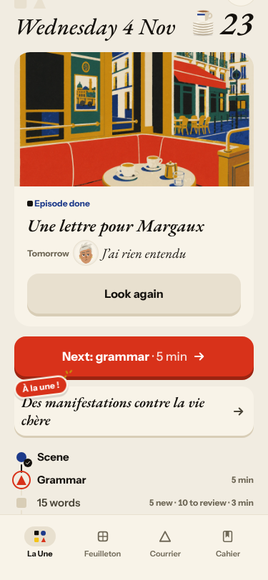 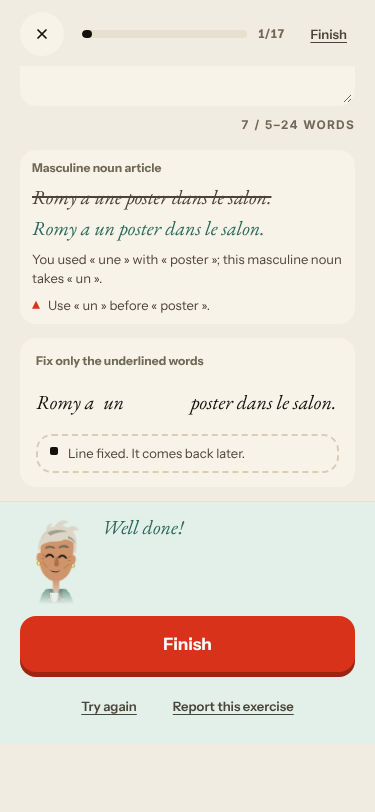
2. **Medium · #443 (again)** La Forge on «Un, une, des» Level 6, not «On = we»; counter 1/17. 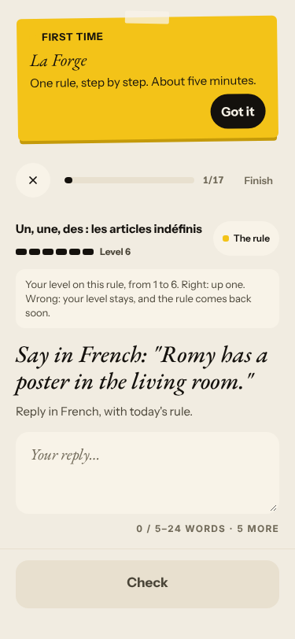
3. **Medium · #504 (comment)** Home promised 15 words, the review said 0/28, then a redirect opened 0/10 (the «photo» card again), and after 25 cards Home said «11 words to come». 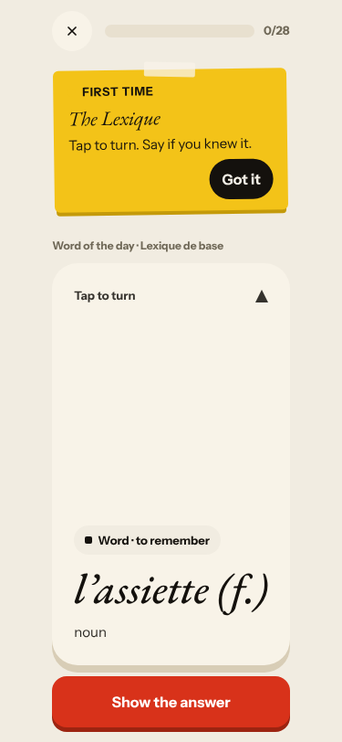 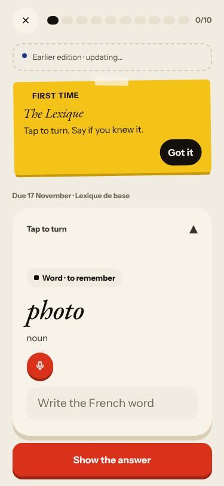
4. **Medium · #397 (comment)** Courrier stamps UTC («03 h 04» at 04:04 Berlin). 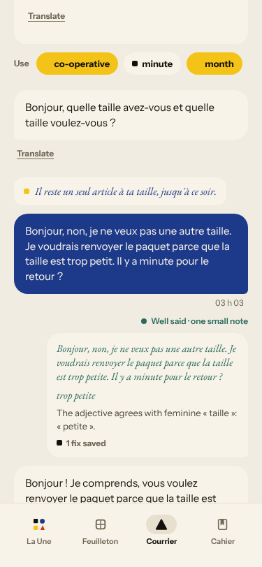 The recall counter grew again (2/4 → 2/5).

### #145 the scene has no state of what the learner said and what is established
5. **Medium · new #518** Off-script reply 3 gets «Attends, on m'appelle»; closing panel «Margaux doit partir… your words are noted». 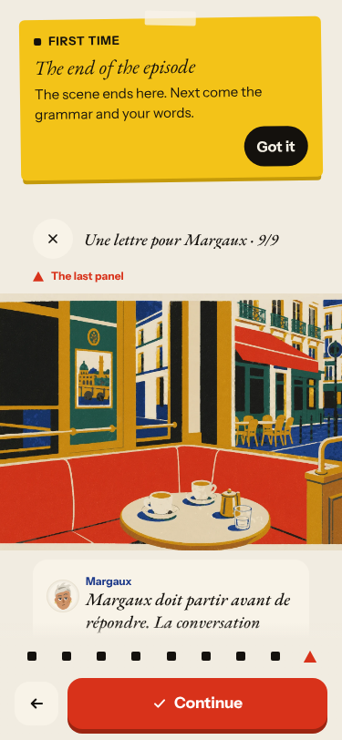
6. **Medium · #500 (again)** The caption «Margaux asks what's wrong…» stayed through the three exchanges and does not match her line «Tu regardes quoi ?». 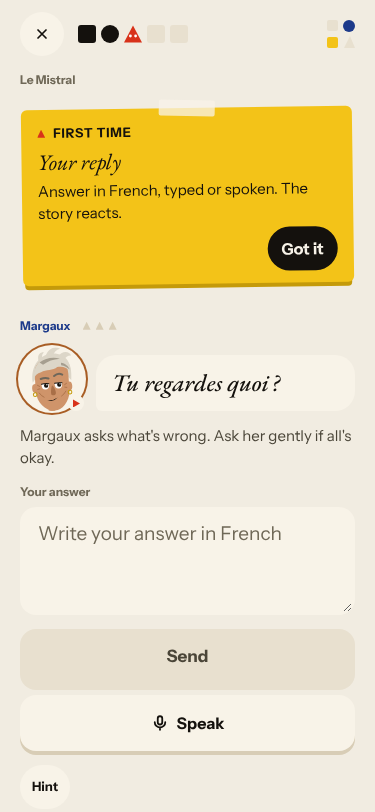
7. **Medium · #445 (again)** «One line to say aloud» is my uncorrected «…annulé ?»; «Previously» and the Journal quote my 3 Nov line as scene text. 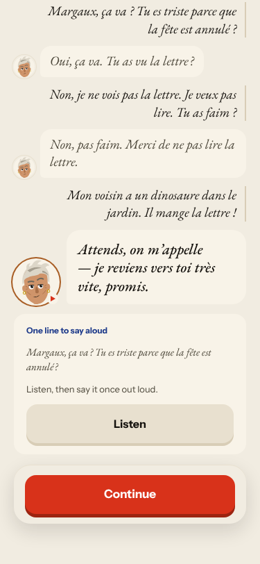
8. **Medium · #466 (comment)** Tomorrow: «J'ai rien entendu», a fragment.

### #146 the day's content and feedback are not driven by one concept
9. **Low · new #519** Number drill: the bare word «vingt-un» under «Correct this sentence». 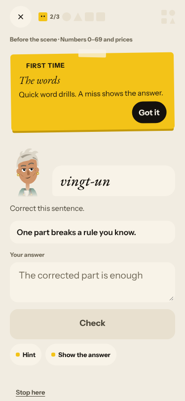
10. **Low · #167 (comment)** First recall drill listen-only. 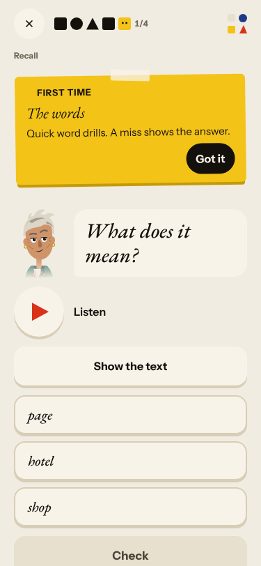
11. **Low · #398 (comment)** Word cards without examples; a typed card «photo» → «photo». Not filed separately: Courrier credited «minute» as used for «Il y a minute pour le retour ?» (noted on #146).

### #147 the cast is not one registry
12. **Low · new #520** Courrier letter mixes «avez-vous» with «à ta taille» / «À ton bureau»; #144 is closed. 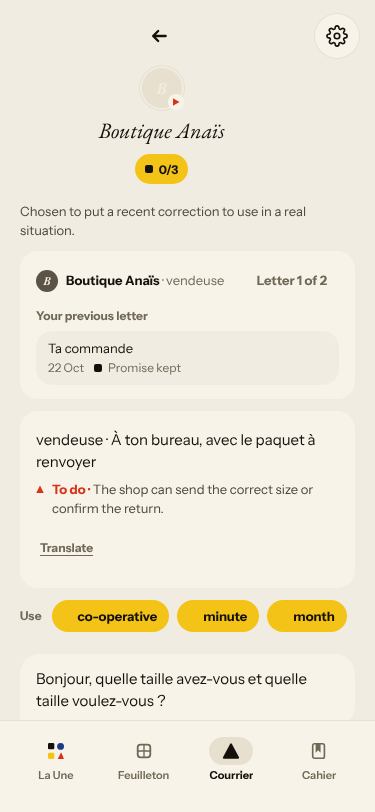

Positive: today's new words («pleuvoir», «signe», «nom») matched the scene; Courrier reacted to two «non» replies; Journal accepted a recall of yesterday.
New root cause: none; every finding fits #143, #145, #146 or #147.

## Re-tests

| issue | result |
|---|---|
| #378 scene allows one reply | not reproduced (three exchanges), but see #518 for the stock exit; left open |
| #132 ignores «non» | not reproduced (scene, Courrier) |
| #443, #500, #445, #466, #167, #397, #504, #398 | reproduced, commented |
| #501 dictation no reason | not reached (no dictation) |
| #444 Journal asks about wrong scene | not reproduced tonight (Lila, 3 Nov, correct) |

Nothing closed. Four new issues (#517–#520), all `queue:ready` with a **Done when:** comment each.
Screenshots: `docs/ops/live-walks/2026-11-04/shots/`.
