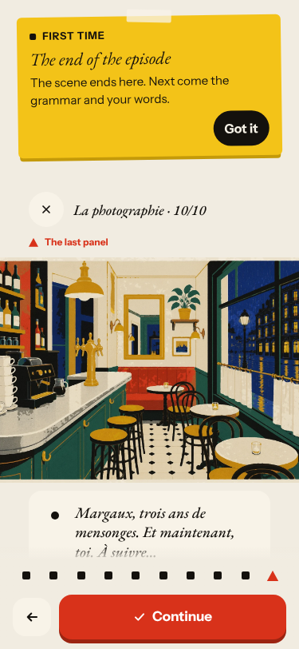
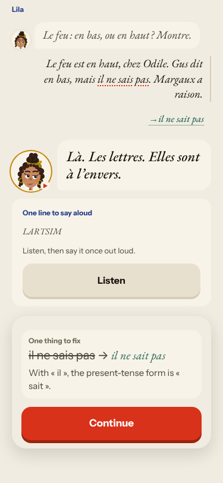
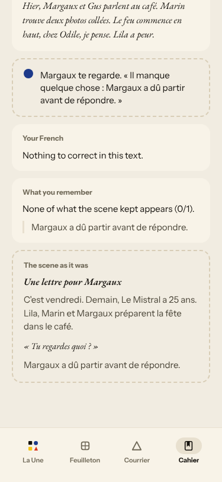
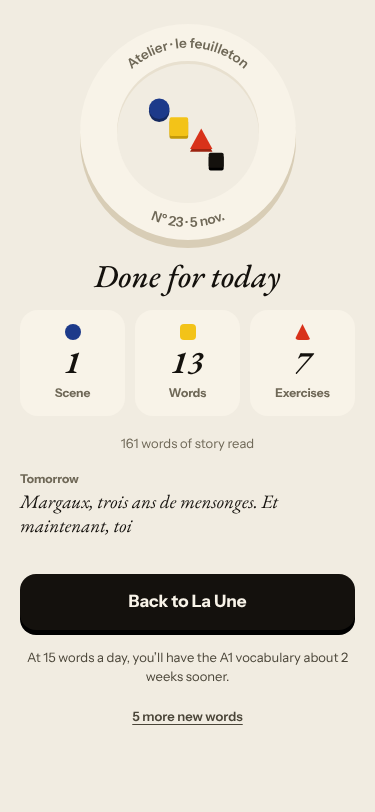
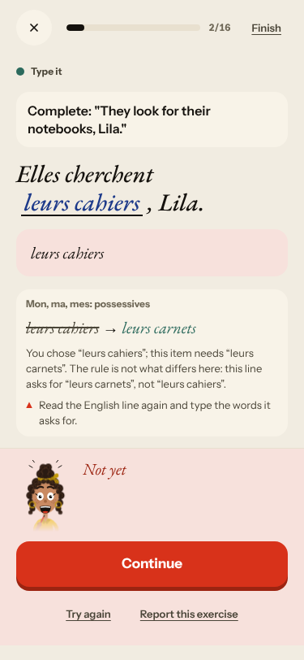
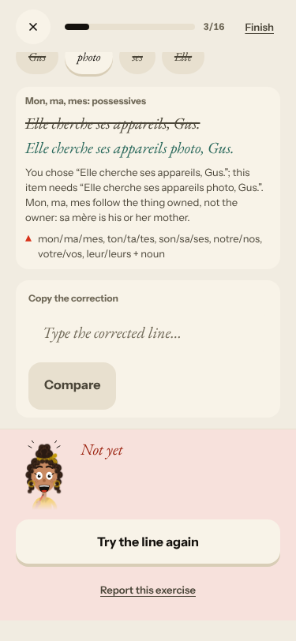
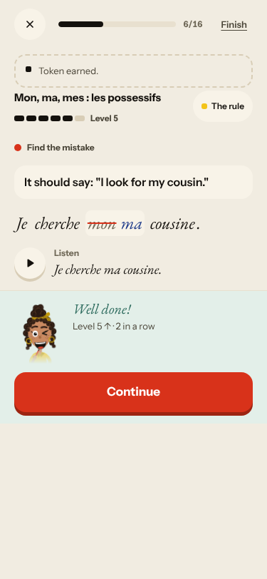
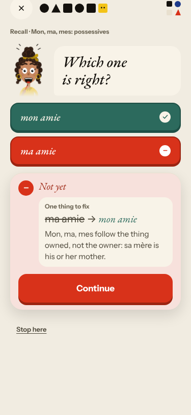
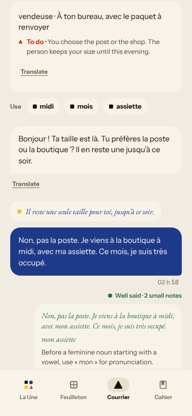

# Live walk · 5 Nov 2026 · production, real model

Run by the scheduled cloud routine (`explore:live` from main at `364644a`, which is the release `/health` reports; Chromium at phone size) against `atelier-api-3njh.onrender.com` with the walk test account.
Account: **A1.1, day 24** (Home chip 24, «Nº 23 · La photographie», this week «we consolidate»). Today's rule: «Mon, ma, mes : les possessifs».
Played: the scene «La photographie» (9 read-only panels, **one** free reply with a mistake, then the closing panel; no second exchange, so no «non» and no off-script reply were possible in the scene), the rule card, 2 recall drills (one miss), La Forge 7 items (misses on purpose: a tap-build, a typed completion, a «pas de» sentence), «Finish» → «Next: 13 words», 13 word cards (mixed grades), Done, Courrier (two replies: a «non» with mistakes, then an off-script question about a cat), Cahier (Rules, Words, Journal with an entry, Progress), Feuilleton.
Q19 n/a (cloud). Previous live report: [4 Nov](2026-11-04.md) (PR #521, not merged when this ran); 3 Nov is merged. Screenshots below are the ones that score 2 or less, plus the two that close #443 and #517.
Setup: `npm ci`, `npm run explore:live -- --skip-build` after the first build (bundle build about 4 min). `WALK_CHROMIUM` had to point to `/opt/pw-browsers/chromium-1243/chrome-linux64/chrome` (the `chromium` folder under `/opt/pw-browsers` is empty). Scene reply 12 s plus about 12 s to the say-aloud card, a Forge free-production check about 25 s, Courrier replies about 15 s, journal check about 15 s.

## Scores

| # | question | live 5 Nov | live 4 Nov | live 3 Nov | trend |
|---|---|---|---|---|---|
| 1 | Where am I | 3 | 3 | 3 | = |
| 2 | What is at stake | 3 | 3 | 3 | = |
| 3 | What to do next | 3 | 2 | 2 | ↑ |
| 4 | Scene reacts to my writing | 2 | 3 | 5 | ↓ |
| 5 | Story coherent | 3 | 3 | 3 | = |
| 6 | Characters consistent | 3 | 3 | 3 | = |
| 7 | Image, text, tone fit | 4 | 4 | 4 | = |
| 8 | Difficulty fits | 3 | 4 | 4 | ↓ |
| 9 | Feedback explained | 3 | 4 | 3 | ↓ |
| 10 | Right answers accepted | 2 | 4 | 4 | ↓↓ |
| 11 | French correct | 3 | 4 | 4 | ↓ |
| 12 | Clear goal today | 4 | 3 | 3 | ↑ |
| 13 | Grammar practised | 4 | 2 | 2 | ↑↑ |
| 14 | Earlier material returns | 4 | 4 | 3 | = |
| 15 | I produce French | 5 | 5 | 5 | = |
| 16 | Errors, dead ends | 3 | 1 | 2 | ↑↑ |
| 17 | Varied, fun | 4 | 4 | 4 | = |
| 18 | Fast enough | 3 | 3 | 3 | = |
| 19 | App only | n/a | n/a | n/a | |
| 20 | Satisfying end | 3 | 2 | 3 | ↑ |
| 21 | Would come back | 3 | 3 | 3 | = |
| 22 | Time vs promise | 3 | 2 | 3 | ↑ |

The day **finished** for the first time since 3 Nov: Forge → «Finish» → «Next: 13 words» → Done (#517 and #443 fixed, closed). It was also the first night the whole day ran on **one concept**: the rule card, two recall drills, seven Forge items and the Courrier correction were all about possessives, and the Forge's review item (pas de) came back from an earlier day (Q12 4, Q13 4, Q14 4). The scene took a step back: **one** reply, then the end (#378), and Lila answered my reply with the next authored panel (Q4 2). Q10 is 2 because La Forge rejected «leurs cahiers» and «ses appareils» (correct French) on vocabulary alone. Q8 3: panel 7 is one 35-word speech by Gus at A1.1. Q9 3: scene correction and «pas de» feedback were explained well, the «mon amie» miss and the «appareils photo» miss were explained with the wrong rule. Q11 3: «LARTSIM» as a line to say aloud and the false «ce mois-ci» correction.

## Findings, by root cause

### #145 the scene has no state of what was established
1. **High · #378 (again, reproduced)** The scene took **one** reply (step 2 of 6) and then went to the closing panel «Margaux, trois ans de mensonges. Et maintenant, toi. À suivre…», which does not mention what I wrote. 
2. **Medium · new #535** Lila answered «Le feu est en haut, chez Odile. Gus dit en bas…» with the authored «Là. Les lettres. Elles sont à l'envers.»; the «One line to say aloud» card shows «LARTSIM» (MISTRAL reversed). 
3. **Medium · new #538** Courrier: after my choice («pas la poste, je viens à la boutique à midi») Anaïs asks for «le problème avec ta commande» and an «échange ou remboursement»; the thread ends on her unanswered question under «Promise kept»; the correction «Ce mois → Ce mois-ci» changes a correct sentence.
4. **Medium · new #539** Journal «What you remember» scores 0/1 against the filler line «Margaux a dû partir avant de répondre»; the feedback has a meta line «Margaux te regarde.» 
5. **Medium · #466 (again)** Done «Tomorrow» is the scene's authored last panel, word for word. 

### #146 the day's learning content and feedback are not driven by one concept, and #174 a right answer is judged against one stored string
6. **Medium · new #536** La Forge: «leurs cahiers» rejected for notebooks (needs «carnets»), «ses appareils» rejected for cameras (needs «appareils photo»), the rule card quoted for a vocabulary slip; «ma» accepted for a masculine «cousin».   
7. **Medium · new #537** The rule card shows «ma sœur» and then «Right: mon amie» with no exception; the recall miss «ma amie» is explained with «follow the thing owned, not the owner». The Courrier explained the same slip correctly. 
8. **Medium · #471 (again)** A Forge free-production item raised the level to 6, then ~25 s later lowered it to 5 when the check found a missing «beaucoup».
9. **Low · #503 / #381 (again, one line each)** After a build miss only «Try the line again» and a typed correction; «Compare» on unchanged text says «Not yet» without a reason.

### #143 the day's progress has no single source of truth
10. **Low · new #540** After the scene's last step the button says «Finish today» and «Every step is done», but grammar, words and Done follow.
11. **Medium · #397 (again, reproduced)** Courrier stamps UTC («02 h 58» at 03:58 Berlin). 
12. **Low · #524** Done counts 7 exercises; the sum is not traceable (6 answered Forge items plus 2 drills would be 8).

## Re-tests

- **#443 fixed, closed:** Forge opened on today's rule and every miss had «Continue» ([screenshot](2026-11-05/shots/forge-opens-on-todays-rule.png)).
- **#517 fixed, closed:** «Finish» → sheet with «Next: 13 words» → words 13/13 → Done ([screenshot](2026-11-05/shots/forge-finish-summary-next-words.png)).
- **#378 reproduced** (one reply), back to ready. **#397 reproduced**, back to ready. **#471 reproduced**, back to ready. **#466 seen again**, stays with the owner. **#524** back to ready.
- **#444 not reproduced:** the Journal asked about «Yesterday · Le Mistral · with Margaux» and compared with «Une lettre pour Margaux», yesterday's scene. Left open (one night).
- Not reached (the scene had one exchange): #500, #518, #445, #171, #132.
- Not reached for lack of a screen: #381, #167 (the first recall drill was a choice, not audio), #504 (not retested after «5 more new words»), #398.

## Scripted walk

Not run (live walk only).
