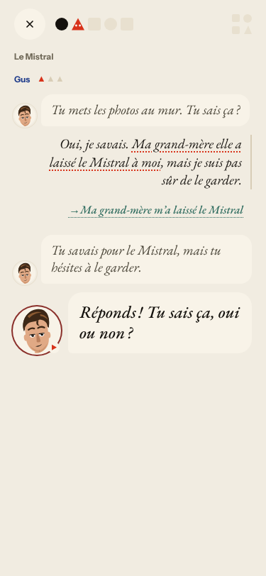
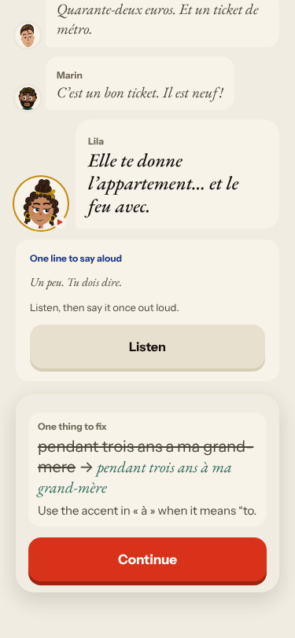
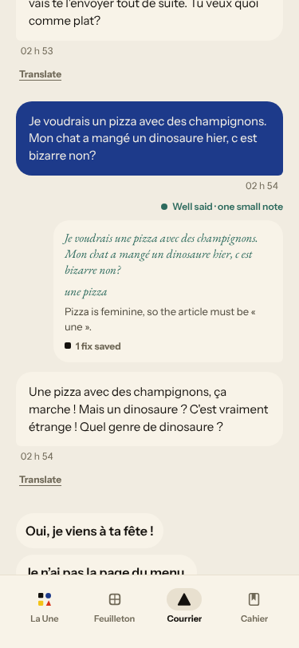
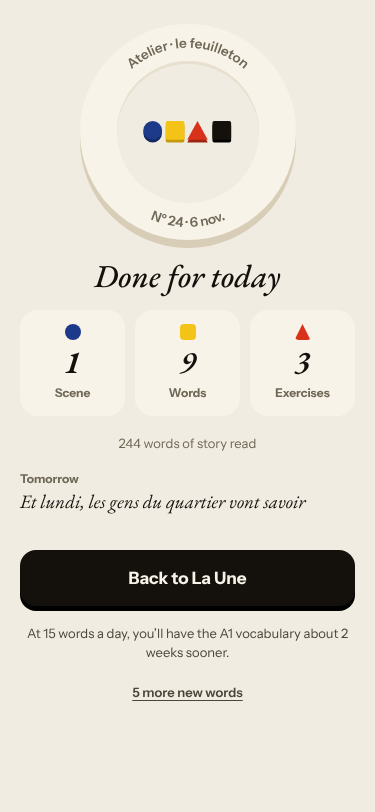
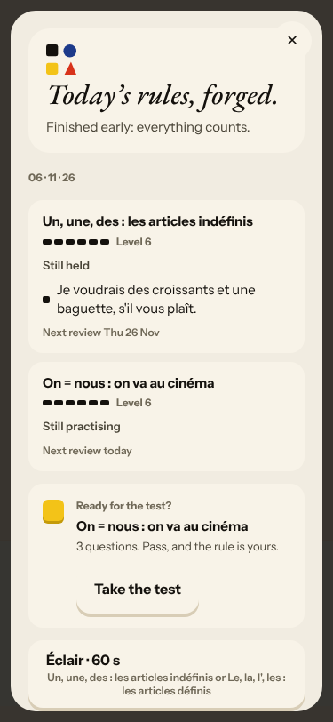
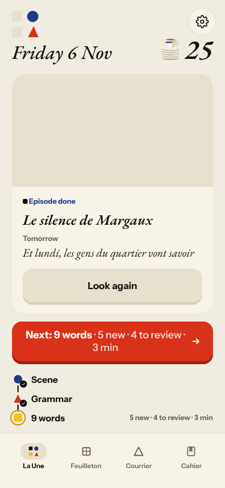
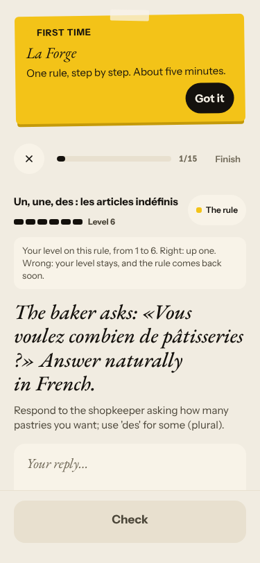
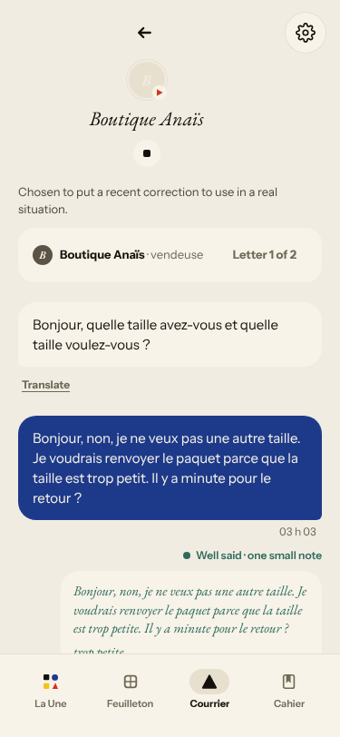
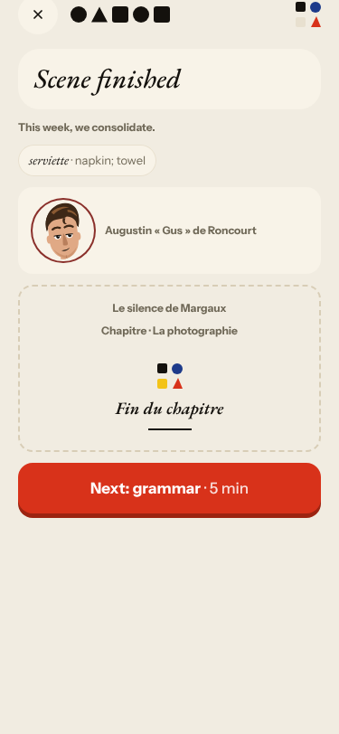

# Live walk · 6 Nov 2026 · production, real model

Run by the scheduled cloud routine (`explore:live` from main, Chromium at phone size) against `atelier-api-3njh.onrender.com` with the walk test account.
Account: **A1.1, day 25** (Home chip 25, «Nº 24 · La clé d'Odile» on Home, scene «Le silence de Margaux» at Le Mistral, this week «we consolidate»). Today's rule: «Le, la, l', les: the».
Played: the scene (Gus, then Margaux: **four** free replies: a mistake, a clear «non» with a question, an off-script dinosaur-and-cheese reply, a real answer; closing panel), rule card, 1 recall drill, La Forge (1 item with a deliberate mistake, repaired, then «Finish» at 1/15), 9 word cards (mixed grades), Done, Courrier (new letter from Zoé, three replies with a «non», mistakes and an off-script reply; the old 4 Nov thread opens first), Cahier (Journal with an entry, Progress, Words), Feuilleton.
Not played: Q19 n/a (cloud). The 5 Nov live report is missing; previous live report: [4 Nov](2026-11-04.md).
Setup: `npm ci`, `npm run explore:live` (bundle build about 4 min, Playwright found its Chromium). Scene replies 4–12 s, Courrier replies about 15 s, Forge check about 10 s.

## Scores

| # | question | live 6 Nov | live 4 Nov | trend |
|---|---|---|---|---|
| 1 | Where am I | 3 | 3 | = |
| 2 | What is at stake | 3 | 3 | = |
| 3 | What to do next | 3 | 2 | ↑ |
| 4 | Scene reacts to my writing | 4 | 3 | ↑ |
| 5 | Story coherent | 3 | 3 | = |
| 6 | Characters consistent | 2 | 3 | ↓ |
| 7 | Image, text, tone fit | 4 | 4 | = |
| 8 | Difficulty fits | 4 | 4 | = |
| 9 | Feedback explained | 4 | 4 | = |
| 10 | Right answers accepted | 4 | 4 | = |
| 11 | French correct | 4 | 4 | = |
| 12 | Clear goal today | 3 | 3 | = |
| 13 | Grammar practised | 2 | 2 | = |
| 14 | Earlier material returns | 4 | 4 | = |
| 15 | I produce French | 5 | 5 | = |
| 16 | Errors, dead ends | 3 | 1 | ↑↑ |
| 17 | Varied, fun | 4 | 4 | = |
| 18 | Fast enough | 3 | 3 | = |
| 19 | App only | n/a | n/a | |
| 20 | Satisfying end | 3 | 2 | ↑ |
| 21 | Would come back | 3 | 3 | = |
| 22 | Time vs promise | 3 | 2 | ↑ |

The day **can be finished again**: after one Forge item Home moves on (Scene done, Grammar done, 9 words next) and the words lead to Done, so #517 is fixed (Q16, Q3, Q20, Q22 up). The scene reacted well where it counted: Gus answered the question «Pourquoi tu me demande ?» («Je te demande parce que les photos sont au mur. Oui, Margaux savait.»), Margaux took the off-script cat («Napoléon, c'est un joli nom pour ton chat !») and then my last reply («Je comprends. Tu veux savoir pourquoi j'ai fait ça»), and Zoé in Courrier took the «non», the pizza and the dinosaur and asked «Quel genre de dinosaure ?». Corrections were right where they came (Forge three reasons for «un baguette, s il, plait»; Courrier «à», «une pizza», «l'heure»), but incomplete («ca», «grand-mere», «je suis pas», «c est» left alone).
Q6 fell to 2: after my last reply the page played authored lines that answer nothing and put **Marin and Lila** into a scene with Gus, Margaux and Odile, and the card «One line to say aloud» was «Un peu. Tu dois dire.» (#558). Q13 stays 2: La Forge again forged «Un, une, des» (Level 6) instead of today's «Le, la, l', les» and ended at 1/15 (#443 reopened); today's rule had one card, no drill.

## Findings, by root cause

### #145 the scene has no state of what the learner said and what is established
1. **Medium · new #556** Gus re-asks «Tu sais ça, oui ou non ?» right after «Oui, je savais»; exchange total grows 2 → 3 → 4. 
2. **Medium · new #558** The closing beats answer nothing I said (Gus «Quarante-deux euros. Et un ticket de métro.», Marin and Lila speak at Le Mistral); the say-aloud line is a fragment.  Also under #147, and #535 (commented).
3. **Low · new #557** Courrier's suggested replies stay the opening set («Oui, je viens à ta fête !» after my «non»). 
4. **Medium · #378, #500 (comments)** Not reproduced as filed (four exchanges, captions followed) but see #556.
5. **Medium · #539 (comment)** Journal scores 0/1 against the hook line and answers with a meta line.
6. **Medium · #466 (comment)** Done and Home «Tomorrow» is the fragment «Et lundi, les gens du quartier vont savoir». 

### #143 the day's progress has no single source of truth
7. **Low · new #559** La Forge's recap says «26 days in a row», Home's chip says 25.  
8. **Medium · #443 (reopened)** La Forge on «Un, une, des», not today's rule; only «Finish» after one item, counter 1/15; the recap lists an unpractised rule as «Still practising» at Level 6. 
9. **Low · #540 (comment)** «Every step is done / Finish today» after a single recall drill.
10. **Medium · #397 (comment)** Courrier opens the finished 4 Nov thread first; stamps are UTC («02 h 53» at 03:53 Berlin). 

### #146 the day's content and feedback are not driven by one concept
11. **Medium · #280 (comment)** New words «house, home», «school», «work, job», «forty», «market» from «Lexique de base», none from the scene.
12. **Low · #167 (comment)** First recall drill listen-only.
13. **Low · #155 (comment)** «Gus smiles at you» over a recall drill. 
14. **High · #250 (comment)** Free-text corrections are right but incomplete: unflagged «ca», «grand-mere», «je suis pas», «c est».

### #147 the cast is not one registry
15. Included in #558 (Marin and Lila in the Mistral scene); commented on #147.

Seen and not filed (known): the «Previously» block reads «Deux promesses : Deux promesses» and the Feuilleton lists Nº 23 and Nº 24 under the same chapter title «La photographie».
New root cause: none; every finding fits #143, #145, #146 or #147.

## Re-tests

| issue | result |
|---|---|
| #517 Home stuck on «Grammar next» after one Forge item | **fixed**, already closed; confirmed |
| #443 Forge not today's rule | reproduced, reopened, `queue:ready` |
| #378 scene allows one reply | not reproduced (four exchanges); left open |
| #500 stale caption | mostly not reproduced; left open |
| #132 ignores «non» | not reproduced (scene, Courrier) |
| #538 Courrier ignores my choice | not reached (new letter, reacted well) |
| #535, #466, #397, #539, #540, #280, #167, #155, #250 | reproduced, commented |
| #520 tu/vous in Courrier | not reproduced (Zoé tu throughout) |
| #444 Journal asks about wrong scene | not judged (yesterday's scene not played on this account) |

Nothing newly closed. Four new issues (#556–#559), all `queue:ready` with a **Done when:** comment each. Screenshots: `docs/ops/live-walks/2026-11-06/`.
