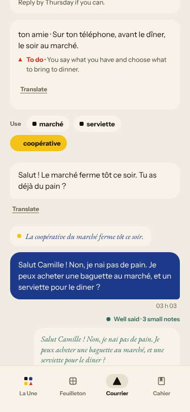
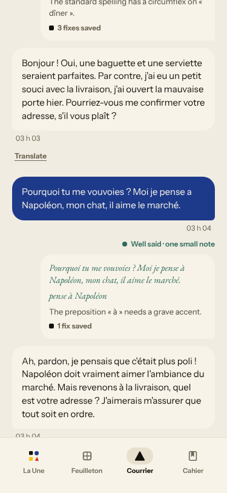
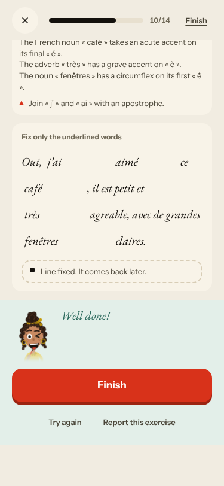
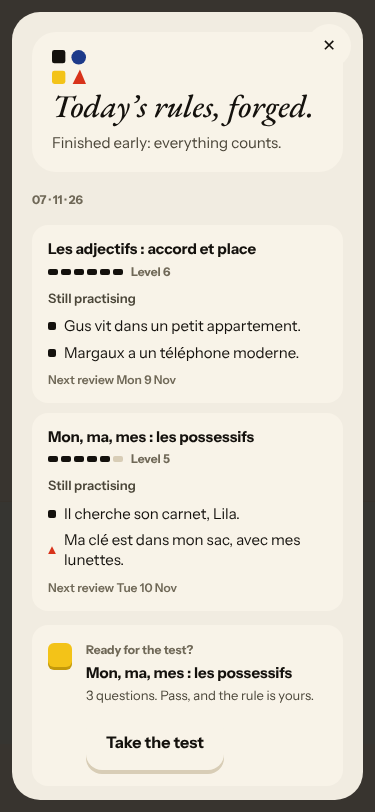
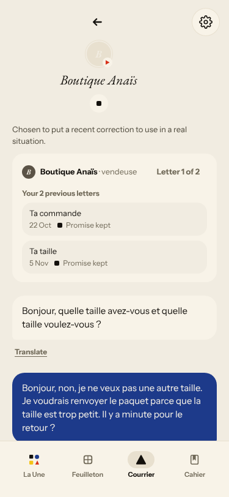
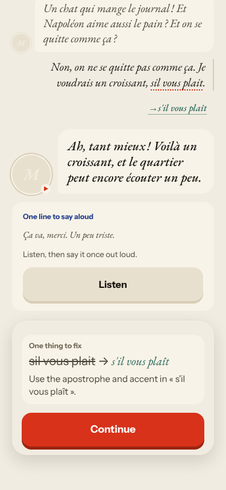
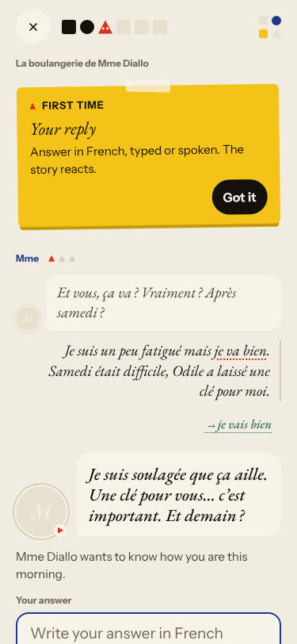
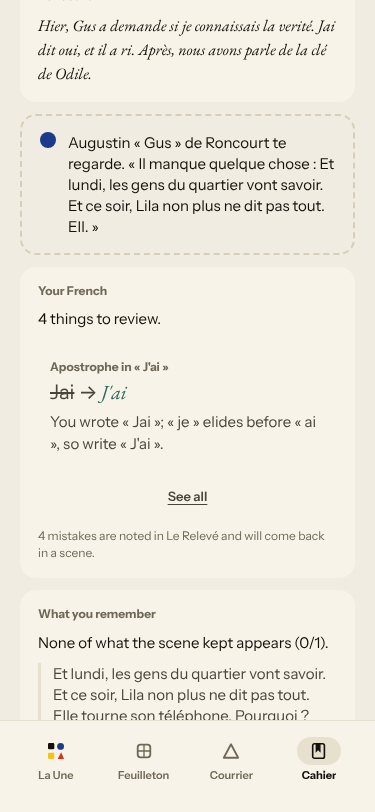
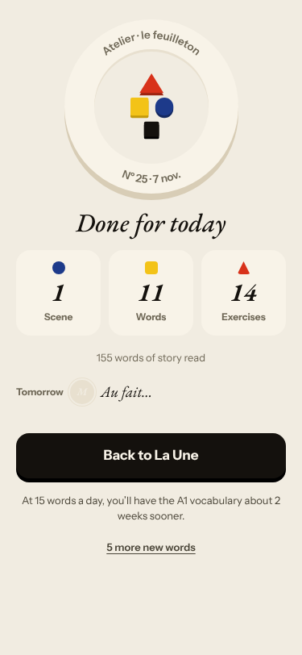
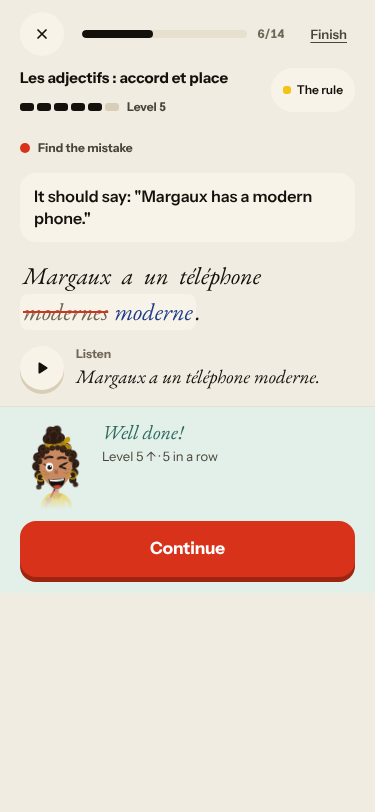

# Live walk · 7 Nov 2026 · production, real model

Run by the scheduled cloud routine (`explore:live` from main at `74989f8`; Chromium at phone size) against `atelier-api-3njh.onrender.com` with the walk test account.
Account: **A1.1, day 26** (Home chip 26, «Nº 25 · La clé d'Odile»). Rules met: «On = we» before the scene, «Les adjectifs : accord et place» and a possessives review in La Forge.
Played: pre-scene rule drill, the scene «Lundi à la boulangerie» (4 panels, **four** free replies with mistakes: a clear «non», an off-script cat story with a question back, a «non, on ne se quitte pas comme ça»), 2 recall drills (one miss on purpose), La Forge 10 items, Finish → «Next: 11 words», 11 word cards, Done, Courrier (old thread, then a new letter with two replies: a «non» with mistakes, then an off-script question), Cahier (Rules, Journal with an entry, Progress), Feuilleton.
Q19 n/a (cloud). Previous live report: [5 Nov](2026-11-05.md); no live report exists for 6 Nov.
Setup: `npm ci`, `npm run explore:live` (bundle build about 2 min), `WALK_CHROMIUM=/opt/pw-browsers/chromium-1243/chrome-linux64/chrome`. Scene replies 12–16 s, Forge free-production checks 20–25 s, Courrier replies 18 s, Journal 20 s.
Harness note: «type» appends to a prefilled find-the-mistake field; I used Ctrl+A. Not a product finding.

## Scores

| # | question | live 7 Nov | live 5 Nov | live 4 Nov | trend |
|---|---|---|---|---|---|
| 1 | Where am I | 3 | 3 | 3 | = |
| 2 | What is at stake | 3 | 3 | 3 | = |
| 3 | What to do next | 4 | 3 | 2 | ↑ |
| 4 | Scene reacts to my writing | 4 | 2 | 3 | ↑↑ |
| 5 | Story coherent | 3 | 3 | 3 | = |
| 6 | Characters consistent | 2 | 3 | 3 | ↓ |
| 7 | Image, text, tone fit | 4 | 4 | 4 | = |
| 8 | Difficulty fits | 3 | 3 | 4 | = |
| 9 | Feedback explained | 4 | 3 | 4 | ↑ |
| 10 | Right answers accepted | 3 | 2 | 4 | ↑ |
| 11 | French correct | 3 | 3 | 4 | = |
| 12 | Clear goal today | 2 | 4 | 3 | ↓↓ |
| 13 | Grammar practised | 4 | 4 | 2 | = |
| 14 | Earlier material returns | 4 | 4 | 4 | = |
| 15 | I produce French | 5 | 5 | 5 | = |
| 16 | Errors, dead ends | 3 | 3 | 1 | = |
| 17 | Varied, fun | 4 | 4 | 4 | = |
| 18 | Fast enough | 3 | 3 | 3 | = |
| 19 | App only | n/a | n/a | n/a | |
| 20 | Satisfying end | 4 | 3 | 2 | ↑ |
| 21 | Would come back | 3 | 3 | 3 | = |
| 22 | Time vs promise | 3 | 3 | 2 | = |

The scene is the news: for the first time in this series it reacted to all four of my replies (the key, a clear «non» — «D'accord, pas de clé», the cat), took more than one exchange (#378 not reproduced) and closed on a summary of what I said plus a real question (Q4 4, Q20 4). The day lost its single concept: the pre-scene card, the recall and La Forge taught three different things (Q12 2, new #576). Courrier's friend Camille turned into a formal stranger asking for my address (Q6 2).

## Findings, by root cause

### #147 the cast is not one registry / #144 register (closed, regressing)
1. **High · #114 (again)** Courrier, Camille «ton amie»: «Salut ! … Tu as déjà du pain ?» → «Bonjour ! … j'ai eu un petit souci avec la livraison … Pourriez-vous me confirmer votre adresse ?»; after I asked why she vouvoie me she kept vous and wrote «quel est votre adresse».  
2. **Low · #520, #557 (again)** same letter; chips ignore the thread.
3. **Medium · new #575** La Forge: «Ta sœur te montre…» then «Votre sœur vous demande…».

### #146 the day is not driven by one concept
4. **Medium · new #576** Pre-scene «On = we», Forge «adjectifs», recall «mois/voisine».

### #250 corrections are raw model output
5. **Medium · new #574** Free-production check: 5 gaps, «agreable» missed, «Line fixed», 17 words for a 7–16 item. 

### #143 day progress / single source of truth
6. **Medium · new #577** Three titles for one episode.
7. **Low · #559 (again)** recap «27 days in a row», Home 26. 
8. **Medium · #397 (again)** Courrier opens on a finished 4 Nov thread, UTC stamps without a date. 

### #145 the scene has no state
9. **Medium · #556 / #535 (again)** exchange counter 3 of 3 then a 4th reply; say-aloud line «Un peu triste.» was never written by me; my question «Vous avez un chien ?» ignored. 
10. **Low · #500 (again)** caption stays on the opening question. 
11. **Medium · #539 (again)** Journal target is the hook filler. 
12. **Medium · #466 (again)** Done «Tomorrow» = «Au fait…». 

### No structural flaw
13. **Low · new #573** find-the-mistake prints old+new word glued. 

## Re-tests

- **#378 not reproduced** (four replies, all reacted to); left open for one more night. **#518 improved** (off-script reply got a fitting answer, no «Attends, on m'appelle»); left open. **#540 not seen** (scene's last step offers «Next: grammar · 5 min»); left open. #443 held (Forge opens on a today's-rule item, every miss had Continue). Word cards came from the scene (cuit, faim, voisine, vraiment): #280 looks better today, not commented.
- Reproduced and commented: #114, #520, #557, #397, #539, #466, #559, #500, #556.
- Not reached: #536, #537, #562, #381, #445, #444 (Journal asked about «Yesterday · Gus», plausible), #167 (first recall drill was audio with «Show the text»).

## Scripted walk

Not run (live walk only).
