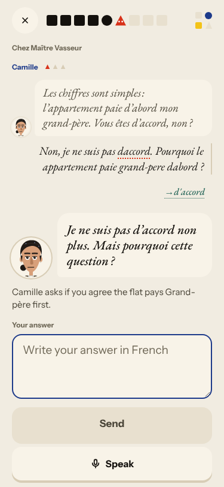
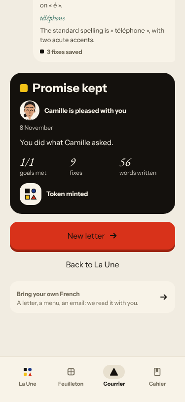
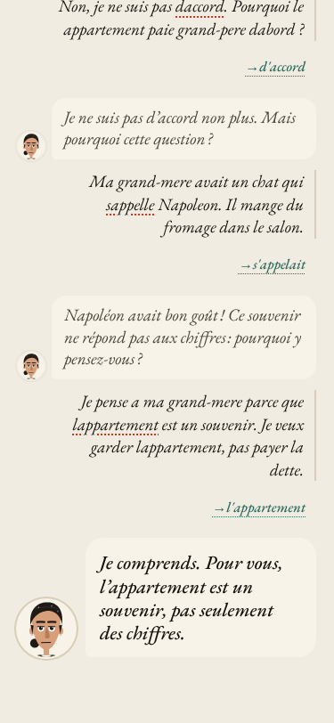
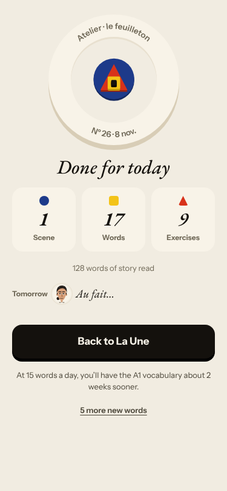
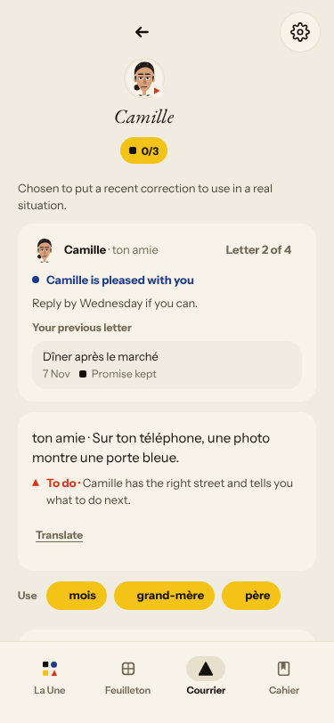
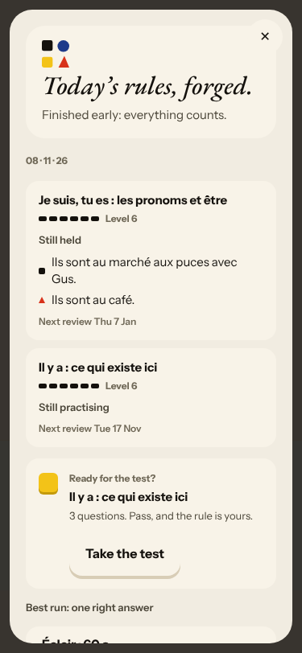
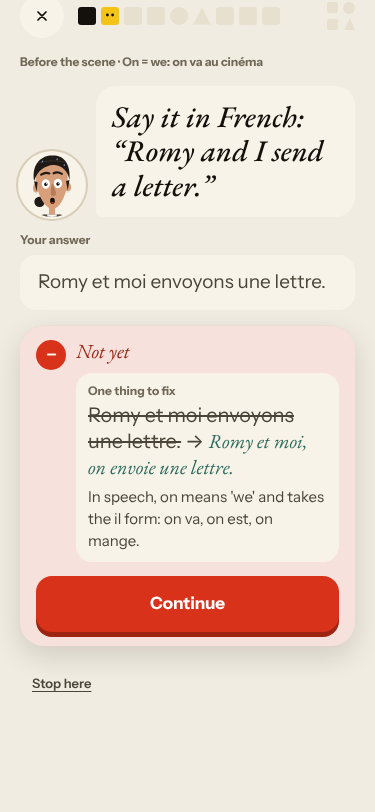

# Live walk · 8 Nov 2026 · production, real model

Run by the scheduled cloud routine (`explore:live` from main, Chromium at phone size) against `atelier-api-3njh.onrender.com` with the walk test account.
Account: **A1.1, day 27** (Home chip 27, «Nº 26 · La clé d'Odile» at Le Mistral on Home; the scene that played was «Camille et la dette» at Chez Maître Vasseur). Rules today: «Il y a», «On = we» (before the scene).
Played: two pre-scene rule drills (build, say-it-in-French with a deliberate «nous» answer, gender, repeat), scene (three free replies: a clear «non» with a question and mistakes, an off-script cat-and-cheese reply, a real answer; closing panel), recall (3), La Forge (2 items: one mistake repaired, one right; Finish), 17 word cards (mixed grades), Done, Courrier (letter 2 of 4: three replies with a «non», an off-script dinosaur reply, a real answer), Cahier (Rules, Journal with an entry, Progress, Words), Feuilleton.
Not played: Q19 n/a (cloud). Previous live report: [6 Nov](2026-11-06.md).
Setup: `npm ci`, `npm run explore:live` (bundle build a few minutes, Playwright found Chromium). Scene replies 5–12 s, Courrier replies about 15 s, Forge check about 13 s.

## Scores

| # | question | live 8 Nov | live 6 Nov | trend |
|---|---|---|---|---|
| 1 | Where am I | 3 | 3 | = |
| 2 | What is at stake | 3 | 3 | = |
| 3 | What to do next | 3 | 3 | = |
| 4 | Scene reacts to my writing | 3 | 4 | ↓ |
| 5 | Story coherent | 3 | 3 | = |
| 6 | Characters consistent | 2 | 2 | = |
| 7 | Image, text, tone fit | 4 | 4 | = |
| 8 | Difficulty fits | 4 | 4 | = |
| 9 | Feedback explained | 3 | 4 | ↓ |
| 10 | Right answers accepted | 3 | 4 | ↓ |
| 11 | French correct | 4 | 4 | = |
| 12 | Clear goal today | 3 | 3 | = |
| 13 | Grammar practised | 3 | 2 | ↑ |
| 14 | Earlier material returns | 4 | 4 | = |
| 15 | I produce French | 5 | 5 | = |
| 16 | Errors, dead ends | 2 | 3 | ↓ |
| 17 | Varied, fun | 4 | 4 | = |
| 18 | Fast enough | 3 | 3 | = |
| 19 | App only | n/a | n/a | |
| 20 | Satisfying end | 3 | 3 | = |
| 21 | Would come back | 3 | 3 | = |
| 22 | Time vs promise | 3 | 3 | = |

Q16 fell to 2 because **Courrier silently stopped answering**: Camille replied to my first message, then two further messages got corrections but no reply and no error, and Finish still said «Promise kept» (#590). Q4 fell with it, and with reply 1 in the scene: Camille proposed «le flat pays Grand-père first», I said «non» and asked why, and she answered «Je ne suis pas d'accord non plus» without answering (#591). The later scene turns reacted well (Napoléon the cat: «Napoléon avait bon goût !»; the closing panel carries my choice and a real hook). Q10 3: a correct «Romy et moi envoyons une lettre.» was «Not yet» in the «on» drill (#592). Q13 rose to 3: grammar was practised before the scene and in La Forge (a miss was repaired in place), but La Forge again forged a rule other than today's (#576).

## Findings, by root cause

### #145 the scene has no state of what the learner said and what is established
1. **High · new #591** Camille agrees with my «non» against her own proposal and skips my question. 
2. **High · new #590** Courrier: two of three messages unanswered, letter ends «Promise kept» (also #333, a failed model call shown as a result). 
3. **Medium · #558 (comment)** «One line to say aloud» is my own uncorrected sentence. 
4. **Low · #557 (comment)** Courrier's suggested replies stay the opening set after my «non».
5. **Medium · #466 (comment)** Done and Home «Tomorrow» read «Au fait…». 

### #147 the cast is not one registry
6. **Medium · #147 (comment)** Camille is vous and a debt negotiator in the scene, «ton amie», tu, in Courrier, and there calls my grandmother hers. 

### #143 the day's progress has no single source of truth
7. **Medium · #576 (comment)** Pre-scene cards teach «Il y a» and «On = we»; La Forge forges «Je suis, tu es» (Level 6) and lists «Il y a» as «Still practising». 
8. **Low · #559 (comment)** Recap «28 days in a row» vs Home chip 27.
9. **Low · #577 (comment)** Home says «Nº 26 · La clé d'Odile» at Le Mistral; the scene is «Camille et la dette» at Maître Vasseur.

### #174 a right answer is judged against one stored string
10. **Medium · new #592** The «on» drill rejects a correct «nous» sentence. 

### #250 free-text corrections are raw model output
11. **Medium · #250 (comment)** Scene correction flagged only «d'accord» (missed «l'appartement», «grand-père»).

### #146
12. **Low · #167, #155 (comments)** Recall drill listen-only; «Camille smiles at you» over a recall drill.

New root cause: none; every finding fits #143, #145, #147, #174, #250 or #333.

## Re-tests

| issue | result |
|---|---|
| #517 day can be finished | holds: Forge Finish after 2 items moved Home to done |
| #378 one reply then the scene ends | not reproduced (three exchanges) |
| #500 stale caption | reproduced: caption stayed on the opening question (noted in #591) |
| #132 ignores «non» | scene: reacted wrongly (#591); Courrier reacted |
| #556, #520, #443 | not reached |

Nothing closed. Three new issues (#590, #591, #592), all `queue:ready` with a **Done when:** comment each. Screenshots: `docs/ops/live-walks/2026-11-08/`.
