# Live walk · 9 Nov 2026 · production, real model

Run by the scheduled cloud routine (`explore:live` from main; Chromium at phone size) against `atelier-api-3njh.onrender.com` with the walk test account.
Account: **A1.1, day 28** (Home «Nº 27 · La clé d'Odile»). Previous live report: [8 Nov](2026-11-08.md) (PR #593, still open).
Played: the scene «Lila revient avec une pizza» (guess, 4 panels, three free replies: a «non» with mistakes, an off-script pet story with a question back, a request for the truth), 7 recall drills (two misses on purpose, a typo), La Forge «Je suis, tu es» (one item, a deliberate accent miss and repair), 14 word cards, Done, Courrier «La porte bleue» (two replies: a «non» with mistakes, an off-script dog question), Cahier (Journal entry), Feuilleton. Q19 n/a (cloud).
Setup: `npm ci`, `npm run explore:live`, `WALK_CHROMIUM=/opt/pw-browsers/chromium-1243/chrome-linux64/chrome`. Scene and Courrier replies took 12–25 s.
Harness notes (not product findings): the find-the-mistake field is `field:1`; clicking by text «I know it»/«Again» in the Lexique hits the swipe hint labels, so cards must be graded by index.

## Scores

| # | question | live 9 Nov | live 8 Nov | trend |
|---|---|---|---|---|
| 1 | Where am I | 3 | 3 | = |
| 2 | What is at stake | 3 | 3 | = |
| 3 | What to do next | 3 | 3 | = |
| 4 | Scene reacts to my writing | 4 | 3 | ↑ |
| 5 | Story coherent | 2 | 3 | ↓ |
| 6 | Characters consistent | 2 | 2 | = |
| 7 | Image, text, tone fit | 3 | 4 | ↓ |
| 8 | Difficulty fits | 3 | 4 | ↓ |
| 9 | Feedback explained | 4 | 3 | ↑ |
| 10 | Right answers accepted | 4 | 3 | ↑ |
| 11 | French correct | 3 | 4 | ↓ |
| 12 | Clear goal today | 2 | 3 | ↓ |
| 13 | Grammar practised | 2 | 3 | ↓ |
| 14 | Earlier material returns | 4 | 4 | = |
| 15 | I produce French | 5 | 5 | = |
| 16 | Errors, dead ends | 2 | 2 | = |
| 17 | Varied, fun | 4 | 4 | = |
| 18 | Fast enough | 3 | 3 | = |
| 19 | App only | n/a | n/a | |
| 20 | Satisfying end | 3 | 3 | = |
| 21 | Would come back | 3 | 3 | = |
| 22 | Time vs promise | 3 | 3 | = |

The scene reacted to everything I wrote (the «non» made Lila keep the pizza, the pet question was answered, the truth request became the cliffhanger), and word drills accepted «assurence» as a typo. But the story around the reply is incoherent (panels from other scenes, a quote I never wrote), and La Forge is a dead end after one item on a rule I already hold at Level 6.

## Findings, by root cause

### #145 the scene has no state
1. **High · new #620** The closing hook says «Tu as promis : « Je pense que je vais vendre la bouillotte… »», which I never wrote; Done «Tomorrow» repeats it. 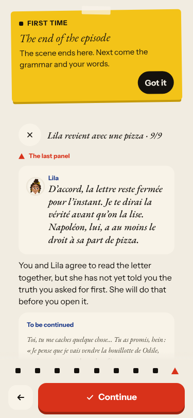 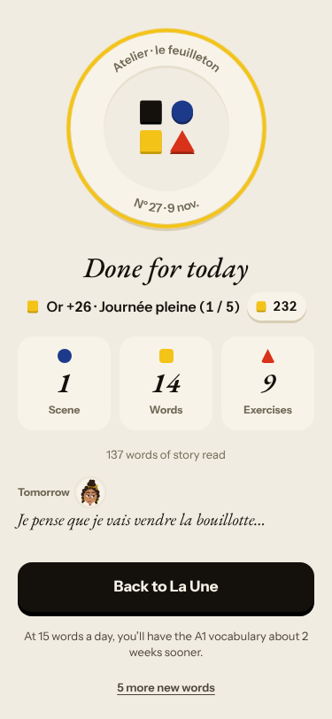
2. **Medium · new #621** The read panels belong to other scenes (insurance, photo, notary; last panel Gus «Bonne journée à vous»).
3. **Medium · new #622** Journal retell target is the filler «L'appartement est un souvenir de ta grand-mère». 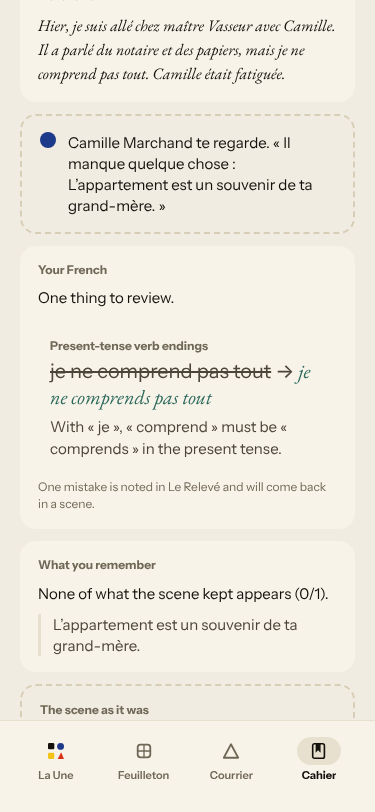
4. **Medium · #556 (again)** say-aloud «Oui, on partage.» after my «non». 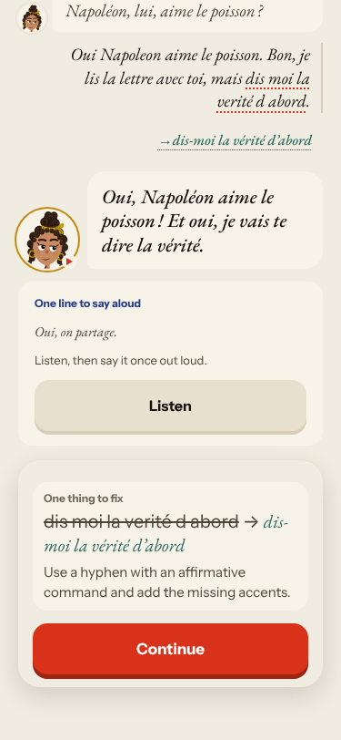
5. **Medium · #500 (again)** caption stays on the opening question.

### #143 day progress
6. **Medium · #443 (again, commented)** La Forge 1/14, only «Finish» after a right answer and after an accepted repair. 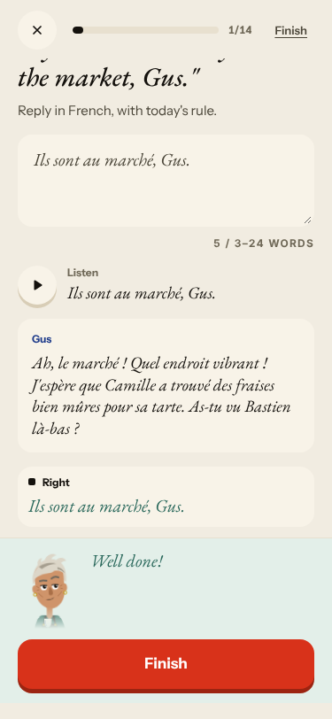 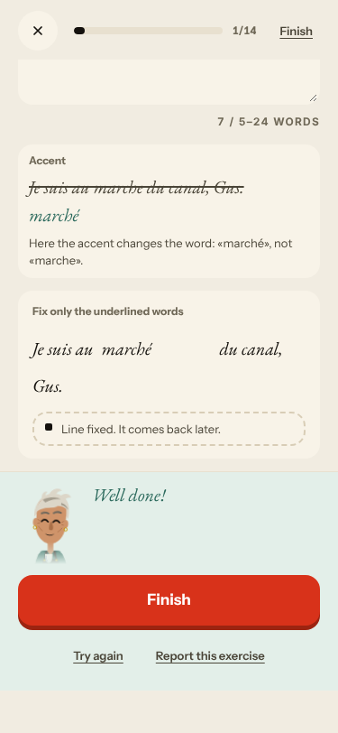 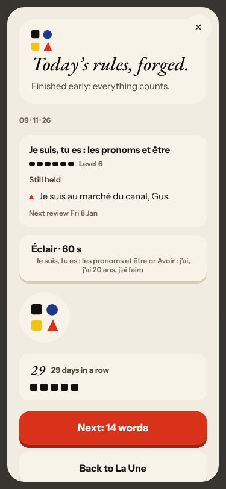
7. **Low · #577 (again)** Nº 27 has three titles. 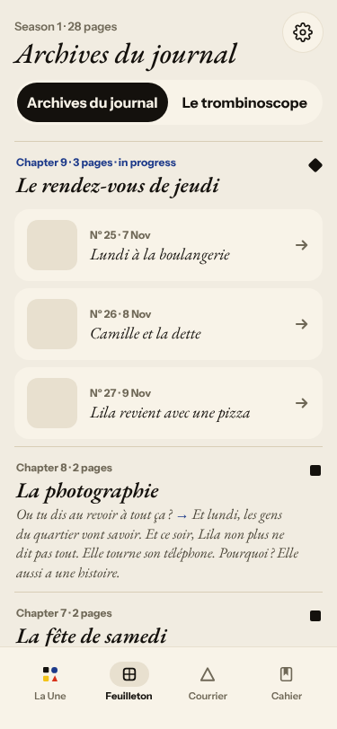

### #146 content not driven by one concept
8. **Medium · #576 (again)** no rule card; the Forge drills a Level-6 day-1 rule on day 28. 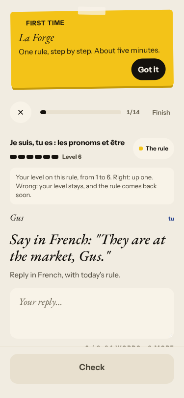

### #147 cast registry / #144 register
9. **High · #114 (again)** Camille talks as the parcel's owner and invents tracking number 123456; ends «Qu'en pensez-vous ?» (vous to a friend). 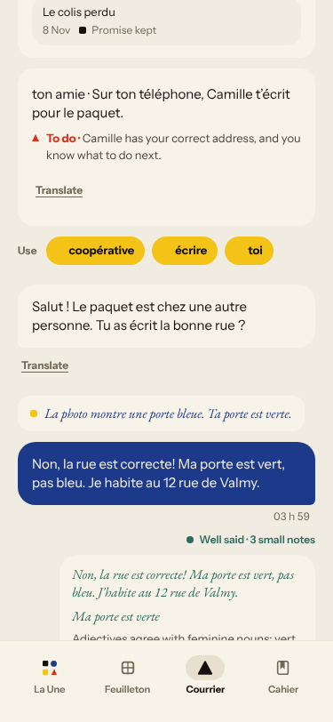 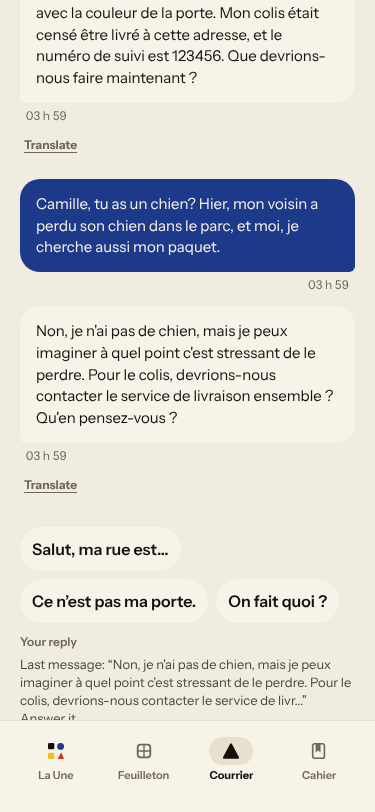

## Re-tests
- **#378 not reproduced (third night)**, **#590 not reproduced** (both letters answered, closed «Partly»): left open, commented.
- #381: the red «Not yet» banner was gone after the accepted repair («Line fixed. Well done!»); the next-step half is #443. Not closed.
- #167: the first recall drill was audio-only with «Show the text» (still true), not commented. Not reached: #518, #536, #537, #562.

## Scripted walk
Not run (live walk only).
