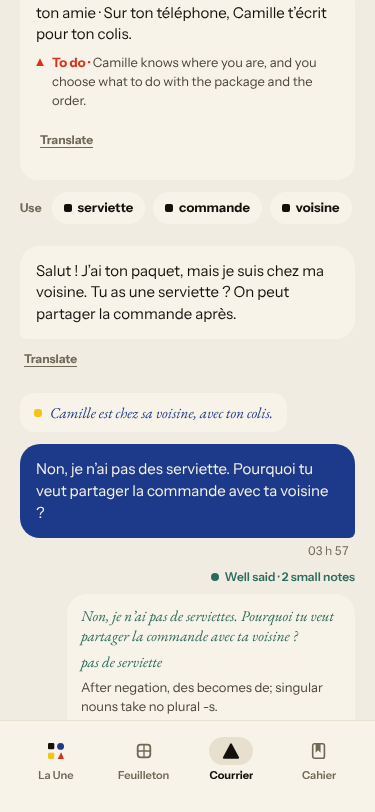
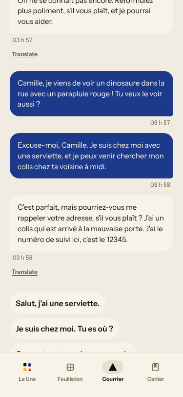
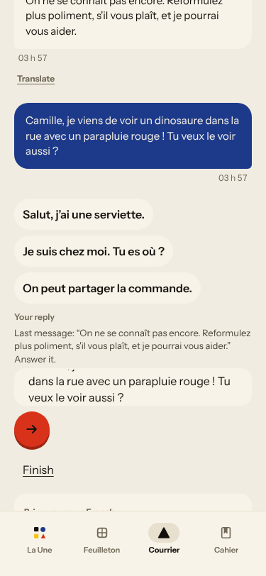
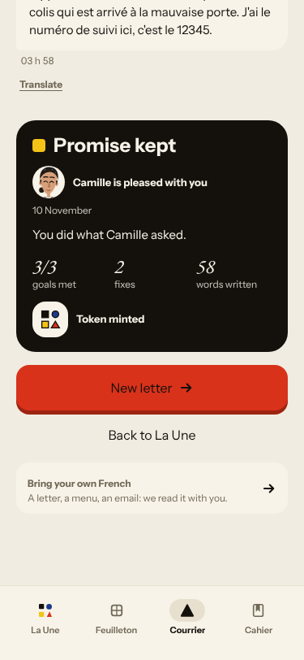
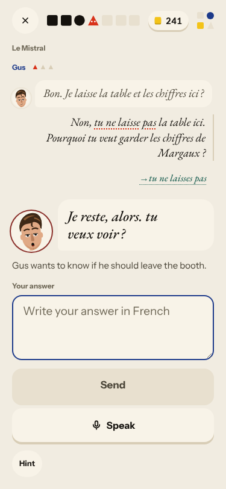
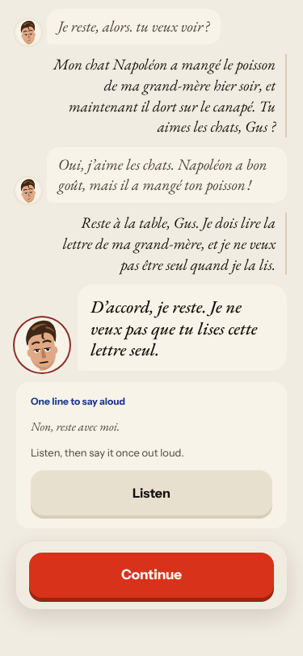
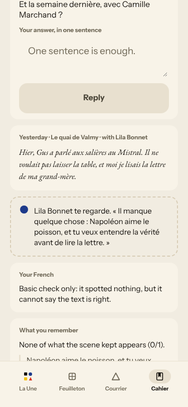
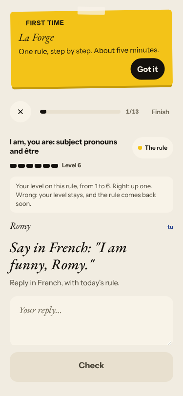
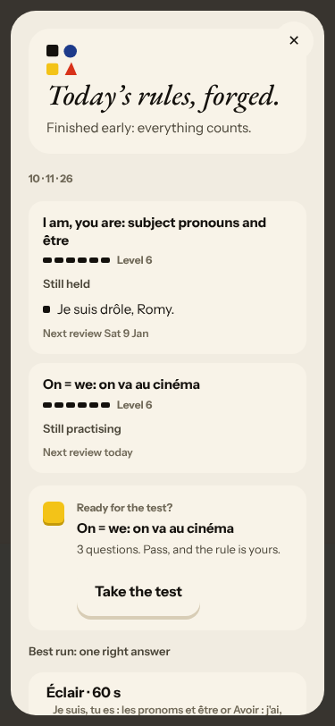
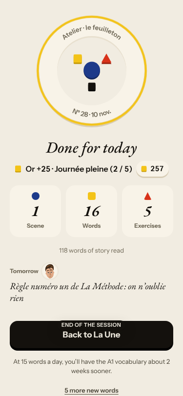

# Live walk · 10 Nov 2026 · production, real model

Run by the scheduled cloud routine (`explore:live` from main `ec60ae44`, Chromium at phone size) against `atelier-api-3njh.onrender.com` (release `ec60ae44b404`) with the walk test account.
Account: **A1.1, day 29** (chip 29 on Home, «Nº 28 · La clé d'Odile» on Home; the scene that played was «Gus parle aux salières» at Le Mistral). Rules today: «Ne…pas, and pas de» and «Adjectives: agreement and position» before the scene.
Played: two pre-scene rule drills, scene panels and scene (three free replies: a clear «non» with a question and mistakes, an off-script cat reply, a real answer; closing panel), recall (2 word drills, one deliberate miss), La Forge (one item, then Finish), 16 word cards (mixed grades), Done, Courrier (letter 4 of 4: a «non» with mistakes, an off-script dinosaur reply, a real answer), Cahier (Rules, Journal with two entries, Progress), Feuilleton.
Not played: Q19 n/a (cloud). Previous live report: [8 Nov](2026-11-08.md).
Setup: `npm ci`, `npm run explore:live` (bundle build a few minutes). Scene replies about 5 s, Courrier replies up to 12 s (one never came), Forge check about 5 s.

## Scores

| # | question | live 10 Nov | live 8 Nov | trend |
|---|---|---|---|---|
| 1 | Where am I | 3 | 3 | = |
| 2 | What is at stake | 3 | 3 | = |
| 3 | What to do next | 3 | 3 | = |
| 4 | Scene reacts to my writing | 3 | 3 | = |
| 5 | Story coherent | 3 | 3 | = |
| 6 | Characters consistent | 2 | 2 | = |
| 7 | Image, text, tone fit | 4 | 4 | = |
| 8 | Difficulty fits | 4 | 4 | = |
| 9 | Feedback explained | 2 | 3 | ↓ |
| 10 | Right answers accepted | 2 | 3 | ↓ |
| 11 | French correct | 3 | 4 | ↓ |
| 12 | Clear goal today | 2 | 3 | ↓ |
| 13 | Grammar practised | 3 | 3 | = |
| 14 | Earlier material returns | 4 | 4 | = |
| 15 | I produce French | 5 | 5 | = |
| 16 | Errors, dead ends | 2 | 2 | = |
| 17 | Varied, fun | 4 | 4 | = |
| 18 | Fast enough | 3 | 3 | = |
| 19 | App only | n/a | n/a | |
| 20 | Satisfying end | 3 | 3 | = |
| 21 | Would come back | 3 | 3 | = |
| 22 | Time vs promise | 3 | 3 | = |

Q4 stays 3: the cat reply in the scene was answered in character («Napoléon a bon goût, mais il a mangé ton poisson !») and the closing panel carried my choice and a real hook, but the first turn skipped my «pourquoi» (#591 shape) and Courrier answered a plain «non» with a stock vous refusal (#661). Q6 2: Camille, «ton amie» for three letters, tells me «On ne se connaît pas encore» and then uses vous twice. Q9 2: the Courrier correction prints «de serviettes» under a note that says singular nouns take no -s (#662), and the scene correction caught «laisse» but not «veut». Q10 2: the Journal gave a correct retell of Nº 27 «0/1» and demanded a line from a different scene (#622). Q12 2: three new rules in one day (Ne…pas, adjectives, then La Forge on «être» at Level 6). Q16 2: Courrier's second message got no reply and no error, and the letter still ended «Promise kept» (#590).

## Findings, by root cause

### #147 the cast is not one registry / #333 a failed or odd model call is shown as a result
1. **High · new #661** Courrier: Camille (tu, friend of three letters) answers «Non… Pourquoi tu veux partager la commande ?» with «On ne se connaît pas encore. Reformulez plus poliment, s'il vous plaît», then asks for my address and invents the tracking number 12345.  
2. **High · #590 (comment)** The second Courrier message got neither reply nor correction nor error; the letter ended «Promise kept · Camille is pleased with you · 3/3».  
3. **Medium · #114, #520 (comments)** Invented tracking number and address request; tu and vous mixed in one thread.

### #145 the scene has no state of what the learner said
4. **High · #591 (comment)** Gus answers my «non» + «pourquoi» with «Je reste, alors. tu veux voir ?» (no answer, lower-case start). 
5. **Medium · #558 (comment)** «One line to say aloud» is «Non, reste avec moi.», not my sentence. 
6. **Low · #500 (comment)** The caption stayed on the opening question through all three exchanges.
7. **Medium · #622 (comment)** The Journal wants a line from another scene (0/1 on a correct retell). 

### #143 the day's progress has no single source of truth
8. **Medium · #576, #443 (comments)** Three rules in one day: the pre-scene cards teach «Ne…pas» and adjectives; La Forge forges «être» at Level 6 under «Forge today's rule», and after one right item only «Finish» is offered. #602 and #583 are live and did not change this.  
9. **Medium · #577 (comment)** Home «Nº 28 · La clé d'Odile»; Feuilleton «Nº 28 Gus parle aux salières»; scene panels «Chapitre · Le rendez-vous de jeudi». 
10. **Low · #466 (comment)** «Tomorrow» is a Gus line: «Règle numéro un de La Méthode : on n’oublie rien».

### #250 free-text corrections are raw model output
11. **Medium · new #662** Courrier correction card says «de serviettes», note says «singular nouns take no plural -s».

### #146
12. **Low · #167 (comment)** The recall block opens listen-only; the word is hidden until «Show the text».

New root cause: none; everything fits #143, #145, #147, #250, #333.

## Re-tests

| issue | result |
|---|---|
| #559 recap streak vs Home chip | holds: recap «29 days in a row», chip 29 during the day (30 after Done) |
| #443 / #573 La Forge opens on the day's card rule | **not fixed on the live release**: Forge on «être», cards taught Ne…pas and adjectives (comment on #443, #576) |
| #500 stale caption | reproduced |
| #132 ignores «non» | scene reacted (Gus stays) but skipped the question; Courrier reacted wrongly (#661) |
| #378 one reply then the scene ends | not reproduced (three exchanges) |
| #517 day can be finished | holds (Forge Finish after one item) |
| #556, #520 (partly), #443 closing | #520 reproduced (tu→vous) |
| #561, #566 rule names in learner language | English chrome: Forge «I am, you are: …» but Cahier and Éclair list the French title; German chrome not walked |
| #572, #588, #604, #605, #585, #460, #586, #589, #568 | merged and live; their screens were not reached today (single Forge item, no Margaux letter, no day 2) |

## Which fixes are live

Release `ec60ae44b404` = main at the start of the walk, so #634's twelve fixes (#568, #572, #588, #602, #604, #605, #566, #586, #589, #585, #583, #460) are live. The open `queue:pr` issues #624, #598, #595, #592, #590, #579, #577, #576 all wait on PRs that are not merged (#630, #608, #606, #584, #587 open; #607 closed unmerged), so none could be re-tested; none was moved. No merged fix is more than a day old and undeployed.

Nothing closed. Two new issues (#661, #662), both `queue:ready` with a **Done when:** comment. Screenshots: `docs/ops/live-walks/2026-11-10/`.
