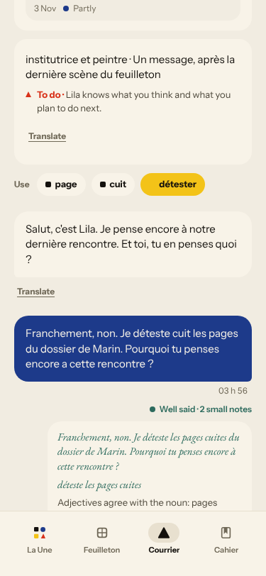
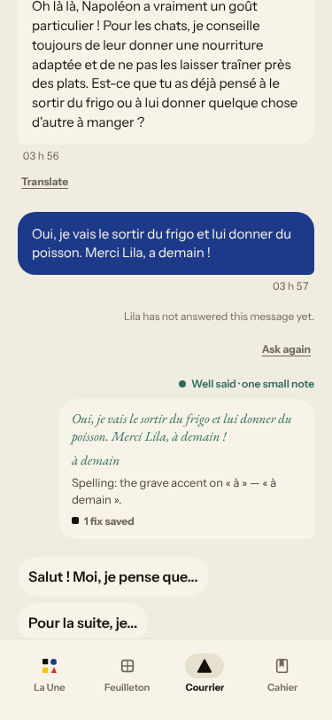
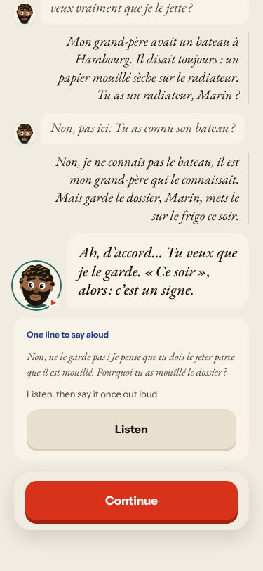
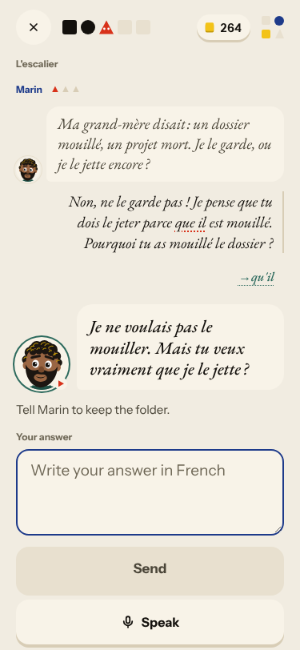
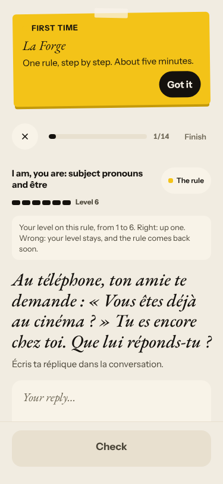
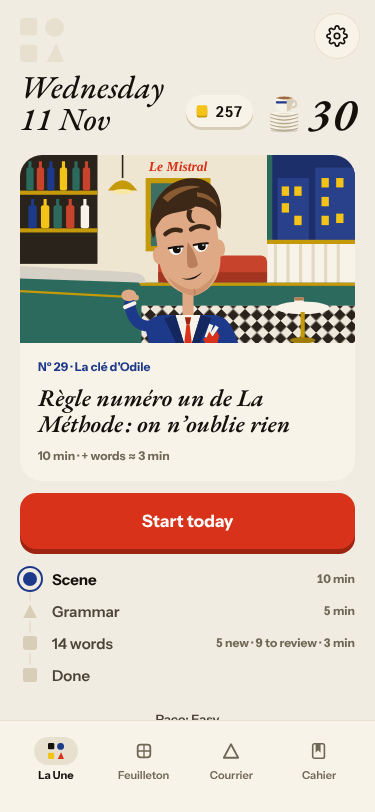
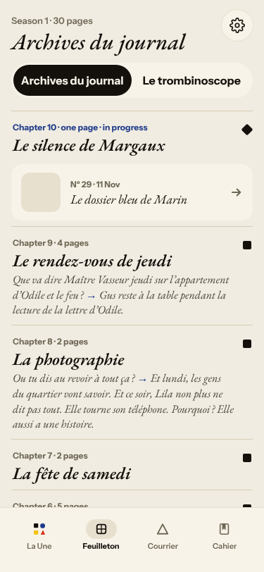
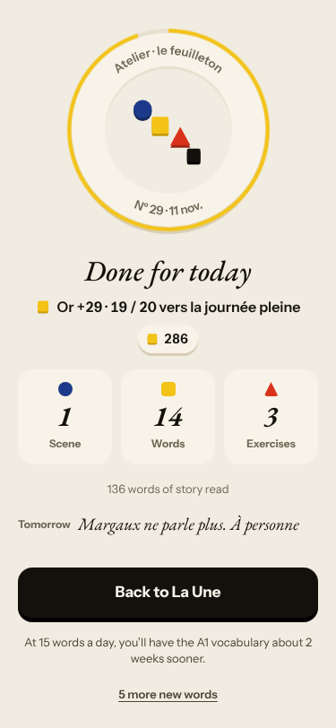
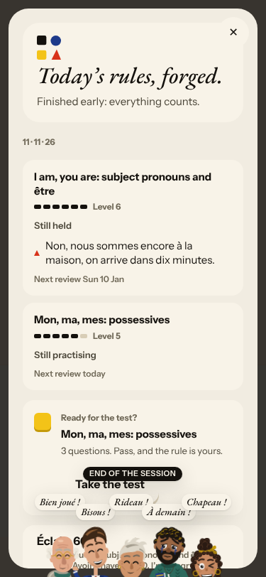

# Live walk · 11 Nov 2026 · production, real model

Run by the scheduled cloud routine (`explore:live`, Chromium at phone size) against `atelier-api-3njh.onrender.com` (release `cbaedd4abe87`) with the walk test account.
Account: **A1.1, day 30** (chip 30 on Home; Home «Nº 29 · La clé d'Odile»; the scene that played was «L'escalier» / «Le dossier bleu de Marin» with Marin). Rule before the scene: «On = we».
Played: one pre-scene drill, scene panels and scene (three free replies: a clear «non» with a question and mistakes, an off-script grandfather/radiator reply, a real answer; closing panel), recall (one word), La Forge (one item, then Finish), 14 word cards (every fourth «Again»), Done, Courrier (letter 4 from Lila: a «non» with mistakes, an off-script cat reply, a real answer), Cahier (Rules, Journal with two prompts), Feuilleton.
Not played: Q19 n/a (cloud). Previous live report: [10 Nov](2026-11-10.md). Replies took roughly 8–14 s.

## Scores

| # | question | live 11 Nov | live 10 Nov | trend |
|---|---|---|---|---|
| 1 | Where am I | 3 | 3 | = |
| 2 | What is at stake | 3 | 3 | = |
| 3 | What to do next | 3 | 3 | = |
| 4 | Scene reacts to my writing | 3 | 3 | = |
| 5 | Story coherent | 3 | 3 | = |
| 6 | Characters consistent | 2 | 2 | = |
| 7 | Image, text, tone fit | 4 | 4 | = |
| 8 | Difficulty fits | 4 | 4 | = |
| 9 | Feedback explained | 3 | 2 | ↑ |
| 10 | Right answers accepted | 3 | 2 | ↑ |
| 11 | French correct | 3 | 3 | = |
| 12 | Clear goal today | 2 | 2 | = |
| 13 | Grammar practised | 3 | 3 | = |
| 14 | Earlier material returns | 4 | 4 | = |
| 15 | I produce French | 5 | 5 | = |
| 16 | Errors, dead ends | 2 | 2 | = |
| 17 | Varied, fun | 4 | 4 | = |
| 18 | Fast enough | 3 | 3 | = |
| 19 | App only | n/a | n/a | |
| 20 | Satisfying end | 4 | 3 | ↑ |
| 21 | Would come back | 3 | 3 | = |
| 22 | Time vs promise | 3 | 3 | = |

Q4 3 (worst screen: Courrier): the scene reacted to everything I wrote (it answered my «pourquoi», my radiator question and my final choice, and the closing panel carried «Je le garde» and the hook «Margaux ne parle plus. À personne»), but Lila answered a plain «non» with a refund-desk line. Q6 2: same line, plus «ma grand-mère … m'inspirer dans ma peinture» claims the learner's grandmother as Lila's. Q9 3: Forge and Courrier corrections were exact; the scene correction caught «parce que il» but not «il est mon grand-père» (should be «c'est»). Q10 3: Journal retell of yesterday accepted 1/1; the week-ago line «Camille voulait partager une commande» scored 0/1 (could not verify what the scene kept). Q12 2: three rules in one day (#576). Q16 2: a Courrier reply never came and «Ask again» did nothing (#693). Q20 4: the tomorrow hook is a real, specific question this time.

## Findings, by root cause

### #147 the cast is not one registry / #333 a failed or odd model call is shown as a result
1. **High · #538, #114 (comments)** Lila answers «non» + «pourquoi» with «…voyager aujourd'hui ou demander un remboursement ?». 
2. **High · new #693 (child of #333)** Third Courrier message: «Lila has not answered this message yet», «Ask again» does nothing. 

### #145 the scene has no state of what the learner said
3. **Medium · #558 (comment)** «One line to say aloud» is my first uncorrected reply, opposite of the outcome. 
4. **Low · #500 (comment)** Caption stuck on «Tell Marin to keep the folder.» 

### #143 the day's progress has no single source of truth
5. **Medium · #576, #443 (comments)** «On = we» before the scene, La Forge on «être» at Level 6, a test offered on «Mon, ma, mes». 
6. **Medium · #577 (comment)** Three names for today: Nº 29 «La clé d'Odile», chapter «Le silence de Margaux», scene «L'escalier».  

### #522 learner text has no locale contract
7. **Low · new #694** «Or +29 · 19 / 20 vers la journée pleine» and «11 · 11 · 26» in English chrome. 

### #250 / #381
8. **Low · #381 (comment)** «Line fixed … Well done!» while the shown sentence keeps the gap. 

Not filed: Marin's «Tu as connu son bateau ?» (asked about my own grandfather's boat) reads oddly; the journal's 0/1 on the week-ago line needs the stored target to judge. New root cause: none.

## Re-tests

| issue | result |
|---|---|
| #590 (closed) Courrier unanswered message | not fixed in spirit: reproduced as #693 (now honest, but retry is silent) |
| #500 stale caption | reproduced |
| #576 / #443 Forge opens on the day's rule | not fixed (PR #587 still open) |
| #574 Forge free-production check | not reached with a long item; the one correction shown was exact (#585 live) |
| #132 ignores «non» | scene reacted; Courrier answered with a stock line (#538) |
| #381 | partly: no red banner, but the repaired line is not redrawn |

Nothing closed.

## Which fixes are live

Release `cbaedd4abe87`. Merged and live: #585, #584 (→#579), #630 (→#624), all ancestors of the release. #579 and #624 are closed. Open `queue:pr` issues wait on PRs not merged (#672, #608, #606, #633, #587, #569, #582 open; #607, #570, #567 closed unmerged), so none could be re-tested or moved. #574 (fix #585, merged 9 Nov, live) was not reachable today and stays. No merged fix is more than a day old and undeployed.

Two new issues (#693, #694), both `queue:ready` with a **Done when:** line. Screenshots: `docs/ops/live-walks/2026-11-11/`.
