# Live walk · 12 Nov 2026 · production, real model

Run by the scheduled cloud routine (`explore:live` from main `95092160`, Chromium at phone size) against `atelier-api-3njh.onrender.com` (release `950921607b45`) with the walk test account.
Account: **A1.1, day 31** (Home «Nº 30 · La clé d'Odile»; the scene that played was «Margaux sert sans parler» at Le Mistral). Rules today: «Mon, ma, mes: possessives» and «Present tense of -er verbs» before the scene, «I am, you are: subject pronouns and être» in recall, then La Forge on «Avoir».
Played: two pre-scene rule drills (one deliberate miss), word drills, scene panels and scene (three free replies: a clear «non» with a question and mistakes, an off-script parrot reply, a heartfelt reply with «je ai»; closing panel), recall (rebuild, dictation with a miss, word, dictation), La Forge (three items, one free sentence whose check never ran, then Finish), 13 word cards (two «Again»), Done, Courrier (Mme Diallo, a «non» with mistakes, an off-script dinosaur reply, no reply ever came), Cahier (Rules, Journal, Progress), Feuilleton.
Not played: Q19 n/a (cloud). Previous live report: [10 Nov](2026-11-10.md).
Setup: `npm ci`, `npm run explore:live` (bundle build a few minutes). Scene replies 3 to 6 s, La Forge free check never answered (6 s then «not checked yet», twice 8 s), Courrier never answered (15, 20 and 12 s waits).

## Scores

| # | question | live 12 Nov | live 10 Nov | trend |
|---|---|---|---|---|
| 1 | Where am I | 3 | 3 | = |
| 2 | What is at stake | 3 | 3 | = |
| 3 | What to do next | 3 | 3 | = |
| 4 | Scene reacts to my writing | 2 | 3 | ↓ |
| 5 | Story coherent | 3 | 3 | = |
| 6 | Characters consistent | 2 | 2 | = |
| 7 | Image, text, tone fit | 4 | 4 | = |
| 8 | Difficulty fits | 4 | 4 | = |
| 9 | Feedback explained | 3 | 2 | ↑ |
| 10 | Right answers accepted | 2 | 2 | = |
| 11 | French correct | 3 | 3 | = |
| 12 | Clear goal today | 2 | 2 | = |
| 13 | Grammar practised | 3 | 3 | = |
| 14 | Earlier material returns | 4 | 4 | = |
| 15 | I produce French | 5 | 5 | = |
| 16 | Errors, dead ends | 2 | 2 | = |
| 17 | Varied, fun | 4 | 4 | = |
| 18 | Fast enough | 3 | 3 | = |
| 19 | App only | n/a | n/a | |
| 20 | Satisfying end | 3 | 3 | = |
| 21 | Would come back | 3 | 3 | = |
| 22 | Time vs promise | 3 | 3 | = |

Q4 2: all three scene replies were stock «Oh. …» lines («Si c'est non, c'est non.», «Bonne question. Je n'ai pas encore la réponse.», «Je ne m'attendais pas à ça.»); none named the parrot, the café or the cellar I wrote about, and the closing panel carried none of it. Q6 2: recall says «Write what you said» over «Im suis au Mistral, Marin.», words I never wrote. Q9 3: the rule drills and La Forge «Avoir» explain a miss well and correctly («Same word, different form: «habitez»», ««suis» does not belong in this line…»); the Courrier correction card was right but the rest of the letter never answered. Q10 2: the Journal gave 0/1 to a retell that matches today's «Previously» panel (#622), and the recall drill accepted the non-word «Im» (#723). Q12 2: four rules in one day (possessives, -er verbs, être in recall, Avoir in La Forge as «today's rule»). Q16 2: the Forge free check ended «Answer saved, not checked yet. It doesn't count yet.» with a dead «Run again» (#724), Courrier ended with «Basic check only. The full check did not run.» and no reply (#693).

## Findings, by root cause

### #333 a failed or odd model call is shown as a result
1. **High · new #724** La Forge «Quel âge as-tu?» free sentence: «Let me read it again…», then «Answer saved, not checked yet. It doesn't count yet.»; «Run again» (twice) changes nothing; only «Skip without a check» is left. 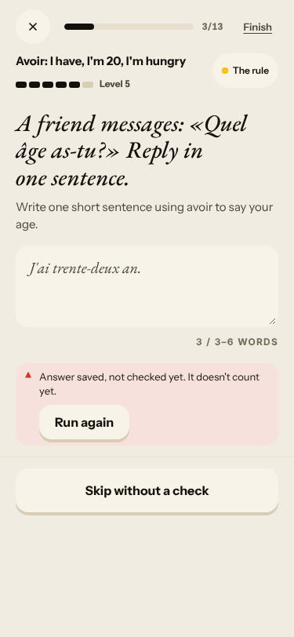
2. **High · #693 (comment)** Courrier Mme Diallo: correction card present, «Basic check only. The full check did not run.», «Mme Diallo has not answered this message yet.», «Ask again» and «Check again» dead, a second message the same, «Finish» ends the letter as «Done». 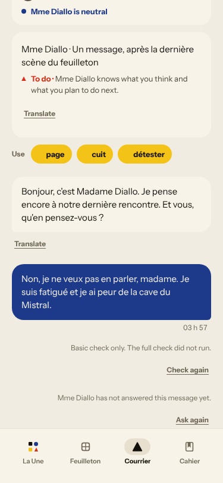 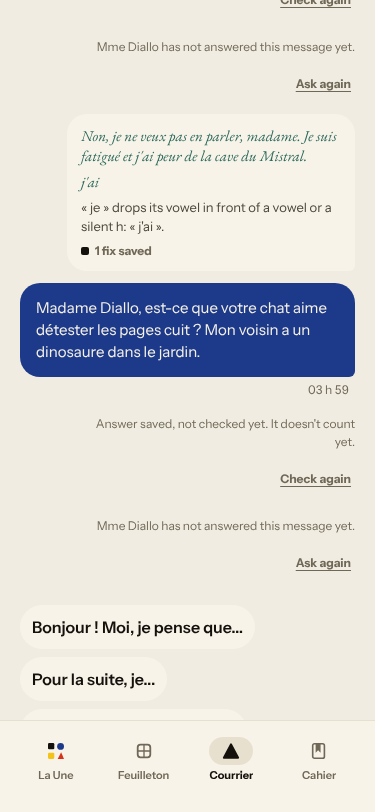
3. **High · #171 (comment)** Three scene replies are stock «Oh. …» lines that ignore the content (see Q4). 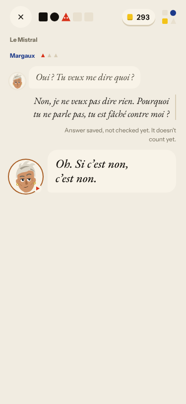 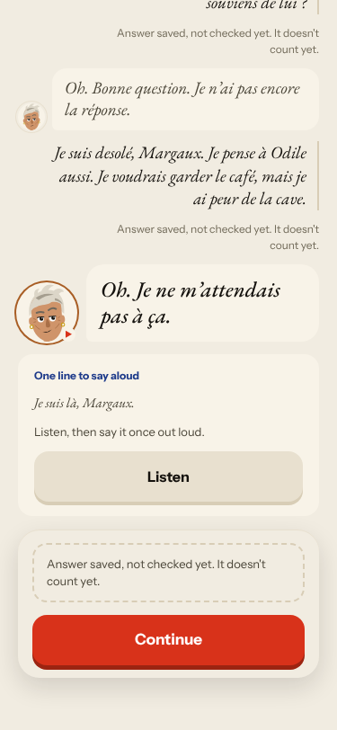 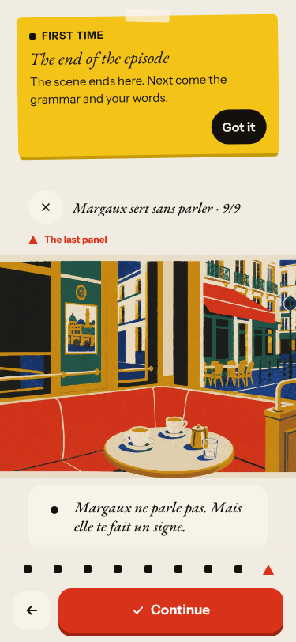

### #174 a right answer is judged against one stored string
4. **High · new #723** Recall «Write what you said, correctly»: «Im suis au Mistral, Marin.», a bank without «Je/Il», and «Im est au Mistral, Marin.» is «Correct». 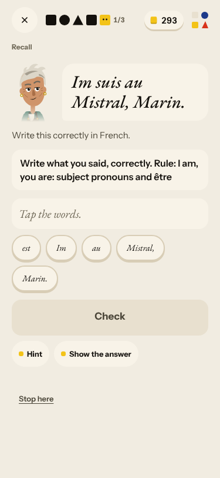 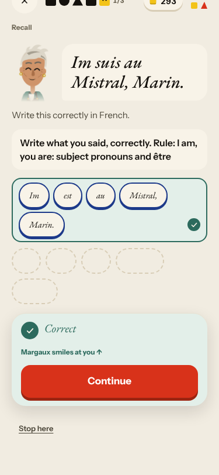

### #522 learner-facing text from a stored field has no locale contract
5. **Low · new #725** Word cards «school» and «forty» (English front, «Tap to turn», no direction cue) among French-front cards. 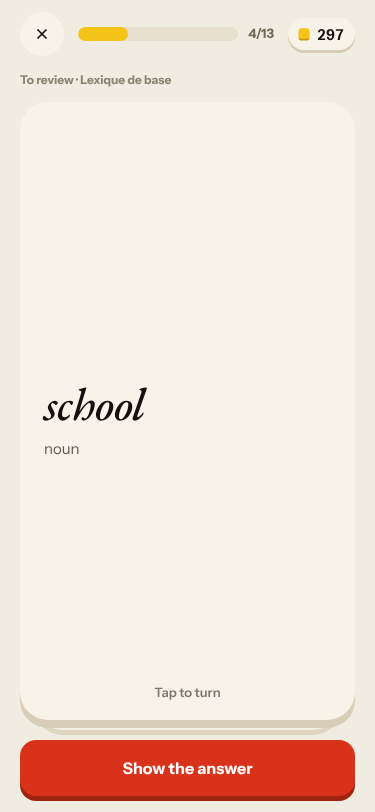

### #145 the scene has no state of what the learner said
6. **Medium · #622 (comment)** Journal asks about «L'escalier · with Marin»; a correct retell of the «Previously» panel is 0/1. 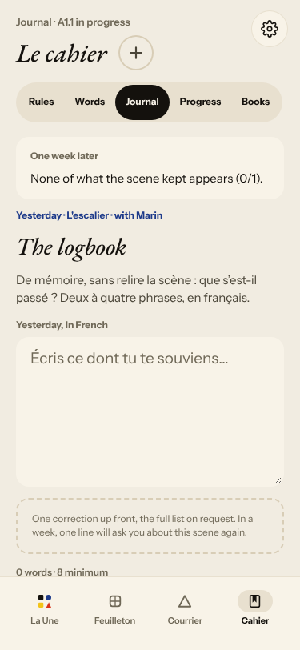

### #143 the day's progress has no single source of truth
7. **Medium · #576 (comment)** Four rules in a day; La Forge opens on «Avoir» as «Forge today's rule». 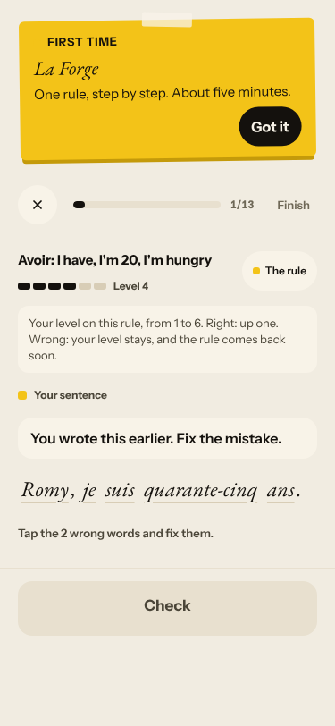
8. **Low · #694 (comment)** Done: «Or +11 · 11 / 20 vers la journée pleine» under English chrome. 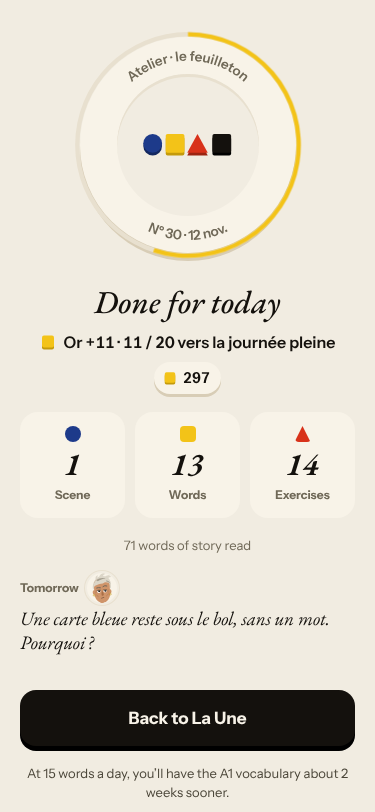

New root cause: none; everything fits #143, #145, #174, #333, #522.

## Re-tests

| issue | result |
|---|---|
| #443 / #573 La Forge opens on the day's card rule | still not fixed on the live release: cards taught possessives and -er verbs, La Forge «Avoir» (comment on #576) |
| #500 stale caption | not reached (scene input had no caption this time) |
| #132 ignores «non» | the scene reacted to «non» («Si c'est non, c'est non.») and skipped my question; Courrier gave no reply |
| #378 one reply then the scene ends | not reproduced (three exchanges) |
| #517 day can be finished | holds (La Forge Finish, Done reached) |
| #167 first word drill listen-only | reproduced: «Show the text» needed to see «le midi» |
| #559 recap streak vs Home chip | not walked today |
| #555 / #520 tu-vous | Mme Diallo uses vous consistently (neutral neighbour) |

## Which fixes are live

Release `950921607b45` = main at the start of the walk, so every merged fix is live (main's last merged PR: #722). The open `queue:pr` issues (#699, #698, #696, #694, #664, #622, #598, #595, #592, #577, #576, #574, #562, #557, #556, #552, #542, #538, #535, #522, #520, #500, #473, #469, #467, #445, #443, #398, #386, #384) wait on PRs that are not merged (#512 and #484 closed unmerged); none was re-testable and none was moved. No merged fix is more than a day old and undeployed (the newest merges, #721 and #722, are in the release).

Nothing closed. Three new issues (#723, #724, #725), all `queue:ready` with a **Done when:** comment. Screenshots: `docs/ops/live-walks/2026-11-12/`.
