# Live walk · 13 Nov 2026 · production, real model

Run by the scheduled cloud routine (`explore:live` from main `faa14974`, Chromium at phone size) against `atelier-api-3njh.onrender.com` (release `faa14974a939`) with the walk test account.
Account: **A1.1, day 32** (Home «Nº 31 · La clé d'Odile»; the scene that played was «Marin fait une omelette»). Rules today: one, La Forge «Le, la, l', les» (no pre-scene rule card).
Played: scene (listen step, reader, three free replies: a clear «non» with a question and «Je ai», an off-script parrot-in-the-cellar reply with «mon clé», a reply to Marin with «mon clé»; closing panel and recap), seven recall drills (one deliberate miss, one accent/plural slip appealed), La Forge (one free sentence with «la oiseau», two repairs, then Finish), 16 word cards (two «Again»), Done, Courrier (Nina, three messages: a «non» with «Je ai oublié», an off-script dinosaur reply, a short confirm), Cahier (Rules, Journal retell, Progress), Feuilleton.
Not played: Q19 n/a (cloud). Previous live report: [12 Nov](2026-11-12.md).
Setup: `npm run explore:live` (bundle build about 4 min). Scene replies 3 to 6 s, La Forge free check about 6 s, Courrier replies 12 to 15 s; every model call answered this time.

## Scores

| # | question | live 13 Nov | live 12 Nov | trend |
|---|---|---|---|---|
| 1 | Where am I | 3 | 3 | = |
| 2 | What is at stake | 3 | 3 | = |
| 3 | What to do next | 3 | 3 | = |
| 4 | Scene reacts to my writing | 4 | 2 | ↑ |
| 5 | Story coherent | 3 | 3 | = |
| 6 | Characters consistent | 2 | 2 | = |
| 7 | Image, text, tone fit | 4 | 4 | = |
| 8 | Difficulty fits | 4 | 4 | = |
| 9 | Feedback explained | 3 | 3 | = |
| 10 | Right answers accepted | 2 | 2 | = |
| 11 | French correct | 3 | 3 | = |
| 12 | Clear goal today | 3 | 2 | ↑ |
| 13 | Grammar practised | 3 | 3 | = |
| 14 | Earlier material returns | 4 | 4 | = |
| 15 | I produce French | 5 | 5 | = |
| 16 | Errors, dead ends | 3 | 2 | ↑ |
| 17 | Varied, fun | 4 | 4 | = |
| 18 | Fast enough | 3 | 3 | = |
| 19 | App only | n/a | n/a | |
| 20 | Satisfying end | 4 | 3 | ↑ |
| 21 | Would come back | 3 | 3 | = |
| 22 | Time vs promise | 3 | 3 | = |

Q4 4: replies 2 and 3 (parrot, cellar, stolen key) and the closing panel («Tu ne veux pas de pizza. Je cherche ta clé avec toi, et le perroquet attend dans la cave») and the recap («Le perroquet a volé ta clé…») used what I wrote; reply 1 ignored my «non» and my question (#171). Q6 2: I address Marin, Lila answers (#750); Nina, a colleague nobody introduced, uses vous (#747). Q10 2: «les oeufs» for «eggs» is «Not yet» (#746), a repair «l'oiseau» for «la oiseau» is rejected (#745). Q9 3: the Courrier note for «Je ai oublié» invents an object («Je l'ai oubliée») and the Journal says «Nothing to correct» for «à moi» (#749). Q16 3: no dead end and no 500; the earlier Forge dead «Run again» did not repeat, but the Forge «Finish»/«Stop here?» pair is easy to misread. Q20 4: the Done screen asks «Tu veux essayer une autre omelette ?» and the recap carried my story. Q12 3: one rule (Le, la, l', les) as «today's rule», but «This week, we consolidate» over four review words.

## Findings, by root cause

### #174 a right answer is judged against one stored string
1. **Medium · new #745** La Forge «Fix only the underlined words»: «l'oiseau» rejected, the rewrite «les oiseaux» explained as «the plural is needed» though I wrote a singular. 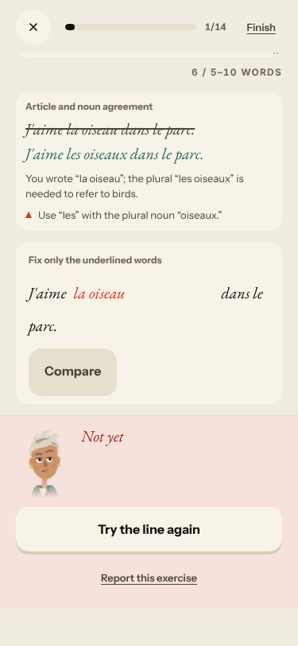 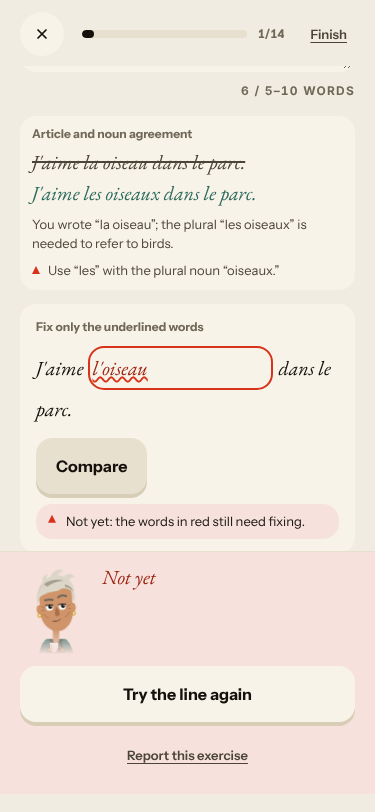
2. **Medium · new #746** Recall «How do you say "eggs"?»: «les oeufs» is «Not yet», «Same word, different form: «oeuf», not «oeufs»». The appeal upheld it. 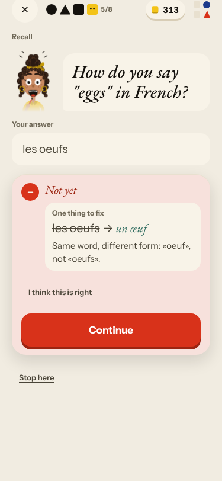

### #145 the scene has no state of what the learner said
3. **Medium · new #748** «One line to say aloud» is «Une pizza, s'il te plaît !» after two refusals of pizza. 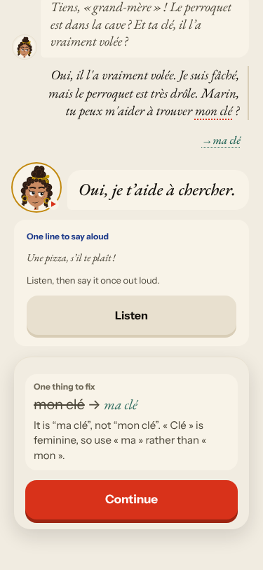
4. **Medium · new #750** I speak to Marin, Lila answers, the panel says «Marin agrees to help you». 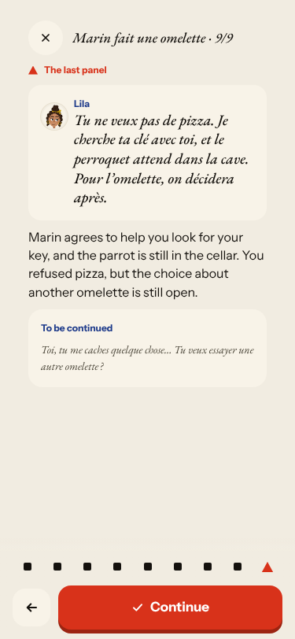
5. **Medium · #171 (comment)** Reply 1 ignored the «non» and the question. 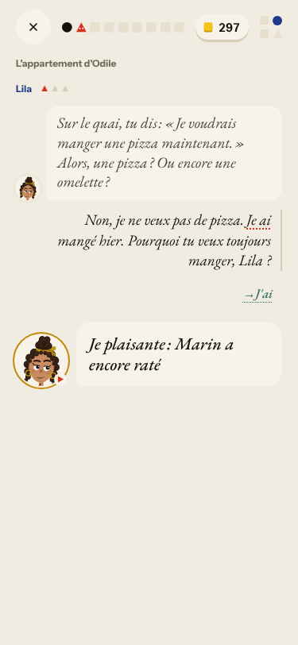

### #147 the cast is not one registry
6. **Medium · new #747** Courrier's Nina («ta collègue») appears from nowhere, uses vous with a tu colleague, writes «que allons-nous» and «d'une sandwich», and her hint contradicts her line. 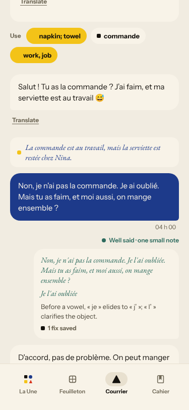 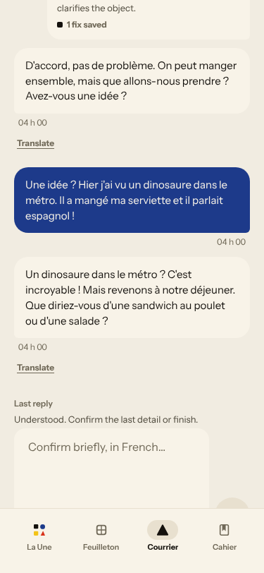

### #250 free-text corrections are raw model output
7. **Medium · new #749** Journal: «Nothing to correct in this text» for «Elle a fait un signe à moi». 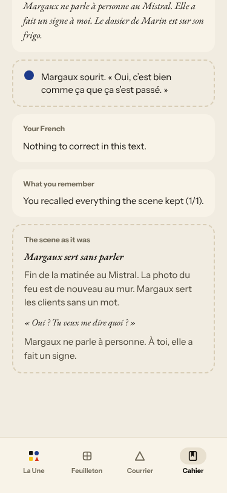

### Seen again (commented)
- **#500** stale scene caption «Lila asks: pizza again…» over the Listen step.
- **#167** first word drill listen-only 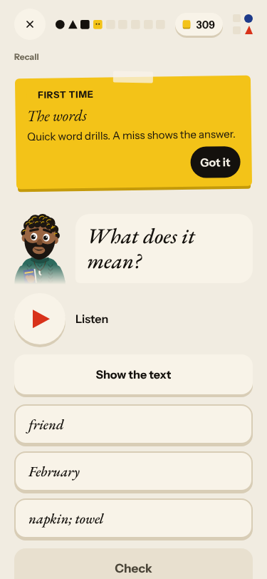
- **#155** «Marin/Lila smiles at you ↑» as the word-drill feedback.
- **#694** Done screen: «Atelier · le feuilleton», «13 nov.», «Or +21 · Journée pleine» under English chrome 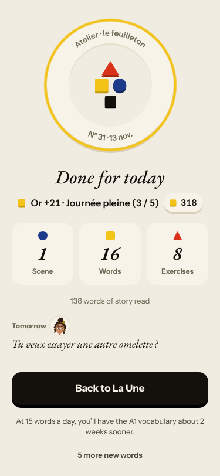
- **#725** Lexique cards mix English-front and French-front with no cue 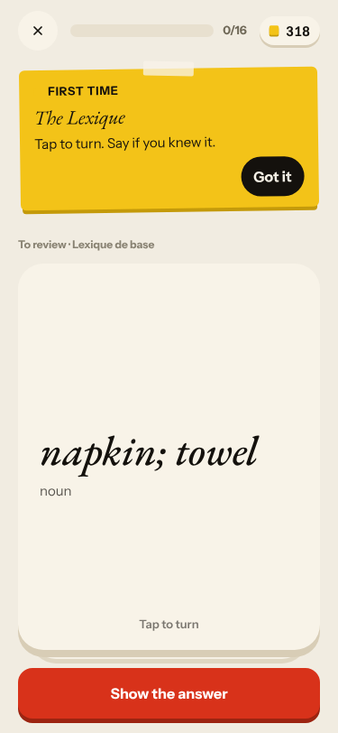
- **#723** recall «de Odile» under «Write what you said, correctly» 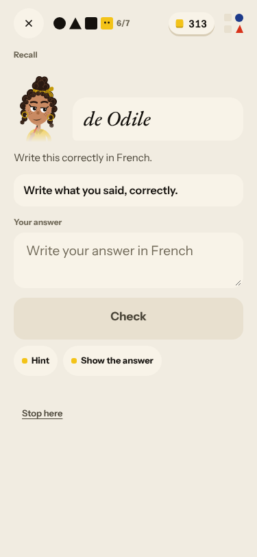
- **#520** tu/vous (see #747).

No new root cause: everything fits #145, #147, #174, #250.

## Re-tests

| issue | result |
|---|---|
| #724 Forge free check «not checked yet» (fixed by #735, live) | holds: the free sentence was checked in about 6 s, the repair step ran (already closed) |
| #132 ignores «non» | the closing panel carried the refusal; reply 1 skipped it (see #171) |
| #378 one reply then the scene ends | not reproduced (three exchanges) |
| #517 day can be finished | holds |
| #622 Journal retell 0/1 for a correct retell | not reproduced: «You recalled everything the scene kept (1/1)» (left open: the live fix is not merged) |
| #693 Courrier reply never arrives | not reproduced today: every message answered; letter finished as «Done» |
| #443 / #573 Forge opens on today's rule | holds today (one rule, Forge on it) |

## Which fixes are live

Release `faa14974a939` = main at the start of the walk, so every merged fix is live. Merged in the last two days: #735 (Forge unchecked sentence, tested above), #739 (upheld appeal, the appeal on «les oeufs» worked), #742. The open `queue:pr` issues wait on PRs that are not merged; none was moved and none is more than a day old and undeployed.

New issues: #745, #746, #747, #748, #749, #750, all `queue:ready` with a **Done when:** comment. Screenshots: `docs/ops/live-walks/2026-11-13/`.
