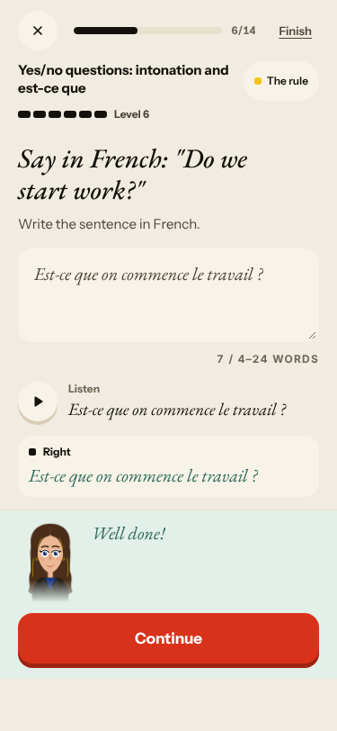
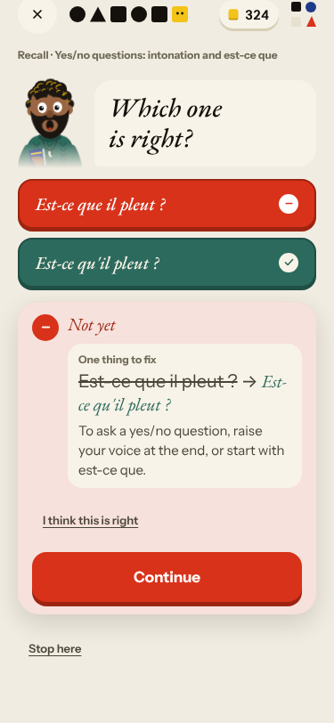
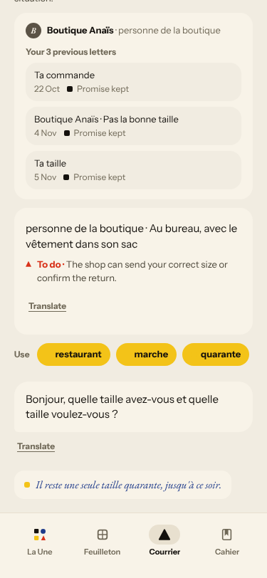
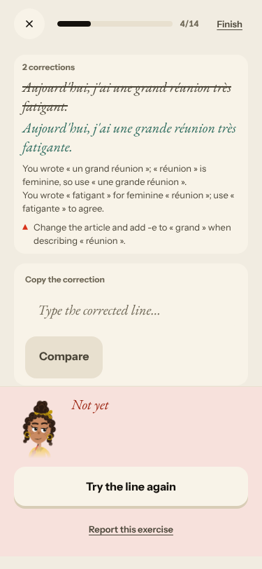
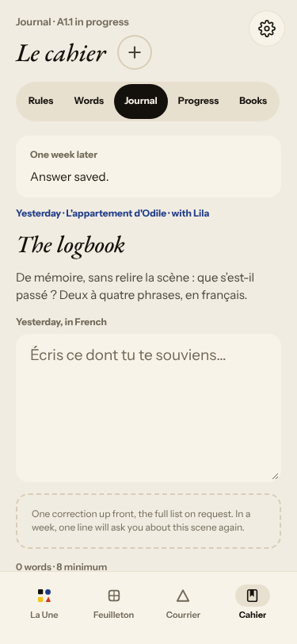
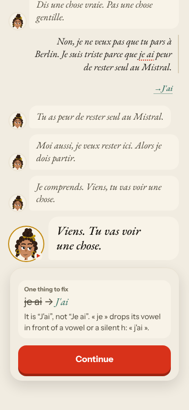
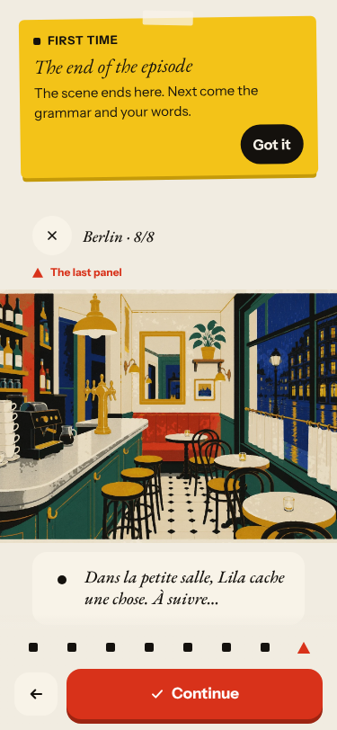
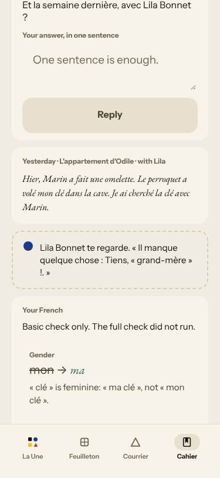
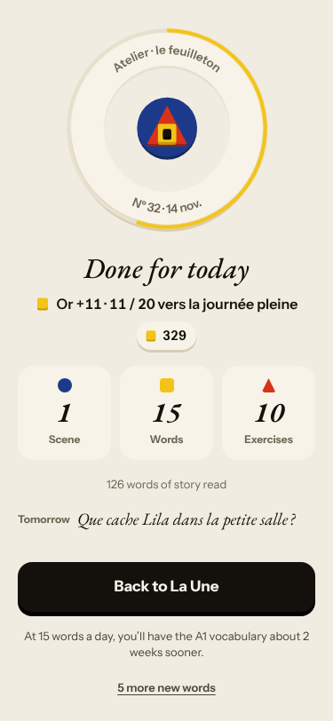
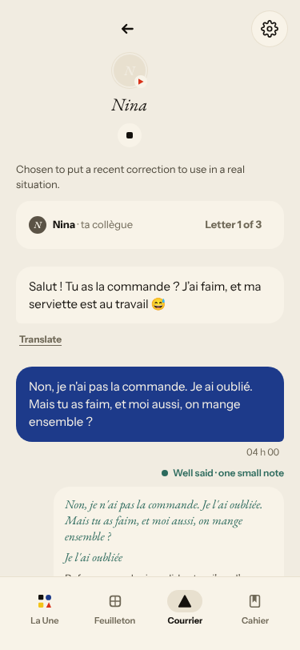

# Live walk · 14 Nov 2026 · production, real model

Run by the scheduled cloud routine (`explore:live` from main `fab6303a`, Chromium at phone size) against `atelier-api-3njh.onrender.com` (release `fab6303a208d`) with the walk test account.
Account: **A1.1, day 33** (Home «Nº 32 · La clé d'Odile», episode «Berlin»; rule «Yes/no questions: intonation and est-ce que»).
Played: scene (reader, one free reply: a clear «non» with «que tu pars» and «je ai peur»; the scene then ended after that single exchange), rule card, two recall drills (one deliberate miss), La Forge (7 of 14 items: a free sentence with «une grand réunion … fatigant», a correct «Est-ce que on commence …» test, then Finish), 15 word cards (two «Again»), Done, Courrier (the week's Nina letter was already Done from last night; a «New letter» from Boutique Anaïs with a «non», an off-script cat and a request), Cahier (Journal callback and retell, Progress), Feuilleton. Only one scene exchange existed, so the second off-script reply went into Courrier.
Not played: Q19 n/a (cloud). Previous live report: [13 Nov](2026-11-13.md).
Harness note: the explore click matcher hit the card container for «I know it» / «Again» in Le Lexique, so the review looked stuck until I clicked by index; the app button works (not an app bug).

## Scores

| # | question | live 14 Nov | live 13 Nov | trend |
|---|---|---|---|---|
| 1 | Where am I | 3 | 3 | = |
| 2 | What is at stake | 3 | 3 | = |
| 3 | What to do next | 3 | 3 | = |
| 4 | Scene reacts to my writing | 3 | 4 | ↓ |
| 5 | Story coherent | 3 | 3 | = |
| 6 | Characters consistent | 3 | 2 | ↑ |
| 7 | Image, text, tone fit | 4 | 4 | = |
| 8 | Difficulty fits | 4 | 4 | = |
| 9 | Feedback explained | 2 | 3 | ↓ |
| 10 | Right answers accepted | 4 | 2 | ↑ |
| 11 | French correct | 3 | 3 | = |
| 12 | Clear goal today | 4 | 3 | ↑ |
| 13 | Grammar practised | 4 | 3 | ↑ |
| 14 | Earlier material returns | 4 | 4 | = |
| 15 | I produce French | 5 | 5 | = |
| 16 | Errors, dead ends | 4 | 3 | ↑ |
| 17 | Varied, fun | 3 | 4 | ↓ |
| 18 | Fast enough | 3 | 3 | = |
| 19 | App only | n/a | n/a |  |
| 20 | Satisfying end | 3 | 4 | ↓ |
| 21 | Would come back | 3 | 3 | = |
| 22 | Time vs promise | 3 | 3 | = |

Q4 3: Lila took up «peur de rester seul au Mistral», but the scene gave one exchange (#776), and the closing page ignored what I said; Courrier's Boutique reacted well to a «non» and the cat. Q9 2: a Forge note quotes words I did not write (#772), the recall note on «Est-ce que il pleut ?» misses the point (#774), the Journal callback has no correction (#775). Q10 4: «Lila voit Romy au Mistral ?» (intonation) and «Est-ce que nous goûtons…» accepted, accent-free variants not tried; but a wrong «Est-ce que on…» is accepted (#773). Q6 3: Nina and the Boutique still use vous (#747 seen again). Q16 4: no dead end, no 500, every model call answered (scene replies 3 to 6 s, Forge free check about 6 s, Courrier replies 12 to 15 s). Q20 3: the Done screen is a mix of French and English (#694) and tomorrow's question is good («Que cache Lila dans la petite salle ?»). Q12/Q13 4: the rule was the day's one goal and Forge practised it.

## Findings, by root cause

### #146 the day's learning content and feedback are not driven by one concept
1. **Medium · new #773** Forge «Say in French: Do we start work?»: «Est-ce que on commence le travail ?» is «Right» and listed under «Still practising», while recall marks «Est-ce que il pleut ?» wrong. 
2. **Medium · new #774** Recall miss explains «raise your voice or start with est-ce que», not the elision. 
3. **Medium · new #777** Courrier «New letter» is «Pas la bonne taille» again (4 Nov), with «restaurant», «marche» as target words. 

### #250 free-text corrections are raw model output
4. **Medium · new #772** Forge note: «You wrote « un grand réunion »» for «une grand réunion». 
5. **Medium · new #775** Journal «One week later» reply saved with «Answer saved.» only (no «son travail»), then a callback about another character. 

### #145 the scene has no state of what the learner said
6. **Medium · new #776** «Exchange 1 of 2», one exchange, repeated Lila line.  

### Seen again (commented)
- **#622** Journal target «Tiens, « grand-mère » !» under the header «L'appartement d'Odile», for the scene «Marin fait une omelette», 0/2. 
- **#378** one-exchange scene. **#694** Done screen mixes French and English. 
- **#754** Journal «basic check only, the full check did not run» misses «Je ai». **#747** Nina thread, vous. 

No new root cause: everything fits #145, #146, #147, #250.

## Re-tests

| issue | result |
|---|---|
| #500 stale caption under the scene input (fix #512, live) | holds: caption matches the question; closed |
| #748 «one line to say aloud» after a refusal (fix #760 merged 13 Nov, live) | not reached: the scene ended with no closing panel today |
| #693 Courrier reply never arrives | not reproduced: every message answered |
| #443 / #573 Forge opens on today's rule | holds today |
| #622 Journal retell target | still reproduces (fix PRs not merged) |

## Which fixes are live

Release `fab6303a208d` = origin/main at the start of the walk, so every merged fix is live. Merged in the last two days: #760, #762, #765, #757, #743. The `queue:pr` issues I could trace wait on PRs that are not merged (#670, #705, #707, #741, #455), so none is a live fix that failed; the one with a merged PR (#512 for #500) holds. No merged PR is older than a day without a deploy.

New issues: #772, #773, #774, #775, #776, #777, all `queue:ready` with a **Done when:** comment. Screenshots: `docs/ops/live-walks/2026-11-14/`.
