# Live walk · 15 Nov 2026 · production, real model

Run by the scheduled cloud routine (`explore:live` from main `fe4f0db3`, Chromium at phone size) against `atelier-api-3njh.onrender.com` (release `fe4f0db31f80`) with the walk test account.
Account: **A1.1, day 34** (Home «Nº 33 · La clé d'Odile», episode «Berlin» / «Le portrait»; rule «Present tense of -er verbs»).
Played: scene (reader; one typed reply «Non, je ne aime pas ce portrait. Mon nez est trop grand, et je veux un chapeau vert comme celui de mon grand-père à Berlin.», then a choice «Non. C'est à toi de parler.»), rule card, recall (13 items, deliberate misses on word order and dictation), La Forge (2 items: a gap fix and a free sentence with «deux thé», then Finish, the only forward button), 12 word cards, Done, Courrier (Nina's weekly letter already Done; «New letter» from Hugo with a «non», an off-script bike request and a deadline), Cahier (Rules, Journal retell, Progress), Feuilleton.
Not played: Q19 n/a (cloud). Previous live report: [14 Nov](2026-11-14.md).

## Scores

| # | question | live 15 Nov | live 14 Nov | trend |
|---|---|---|---|---|
| 1 | Where am I | 3 | 3 | = |
| 2 | What is at stake | 3 | 3 | = |
| 3 | What to do next | 3 | 3 | = |
| 4 | Scene reacts to my writing | 3 | 3 | = |
| 5 | Story coherent | 2 | 3 | ↓ |
| 6 | Characters consistent | 3 | 3 | = |
| 7 | Image, text, tone fit | 4 | 4 | = |
| 8 | Difficulty fits | 4 | 4 | = |
| 9 | Feedback explained | 3 | 2 | ↑ |
| 10 | Right answers accepted | 2 | 4 | ↓ |
| 11 | French correct | 3 | 3 | = |
| 12 | Clear goal today | 4 | 4 | = |
| 13 | Grammar practised | 4 | 4 | = |
| 14 | Earlier material returns | 4 | 4 | = |
| 15 | I produce French | 5 | 5 | = |
| 16 | Errors, dead ends | 3 | 4 | ↓ |
| 17 | Varied, fun | 3 | 3 | = |
| 18 | Fast enough | 3 | 3 | = |
| 19 | App only | n/a | n/a |  |
| 20 | Satisfying end | 2 | 3 | ↓ |
| 21 | Would come back | 3 | 3 | = |
| 22 | Time vs promise | 3 | 3 | = |

Q4 3: Lila took up «mon nez» and corrected «je ne aime» (→ «n'aime»), but ignored the hat and the grandfather; the closing lines did not answer my «non». Q5 2: after «Non. C'est à toi de parler.» Lila says «C'est un signe, ça !» and «Il va pleurer. Et faire une crêpe pour moi.», and the last panel says «Marin fait une place pour Lila» though Marin is not in the scene (#558, #750). Q10 2: recall marked «une» → «one» wrong when «one» sat beside «a, an (f.); one» (#804). Q9 3: the Forge plural note was good and the Courrier elision notes right; recall misses mostly show a bare diff. Q16 3: Courrier Hugo's 3rd reply never came, the letter closed «No answer · nothing is counted» (#693). Q20 2: tomorrow's line is the statement «Marin fait une place pour Lila. Lila part.», no open question (#466), and the Done screen mixes French and English (#694). Q18: Courrier replies 12 to 20 s; scene replies about 5 s.

## Findings, by root cause

### #174 a right answer is judged against one stored string
1. **Medium · new #804** «une» → «one» Not yet. 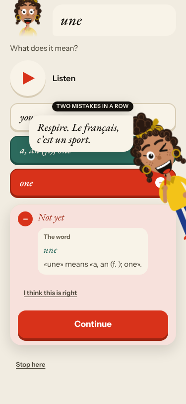

### #146 the day's learning content and feedback are not driven by one concept
2. **Medium · new #805** first recall drill: «le bureau de poste» shown, tiles «poste»/«la», answer «la poste», rule «Le, la, l', les» on a -er day. 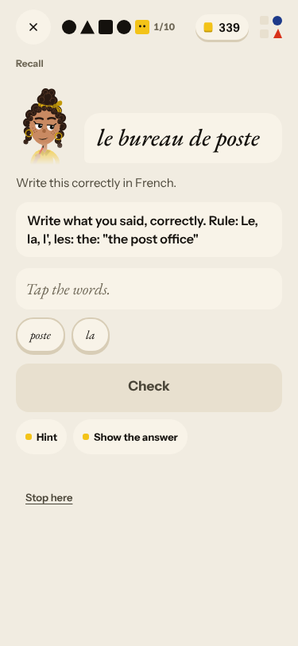
3. **Medium · #562 seen again** Forge prints «Tu donnes un livre a Romy.» as right. 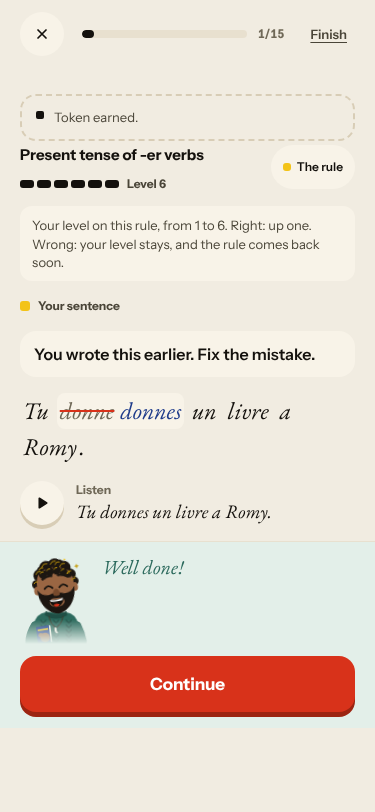
4. **Medium · #443 re-test, not fixed** after a repaired free line the only forward button is «Finish» (see Re-tests). 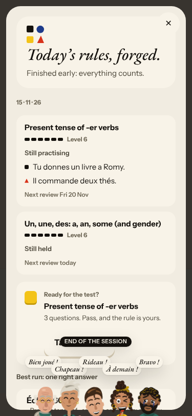

### #145 the scene has no state of what the learner said
5. **High · #558 / #750 / #378 seen again** the closing panels ignore the «non», bring in Marin. 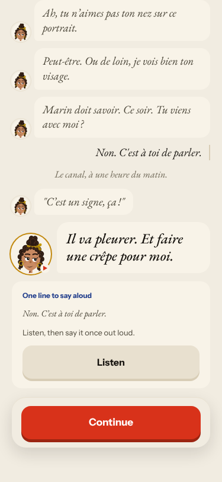 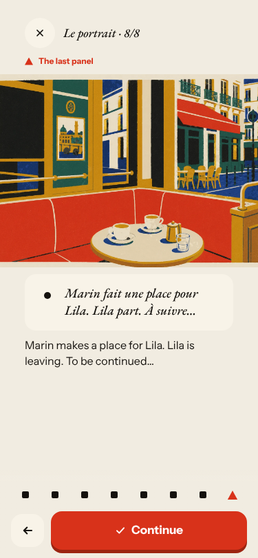
6. **Medium · #622 seen again** Journal retell target is a pile of lines with a repeated one, «basic check only» (#754). 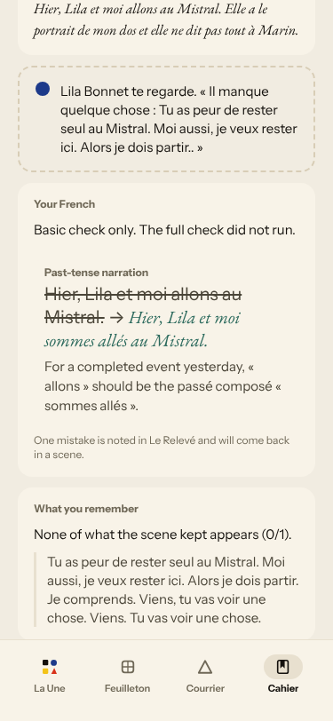

### #147 the cast is not one registry
7. **Medium · #747 seen again** Nina and Hugo (a friend) use vous; suggested replies ignore the thread (#557). 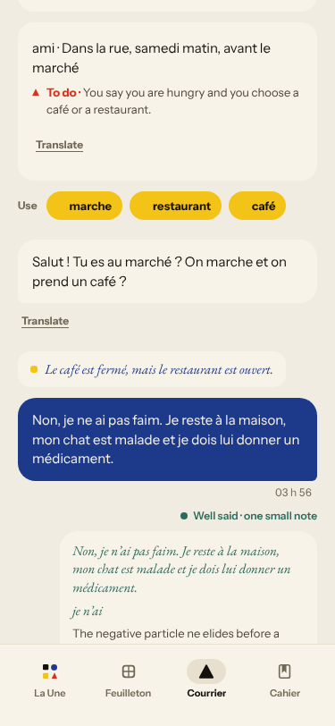 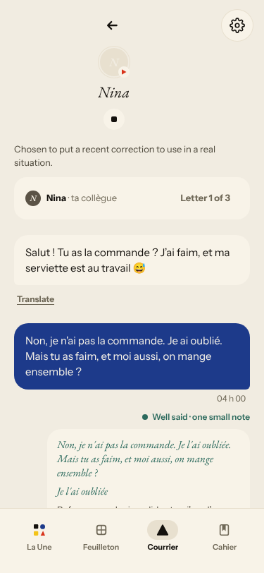

### Other
- **#693 seen again** Courrier reply never arrives. 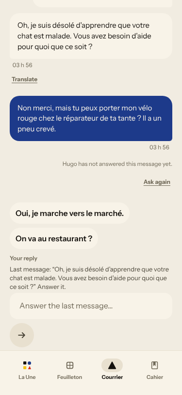 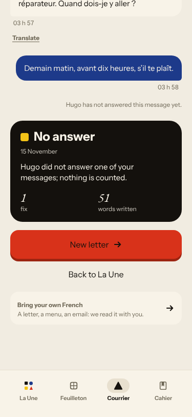
- **#694** Done screen mixes languages. 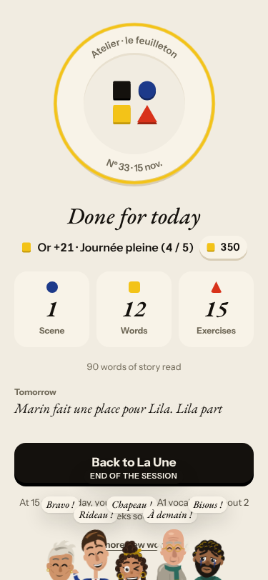
- **#725** Lexique fronts in English. 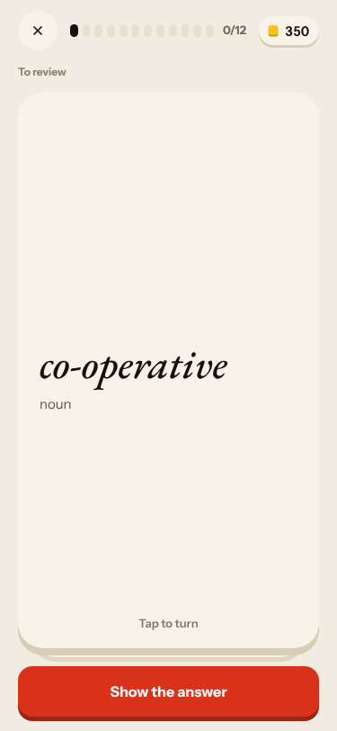

No new root cause: everything fits #145, #146, #147, #174.

## Re-tests

| issue | result |
|---|---|
| #443 La Forge opens on today's rule, fix #458 (merged 7 Nov, live) | half: opens on today's rule; item 1 gives «Continue»; item 2 (free line) gives only «Finish» → back to `queue:ready` |
| #693 Courrier reply never arrives | reproduces |
| #725 English Lexique fronts | reproduces |
| #194 titles of consecutive episodes | Nº 32 «Berlin» and Nº 33 «Le portrait» differ; the header still has an English goal line, left open |

## Which fixes are live

Release `fe4f0db31f80` = origin/main at the start of the walk, so every merged fix is live. Merged fixes behind `queue:pr` issues still open: #585 (#574), #546 (#542), #528 (#522), #458 (#443), #410 (#386), #628 (#333), #326 (#319), #223 (#194). The rest of the `queue:pr` issues wait on PRs that are not merged (#793, #791, #789, #788 and older). None merged more than a day ago is undeployed. One live fix, #458, is not fully fixed.

New issues: #804, #805, both `queue:ready` with a **Done when:** comment. Screenshots: `docs/ops/live-walks/2026-11-15/`.
