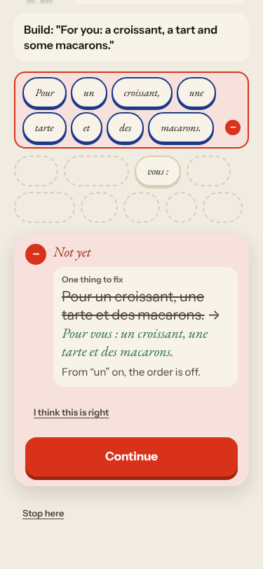
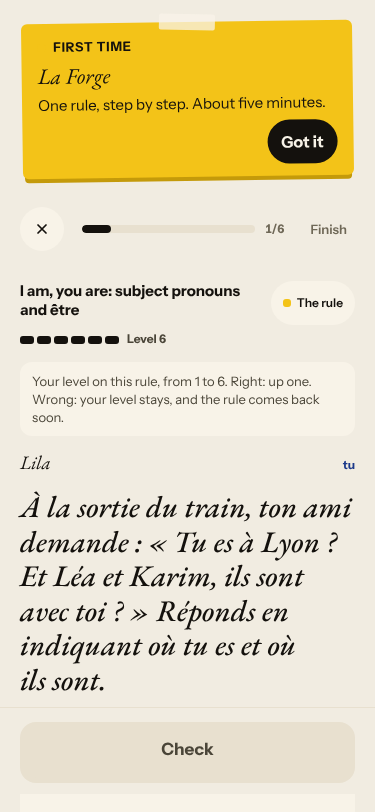
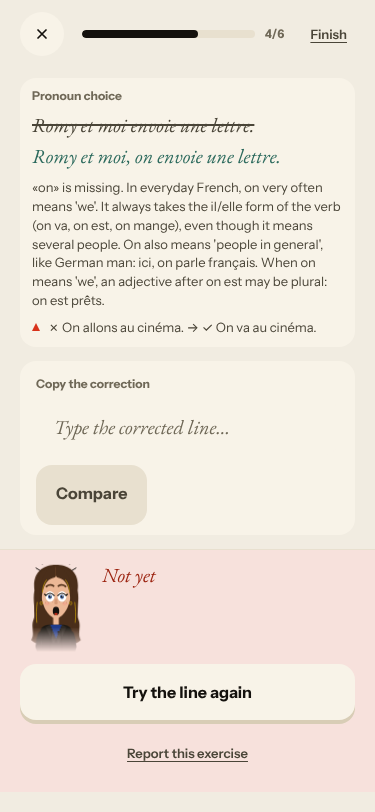
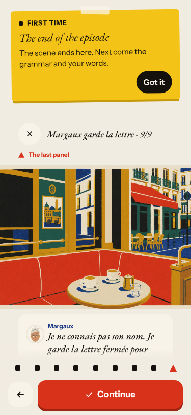
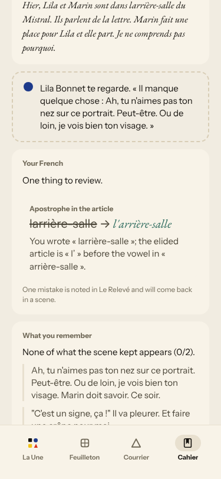
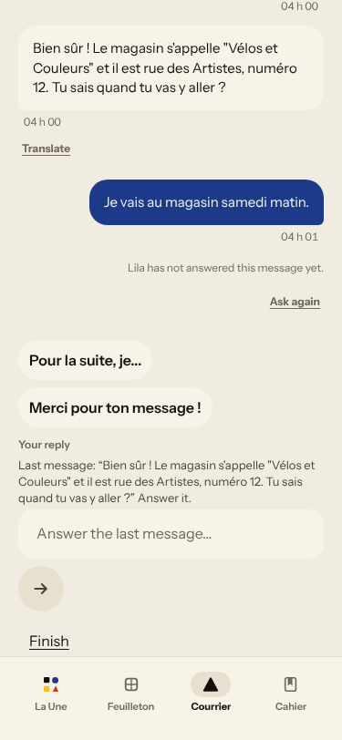
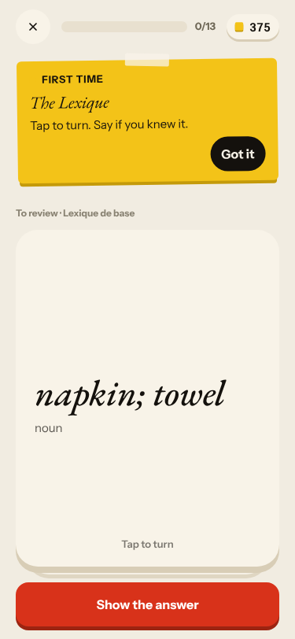

# Live walk · 16 Nov 2026 · production, real model

Run by the scheduled cloud routine (`explore:live` from main `3d3fa88d`, Chromium at phone size) against `atelier-api-3njh.onrender.com` (release `3d3fa88d37bc` = origin/main) with the walk test account.
Account: **A1.1, day 35** (Home «Nº 34 · La clé d'Odile», episode «La lettre sous la caisse»; pre-scene rule «Un, une, des»).
Played: pre-scene rule drills (order build with a deliberate miss, gender miss), word drills, scene (3 typed exchanges: a «je suis peur» slip, a clear «non» with an off-script wish for the pizza, an off-script cat), recall (2 items, one deliberate miss), La Forge (6 items: free line with «a»/«est» slips, two correct lines, a review of an old sentence, a plural slip; Finish on item 6), 13 word cards, Done, Courrier (Lila, 4 replies with slips and an off-script bike), Cahier (Rules, Journal retell, Progress), Feuilleton.
Not played: Q19 n/a (cloud). Previous live report: [15 Nov](2026-11-15.md).

## Scores

| # | question | live 16 Nov | live 15 Nov | trend |
|---|---|---|---|---|
| 1 | Where am I | 3 | 3 | = |
| 2 | What is at stake | 4 | 3 | ↑ |
| 3 | What to do next | 3 | 3 | = |
| 4 | Scene reacts to my writing | 5 | 3 | ↑ |
| 5 | Story coherent | 4 | 2 | ↑ |
| 6 | Characters consistent | 4 | 3 | ↑ |
| 7 | Image, text, tone fit | 4 | 4 | = |
| 8 | Difficulty fits | 4 | 4 | = |
| 9 | Feedback explained | 3 | 3 | = |
| 10 | Right answers accepted | 3 | 2 | ↑ |
| 11 | French correct | 3 | 3 | = |
| 12 | Clear goal today | 3 | 4 | ↓ |
| 13 | Grammar practised | 4 | 4 | = |
| 14 | Earlier material returns | 4 | 4 | = |
| 15 | I produce French | 5 | 5 | = |
| 16 | Errors, dead ends | 3 | 3 | = |
| 17 | Varied, fun | 4 | 3 | ↑ |
| 18 | Fast enough | 3 | 3 | = |
| 19 | App only | n/a | n/a |  |
| 20 | Satisfying end | 4 | 2 | ↑ |
| 21 | Would come back | 4 | 3 | ↑ |
| 22 | Time vs promise | 3 | 3 | = |

Q4 5: Margaux corrected «je suis peur» → «j'ai peur» and asked «Tu as peur de quoi ?»; my «non» got «D'accord. On laisse la lettre. Mange la pizza, alors.»; my invented cat was taken up and named in the last panel and the closing summary («You and Margaux did not read the letter together… The little cat is eating Lila's pizza»). Nothing in the scene came from a script. Q5/Q6 4: coherent, but the fear of the grandmother I mentioned was dropped. Q9 3: the Forge notes were exact (à/a, sont/est, plural -s), but the order drill blamed the wrong cause (#821) and the review item flagged a right sentence (#592). Q10 3: «Vous êtes gentil ?», «Elle est dans le magasin.» were accepted; «Romy et moi envoyons une lettre.» was shown as the mistake to fix. Q11 3: «J'ai rien entendu» in the hook (#822). Q12 3: the pre-scene card taught «Un, une, des», La Forge forged «être» (#576). Q18: scene replies 5 to 12 s, Courrier replies 12 to 20 s, Courrier's 4th reply never came. Q20 4: the Done screen ends on «Margaux lira-t-elle la lettre avec toi ?», a real open question.

## Findings, by root cause

### #146 the day's learning content and feedback are not driven by one concept
1. **Medium · new #821** the order drill says «From “un” on, the order is off» when the tile «vous :» is missing. 
2. **Medium · #576 seen again** one day, two rules: card «Un, une, des», La Forge on «être» (Level 6). 
3. **Medium · #592 seen again** La Forge review item treats a correct «Romy et moi envoyons une lettre.» as the mistake. 

### #145 the scene has no state of what the learner said
4. **Low · new #822** the closing hook «J'ai rien entendu. Mais quand même…» is a stray fragment. 
5. **Medium · #622 seen again** Journal retell keeps filler lines as the target (0/2). 

### #333 / #522 other
- **High · #693 seen again** Courrier: Lila's 4th reply never arrives, «Ask again» does nothing. 
- **Low · #725 seen again** first Lexique card has an English front. 

No new root cause: everything fits #143, #145, #146, #333, #522.

What worked (for the trend): the scene reacted to every reply ([correction](2026-11-16/scene-reacts-correction.png), [end](2026-11-16/scene-reacts-end.png)); Courrier gave two specific corrections and answered the bike and the cat ([courrier-ok.png](2026-11-16/courrier-ok.png)); La Forge ran 6 items with Continue and a single Finish at the end.

## Re-tests

| issue | result |
|---|---|
| #443 La Forge opens on today's rule, Finish only at the end (#708, merged, live) | half fixed: Finish only on item 6 of 6; the rule is still not the card's rule (#576/#587) → stays `queue:ready`, commented |
| #693 Courrier reply never arrives | reproduces |
| #725 English Lexique fronts | reproduces (mixed directions) |
| #592 «on» drill flags a correct «nous» sentence | reproduces on a Forge review item |
| #622 Journal retell target | reproduces |
| #558 / #378 / #750 scene ignores or invents | not reproduced today: the scene reacted |
| #804 / #805 recall «une» → «one», «le bureau de poste» | not reached today |

## Which fixes are live

Release `3d3fa88d37bc` = origin/main at the start of the walk, so every merged fix is live. Merged: #708 (#443, half fixed), plus those listed on 15 Nov. Open fix PRs for `queue:pr` issues walked tonight, none live: #587 (#576), #606 (#592), #705 (#622), #741 (#725), #813 (#804, #805); #701 (#693) is closed `loop:failed-verify`. None merged more than a day ago is undeployed.

New issues: #821, #822, both `queue:ready` with a **Done when:** line. Screenshots: `docs/ops/live-walks/2026-11-16/`.
