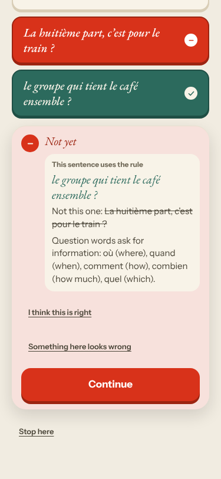
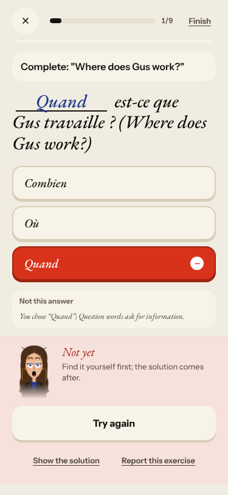
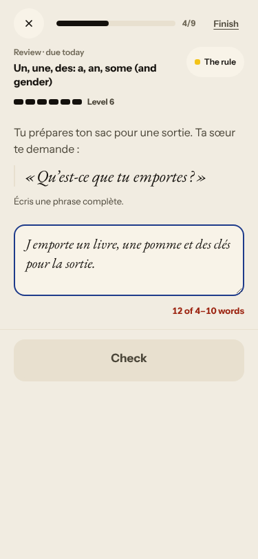
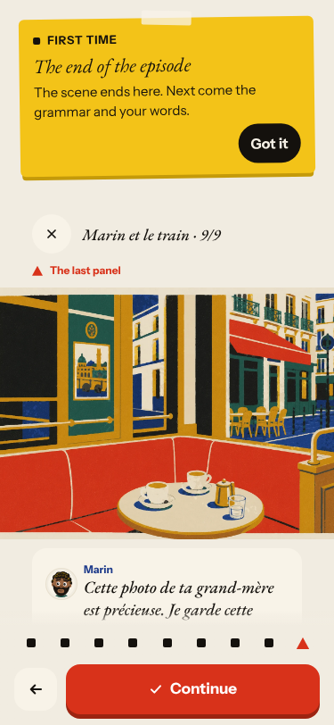
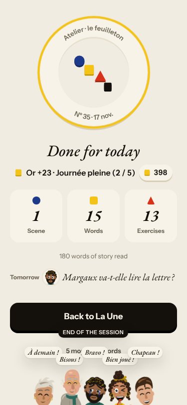
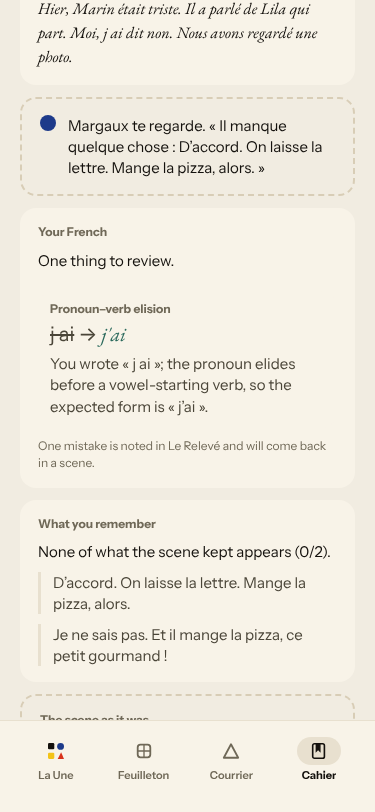
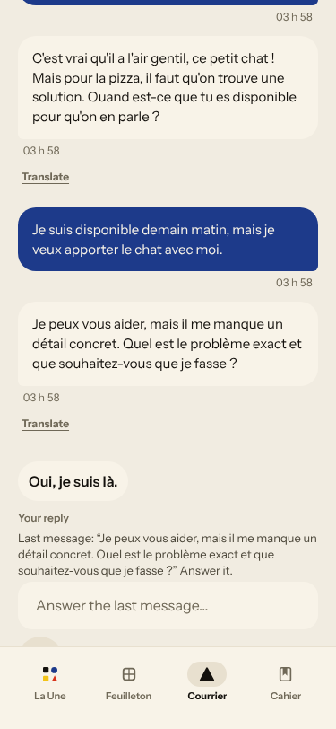
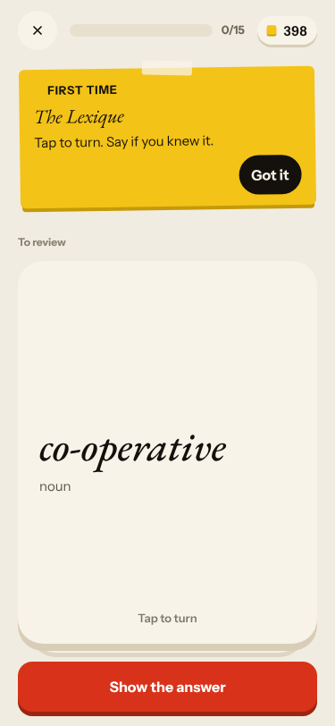

# Live walk · 17 Nov 2026 · production, real model

Run by the scheduled cloud routine (`explore:live` from main `e81e3e0`, Chromium at phone size) against `atelier-api-3njh.onrender.com` (release `e81e3e0297e6` = origin/main) with the walk test account.
Account: **A1.1, day 36** (Home «Nº 35 · La clé d'Odile», episode «Marin et le train»; pre-scene rule «Question words: où, quand, comment, combien, quel»).
Played: rule card and 2 drills (a deliberate «Quel heure est-il ?» miss), scene (3 typed exchanges: «je comprend … est mort» slips, a clear «non» to Lila leaving with an off-script wish, an off-script parrot photo), La Forge (9 items: a miss on «Quand», a judge item, an «J emporte» slip, a typed gap, a find-the-mistake, a colloquial «Lila arrive quand ?», a «le guitare» slip; Finish on 9/9), 15 word cards, Done, Courrier (3 replies, a clear «non», an off-script grandfather), Cahier (Rules, Journal retell, Progress), Feuilleton.
Not played: Q19 n/a (cloud). Previous live report: [16 Nov](2026-11-16.md).

## Scores

| # | question | live 17 Nov | live 16 Nov | trend |
|---|---|---|---|---|
| 1 | Where am I | 4 | 3 | ↑ |
| 2 | What is at stake | 4 | 4 | = |
| 3 | What to do next | 3 | 3 | = |
| 4 | Scene reacts to my writing | 5 | 5 | = |
| 5 | Story coherent | 4 | 4 | = |
| 6 | Characters consistent | 3 | 4 | ↓ |
| 7 | Image, text, tone fit | 4 | 4 | = |
| 8 | Difficulty fits | 4 | 4 | = |
| 9 | Feedback explained | 3 | 3 | = |
| 10 | Right answers accepted | 3 | 3 | = |
| 11 | French correct | 3 | 3 | = |
| 12 | Clear goal today | 4 | 3 | ↑ |
| 13 | Grammar practised | 4 | 4 | = |
| 14 | Earlier material returns | 4 | 4 | = |
| 15 | I produce French | 5 | 5 | = |
| 16 | Errors, dead ends | 3 | 3 | = |
| 17 | Varied, fun | 4 | 4 | = |
| 18 | Fast enough | 3 | 3 | = |
| 19 | App only | n/a | n/a |  |
| 20 | Satisfying end | 4 | 4 | = |
| 21 | Would come back | 3 | 4 | ↓ |
| 22 | Time vs promise | 3 | 3 | = |

Q4 5: Marin took up my correction target («je comprends»), answered «non» with «Tu dis non au départ de Lila… Pourquoi ouvrir le dossier ?», and the invented parrot photo became the closing summary and the Done line («Dans le dossier bleu, une photo montre ta grand-mère avec un perroquet…», [correction](2026-11-17/scene-reacts-correction.png)). Q6 3: Courrier Margaux fell back to a generic «vous» line (#538); Lila's forge reply brings in an unknown «Camille». Q12 4: the card, the drills, the scene and La Forge all stood on question words (#576 closed). Q16 3: first-time note swallows taps (#851), Check dead at 12 words (#853). Q18: scene replies 7 s; the closing panel took about 30 s («What happens next is being written…»); Courrier replies 14–16 s. Q21 3: the same cliffhanger for the third day (#850).

## Findings, by root cause

### #146 the day's learning content and feedback are not driven by one concept
1. **Medium · new #849** the rule drill keys «le groupe qui tient le café ensemble ?» (no question word) as the sentence that uses the rule. 
2. **Low · new #852** a Forge choice miss says «Question words ask for information», not why «Quand» is wrong. 
3. **Low · new #853** Check stays disabled at «12 of 4–10 words», no message. 

### #145 the scene has no state of what the learner said
4. **Medium · new #850** «Margaux va-t-elle lire la lettre ?» is the hook for a third day.  
5. **Medium · #622 seen again** Journal retell target is filler (0/2). 

### #333 / #522 other
- **Medium · #538 seen again** Courrier's 3rd reply is the generic «Je peux vous aider, mais il me manque un détail concret…». 
- **Medium · new #851** the Lexique's first-time note makes «I know it» a no-op (0/15 after 15 taps). 
- **Low · #725 seen again** English Lexique front «co-operative».

No new root cause: everything fits #143, #145, #146, #333, #522.

What worked: the scene reacted to every reply; Forge items 3–9 had specific, correct feedback («Feminine noun agreement», «Apostrophe in j'emporte»), accepted a trimmed «  combien  » and the colloquial «Lila arrive quand ?»; Courrier gave clear corrections for «j ai allé»; today's La Forge opened on today's rule ([card](2026-11-17/rule-card.png), [Forge](2026-11-17/forge-opens-on-rule.png)).

## Re-tests

| issue | result |
|---|---|
| #576 one day, two rules | fixed: card and La Forge both on question words → closed |
| #693 Courrier reply never arrives | not reproduced (3 of 3 replies arrived) → open |
| #725 English Lexique fronts | reproduces |
| #622 Journal retell target | reproduces |
| #538 Courrier ignores my choice / generic fallback | reproduces (reply 3) |
| #835 Forge «Finish» only on N/N (merged) | partly: the header Finish is enabled after the first miss; the counter grew 8 → 9 (the miss is queued again) → noted, no new issue |
| #821 order drill, #592 «on» drill, #804/#805 | not reached today |

## Which fixes are live

Release `e81e3e0297e6` is origin/main at the start of the walk, so every merged fix is live. Merged and seen live: #708 (La Forge opens on a taught rule), #836 (the last panel's hook is no longer a line nobody said; not fixed on #850's repetition). Open fix PRs for `queue:pr` issues, none live: #834 (#821), #741 (#725), #705 (#622), #569 (#538), #587, #606 and others. None merged more than a day ago is undeployed.

New issues: #849, #850, #851, #852, #853, each `queue:ready` with a **Done when:** line. Screenshots: `docs/ops/live-walks/2026-11-17/`.
