# Live walk · 19 Nov 2026 · production, real model

Run by the scheduled cloud routine (`explore:live`, Chromium at phone size) against `atelier-api-3njh.onrender.com` (release `a2d3ccdd584a`, which is **not** origin/main `d1486e6`, see #921) with the walk test account.
Account: **A1.1, day 37** (Home «Nº 36 · La clé d'Odile», hook «Margaux va-t-elle lire la lettre ?», scene «Romy et la tuque»). The 18 Nov walk did not run.
Played: scene (reader, 4 typed replies: «ce que est … au usine» slips, a clear «non» with an off-script sick cat, the invented cat «Napoléon» and a plastic parrot, a thank-you; last panel, say-aloud line), La Forge (6 items on être and est-ce que: «je es», «marche», «Est-ce que ils», «l aéroport», a vous variant, Quebec; Finish), 22 word cards (4 «Again»), Done, Courrier (3 replies: a clear «non» to the napkin, an off-script pirate grandfather, «tu va l aimer»), Cahier (Rules, Journal retell, Progress), Feuilleton.
Today the day had no pre-scene rule card and no separate drills: scene → La Forge → words → Done.
Not played: Q19 n/a (cloud). Previous live report: [17 Nov](2026-11-17.md).

## Scores

| # | question | live 19 Nov | live 17 Nov | trend |
|---|---|---|---|---|
| 1 | Where am I | 3 | 4 | ↓ |
| 2 | What is at stake | 3 | 4 | ↓ |
| 3 | What to do next | 3 | 3 | = |
| 4 | Scene reacts to my writing | 5 | 5 | = |
| 5 | Story coherent | 3 | 4 | ↓ |
| 6 | Characters consistent | 3 | 3 | = |
| 7 | Image, text, tone fit | 3 | 4 | ↓ |
| 8 | Difficulty fits | 4 | 4 | = |
| 9 | Feedback explained | 3 | 3 | = |
| 10 | Right answers accepted | 4 | 3 | ↑ |
| 11 | French correct | 3 | 3 | = |
| 12 | Clear goal today | 4 | 4 | = |
| 13 | Grammar practised | 4 | 4 | = |
| 14 | Earlier material returns | 4 | 4 | = |
| 15 | I produce French | 5 | 5 | = |
| 16 | Errors, dead ends | 3 | 3 | = |
| 17 | Varied, fun | 4 | 4 | = |
| 18 | Fast enough | 3 | 3 | = |
| 19 | App only | n/a | n/a |  |
| 20 | Satisfying end | 4 | 4 | = |
| 21 | Would come back | 4 | 3 | ↑ |
| 22 | Time vs promise | 3 | 3 | = |

Q1/Q2/Q5/Q7 3: the day's names do not agree (Home «La clé d'Odile» + Margaux's letter, Feuilleton «Romy et la tuque», scene about Solvel), the «Previously» card says «La carte du learner», reader panel 3 is about a soup pot ([#577](https://github.com/Pechst1/ConversationalLanguageLearning/issues/577), [#621](https://github.com/Pechst1/ConversationalLanguageLearning/issues/621), #917). Q4 5: the scene took up every reply: the «non» («Non, je ne mets pas ton nom dans l'article»), the sick cat, Napoléon and the plastic parrot, and the closing panel and the finish card kept them («Napoléon a mangé un perroquet en plastique.»). Q10 4: «Vous êtes au marché ?» for «Are you at the market?», «Est-ce qu'ils» fix with «qu ils», «Elles sont à l'aéroport» all judged sensibly (the missing apostrophe or accent is a «Not yet» by design). Q21 4: tomorrow's hook is new («Lila et Berlin…»), not Margaux's letter again (#850 holds). Q9 3 / Q11 3: one of three slips corrected in the scene (#919), Zoé writes «vous» to a friend (#920). Q16 3: Check with no message at 14 words (#853), stale panel after «Line fixed» (#381). Q18: scene replies ≈7–12 s, the finish panel ≈20 s, Courrier ≈15 s.

## Findings, by root cause

### #145 the scene has no state of what the learner said and what is established
1. **Medium · new #917** «Previously»: «La carte du learner trouve sa place parmi les souvenirs d'Odile.» 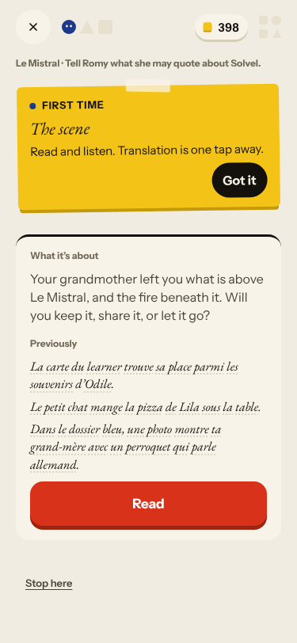
2. **Medium · new #918** the Journal retell confirms invented facts («Oui, c'est bien comme ça que ça s'est passé») and scores 2/2. 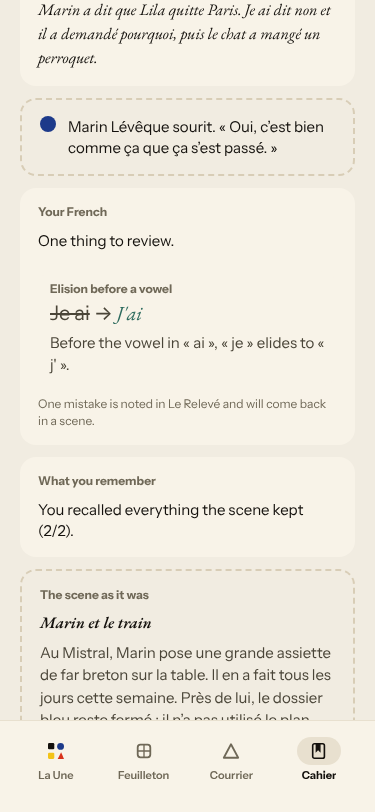
3. **Medium · #556 seen again** «Exchange 3 of 3» then a fourth reply. 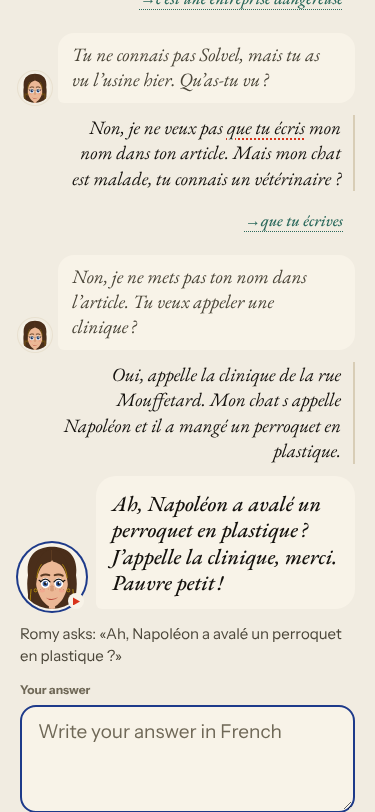
4. **Medium · #558 seen again** the say-aloud line «Solvel veut acheter le café, mais je veux le garder.» is a line I never said. 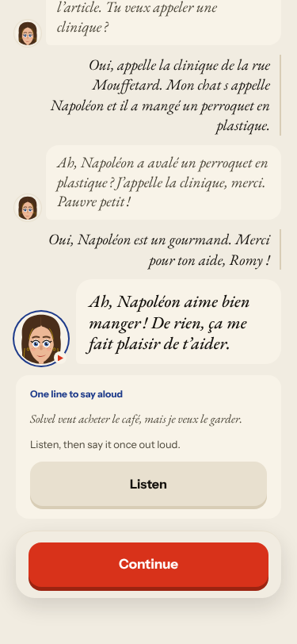
5. **Low · #577, #621 seen again** Home/Feuilleton/scene names disagree; reader panel 3 does not belong to the scene. 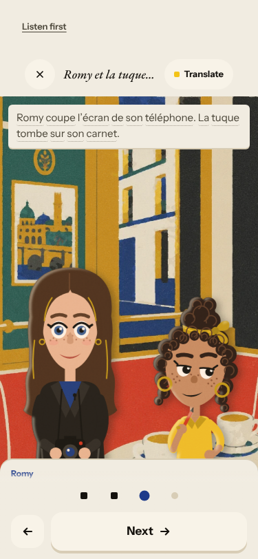

### #250 free-text corrections are raw model output
6. **Medium · new #919** one of three slips corrected («ce que est», «au usine» missed). 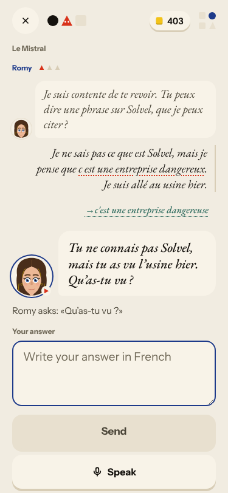

### #147 the cast is not one registry
7. **Medium · new #920** friend writes «vous» in a La Forge prompt and in Courrier (#520, #747 seen again). 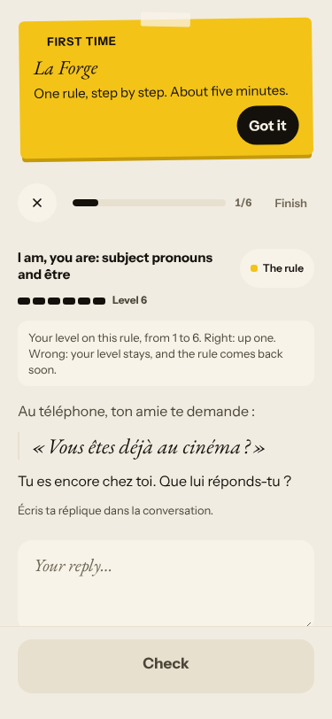 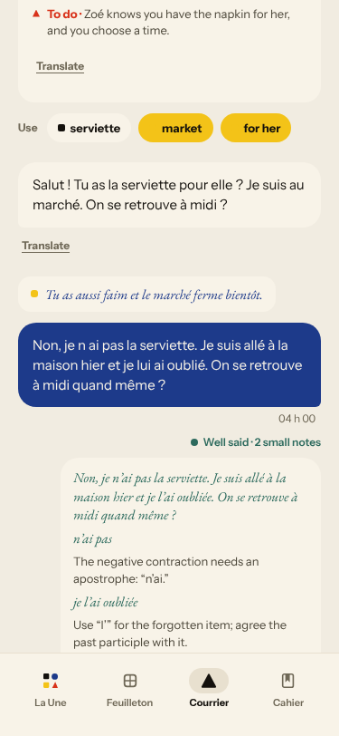 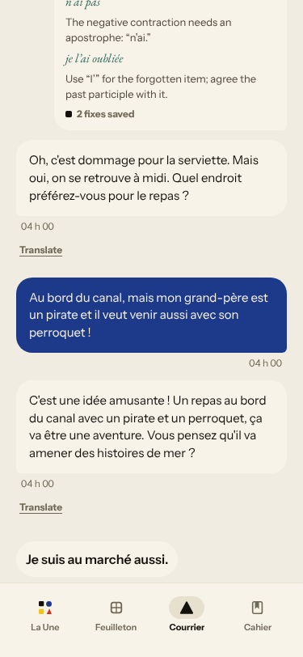

### #333 an unchecked answer is shown as a result
8. **Low · new #922** «Promise kept 1/1» for a reply that negates the task's fact. 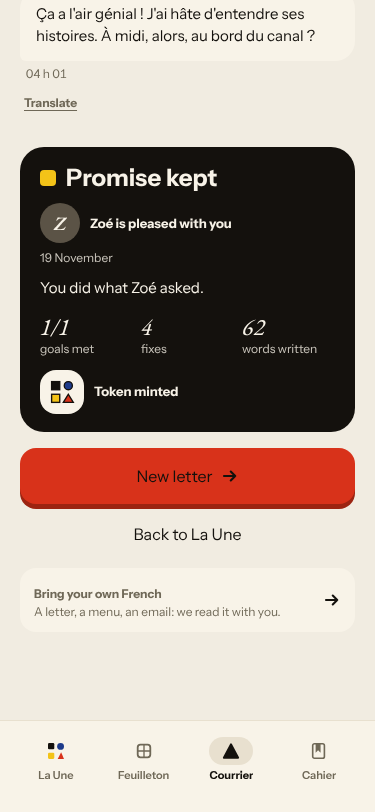

### #146 / #522 / #143 other
- **Medium · new #921** the release lags main: #860 (merged 17 Nov 12:19) is still not deployed, `Publish verified image` was skipped after the en + B1 walk failed (#868, fix PR #906 open).
- **Low · seen again** #725 English Lexique front, #694 Done «Or +19 · 19 / 20», #853 Check silent at 14 words, #381 stale «Fix the marked words» after «Line fixed», #557 stale Courrier suggestion. 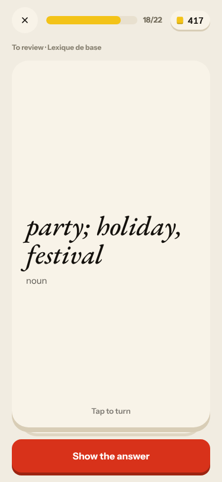 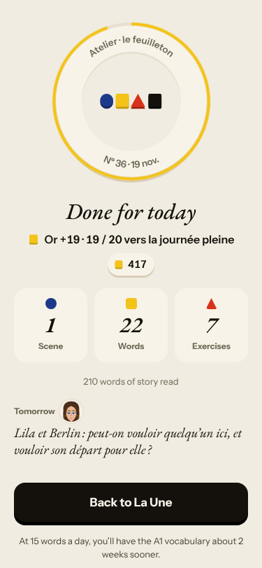 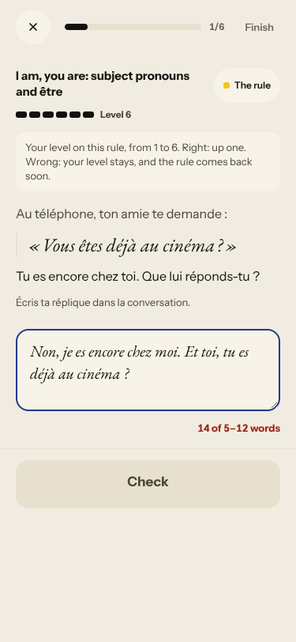 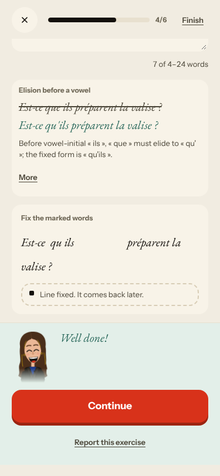

No new root cause: everything fits #143, #145, #147, #250, #333.

What worked: the scene reacted to every reply including a plain «non» and two off-script lines, and its summary kept them; La Forge named the exact trap («Elision before a vowel», «Here the accent changes the word: «marché», not «marche»») and accepted «qu ils» / a vous answer; the Lexique «I know it» counter reached 22/22 (#851 fixed); Courrier corrected «je lui ai oublié» → «je l'ai oubliée» and «tu va» → «tu vas».

## Re-tests

| issue | result |
|---|---|
| #849 rule drill keys a fragment (closed, fix #863 live) | not reached: no rule drill in today's day |
| #850 tomorrow's hook repeats yesterday's question (closed, fix #865 live) | holds: tomorrow's hook is «Lila et Berlin…», not Margaux's letter |
| #851 Lexique «I know it» no-op (closed, fix #864 live) | holds: 22 of 22 counted |
| #773 / #774 «Est-ce que ils/on» Right in La Forge, wrong in recall | La Forge now marks «Est-ce que ils» wrong with the elision explanation; stays open (owner, «on» not reached) |
| #725, #694, #853, #381, #557, #556, #558, #577, #621, #520, #747 | reproduce (commented) |
| #693 Courrier reply never arrives | not reproduced (3 of 3 replies arrived) |

## Which fixes are live

Release `a2d3ccdd584a`. Merged and live: #863, #864, #865, #704, #859. **Not live**: #860 (`d1486e6`, merged 17 Nov 12:19, more than a day ago): finding #921. Open fix PRs for `queue:pr` issues are not merged, so none can be live.

New issues: #917, #918, #919, #920, #921, #922, each `queue:ready` with a **Done when:** line. Screenshots: `docs/ops/live-walks/2026-11-19/`.
