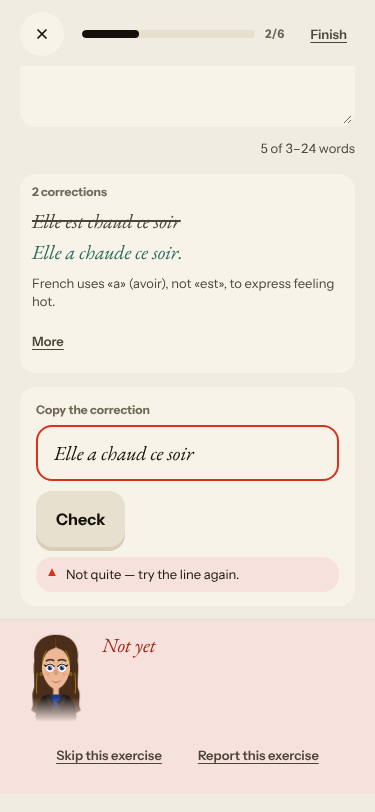
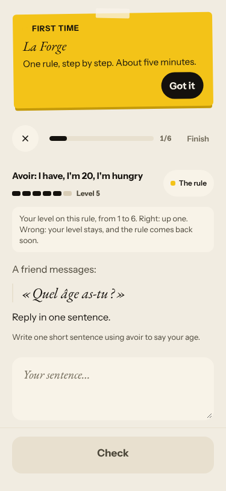
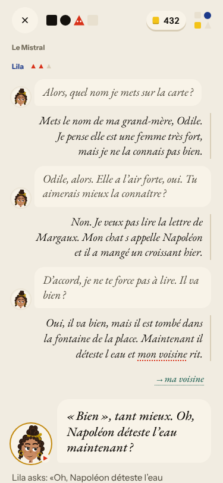
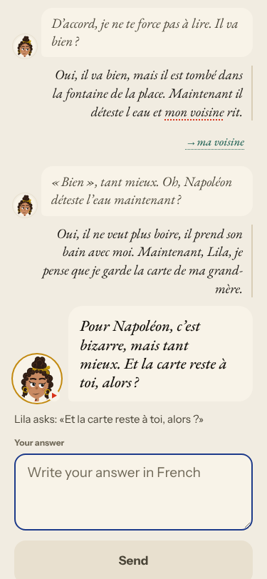
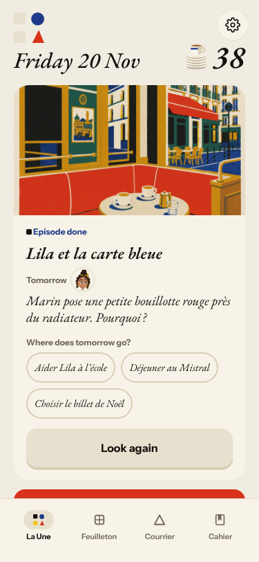
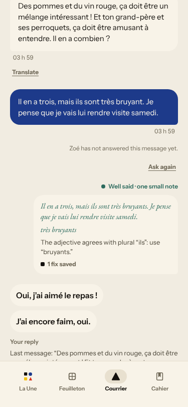

# Live walk · 20 Nov 2026 · production, real model

Run by the scheduled cloud routine (`explore:live`, Chromium at phone size) against `atelier-api-3njh.onrender.com` (release `d6208e22254a`, the merge of #945) with the walk test account.
Account: **A1.1, day 38** (Home «Nº 37 · La clé d'Odile», episode «Lila et la carte bleue»; pre-scene rule «Question words: où, quand, comment, combien, quel»).
Played: rule card and 2 drills (a deliberate «Quel heure est-il ?» miss), scene (5 typed replies: «je pense elle est… très fort» slips, a clear «non» with an off-script cat, an off-script fountain story, «mon voisine», a decision), La Forge (6 items on Avoir: «J ai», «Elle est chaud», a find-the-mistake review, «freres», «je suis soixante-quatre ans»), tomorrow's choice, 17 word cards, Done, Courrier (3 replies, a clear «non merci», an off-script grandfather with parrots), Cahier (Rules, Journal, Progress).
Q19 n/a (cloud). Previous live report: [17 Nov](2026-11-17.md) (no live reports on 18 and 19 Nov).

## Scores

| # | question | live 20 Nov | live 17 Nov | trend |
|---|---|---|---|---|
| 1 | Where am I | 4 | 4 | = |
| 2 | What is at stake | 4 | 4 | = |
| 3 | What to do next | 3 | 3 | = |
| 4 | Scene reacts to my writing | 4 | 5 | ↓ |
| 5 | Story coherent | 4 | 4 | = |
| 6 | Characters consistent | 4 | 3 | ↑ |
| 7 | Image, text, tone fit | 4 | 4 | = |
| 8 | Difficulty fits | 4 | 4 | = |
| 9 | Feedback explained | 3 | 3 | = |
| 10 | Right answers accepted | 2 | 3 | ↓ |
| 11 | French correct | 2 | 3 | ↓ |
| 12 | Clear goal today | 3 | 4 | ↓ |
| 13 | Grammar practised | 4 | 4 | = |
| 14 | Earlier material returns | 4 | 4 | = |
| 15 | I produce French | 5 | 5 | = |
| 16 | Errors, dead ends | 3 | 3 | = |
| 17 | Varied, fun | 4 | 4 | = |
| 18 | Fast enough | 3 | 3 | = |
| 19 | App only | n/a | n/a |  |
| 20 | Satisfying end | 4 | 4 | = |
| 21 | Would come back | 3 | 3 | = |
| 22 | Time vs promise | 3 | 3 | = |

Q4 4: the scene took up the cat and the fountain, answered «non» with «D'accord, je ne te force pas à lire. Il va bien ?», fixed «mon voisine» («Corrected form → ma voisine») and closed on «Lila remembers that you prefer your grandmother's name on the card»; the counter and the line to say aloud lose a point (#948, #949). Q10/Q11 2: La Forge's correction is the wrong French «Elle a chaude ce soir» and rejects the right «Elle a chaud ce soir» (#946, [correction](2026-11-20/forge-chaude-wrong-french.png), [rejected](2026-11-20/forge-correct-rejected.png)). Q12 3: the card and the scene are question words, La Forge is Avoir (#947, [Forge](2026-11-20/forge-wrong-rule.png)). Q6 4: Courrier no longer slips into «vous»; Zoé answered every reply in character. Q18: scene replies 7–10 s, Courrier replies 15–20 s, the words and Forge steps load at once.

## Findings, by root cause

### #250 / #174 free-text corrections are raw model output, a right answer is judged against one string
1. **High · new #946** La Forge corrects «Elle est chaud ce soir» to «Elle a chaude ce soir» and refuses «Elle a chaud ce soir».  

### #146 the day's learning content is not driven by one concept
2. **Medium · new #947** the card and drills teach question words, La Forge's six items are Avoir (regression of #576). 

### #145 the scene has no state of what happened
3. **Medium · new #948** «Exchange 3 of 3» for replies 3 to 5. 
4. **Low · new #949** «One line to say aloud» is my own 21-word reply. 

### #143 / #147 other
5. **Low · new #950** «A day off kept your streak. This week, we consolidate.» on a played day; Home's «Next: 17 words» re-opens the finished card. 
6. **Low · new #951** stray «Lila» and «tu» lines above a dialogue prompt.
- **Medium · #693 seen again**: Courrier reply 3 showed «Zoé has not answered this message yet»; «Ask again» worked. 
- **Low · #661 seen again (softer)**: Zoé ignored «Non merci, je suis plein».
- **Low · #852 seen again**: a rule-drill miss on «Quel heure est-il ?» says «Question words ask for information…», not that «heure» is feminine.

No new root cause: everything fits #143, #145, #146, #147, #174, #250.

What worked: the Forge «Fix the marked words» feedback was specific and correct («Elision in j'ai», «The plural form freres needs a grave accent», «For age, je suis is incorrect; use j'ai»); Courrier gave three clear, correct correction cards («ma voisine», «très bon», «très bruyants») and answered the grandfather's parrots; the finished scene named my choice; the words session finished 17/17 with «I know it»/«Again» (#851 stays fixed); tomorrow's hook is a new question, not yesterday's (#850 stays fixed).

## Re-tests

| issue | result |
|---|---|
| #850 hook repeats | fixed: «bouillotte rouge… Pourquoi ?» is new → already closed |
| #851 Lexique «I know it» no-op | fixed: 17/17 → already closed |
| #693 Courrier reply never arrives | reproduces (reply 3), «Ask again» recovers → commented |
| #725 English Lexique fronts | reproduces («month» on the front) |
| #921 deploy lag | live now, release `d6208e22254a` contains d1486e6 (#860) → commented, left open for #924 |
| #576 one day, two rules | closed, but the same break is back → new #947 |
| #849, #852, #853, #821, #622, #538 | not reached or no open fix merged |

## Which fixes are live

Release `d6208e22254a` (merge of #945, 02:33 Berlin) is an ancestor of origin/main and every merged fix up to it is live: #860, #864, #865, #859, #863 and #708 were seen working or not contradicted today. No open `queue:pr` issue has a merged fix that is missing from the release; the three-day lag of #860 (merged 17 Nov, live 20 Nov) is #921 (main CI red, #924).

New issues: #946, #947, #948, #949, #950, #951, each `queue:ready`, with **Done when:**. Screenshots: `docs/ops/live-walks/2026-11-20/`.
