# Live walk · 21 Nov 2026 · production, real model

Run by the scheduled cloud routine (`explore:live`, Chromium at phone size) against `atelier-api-3njh.onrender.com` (release `b8564d6757ca`, the merge of #965 and the current tip of main) with the walk test account.
**First live walk after the pilot (#958, merged 20 Nov 15:33)**: the 20 Nov walk ran before it, so every change below is new to the live scores.
Account: **A1.1, day 39** (Home «Nº 38 · La clé d'Odile», scene «Bastien mesure le Mistral», with Gus).
Played: three pre-scene word drills (a miss on «café un»), the scene with five typed replies (beau/ancien slips, a clear «non» with an off-script cat, an off-script cheese question, a decision with a missing «n'»), the six-item La Forge on «Mon, ma, mes» (one spelling variant «clef», «notre cahiers», «Je suis vingt-trois ans», «son bague»), 12 word cards, Done, Courrier (the 19 Nov Zoé letter was still open; today's letter from Mme Vidal, three replies with a clear «non», «pas de gâteau» and an off-script grandfather with two parrots), Cahier (Journal retell, Progress).
Q19 n/a (cloud). Previous live report: [20 Nov](2026-11-20.md).

## Scores

| # | question | live 21 Nov | live 20 Nov | trend |
|---|---|---|---|---|
| 1 | Where am I | 4 | 4 | = |
| 2 | What is at stake | 4 | 4 | = |
| 3 | What to do next | 3 | 3 | = |
| 4 | Scene reacts to my writing | 4 | 4 | = |
| 5 | Story coherent | 3 | 4 | ↓ |
| 6 | Characters consistent | 3 | 4 | ↓ |
| 7 | Image, text, tone fit | 4 | 4 | = |
| 8 | Difficulty fits | 4 | 4 | = |
| 9 | Feedback explained | 3 | 3 | = |
| 10 | Right answers accepted | 2 | 2 | = |
| 11 | French correct | 2 | 2 | = |
| 12 | Clear goal today | 3 | 3 | = |
| 13 | Grammar practised | 4 | 4 | = |
| 14 | Earlier material returns | 4 | 4 | = |
| 15 | I produce French | 5 | 5 | = |
| 16 | Errors, dead ends | 3 | 3 | = |
| 17 | Varied, fun | 4 | 4 | = |
| 18 | Fast enough | 3 | 3 | = |
| 19 | App only | n/a | n/a |  |
| 20 | Satisfying end | 3 | 4 | ↓ |
| 21 | Would come back | 3 | 3 | = |
| 22 | Time vs promise | 3 | 3 | = |

Q4 4: the scene took up the cat, the cheese question and the decision, fixed «très beau» and «je ai» («→ j'ai»), but missed «ancien» and «est pas», and Gus asked again what I had just answered (#556, #919). Q5/Q6 3: Gus' gloss names Gus as the addressee (#970), the reading panels open on a coat («Beau manteau. Non : magnifique. Non : criminel.») in a scene about a banquette, and Mme Vidal, the neighbour who complained, promises to be quieter (#969). Q10 2: La Forge refuses «clef» (#966) and the pre-scene order drill accepts «Im est au Mistral.» (#723). Q11 2: La Forge's «One possible answer» is «On cherche ses carnets.» for «We look for our notebooks» (#968), the line to say aloud keeps my slip «Bastien est pas un ami» (#949), Zoé writes «Vous pensez» to a tu friend (#920). Q12 3: no rule card was shown; the pre-scene drills were Avoir and être, La Forge was possessives (#947). Q20 3: «Tomorrow · On va aider Lila à l'école.» is a statement that ignores my decision (#466). Q18: scene replies 10–16 s, Courrier replies about 20 s, drills, words and La Forge steps at once.

## Findings, by root cause

### #174 a right answer is judged against one stored string
1. **Medium · new #966** La Forge's find-the-mistake item fails «clef» («The ending is off … the form here is «clé»»), while the free-production item accepts «clefs». 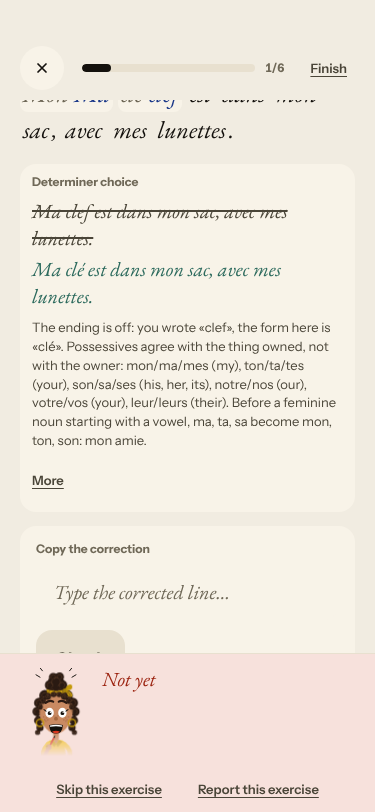
2. **High · #723 seen again** the pre-scene order drill marks «Im est au Mistral.» Correct. 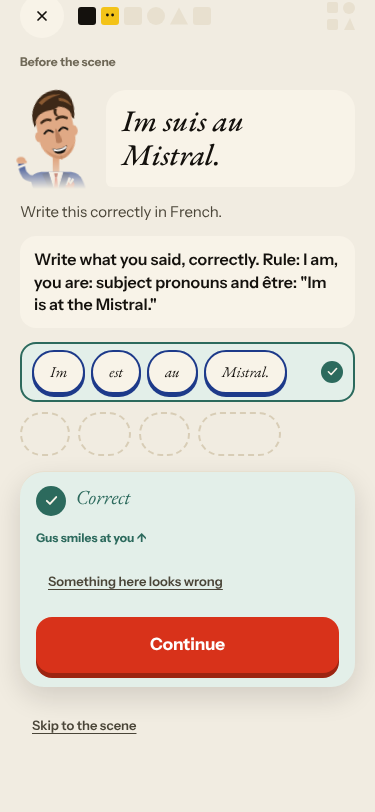

### #146 the day's learning content and feedback are not driven by one concept
3. **Medium · new #967** «café un» → «It does not start with “café”.»; the gender slip is never explained. 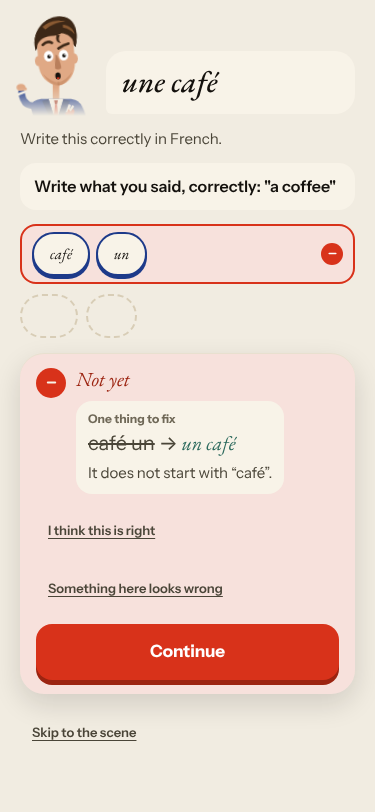
4. **Medium · #947 seen again** pre-scene drills Avoir/être, La Forge possessives, no rule card. 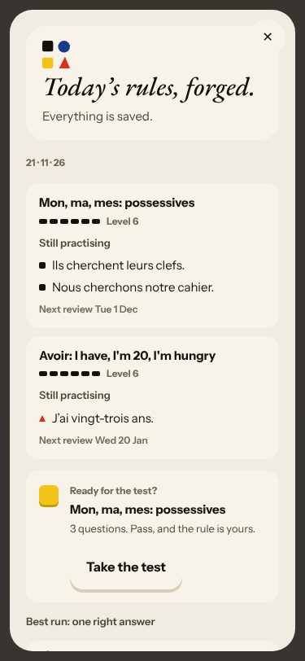

### #250 / #333 model output shown unchecked
5. **Medium · new #968** «One possible answer: On cherche ses carnets.» for «We look for our notebooks». 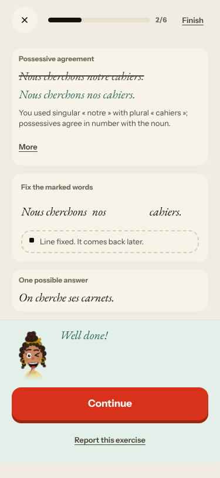
6. **Medium · new #971** the Journal lists my own uncorrected slip as a detail to remember and Lila confirms an unchecked retell (#918 seen again). 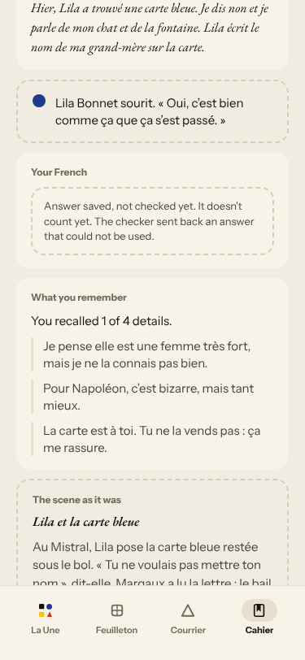
7. **Low · #949 seen again** «One line to say aloud» keeps my slip. 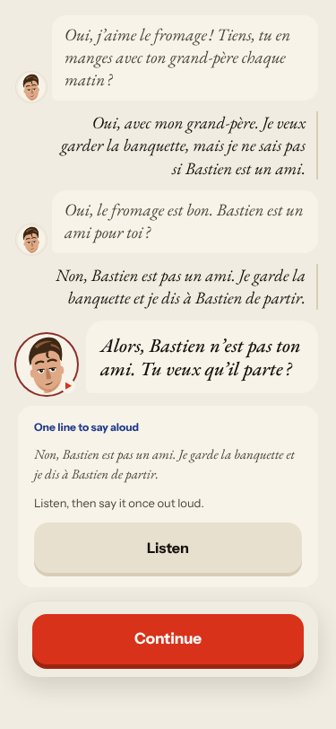

### #145 the scene has no state of what happened
8. **Medium · new #969** Courrier: the neighbour who complains promises to cut the noise. 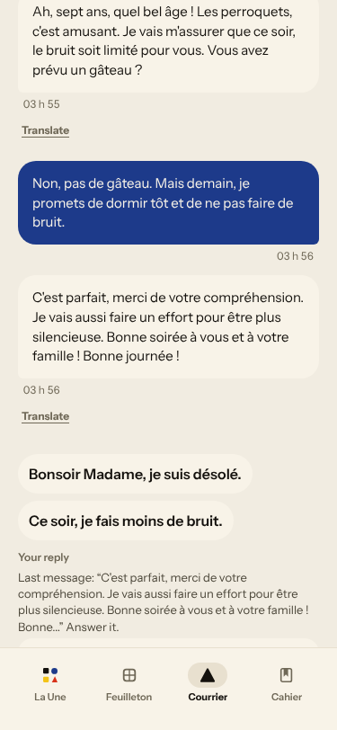
9. **Medium · #948 seen again** «Exchange 3 of 3» for replies 3 to 5. 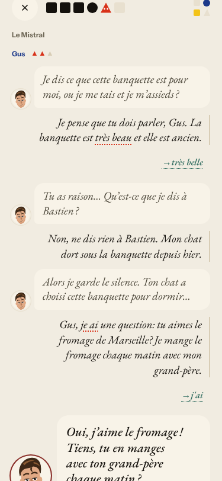
10. **Medium · #556 / #919 seen again** Gus re-asks what I answered; two slips in one reply uncorrected.
11. **Medium · #466 seen again** tomorrow's hook is a statement. 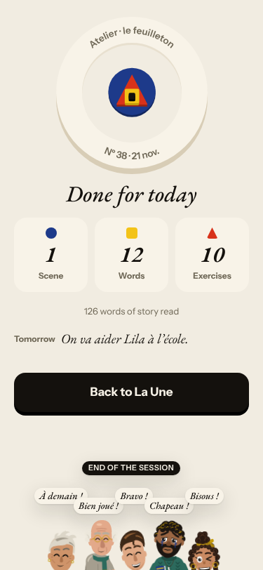

### #147 the cast is not one registry
12. **Low · new #970** «Gus asks if he should speak to Gus or stay silent.» 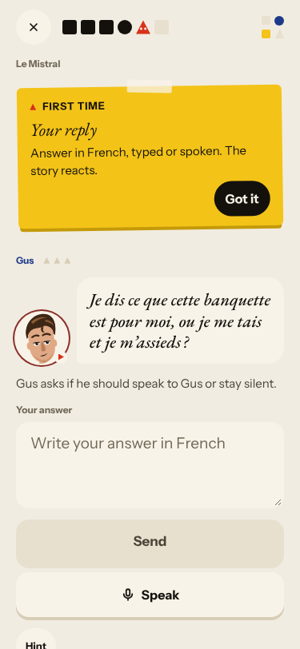
13. **Medium · #920 seen again** Zoé (amie) uses «vous». 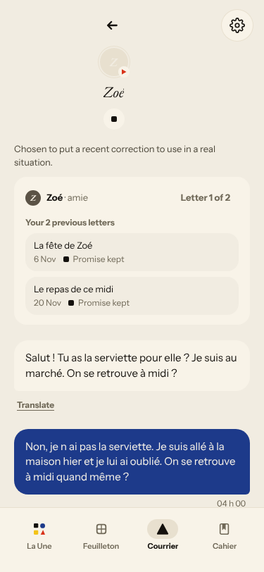

### Other, seen again
- **Low · #950** «A day off kept your streak» on a played day. 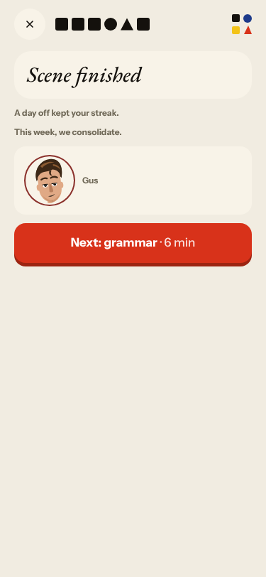
- **Low · #577** Home «Nº 38 · La clé d'Odile» vs scene «Bastien mesure le Mistral». 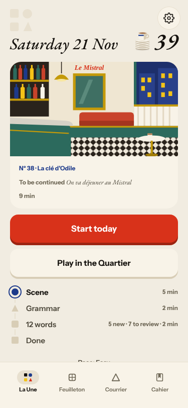
- **Low · #725** Lexique cards open on the English word. 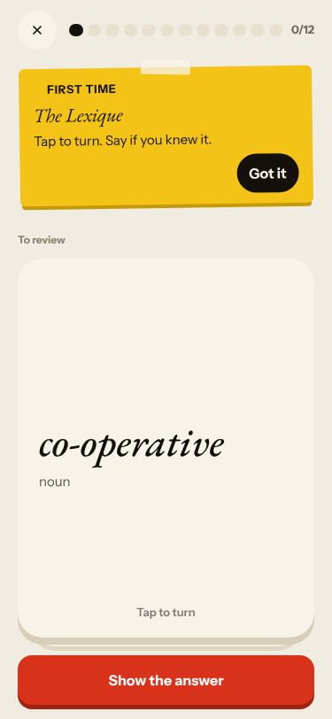
- **Low · #557** Courrier's suggested replies never change across three turns.

No new root cause: every finding fits #145, #146, #147, #174, #250, #333. Six new issues (#966–#971), the cap.

What worked: the scene reacted to «non», the cat, the cheese question and my decision in character; La Forge's «Fix the marked words» feedback was specific and correct («notre» with plural «cahiers», «son» for «bague», «suis» for age); Courrier gave correct correction cards («ce n'est pas», «a fêté», «parlent», «tu vas l'aimer») and answered the parrots; the day ended with a saved scene, a Forge summary with next review dates, 12/12 words and a Done screen.

## Re-tests

| issue | result |
|---|---|
| #723 order drill accepts «Im est» | reproduces → commented |
| #661 Courrier answers «non» with «Reformulez plus poliment» | not reproduced (two clear «non» answered in character) → commented, left open |
| #693 Courrier reply never arrives | not reproduced (3 of 3 arrived, ~20 s) → commented, left open |
| #725 English Lexique fronts | reproduces → commented |
| #577 Home vs scene title | reproduces → commented |
| #556, #919, #920, #948, #949, #950, #466, #557, #918 | seen again → commented |
| #852, #853, #821, #926, #592, #750, #776 | screen not reached today |

## Which fixes are live

Release `b8564d6757ca` is the tip of origin/main (merge of #965, 21 Nov 02:07 Berlin), so the pilot (#958, 20 Nov 15:33) and every other merged fix are live: no merged PR waits for a deploy and none is older than a day without being live. The three-day lag in #921 is over. Nothing today showed a `queue:pr` fix failing: #776's exchange counter and #750/#621 were not conclusively re-tested (the counter still sticks at «3 of 3», #948).

New issues: #966, #967, #968, #969, #970, #971, each `queue:ready` with **Done when:**. Screenshots: `docs/ops/live-walks/2026-11-21/`.
