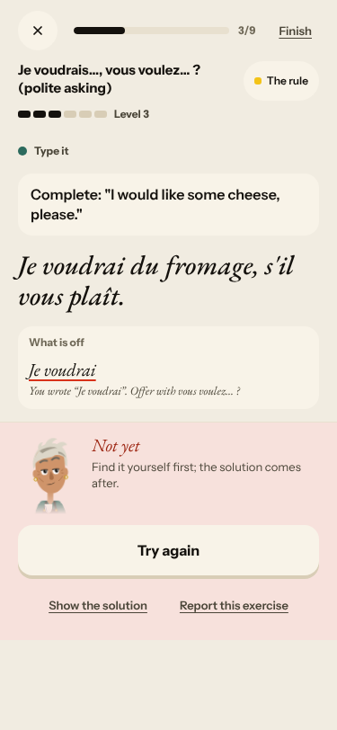
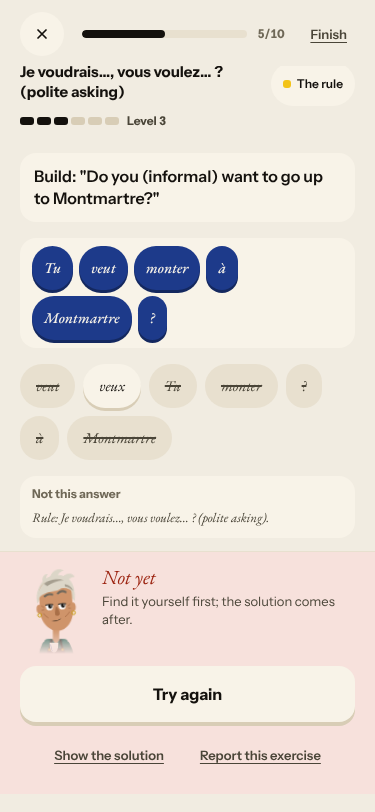
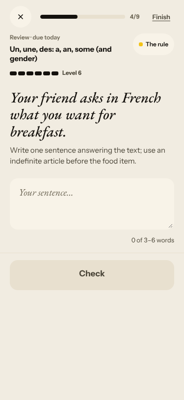
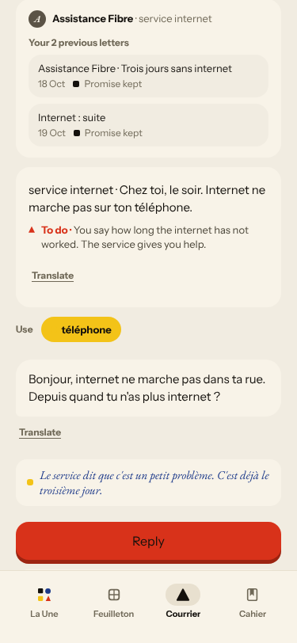
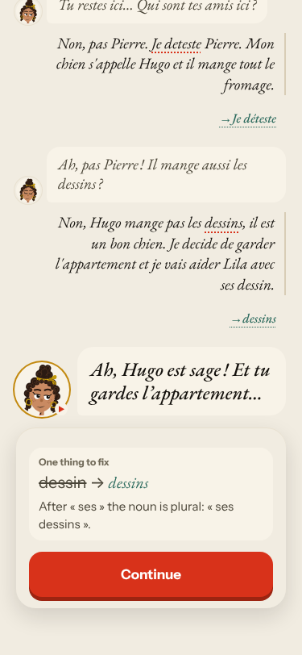
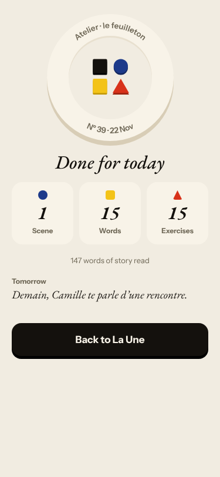
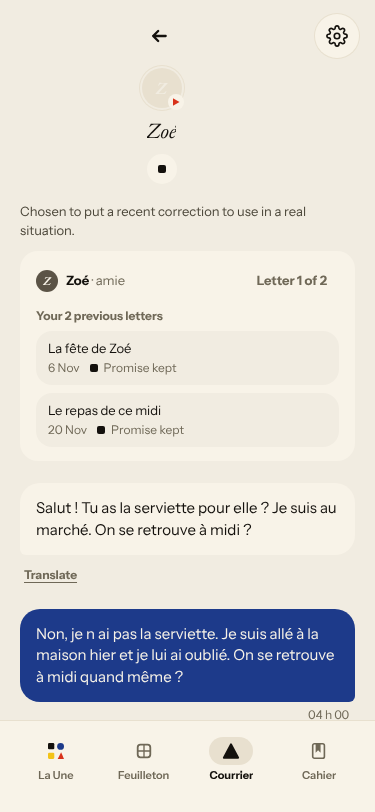
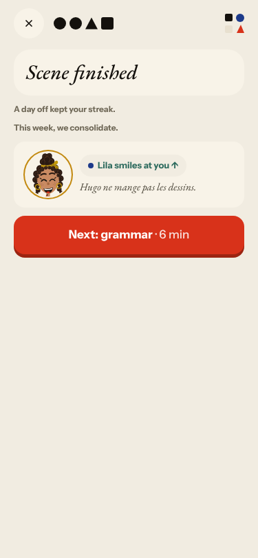
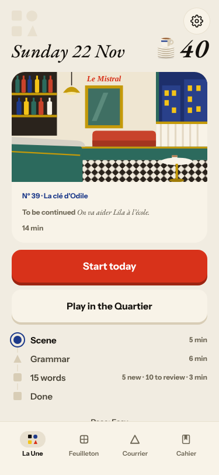

# Live walk · 22 Nov 2026 · production, real model

Run by the scheduled cloud routine (`explore:live`, Chromium at phone size) against `atelier-api-3njh.onrender.com` (release `842320c735c4`, the tip of main, 02:07 Berlin) with the walk test account.
Account: **A1.1, day 40** (Home «Nº 39 · La clé d'Odile», Previous «Bastien mesure le Mistral»; the scene played was «Les dessins de Lila au Mistral», with Lila).
Played: rule card «Je voudrais…, vous voulez… ? (polite asking)», the scene with three typed replies (a «de amis» slip, a clear «non» with an off-script dog Hugo that eats the cheese, a decision with four slips), La Forge on the rule (ten items, level 1 → 6, deliberate misses «Je voudrai», «un baguette», «Tu veut», «patisserie», «Je voudrait … a … redaction»), 15 word cards (two «Again»), Done, Courrier (the finished 19 Nov Zoé letter, then a new letter from Assistance Fibre: three replies incl. a clear «non» and an off-script pirate grandfather with parrots), Cahier (Rules, Journal; the Journal retell was not played).
Q19 n/a (cloud). Previous live report: [21 Nov](2026-11-21.md).

## Scores

| # | question | live 22 Nov | live 21 Nov | trend |
|---|---|---|---|---|
| 1 | Where am I | 4 | 4 | = |
| 2 | What is at stake | 4 | 4 | = |
| 3 | What to do next | 3 | 3 | = |
| 4 | Scene reacts to my writing | 4 | 4 | = |
| 5 | Story coherent | 4 | 3 | ↑ |
| 6 | Characters consistent | 3 | 3 | = |
| 7 | Image, text, tone fit | 4 | 4 | = |
| 8 | Difficulty fits | 4 | 4 | = |
| 9 | Feedback explained | 3 | 3 | = |
| 10 | Right answers accepted | 4 | 2 | ↑ |
| 11 | French correct | 3 | 2 | ↑ |
| 12 | Clear goal today | 4 | 3 | ↑ |
| 13 | Grammar practised | 4 | 4 | = |
| 14 | Earlier material returns | 4 | 4 | = |
| 15 | I produce French | 5 | 5 | = |
| 16 | Errors, dead ends | 3 | 3 | = |
| 17 | Varied, fun | 4 | 4 | = |
| 18 | Fast enough | 3 | 3 | = |
| 19 | App only | n/a | n/a |  |
| 20 | Satisfying end | 3 | 3 | = |
| 21 | Would come back | 3 | 3 | = |
| 22 | Time vs promise | 3 | 3 | = |

Q4 4: the scene took up «Je vais rester ici», the dog and the cheese, and the decision in character, corrected «de amis», «déteste» and «dessins», but missed «mange pas», «il est un bon chien» and «decide» (#919). Q5 4 / Q10 4 / Q11 3 / Q12 4 are higher than 21 Nov because today's day has none of the earlier traps (no gloss naming Gus twice, no rejected «clef», no rule-less day: a rule card opened the day and La Forge drilled the same rule); the underlying issues (#966, #968, #970) were not reached. Q6 3: Zoé (amie) and the Assistance Fibre service write «tu»/«vous» against the register (#920, #520). Q9 3: Forge misses explain with the rule's gloss («Je voudrai» → «Offer with vous voulez… ?»), see #992; the free-text fix lists were specific (marked «patisserie», «voudrait / a / redaction»). Q16 3: «Exchange 3 of 3» again on reply 3 (#948); «Scene finished» says «A day off kept your streak» on a played day (#950); in the scene reader the first tap on «Continue» at panel 5 did nothing, a second tap went on. Q18: scene replies 10–16 s, Courrier replies about 20–25 s, drills and word cards at once. Q20 3: «Tomorrow · Demain, Camille te parle d'une rencontre.» is a statement, again (#466). Q22: about 30 minutes of play against the promised «14 min» (waiting on replies included).

## Findings, by root cause

### #146 the day's learning content and feedback are not driven by one concept
1. **Medium · new #992** a Forge miss on «Je voudrai» says «Offer with vous voulez… ?», «Tu veut …» gets «Rule: …» (also #809).  
2. **Medium · new #993** a writing item says «Your friend asks in French … answering the text» and shows no text. 

### #145 the scene has no state of what happened
3. **Medium · new #994** Courrier's new letter «Trois jours sans internet» repeats the 18 Oct letter and is unrelated to the Mistral story. 
4. **Medium · #919 seen again** one of four slips corrected in reply 3.
5. **Medium · #948 seen again** «Exchange 3 of 3» for reply 3. 
6. **Medium · #466 seen again** tomorrow's hook is a statement. 

### #147 the cast is not one registry
7. **Medium · #920 / #520 seen again** Zoé (amie) uses «vous»; Assistance Fibre «tu» with a «vous» suggested reply. 

### Other, seen again
- **Low · #950** «A day off kept your streak» on a played day. 
- **Low · #577** Home «Nº 39 · La clé d'Odile» vs scene «Les dessins de Lila au Mistral». 
- **Low · #557** Courrier's suggested replies stay the same across turns.

No new root cause: every finding fits #145 or #146. Three new issues (#992–#994), below the cap.

What worked: the scene reacted to «non», the dog and the cheese, the decision, in character; Courrier gave correct correction cards («téléphone», «trois jours», «personne ne répond», «grand-père») and answered «non» and the off-script grandfather in character; La Forge's «Fix the marked words» marked exactly the slipped words, and an unusual order («Je voudrais donner des fleurs à Lila» without the full stop) was accepted; the Éclair, rule levels and next-review dates (Tue 24 Nov) showed on the end sheet; the Lexique front now asks «How do you say it in French?».

## Re-tests

| issue | result |
|---|---|
| #725 Lexique English front | fixed: the first card asks «How do you say it in French?» (already closed 21 Nov) |
| #557 Courrier suggestions ignore the thread | reproduces → commented, `queue:pr` → `queue:ready` |
| #577 Home vs scene title | reproduces, fix live → commented, `queue:pr` → `queue:ready` |
| #919, #948, #950, #920, #520, #466, #809 | seen again → commented |
| #381 red «Not yet» after an accepted repair | not conclusive (the retry path showed «Well done!» with no red banner; the repair-field path was not reached) |
| #167, #556, #538, #535, #467, #622, #853, #821 | screen not reached today |

## Which fixes are live

Release `842320c735c4` is the tip of origin/main (merge of #991, 22 Nov 02:07 Berlin), so every merged fix is live. No `queue:pr` issue has a PR merged more than a day ago that is missing from the release. Two live fixes were re-tested and are not fixed: #557 and #577 (back to `queue:ready`). 27 other `queue:pr` issues are old merges not reachable today.

New issues: #992, #993, #994, each `queue:ready` with **Done when:**. Screenshots: `docs/ops/live-walks/2026-11-22/`.
