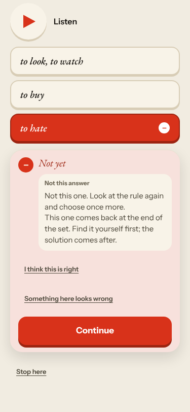
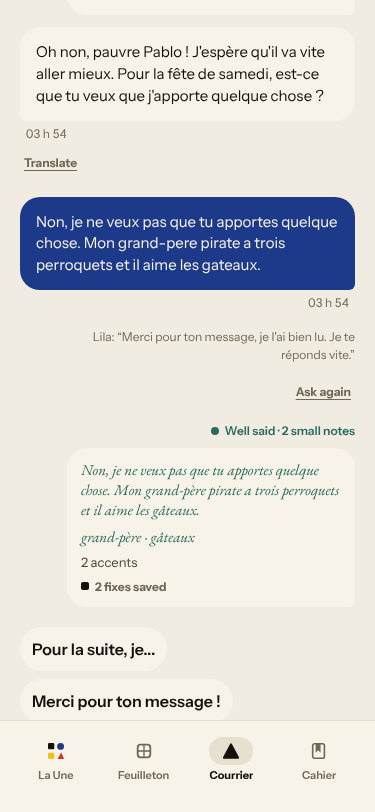
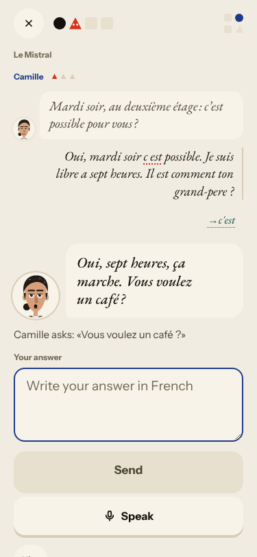
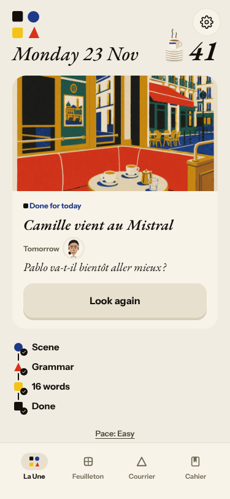
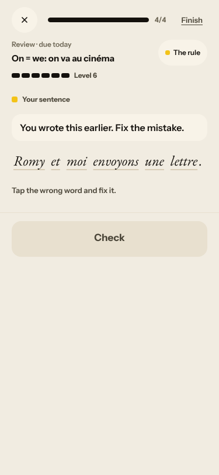
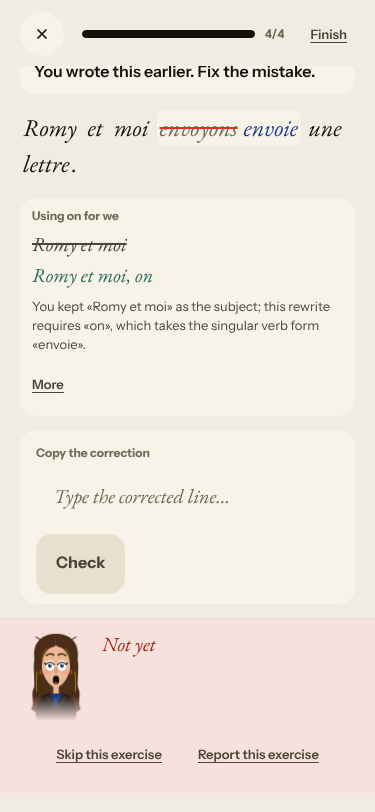
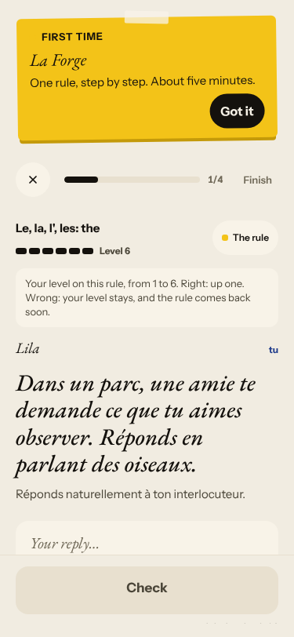

# Live walk · 23 Nov 2026 · production, real model

Run by the scheduled cloud routine (`explore:live`, Chromium at phone size) against `atelier-api-3njh.onrender.com` (release `83b33ea85d16`, the tip of main) with the walk test account.
Account: **A1.1, day 41** (Home «Nº 40 · La clé d'Odile», Previous «Les dessins de Lila au Mistral»; the scene played was «Camille vient au Mistral», with Camille and Lila).
Played: the scene (listen mode skipped, read mode, three typed replies: a tu question about the grandfather with «a sept heures» / «grand-pere» slips; a clear «non» to the coffee plus an off-script cat Pablo that ate the cake; a decision with «mange», «decide», «grand-pere»), seven recall drills (two misses on purpose, one «Depuis» capital), La Forge on «Le, la, l', les: the» (level 6; four items: «le oiseaux dans la parc» with «J aime», «la parc», «supermarche» without accent, and a review item «On = we»), 16 word cards (one «Again»), Done, Courrier (letter from Lila: three replies, incl. a clear «non» and an off-script pirate grandfather with parrots), Cahier (Rules, Journal; the Journal retell was not played).
Q19 n/a (cloud). Previous live report: [22 Nov](2026-11-22.md).

## Scores

| # | question | live 23 Nov | live 22 Nov | trend |
|---|---|---|---|---|
| 1 | Where am I | 4 | 4 | = |
| 2 | What is at stake | 4 | 4 | = |
| 3 | What to do next | 3 | 3 | = |
| 4 | Scene reacts to my writing | 4 | 4 | = |
| 5 | Story coherent | 4 | 4 | = |
| 6 | Characters consistent | 3 | 3 | = |
| 7 | Image, text, tone fit | 4 | 4 | = |
| 8 | Difficulty fits | 4 | 4 | = |
| 9 | Feedback explained | 3 | 3 | = |
| 10 | Right answers accepted | 4 | 4 | = |
| 11 | French correct | 4 | 3 | ↑ |
| 12 | Clear goal today | 4 | 4 | = |
| 13 | Grammar practised | 4 | 4 | = |
| 14 | Earlier material returns | 4 | 4 | = |
| 15 | I produce French | 5 | 5 | = |
| 16 | Errors, dead ends | 3 | 3 | = |
| 17 | Varied, fun | 4 | 4 | = |
| 18 | Fast enough | 3 | 3 | = |
| 19 | App only | n/a | n/a |  |
| 20 | Satisfying end | 4 | 3 | ↑ |
| 21 | Would come back | 4 | 3 | ↑ |
| 22 | Time vs promise | 4 | 3 | ↑ |

Q4 4: the scene took up the «non» («Pas de café, compris. Pauvre gâteau !»), the cat, and the decision, and the closing panel named Pablo; but it skipped my question about the grandfather and answered a tu with «vous» (#591, #920), and corrected one slip per reply (#919). Q6 3: Camille uses «vous» to a friend. Q9 3: La Forge's explanations were specific («You used «la» with «parc»; this masculine noun requires «le»»; «You wrote «J aime»; French requires an apostrophe»), but a word-drill miss says «Look at the rule again» (#1024) and the review item «Fix the mistake» shows a correct sentence (#625). Q10 4: «supermarche» was accepted with an accent note, «Depuis» and «la page» were accepted. Q11 4: no wrong French seen in the character lines (the register aside). Q16 3: Courrier showed a stock line as Lila's answer (#1025); the review item cannot be solved as posed. Q18 3: scene replies 8–12 s, Courrier replies 20–25 s (one still typing out at +26 s); drills and word cards at once. Q20 4 / Q21 4: «Tomorrow · Pablo va-t-il bientôt aller mieux ?» is a concrete question that takes up my off-script reply, the first such hook in the live walks (#466 left open: one night). Q22 4: about 11 minutes of machine time against the promised «10 min» (a person reading and typing would take longer).

## Findings, by root cause

### #542 a drill's instruction is picked from the widget, not the declared task
1. **Low · new #1024** a word drill's miss says «Look at the rule again and choose once more», and the choices are then locked. 

### #333 a failed model call is shown as a result
2. **Medium · new #1025** Courrier's answer to reply 2 is «Merci pour ton message, je l'ai bien lu. Je te réponds vite.»; «Ask again» then produced a real answer. 

### #145 the scene has no state of what happened
3. **Medium · #591 seen again** Camille skips my question about the grandfather. 
4. **Medium · #919 seen again** one slip corrected per reply, three replies.
5. **Low · #557 seen again** Courrier's suggested replies do not change across three turns.
6. **Low · #577 seen again** Home «Nº 40 · La clé d'Odile» vs scene «Camille vient au Mistral». 

### #146 the day's learning content and feedback are not driven by one concept
7. **Medium · #625 seen again** La Forge's review item «Fix the mistake» shows a correct sentence; the solution is a rewrite.  

### #147 the cast is not one registry
8. **Medium · #920 seen again** Camille (friend, tu) writes «pour vous», «Vous voulez un café ?».
9. **Low · #951 seen again** loose tokens «Lila» and «tu» above the dialogue prompt (fix #1010 not merged). 

No new root cause: every finding fits #145, #146, #147, #333 or #542. Two new issues (#1024, #1025), below the cap.

Observation, not filed: in the scene reader about every second tap on «Next» does not advance when taps arrive back to back; the same as on 22 Nov, not reproducible by a person tapping slowly.

What worked: the scene reacted to «non», the off-script cat and the decision; the Courrier answered «non» and the pirate grandfather with parrots in character (on the second ask); La Forge marked exactly the slipped words and accepted a missing accent with a note; the end sheet showed levels and next-review dates; Done's «Tomorrow» was a question; «A day off kept your streak» is gone.

## Re-tests

| issue | result |
|---|---|
| #950 «A day off kept your streak» on a played day | fixed (#1005 live): closed with [screenshot](2026-11-23/scene-finished-no-dayoff.png) |
| #948 «Exchange 3 of 3» past the plan | the scene counted 1, 2, 3 of 3 and ended after reply 3 (#1002 live); already closed |
| #167 first word drill listen-only | behaves as #430 designed (French word after «Show the text» and the answer); the default is a product decision → comment, `queue:pr` → `queue:owner` |
| #951, #557, #577, #591, #919, #920, #625 | seen again → commented |
| #466 hook is a statement | today a question → commented, left open (owner) |
| #556, #538, #535, #467, #622, #520, #445, #381, #574 | screen not reached today |

## Which fixes are live

Release `83b33ea85d16` is the tip of origin/main (merge of #1022, 23 Nov 02:13 Berlin), so every merged fix is live; no `queue:pr` issue has a PR merged more than a day ago that is missing from the release. Open PRs not merged, so not live: #1010 (#951), #1012 (#998). Live and re-tested: #1005 (#950, fixed), #1002 (#948, fixed). Not re-tested: the rest of the `queue:pr` list (old merges not reachable today).

New issues: #1024, #1025, each `queue:ready` with **Done when:**. Screenshots: `docs/ops/live-walks/2026-11-23/`.
