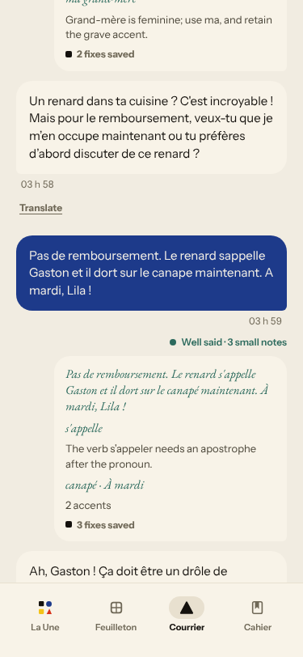
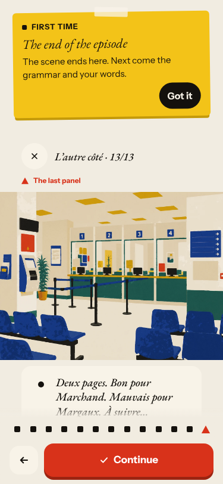
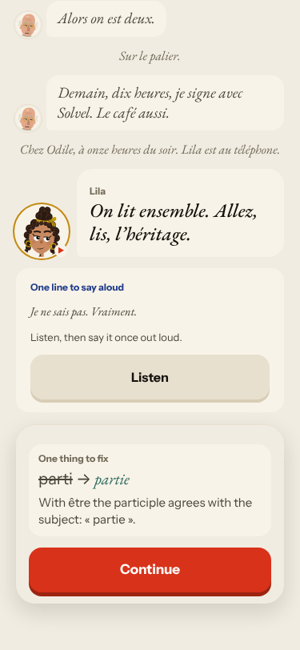
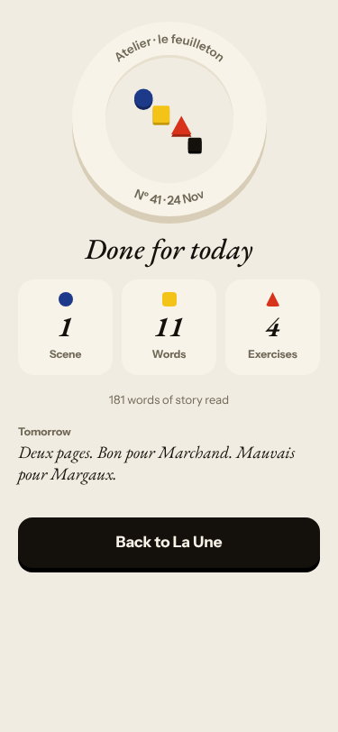
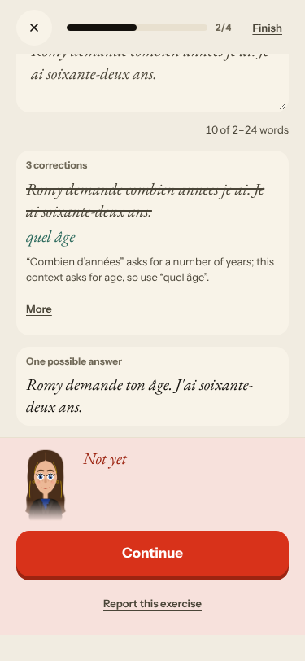
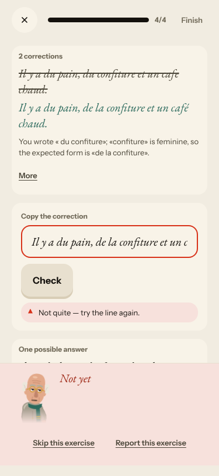
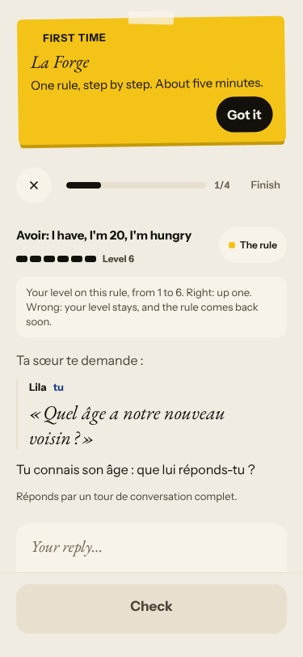

# Live walk · 24 Nov 2026 · production, real model

Run by the scheduled cloud routine (`explore:live`, Chromium at phone size) against `atelier-api-3njh.onrender.com` (release `8343a437dffa`, the tip of main) with the walk test account.
Account: **A1.1, day 42** (Home «Nº 41 · La clé d'Odile»; the scene played was «L'autre côté», La gérance Marchand, with Camille and M. Marchand).
Played: the scene (read mode; **one** typed reply: a clear «non» with slips «est parti», «ne a», «a moi», «grand-mere»; the scene then ended), La Forge on «Avoir» (level 6; four items: «Il est vingt ans… il a faim toujours», «combien annees je ai», a right «Nous avons une idée pour Gus», and a review item on «il y a» with «du confiture» / «cafe»), 11 word cards (one «Again»), Done, Courrier (letter from Lila: three replies, incl. a clear «non» and an off-script fox Gaston), Cahier (Rules; the Journal retell was not played). Today's plan had no recall drills.
Q19 n/a (cloud). Previous live report: [23 Nov](2026-11-23.md).

## Scores

| # | question | live 24 Nov | live 23 Nov | trend |
|---|---|---|---|---|
| 1 | Where am I | 4 | 4 | = |
| 2 | What is at stake | 4 | 4 | = |
| 3 | What to do next | 3 | 3 | = |
| 4 | Scene reacts to my writing | 4 | 4 | = |
| 5 | Story coherent | 3 | 4 | ↓ |
| 6 | Characters consistent | 3 | 3 | = |
| 7 | Image, text, tone fit | 4 | 4 | = |
| 8 | Difficulty fits | 4 | 4 | = |
| 9 | Feedback explained | 3 | 3 | = |
| 10 | Right answers accepted | 3 | 4 | ↓ |
| 11 | French correct | 3 | 4 | ↓ |
| 12 | Clear goal today | 4 | 4 | = |
| 13 | Grammar practised | 4 | 4 | = |
| 14 | Earlier material returns | 4 | 4 | = |
| 15 | I produce French | 5 | 5 | = |
| 16 | Errors, dead ends | 3 | 3 | = |
| 17 | Varied, fun | 4 | 4 | = |
| 18 | Fast enough | 3 | 3 | = |
| 19 | App only | n/a | n/a |  |
| 20 | Satisfying end | 3 | 4 | ↓ |
| 21 | Would come back | 4 | 4 | = |
| 22 | Time vs promise | 4 | 4 | = |

Q4 4: the scene took up the «non» («Je comprends. Votre grand-mère ne vous a rien dit. Alors on est deux.») and Courrier took up the off-script fox («Un renard dans ta cuisine ?») and Gaston; but the scene allowed one reply only (#378) and fixed one of three slips (#919). Q5 3: Lila invents a refund thread in Courrier (#1043). Q6 3: Camille (friend) says «avec vous» (#920). Q9 3: Courrier's notes were exact (four fixes for the «non» reply, accents, ma/mon); La Forge announced «3 corrections», listed one and left «je ai» unmarked (#1044). Q10 3: the corrected line without «é» is «Not quite» (#1045). Q11 3: Lila's «Je suis contente que tu ne prennes pas de remboursement» is odd French in context. Q16 3: loose tokens «Lila» / «tu» in La Forge again (#951); the stale suggested replies in Courrier (#557). Q18 3: scene reply about 14 s, Forge checks 8–12 s, Courrier replies 25–40 s; cards at once. Q20 3: «Tomorrow · Deux pages. Bon pour Marchand. Mauvais pour Margaux.» is a statement, not a question (#466); 23 Nov's was a question. Q22 4: about 25 minutes of machine time including waiting on Courrier, against «9 min» plus the letter.

## Findings, by root cause

### #145 the scene has no state of what happened
1. **Medium · new #1043** Courrier: Lila offers a refund («la carte aujourd'hui ou… un remboursement ?») in a thread about a name on a card, and keeps it for three turns. 
2. **High · #378 seen again** the scene ends after one typed reply («Step 2 of 3», then «13/13»). 
3. **Medium · #919 seen again** one slip fixed of three in the scene reply. 
4. **Low · #557 seen again** Courrier's suggested replies do not change; the first contradicts my «non».
5. **Low · #577 seen again** Home «Nº 41 · La clé d'Odile» vs scene «L'autre côté».
6. **Medium · #466 seen again** Done's «Tomorrow» is a statement. 

### #250 free-text corrections are raw model output, never checked against the learner's sentence
7. **Medium · new #1044** La Forge: «3 corrections», one listed, «je ai» unmarked. 

### #174 a right answer is judged against one stored string
8. **Low · new #1045** the repair box rejects the corrected line without its accent with «Not quite». 

### #147 the cast is not one registry
9. **Medium · #920 seen again** Camille: «Grand-père veut parler avec vous.»
10. **Low · #951 seen again** stray tokens «Lila» and «tu» above the dialogue prompt (fix #1010 not merged). 

No new root cause: every finding fits #145, #147, #174 or #250. Three new issues (#1043, #1044, #1045), below the cap.

Observations, not filed: the harness cannot type into La Forge's repair fields with `/type` (it fills the disabled textarea), nor «é» with `/key`; I used key presses, so these are not app findings. After a skipped review item La Forge's end sheet lists the correction line as «Still practising» with a next review date; watch whether it recurs.

What worked: the scene and Courrier both took up the «non»; Courrier's correction notes were specific and complete (apostrophe, ma/mon, accents, s'appelle, «À mardi»); La Forge marked «du confiture» and «cafe» and explained gender; the end sheet showed levels and review dates.

## Re-tests

| issue | result |
|---|---|
| #951 stray tokens | not fixed (#1010 not merged) → commented, left `queue:pr` |
| #378, #919, #920, #466, #557, #577 | seen again → commented |
| #1025 stock Courrier line | three replies were real answers; the earlier failure not reproduced (one night, left open) |
| #556, #538, #535, #467, #622, #520, #445, #381, #574, #1024, #993 | screen or condition not reached today |

## Which fixes are live

Release `8343a437dffa` is the tip of origin/main (merge of #1042, 24 Nov 02:08 Berlin), so every merged fix is live; no `queue:pr` issue has a PR merged more than a day ago that is missing from the release. Merged and live since the last walk: #1032, #1033 (spelling slips), #1037 (Journal retell, #622: the retell was not played today, so not re-tested), #1039 (La Forge «we» cards). Not merged, so not live: #1010 (#951), #1012 (#998).

New issues: #1043, #1044, #1045, each `queue:ready` with **Done when:**. Screenshots: `docs/ops/live-walks/2026-11-24/`.
