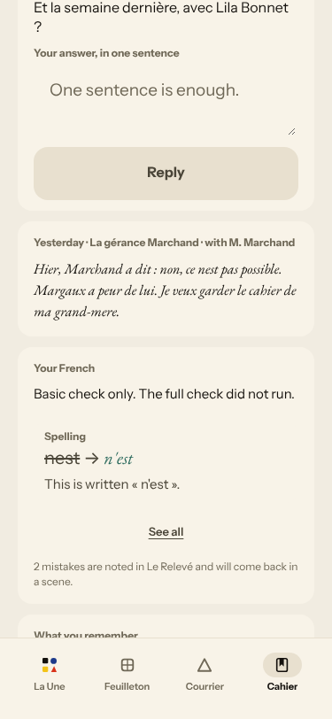
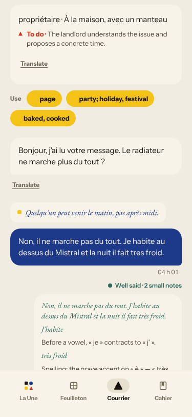
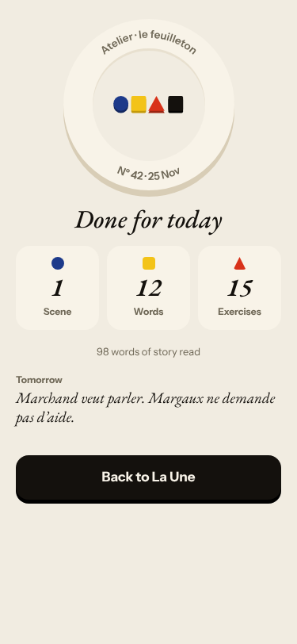
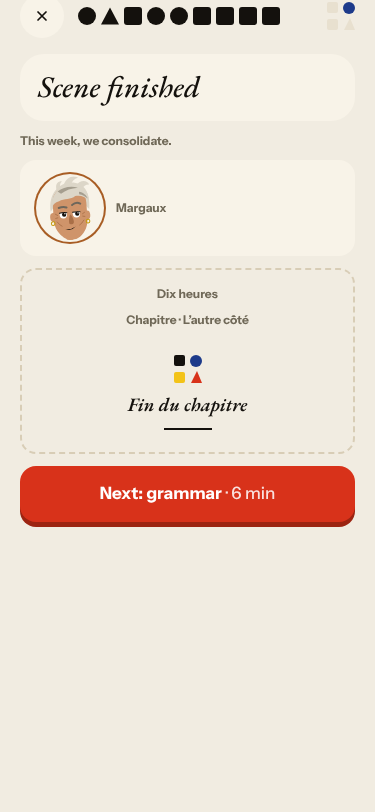
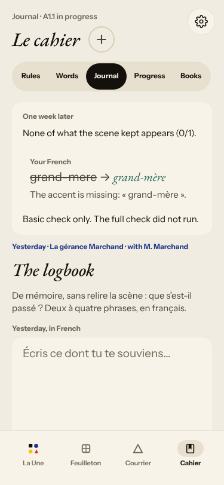
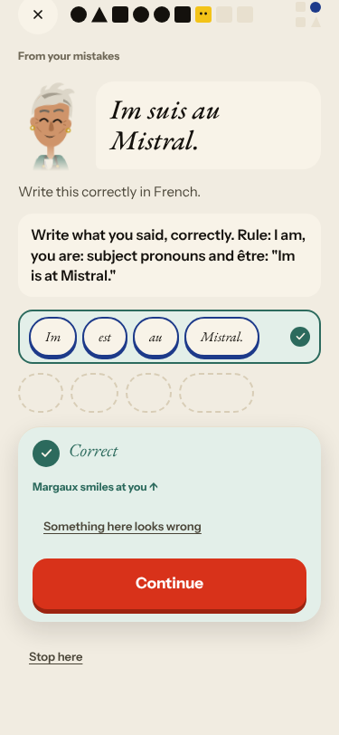

# Live walk · 25 Nov 2026 · production, real model

Run by the scheduled cloud routine (`explore:live`, Chromium at phone size) against `atelier-api-3njh.onrender.com` (release `56a648d8ddfd`, the tip of main) with the walk test account.
Account: **A1.1, day 43** (Home «Nº 42 · La clé d'Odile»; the scene played was «L'autre côté», with Margaux, Romy, M. Marchand).
Played: the scene (reader of 6 panels, **one** typed reply: a clear «non» with slips «a Marchand», «je ai», «a ma grand-mere»; a three-card choice followed; the scene then ended), two rule cards (Avoir, plural nouns) with four «From your mistakes» drills, La Forge on «Plural nouns» (8 items: a typed «ses cles», «Ils ont un idée», «Je voit quelques oiseau», «Je suis soixante-cinq ans» each corrected and retried), 12 word cards (one «Again»), Done, Courrier (letter «Le radiateur est froid»: a clear «non», an off-script chat Gaston and the lease question, a closing reply), Cahier (Rules, Words, Journal: both prompts answered).
Q19 n/a (cloud). Previous live report: [24 Nov](2026-11-24.md).

## Scores

| # | question | live 25 Nov | live 24 Nov | trend |
|---|---|---|---|---|
| 1 | Where am I | 4 | 4 | = |
| 2 | What is at stake | 4 | 4 | = |
| 3 | What to do next | 3 | 3 | = |
| 4 | Scene reacts to my writing | 4 | 4 | = |
| 5 | Story coherent | 3 | 3 | = |
| 6 | Characters consistent | 3 | 3 | = |
| 7 | Image, text, tone fit | 3 | 4 | ↓ |
| 8 | Difficulty fits | 4 | 4 | = |
| 9 | Feedback explained | 4 | 3 | ↑ |
| 10 | Right answers accepted | 4 | 3 | ↑ |
| 11 | French correct | 3 | 3 | = |
| 12 | Clear goal today | 4 | 4 | = |
| 13 | Grammar practised | 5 | 4 | ↑ |
| 14 | Earlier material returns | 4 | 4 | = |
| 15 | I produce French | 5 | 5 | = |
| 16 | Errors, dead ends | 3 | 3 | = |
| 17 | Varied, fun | 4 | 4 | = |
| 18 | Fast enough | 3 | 3 | = |
| 19 | App only | n/a | n/a |  |
| 20 | Satisfying end | 3 | 3 | = |
| 21 | Would come back | 4 | 4 | = |
| 22 | Time vs promise | 4 | 4 | = |

Q4 4: the scene took up the «non» («Tu as peur de Marchand. Merci.»), Courrier took up «non», the chat Gaston and the lease question, but the scene allowed one reply and then a card choice that contradicted the «non» (#378). Q7 3: «Dix heures» printed as Margaux's speech (#1064). Q9 4: La Forge named the gender of «idée», the tense of «voit», and être/avoir for age; Courrier's notes were exact; the Journal's check was partial (#1062). Q10 4: «ses cles» accepted with an accent hint; but «Im est au Mistral.» accepted (#723). Q11 3: the same drill; Marchand's role in the letter (#1065). Q13 5: the rule was shown, drilled and re-asked in La Forge with specific hints. Q16 3: «Basic check only. The full check did not run.» (#1062), stale chips (#557). Q18 3: scene reply ≈14 s, Forge checks 8–12 s, Courrier 30–40 s, Journal 25 s. Q20 3: «Tomorrow · Marchand veut parler. Margaux ne demande pas d'aide.» is a statement (#466). Q22 4: ≈40 minutes of machine time including waiting on the model, against «9 min» plus the letter.

## Findings, by root cause

### #145 the scene has no state of what happened
1. **Medium · new #1063** the Journal says «You recalled everything the scene kept (1/1)» for an invented retell. 
2. **Low · new #1065** the landlord asks the tenant to arrange the repair. 
3. **High · #378 seen again** one typed reply, then a choice that ignores the «non», «Merci.» twice, end.
4. **Medium · #466 seen again** the Done card's «Tomorrow» is a statement. 
5. **Low · #557 seen again** chips unchanged over three turns.

### #147 the cast is not one registry
6. **Medium · new #1064** the stage label «Dix heures» is a «Margaux» bubble. 
7. **Medium · #920 seen again** Camille: «Grand-père veut parler avec vous.» in the Journal.

### #333 a failed model call is shown as a result
8. **Medium · new #1062** the Journal's «Basic check only. The full check did not run.» with slips left unmarked. 

### #250 free-text corrections / drill targets built from the learner's text
9. **Medium · #723 seen again** «Im est au Mistral.» is marked Correct. 

No new root cause: every finding fits #145, #147, #250 or #333. Four new issues (#1062–#1065), below the cap.

What worked: La Forge's hints were specific for each slip (gender, ending, être/avoir for age) and allowed a second try; word cards from the scene and earlier days came back; Courrier's corrections (j'habite, très, grand-mère, laissé, c'est) were precise and it answered the off-script lease question and the chat.

## Re-tests

| issue | result |
|---|---|
| #723 | seen again (see above) |
| #378, #466, #557, #920 | seen again → commented |
| #622 | Journal retell shows scene lines, not the filler; fix #705 unmerged → commented |
| #951 | screen not reached; #1010 unmerged |
| other open live-walk issues | screen or condition not reached today |

## Which fixes are live

Release `56a648d8ddfd` is the tip of origin/main. Every fix PR named by an open `queue:pr` issue (#1036, #1010, #705, #608, #585, #582, #569, #549, #476, #455, #437, #436, #429, #511, #484) is still open and unmerged, so none is live and none is a deploy finding (no PR merged more than a day ago is missing from the release).

New issues: #1062, #1063, #1064, #1065, each `queue:ready` with **Done when:**. Screenshots: `docs/ops/live-walks/2026-11-25/`.
