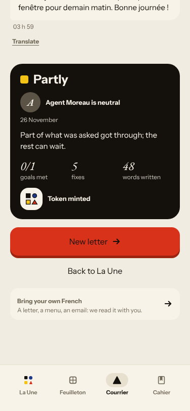
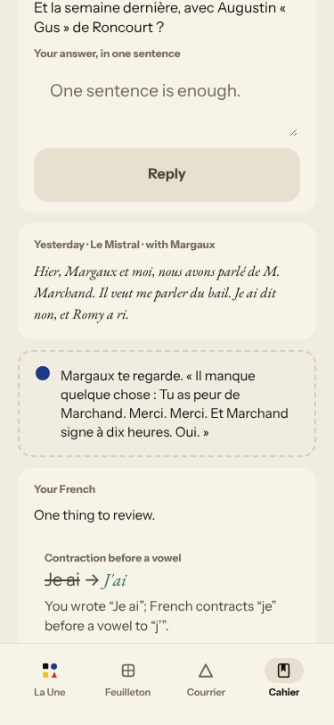
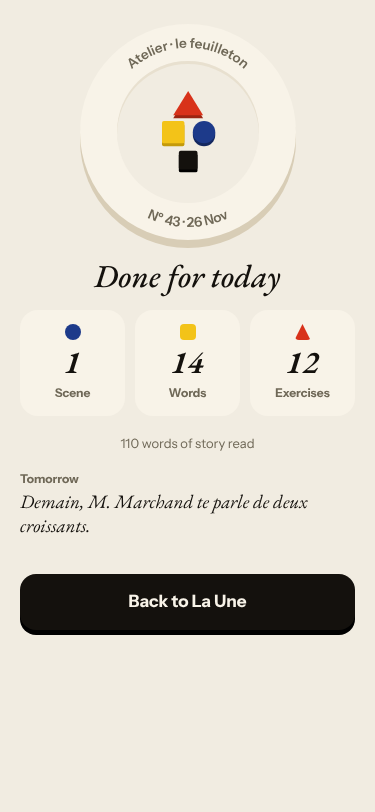
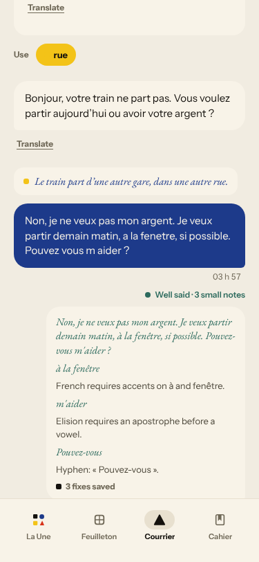
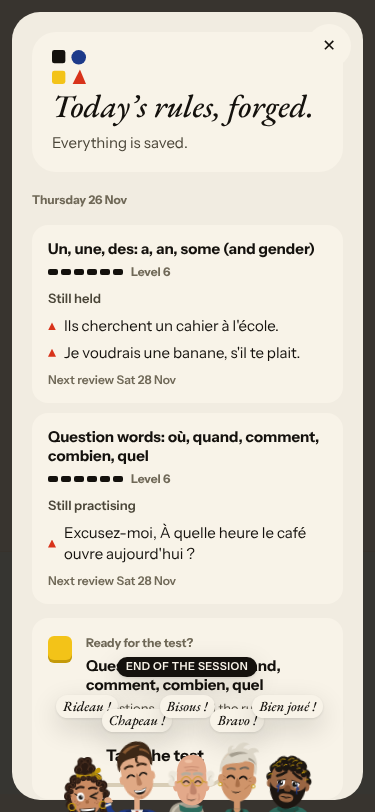
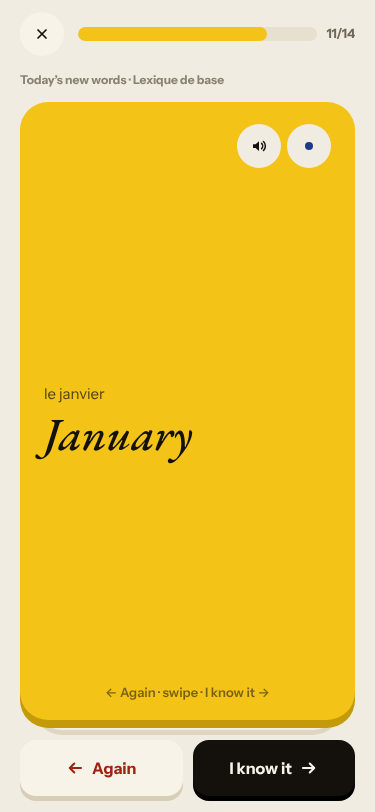
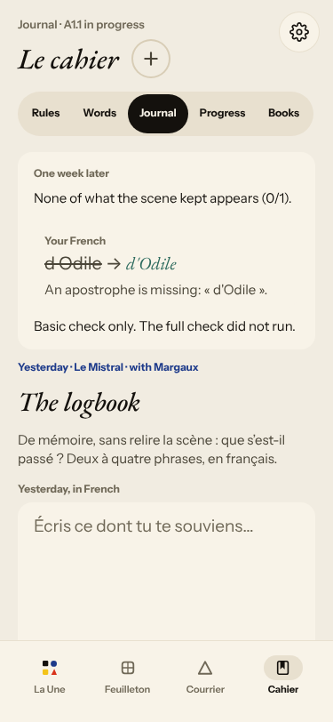
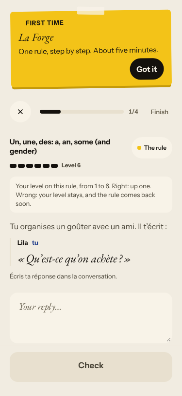
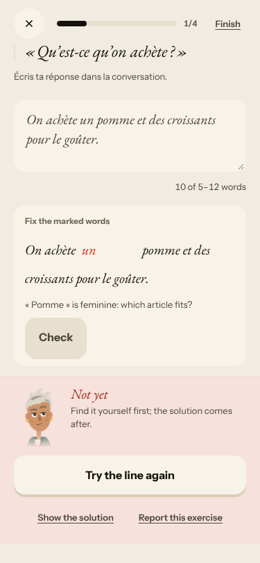

# Live walk · 26 Nov 2026 · production, real model

Run by the scheduled cloud routine (`explore:live`, Chromium at phone size) against `atelier-api-3njh.onrender.com` (release `831173baea27`, the tip of main) with the walk test account.
Account: **A1.1, day 44** (Home «Nº 43 · La clé d'Odile»; the scene played was «Le cadeau de Lila», with Lila, Margaux and Odile's name behind the painting).
Played: the scene (reader of 5 panels, **three** typed replies: a clear «non» with slips «Je ai», «grand-mere»; an off-script question about the name behind the painting and my cat Gaston; a reply about the croissant and 8 January; then the scene's own recall drills, 8 items, one listen-and-write that I could not hear), La Forge on «Un, une, des» (4 items: «un pomme», «s il te plait», «a lecole», «quelle heure…» each corrected through the repair box) with no rule card shown first, 14 word cards (one «Again»), Done, Courrier (the weekly letter of 25 Nov was already done, so «New letter»: «Un train pour demain», Agent Moreau; a clear «non», an off-script question about my cat, a confirmation), Cahier (Rules, Journal: both «one week later» prompts and the retell of yesterday).
Q19 n/a (cloud). Previous live report: [25 Nov](2026-11-25.md).

## Scores

| # | question | live 26 Nov | live 25 Nov | trend |
|---|---|---|---|---|
| 1 | Where am I | 4 | 4 | = |
| 2 | What is at stake | 4 | 4 | = |
| 3 | What to do next | 3 | 3 | = |
| 4 | Scene reacts to my writing | 4 | 4 | = |
| 5 | Story coherent | 3 | 3 | = |
| 6 | Characters consistent | 4 | 3 | ↑ |
| 7 | Image, text, tone fit | 3 | 3 | = |
| 8 | Difficulty fits | 4 | 4 | = |
| 9 | Feedback explained | 4 | 4 | = |
| 10 | Right answers accepted | 4 | 4 | = |
| 11 | French correct | 3 | 3 | = |
| 12 | Clear goal today | 4 | 4 | = |
| 13 | Grammar practised | 4 | 5 | ↓ |
| 14 | Earlier material returns | 4 | 4 | = |
| 15 | I produce French | 5 | 5 | = |
| 16 | Errors, dead ends | 3 | 3 | = |
| 17 | Varied, fun | 4 | 4 | = |
| 18 | Fast enough | 3 | 3 | = |
| 19 | App only | n/a | n/a |  |
| 20 | Satisfying end | 3 | 3 | = |
| 21 | Would come back | 4 | 4 | = |
| 22 | Time vs promise | 4 | 4 | = |

Nothing scored 2 or less, so no screenshot is required for a score; the findings carry their own.
Q3 3: Courrier's chips offered «Je veux partir aujourd'hui» against the To do «tomorrow» and stayed unchanged over four turns (#557); after the agent had asked «tôt ou plus tard ?» the box read «Understood. Confirm the last detail or finish.» Q4 4: the scene took up the «non» («D'accord, je ne te force pas. Tu as peur pour le cadeau d'Odile ?»), the question about the name («Oui, il y a un nom : Odile») and Gaston; Courrier took up my cat and the seat; the scene's last panel was fitted to my replies. The hook did not («deux croissants»). Q5 3: the hook invents «deux croissants» and M. Marchand, who was not in the scene; Cahier calls «Question words» «shaky in practice» while La Forge shows it at Level 6. Q6 4: Lila, Margaux and the agent kept their voices; the tu/vous slip is in the model answer (#1082). Q7 3: «Lila tu» tokens (#951), the Journal's stitched and repeated lines (#1081). Q9 4: La Forge's hints named gender, accent and elision before asking, but one note calls «s» a conjunction and one correction capitalises «À» mid-sentence (#1082). Q10 4: «tablau» was accepted as «small typo», missing accents and apostrophes were corrected with notes. Q11 3: «le janvier» (#1083), the same drills. Q13 4: three items drilled the rule with specific hints plus one review rule, but no rule card came before them today and item 3 («un cahier») did not need the rule. Q16 3: «Basic check only» twice (#1062), stale panel after «Line fixed» (#381), chips (#557), a flash of «Sending to the server… The scene is done … Save the scene» before the end card. Q18 3: scene replies ≈15–20 s, Forge checks ≈10 s, Courrier 30–35 s, Journal 25–30 s. Q20 3: «Tomorrow · Demain, M. Marchand te parle de deux croissants.» is a statement (#466). Q22 4: ≈50 minutes of machine time including model waits, against «10 min» plus the letter.

## Findings, by root cause

### #145 the scene has no state of what happened
1. **Medium · new #1080** Courrier ends «Partly · goals met 0/1» though the agent confirmed tomorrow and the window seat; the only open goal was the unrelated word chip «rue». 
2. **Medium · new #1081** (also #147) the Journal quotes four scene lines glued into one speech of Margaux and prints «Dix heures» three times, although #1064 is live. 
3. **Medium · #466 seen again** the Done card's «Tomorrow» is a statement and invents «deux croissants». 
4. **Low · #557 seen again** Courrier's chips ignore the thread. 

### #250 free-text corrections are raw model output
5. **Low · new #1082** «The conjunction « s » elides before « il »», «Excusez-moi, À quelle heure…», «s'il vous plaît» as the model answer to a tu speaker (also #920). 

### #146 the day's content is not driven by one concept
6. **Low · new #1083** (also #280) new word card «le janvier», new words from the base list, not the scene. 

### #333 a failed model call is shown as a result
7. **Medium · #1062 seen again** the Journal's «Basic check only. The full check did not run.» twice. 

### Not under a root-cause issue
8. **Low · #951 seen again** La Forge dialogue prompts show «Lila tu» / «Margaux tu». 
9. **Low · #381 seen again** the «Fix the marked words» panel stays above «Line fixed» with the cut sentence. 

No new root cause: every finding fits #145, #146, #147, #250 or #333. Four new issues (#1080–#1083), below the cap.

What worked: the scene reacted to a clear «non», to a question about the name behind the painting and to the cat; La Forge's hints named the slip (gender of «pomme», elision, «à» before a place) and allowed a second try; the earlier scene words (serviette, eau, partir, entendre) came back as review; Courrier took up the cat and the window seat and corrected five slips with exact notes.

## Re-tests

| issue | result |
|---|---|
| #381 | banner half still fixed; stale cut-sentence panel seen again → commented |
| #951, #466, #557, #1062, #920, #280 | seen again → commented |
| #1064 (fix #1074, live) | the scene reader showed no title as a line today; the Journal's «scene as it was» still prints «Dix heures» three times → new #1081 |
| #1048, #1069 (fix #1076, live) | La Forge item «un rendez-vous» not reached today |
| other open live-walk issues | screen or condition not reached today |

## Which fixes are live

Release `831173baea27` is the tip of origin/main (merge of #1079). Merged and live: #1074 (page title as a line, #1064), #1076 (forge gloss, #1048 and #1069), #1071. The open `queue:pr` issues name fix PRs that are still open or unmerged (#1072, #1073, #1075, #1077, #1078 and older), so none of them is live and none is a deploy finding: no PR merged more than a day ago is missing from the release.

New issues: #1080, #1081, #1082, #1083, each `queue:ready` with **Done when:**. Screenshots: `docs/ops/live-walks/2026-11-26/`.
