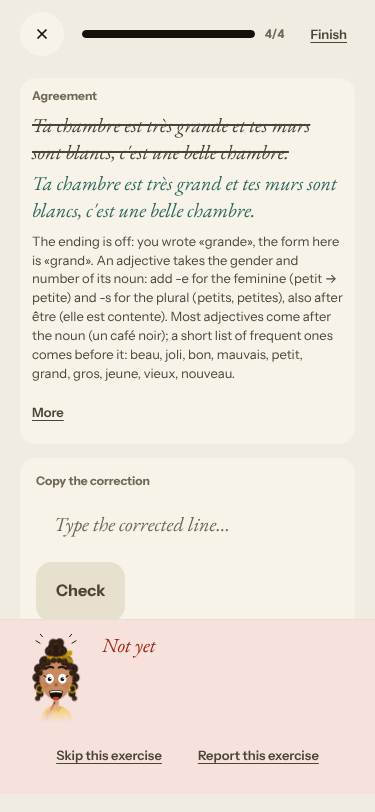
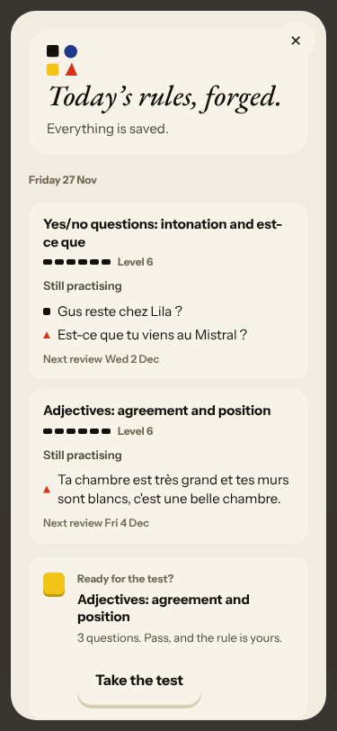
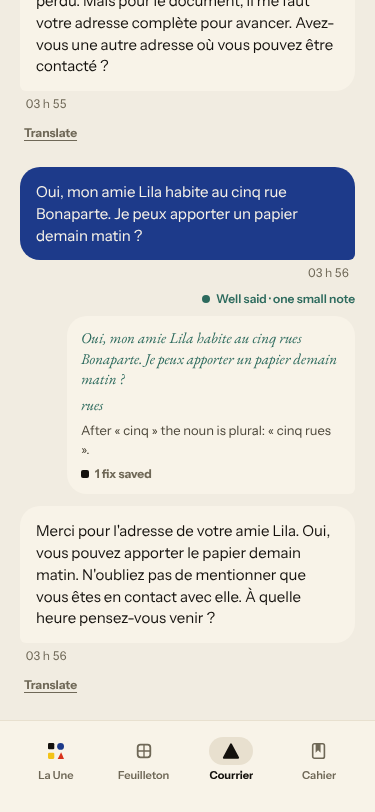
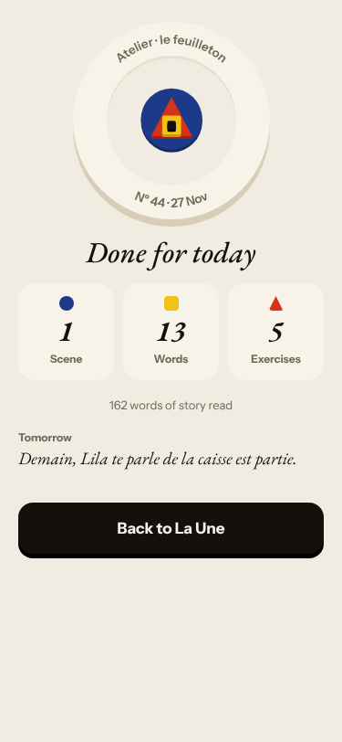
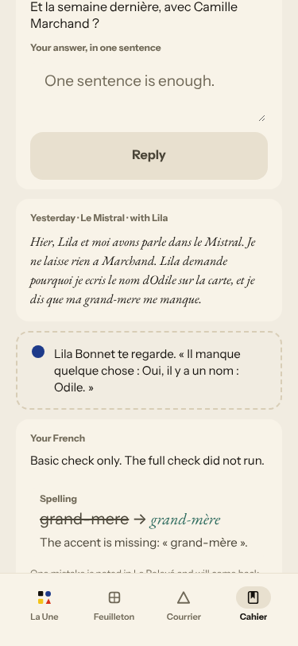
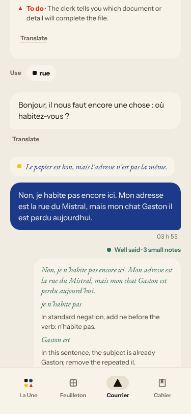
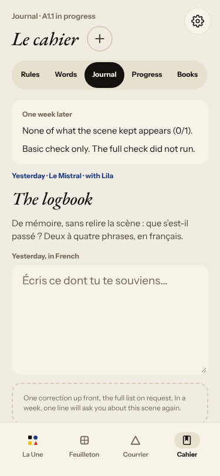
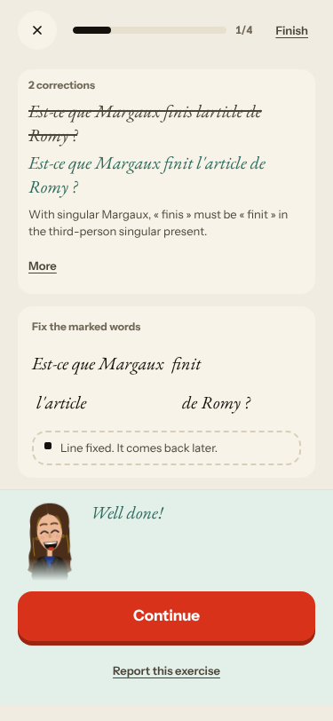

# Live walk · 27 Nov 2026 · production, real model

Run by the scheduled cloud routine (`explore:live`, Chromium at phone size) against `atelier-api-3njh.onrender.com` (release `a454b71a0b83`, the tip of main) with the walk test account.
Account: **A1.1, day 45** (Home «Nº 44 · La clé d'Odile»; the scene played was «La gérance Marchand» / reader «Deux croissants pour Marchand», with Lila).
Played: the scene (reader of 5 panels, **four** typed replies: a clear «non» with slips «Je ai», «grand-mere»; an off-script question about a pigeon on Marchand's desk; a reply with «Peut-etre»; a reply with «mon grand-mère»; then the 11-panel recap), La Forge on «Yes/no questions: intonation and est-ce que» (rule card opened first; 3 items, 2 repaired through the fix box, one right variant «Gus reste chez Lila ?»; then one review item on adjectives), 13 word cards (all «I know it»), Done, Courrier (the weekly letter of 25 Nov was already done, so «New letter»: «Un papier pour la mairie», Accueil Mairie; a clear «non», an off-script mention of my cat Gaston, a confirmation, a time), Cahier (Rules, Journal: the «One week later» line and the retell of yesterday).
Q19 n/a (cloud). Previous live report: [26 Nov](2026-11-26.md).

## Scores

| # | question | live 27 Nov | live 26 Nov | trend |
|---|---|---|---|---|
| 1 | Where am I | 4 | 4 | = |
| 2 | What is at stake | 4 | 4 | = |
| 3 | What to do next | 3 | 3 | = |
| 4 | Scene reacts to my writing | 4 | 4 | = |
| 5 | Story coherent | 3 | 3 | = |
| 6 | Characters consistent | 4 | 4 | = |
| 7 | Image, text, tone fit | 3 | 3 | = |
| 8 | Difficulty fits | 4 | 4 | = |
| 9 | Feedback explained | 3 | 4 | ↓ |
| 10 | Right answers accepted | 2 | 4 | ↓ |
| 11 | French correct | 2 | 3 | ↓ |
| 12 | Clear goal today | 4 | 4 | = |
| 13 | Grammar practised | 4 | 4 | = |
| 14 | Earlier material returns | 4 | 4 | = |
| 15 | I produce French | 5 | 5 | = |
| 16 | Errors, dead ends | 3 | 3 | = |
| 17 | Varied, fun | 4 | 4 | = |
| 18 | Fast enough | 3 | 3 | = |
| 19 | App only | n/a | n/a |  |
| 20 | Satisfying end | 3 | 3 | = |
| 21 | Would come back | 4 | 4 | = |
| 22 | Time vs promise | 4 | 4 | = |

Q3 3: Courrier's chips «Bonjour Madame, Monsieur…» / «Qu'est-ce qu'il faut ?» stayed over four turns (#557); the scene's «Lila asks: «Oh, fan de chichourle, un pigeon ?»» restated her surprise instead of asking the learner something. Q4 4: the scene took up the «non» («D'accord, rien pour Marchand. Pourquoi le nom d'Odile ?»), the pigeon, the café and the Sunday croissants (last panel and the Done line «Odile faisait des croissants le dimanche»); Courrier took up the cat twice and the time. The hook did not. Q5 3: «Demain, Lila te parle de la caisse est partie.» is not a sentence (#466); the Journal's week-later prompt changed from «Mme Diallo» to «Camille Marchand» after my answer. Q6 4: Lila, M. Marchand and the clerk kept their voices. Q7 3: «Dix heures» as a heading under «Previously» and the stitched Journal line (#1081). Q9 3: the Forge's est-ce que hints named the slip and gave a second try, but the review item's note contradicts the rule it quotes (#1105) and one Courrier note teaches «cinq rues» (#1106). Q10 2: **the correct fix «grande» + «blancs» was rejected** (#1105); the right variant «Gus reste chez Lila ?» and «Est-ce qu'…» were accepted. Q11 2: «Ta chambre est très grand» shown as the model answer (#1105), «cinq rues Bonaparte» (#1106). Q13 4: the rule card came first, 3 items drilled the rule with named hints, plus one review rule. Q16 3: «Basic check only» twice (#1062), the stale «Fix the marked words» panel after «Line fixed» (#381), chips (#557), «Skip this exercise» the only way out of a rejected item. Q18 3: scene replies ≈14–16 s, Forge checks ≈10 s, Courrier 30 s, Journal 25–30 s. Q20 3: the hook is a fragment (#466). Q22 4: ≈14 minutes of play time for the day plus the letter and the Journal, against «10 min».

Screenshots for the scores of 2: `2026-11-27/forge-review-rejects-grande-blancs.png` (Q10, Q11), `2026-11-27/courrier-cinq-rues-wrong-correction.png` (Q11), `2026-11-27/forge-end-sheet-wrong-line.png`.

## Findings, by root cause

### #174 a right answer is judged against one stored string, and #250 free-text corrections are raw model output
1. **High · new #1105** La Forge's review item «Ta chambre est très grand et tes murs sont blanc…»: my correct fix «grande» + «blancs» ended «Not yet», the model note said «you wrote «grande», the form here is «grand»» and printed «Ta chambre est très grand et tes murs sont blancs…» as the corrected line; «Skip this exercise» was the only way on, and the end sheet lists the wrong line as «Still practising».  
2. **Medium · new #1106** Courrier «corrects» «cinq rue Bonaparte» to «cinq rues Bonaparte» and saves it as a fix. 

### #145 the scene has no state of what happened
3. **Medium · #466 seen again** the Done card and Home end on «Demain, Lila te parle de la caisse est partie.». 
4. **Low · #445 seen again** the scene's last panel quotes my uncorrected «mon grand-mère».
5. **Medium · #1081 seen again** (also #147) the Journal prints «Lila Bonnet te regarde. « Il manque quelque chose : Oui, il y a un nom : Odile. »». 
6. **Low · #557 seen again** Courrier's chips ignore the thread. 

### #333 a failed model call is shown as a result
7. **Medium · #1062 seen again** the Journal's «Basic check only. The full check did not run.» twice, and the week-later answer's «Je ne souviens» went uncorrected. 

### #146 the day's content is not driven by one concept
8. **Low · #1083 seen again** new words «mars» and «mai» next to the scene's «la gérance», «le bureau», «le sac».

### Not under a root-cause issue
9. **Low · #381 seen again** the «Fix the marked words» panel stays above «Line fixed». 

No new root cause: both new findings fit #174 / #250. Two new issues (#1105, #1106), below the cap.

What worked: the scene reacted to a clear «non», to a pigeon on Marchand's desk and to «le café de ma grand-mère», and its last panel was fitted to my replies; the rule card came before the items today (yesterday it did not); La Forge accepted the right variant «Gus reste chez Lila ?» and explained «Est ce que» → «Est-ce que»; the earlier scene words (café, la gérance, le bureau, le sac) came back as cards; Courrier corrected «je habite», «aujourd'hui», the repeated «il» and «très» with exact notes, and the clerk took up Gaston and the 10 o'clock time; goals met 1/1.

## Re-tests

| issue | result |
|---|---|
| #381, #557, #1062, #1081, #466, #445, #1083 | seen again → commented |
| #1090 (live, a miss whose reason was cut away) | two Forge misses today both showed a reason; not contradicted |
| #1092 (live, Courrier friend says tu) | today's letter was a clerk (vous); the friend case was not reached |
| #1096 (live, browser-walk CI only) | not reachable in this walk |
| #1087, #1048, #1069 | the screens were not reached today |
| other open live-walk issues | screen or condition not reached today |

## Which fixes are live

Release `a454b71a0b83` is the tip of origin/main (merge of #1104). Merged and live: #1092, #1096, #1090, #1076, #1074 and every older merged fix PR. Of the 30 open `queue:pr` issues, only #927, #951, #993 and #1028 name an open PR (#1036, #981, #1010), which is not merged; a search of PR bodies for «Fixes/Closes/Refs #N» found no PR for the others. No PR merged more than a day ago is missing from the release, so there is no deploy finding.

New issues: #1105, #1106, each `queue:ready` with **Done when:**. Screenshots: `docs/ops/live-walks/2026-11-27/`.
