# Live walk · 28 Nov 2026 · production, real model

Run by the scheduled cloud routine (`explore:live`, Chromium at phone size) against `atelier-api-3njh.onrender.com` (release `ffe7e01aa45f`, the tip of main) with the walk test account.
Account: **A1.1, day 46** (Home «Nº 45 · La clé d'Odile»; the scene played was «Lila et la valise vide», with Lila).
Played: the scene (listen-first screen skipped to the reader of 5 panels; **four** typed replies: a clear «non» with slips «un chambre», «fenetre»; an off-script question about the fork, Gaston and a gift; an offer of a book from Berlin with «a Berlin»; a coffee and a croissant for Gaston with «cafe»; then the 11-panel recap and «One line to say aloud»), the day's words as Recall drills (5 items: choice, a typed «un verre», a typed «la fourchete», a typed «une»), La Forge on «On = we» (rule card first; 6 items: a «Your sentence» repair, a dialogue reply with a deliberate «On allons», a translation with «Est-ce qu'on pose…», a numbers review, two translations), 15 word cards (one «Again»), Done, Courrier (the letter «Un papier pour la mairie» was at letter 2 of 2; three replies: a clear «non» with «Mon facture», «aujourdhui», «a Berlin»; the cat Gaston; a close with «C est tout»), Cahier (Rules, Journal: the «One week later» line and the retell of yesterday).
Q19 n/a (cloud). Previous live report: [27 Nov](2026-11-27.md).

## Scores

| # | question | live 28 Nov | live 27 Nov | trend |
|---|---|---|---|---|
| 1 | Where am I | 4 | 4 | = |
| 2 | What is at stake | 4 | 4 | = |
| 3 | What to do next | 3 | 3 | = |
| 4 | Scene reacts to my writing | 4 | 4 | = |
| 5 | Story coherent | 3 | 3 | = |
| 6 | Characters consistent | 3 | 4 | ↓ |
| 7 | Image, text, tone fit | 3 | 3 | = |
| 8 | Difficulty fits | 4 | 4 | = |
| 9 | Feedback explained | 2 | 3 | ↓ |
| 10 | Right answers accepted | 2 | 2 | = |
| 11 | French correct | 2 | 2 | = |
| 12 | Clear goal today | 4 | 4 | = |
| 13 | Grammar practised | 4 | 4 | = |
| 14 | Earlier material returns | 4 | 4 | = |
| 15 | I produce French | 5 | 5 | = |
| 16 | Errors, dead ends | 3 | 3 | = |
| 17 | Varied, fun | 4 | 4 | = |
| 18 | Fast enough | 3 | 3 | = |
| 19 | App only | n/a | n/a |  |
| 20 | Satisfying end | 4 | 3 | ↑ |
| 21 | Would come back | 4 | 4 | = |
| 22 | Time vs promise | 4 | 4 | = |

Q3 3: Courrier's chips «Bonjour Madame, Monsieur…» stayed over four turns (#557); La Forge's first item cannot be passed by the right sentence (#625). Q4 4: Lila took up the «non» («Je pars pour Berlin, pas pour te fuir»), the fork and Gaston, the book about Paris and the coffee, and the last panel was fitted to my replies; the Courrier clerk took up the cat and «lundi matin». The hook did not. Q5 3: Home still shows yesterday's fragment «Demain, Lila te parle de la caisse est partie.» (#466); the Journal's week-later line names «Camille Marchand» and, after my answer, «Lila Bonnet» (#1121). Q6 3: La Forge's prompt «Ton frère te demande :» with Lila as the speaker (#1120). Q7 3: the stitched Journal line (#1081). Q9 2: the numbers review's miss on «quarante neuf» gives no reason, only my own line again under «What is off» (#1119); the «Your sentence» solution blames my own try (#625). Q10 2: the correct «Romy et moi envoyons une lettre.» is presented as a mistake and cannot be passed (#625). Q11 2: «Corrected line: Romy et moi envoyez une lettre.» (#625); «Je vois une chambre grande et vide.» as the line to say aloud reads stiff (a grande chambre vide). Q13 4: the rule card came first, six items drilled the rule. Q16 3: the clerk's first answer did not arrive («has not answered this message yet · Ask again»; one «Ask again» brought it after ≈35 s, #693), the Journal's full check failed twice, chips (#557), «Skip this exercise» the only way out of the rejected item. Q18 3: scene replies ≈18–20 s, Forge checks ≈12–14 s, Courrier 30–45 s, Journal 30–40 s. Q20 4: today's hook «Demain, Margaux te parle des verres.» is a sentence and the Done card shows 1 scene, 15 words, 13 exercises and the streak. Q22 4: ≈15 minutes of play for the day plus the letter and the Journal, against «10 min».

Screenshots for the scores of 2: `2026-11-28/forge-correct-sentence-as-mistake.png`, `2026-11-28/forge-solution-withheld.png` (Q9, Q10, Q11), `2026-11-28/forge-numbers-hyphen-no-reason.png`, `2026-11-28/forge-numbers-solution-no-reason.png` (Q9).

## Findings, by root cause

### #174 a right answer is judged against one stored string, and #250 free-text corrections are raw model output
1. **High · #625 seen again** La Forge «Your sentence · You wrote this earlier. Fix the mistake.» shows the correct «Romy et moi envoyons une lettre.»; Check stays disabled until I change the word; my wrong try gets «Not yet», «Show the solution» prints «Romy et moi envoyez une lettre.» (my wrong try) as the correction and the note «You wrote «envoyez»; here it is «on». «envoie» is missing». 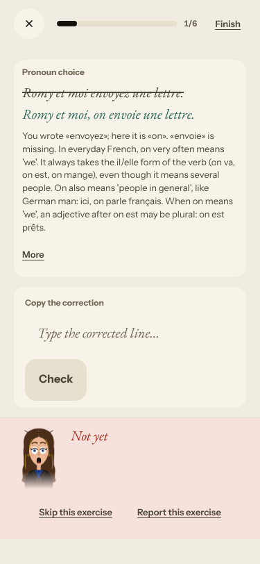 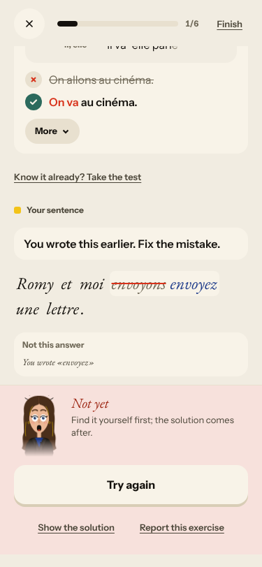

### #1085 a La Forge miss's reason is whatever survives string filters
2. **Medium · new #1119** the numbers review rejects «quarante neuf» (hyphen missing) with a «What is off» box that repeats my line, no marked word, no reason; the solution does not name the hyphen. 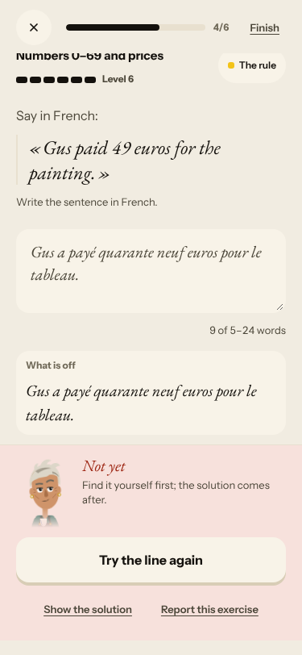 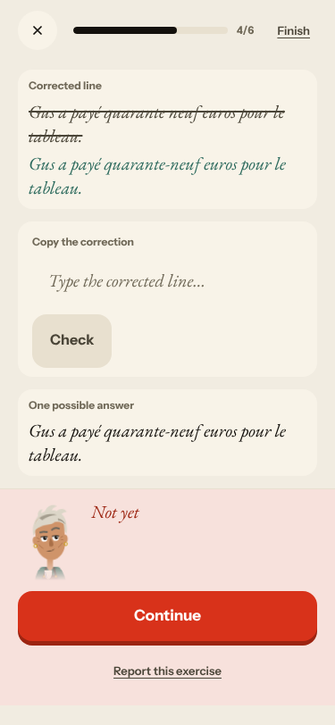

### #147 the cast is not one registry
3. **Medium · new #1120** the dialogue prompt says «Ton frère te demande :» with Lila as the speaker and a stray «tu» (#951 seen again). 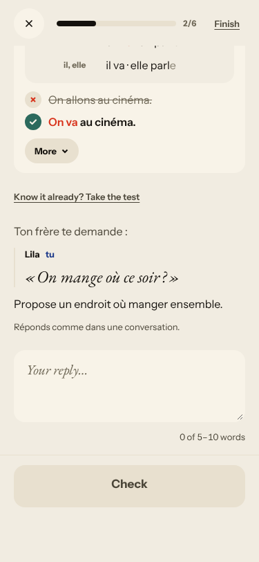

### #145 the scene has no state of what happened
4. **Medium · new #1121** the Journal's recall check says «None of what the scene kept appears (0/2)» for an accurate retell (pigeon, Marchand, the name on the card, Odile); its targets are two of Lila's quoted lines; the week-later line changes its person from «Camille Marchand» to «Lila Bonnet» after my answer. 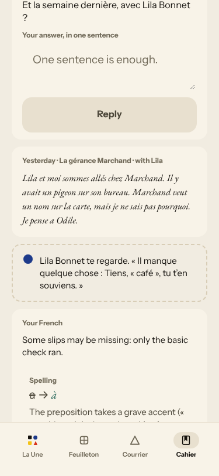
5. **Medium · #466 seen again** Home starts the day with yesterday's fragment «Demain, Lila te parle de la caisse est partie.». 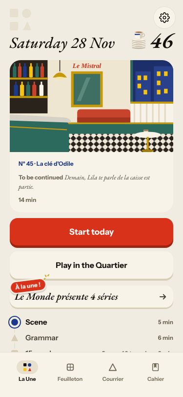
6. **Medium · #1081 reopened** the stitched line «Lila Bonnet te regarde. « Il manque quelque chose : Tiens, « café », tu t'en souviens. »» is still printed after #1114 (see Which fixes are live).

### #143 the day's progress has no single source of truth
7. **Low · new #1122** «Level 6» (full bar) on «On = we» in La Forge, «practising · shaky in practice» in the Cahier, «Ready for the test?» on the end sheet. 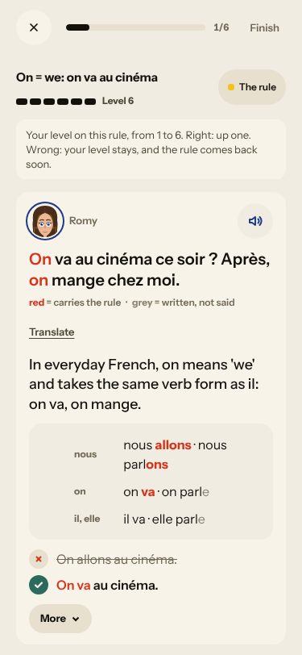 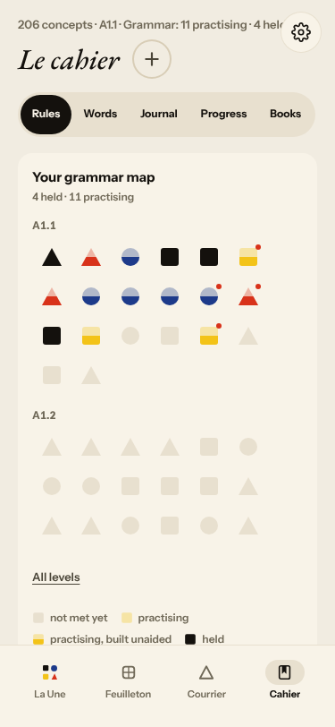

### #333 a failed model call is shown as a result
8. **Medium · #1062 re-tested** the Journal's full check failed twice again; the card now says «Some slips may be missing: only the basic check ran.» and the basic check marked «cherché» and «a → à». 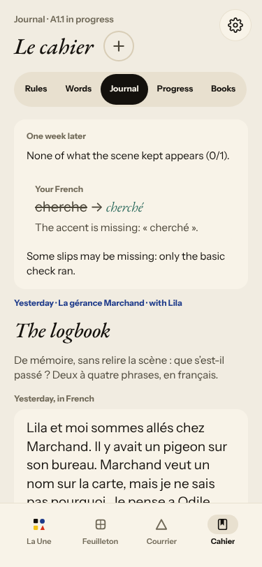
9. **Low · #693 related** the Courrier clerk's first reply did not arrive («has not answered this message yet»); «Ask again» brought it. 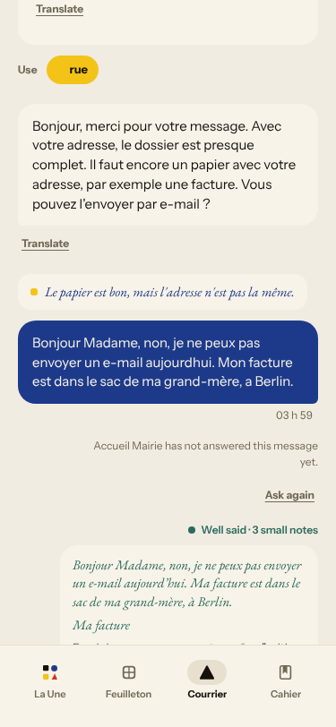

### #146 the day's content is not driven by one concept
10. **Low · #1083 half fixed** new words «juin», «septembre», «bonjour», «bonsoir» (no article now), none from the scene.

### Not under a root-cause issue
11. **Low · #557 seen again** Courrier's chips ignore the thread over four turns. 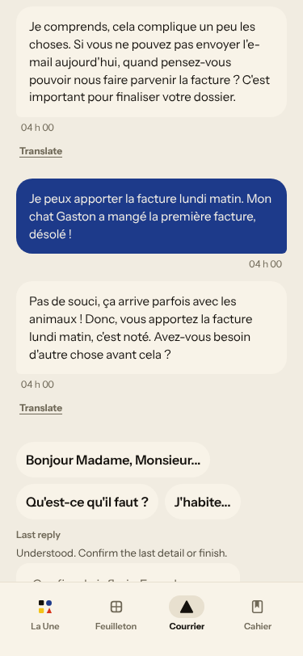

No new root cause: every new finding fits #1085, #147, #145 or #143. Four new issues (#1119–#1122), below the cap.

What worked: the scene reacted to a clear «non», to Gaston and the fork, to the book about Paris and the café, and corrected «un chambre», «a Berlin» and «cafe» with exact notes; the rule card came before the items; the dialogue item caught «On allons» with a rule-specific note and Lila answered the corrected «On va au Mistral, on mange une soupe.» in character; La Forge accepted the variant «Est-ce qu'on pose les clés…» and the recall drill accepted «un verre» and forgave «la fourchete» with «small typo»; Courrier corrected «Mon facture → Ma facture», «aujourdhui», «à Berlin», «C est» with exact notes and the clerk took up the cat and the Monday; goals met 1/1 and the Done hook is a real sentence.

## Re-tests

| issue | result |
|---|---|
| #625, #557, #466, #951 | seen again → commented |
| #1062 (live, Journal basic check) | fixed per its Done when → commented |
| #1081 (live, stitched Journal line) | not fixed → reopened, back to `queue:ready` |
| #1083 (live, month article) | article fixed, scene-word clause not met → back to `queue:ready` |
| #1090 (live, a miss whose reason was cut away) | two Forge misses showed no reason or a wrong one (#1119, #625); not contradicted for the cases it named |
| #1108, #1110 (live) | today's rule was a due, not a planned, rule of the day; not distinguishable from the screen; the -dre case was not reached |
| #1095 (live, months bare) | «juin», «septembre» bare → confirmed |
| other open live-walk issues | screen or condition not reached today |

## Which fixes are live

Release `ffe7e01aa45f` is the tip of origin/main (merge of #1118). Merged and live: #1112, #1114, #1095, #1092, #1096, #1090 and every older merged fix PR. Open `queue:pr` issues name open PRs only for #927, #951, #993, #1028 (not merged); the PRs for #1087, #1098/#1105/#1088, #1099 and #1080/#922 (#1113, #1115, #1116, #1117) were closed unmerged. No PR merged more than a day ago is missing from the release, so there is no deploy finding.

New issues: #1119, #1120, #1121, #1122, each `queue:ready` with **Done when:**. Screenshots: `docs/ops/live-walks/2026-11-28/`.
