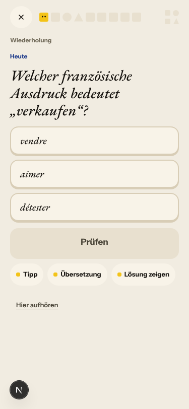
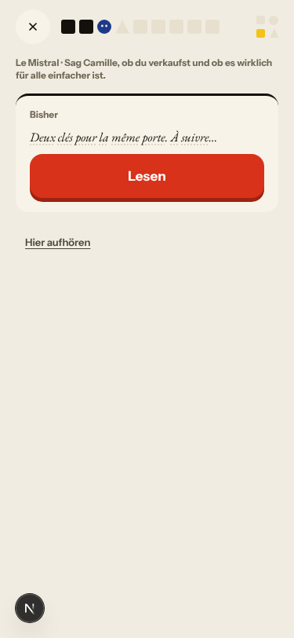
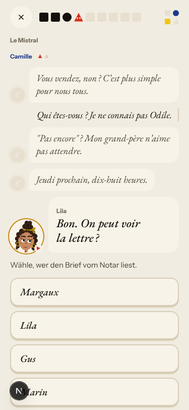
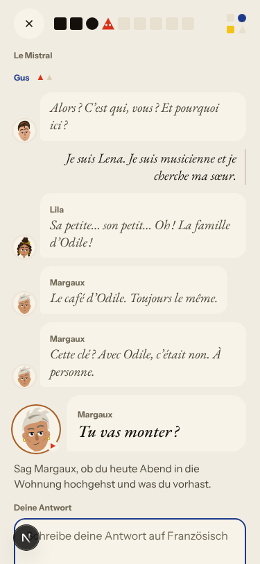
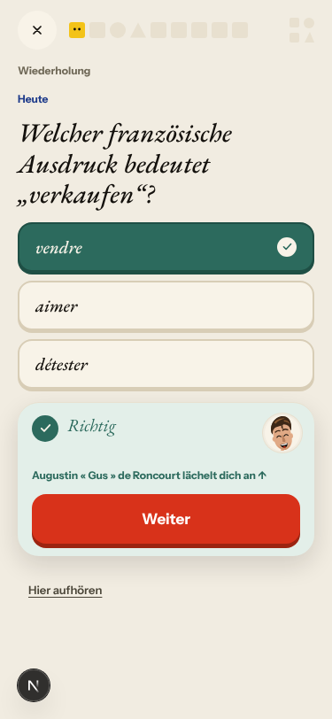

# Walk · 2026-10-12

**Build:** `main` at bb1ca3f, local stack, fake story provider, season 1 «La clé d'Odile».
**Persona:** `a1-de-fresh` (German speaker, new to French, signed up through the UI).
Played: landing → café teaser → sign-up → day 1 → recap → Home → La Forge → day 2 up
to the notary choice.
**Scripted walk** (de 2 days + season-en 3 days): 601 checks, 3 failed — two season
tentpoles not reached because the run was shortened (expected), one empty page.
The nightly CI walk on `main` is green.

Ranked findings. Story-engine findings were judged on the fake provider: the replies
are picked by keyword matching there, so the live classifier may route differently;
the authored reaction lines are the same either way.

## 1 · high · onboarding — after sign-up the story disappears into a quiz

The teaser is a scene (Romy, Le Mistral, a coffee) and ends «Romy, Marin und Lila
warten. Behalten Sie Ihre Geschichte.» Right after the account is created, the learner
lands on **«Wiederholung · Schritt 1 von 9»: «Welcher französische Ausdruck bedeutet
„verkaufen“?»** None of vendre/aimer/détester has appeared; Romy and the café are not
mentioned again; the day's story is a different scene («Le mauvais accueil», rain, a
suitcase, a letter, a key). Day 2 opens the same way («la lettre — was bedeutet das?»).
Expected: the day picks up where the teaser left off, or says in one line where I am
and why, and words taught before the scene are labelled as new, not «Wiederholung».

## 2 · high · orientation — the «Bisher» card does not recap

Day 2's scene opens with «Bisher: Deux clés pour la même porte. À suivre…» — only
yesterday's last line, in French. Nothing says who I am (Odile's heir), where I am
(Solvel, Le Mistral), who Camille is, or what is at stake (selling the flat). The
header above it already asks «Sag Camille, ob du verkaufst…» before I have read
anything. Expected: two or three native-language sentences: who you are, where you are,
what happened yesterday, what is at stake today.

## 3 · high · story-engine — a character quotes words the learner never wrote

Camille: «Vous vendez, non ?» I wrote «Qui êtes-vous ? Je ne connais pas Odile.»
Camille answers «"Pas encore" ? Mon grand-père n'aime pas attendre.» — quoting «pas
encore». The keyword matcher fell back to the authored branch. In production the
classifier should mark the reply unclear and ask again
(`app/services/season/turns.py:51`), but a question back to the character is a
legitimate answer and has no branch to go to.

## 4 · high · story-engine — the free-text answer changes nothing

Gus: «C'est qui, vous ? Et pourquoi ici ?» I wrote «Je suis Lena. Je suis musicienne
et je cherche ma sœur.» Lila: «Sa petite… son petit… Oh ! La famille d'Odile !» and the
scene carries on with the key. My name, job and reason are not picked up anywhere, and
there is no word on my French. On a tentpole day every reaction is an authored line
(`app/services/season/turns.py:1`), so the scene can only ever answer with one of a
handful of prepared replies. This is Vincent's «deterministic» complaint, reproduced.

## 5 · medium · copy — an unintroduced name, and du after Sie

After the first correct review answer: «Augustin « Gus » de Roncourt lächelt dich an ↑».
Gus has not been introduced yet (the teaser had Romy, Marin, Lila, Margaux), and the
line says *dich* while the onboarding and Home say *Sie*. The thread task lines also
say *du* («Sag, wer du bist…»). Source: `web-frontend/components/atelier-v2/journey/ReplyStage.tsx:145`,
`recap-copy.ts:59`. Pick one form of address for German and use it everywhere.

## Smaller notes

- Teaser: «Un café, s'il vous plaît» → Romy calls «Margaux, deux cafés !» — I ordered one.
- Day 2 scene opens «Un chocolat ? — Vous vous souvenez ? — Le mercredi. À neuf ans.»
  with no hint who remembers what.
- Sentence-building drill shows three instructions for one task («Bring den Satz…»,
  «Bau den Satz…», «Tippe die Wörter an…»).
- Gender drill asks «Maskulin oder feminin?» and offers «männlich / weiblich»; a wrong
  answer says «Noch nicht» without «un appartement» as the reason.
- Recap: «2 Min. · geplant 10 Min.» reads as a reproach; «Siegel behalten» and «Regel
  des Tages schmieden» are unexplained.
