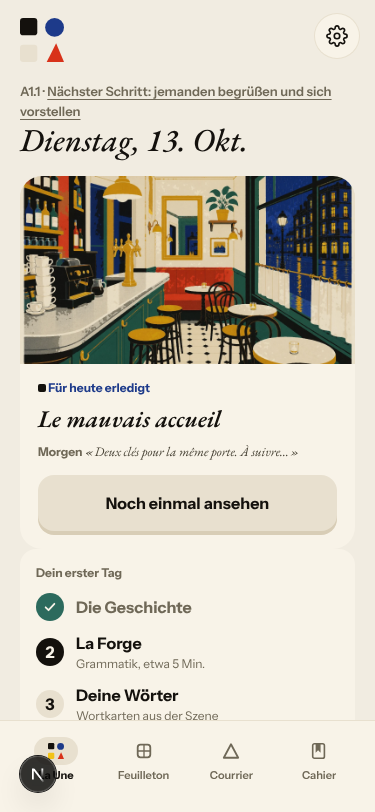
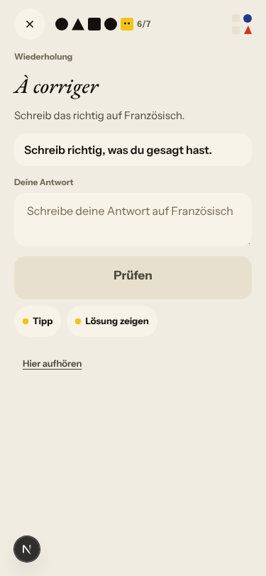
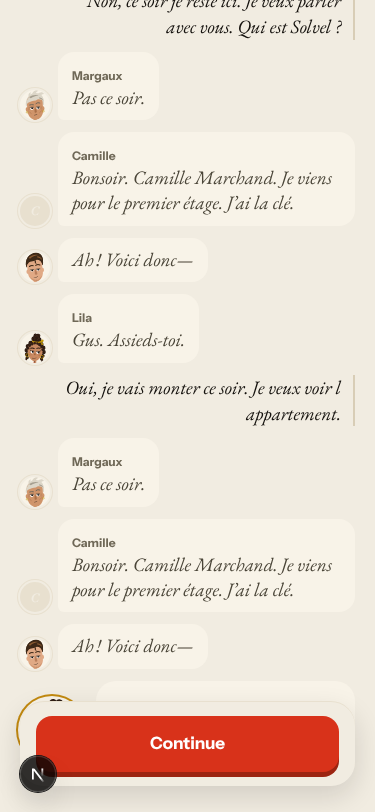
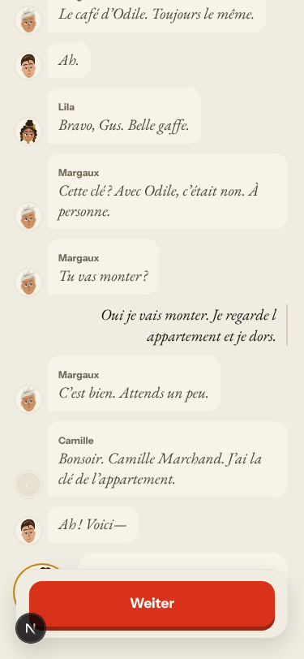
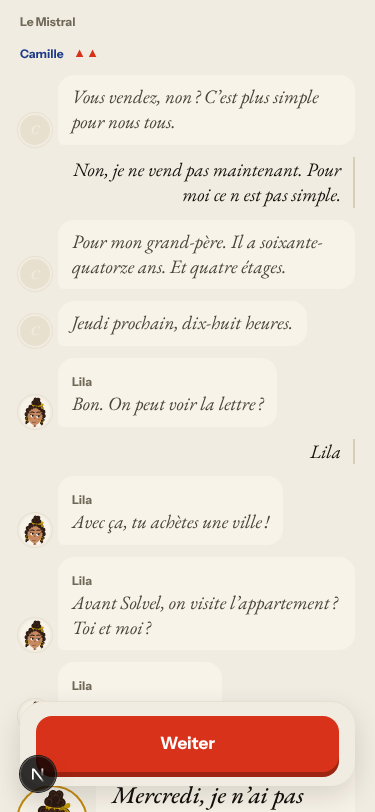
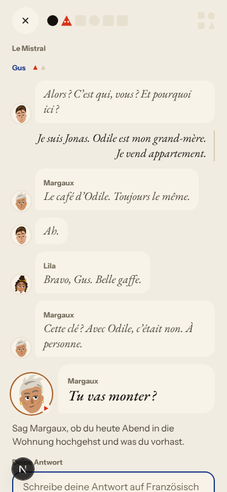
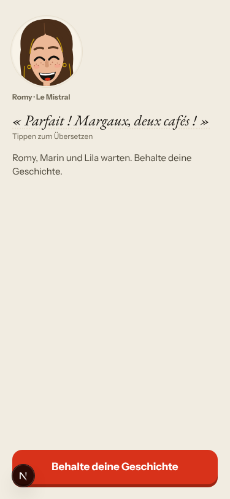

# Walk · 13 Oct 2026 · nightly explore walk

Main at `45297bb` (after #95 gentle first day, #91 grammar from day one, #97, #101).
Fake story provider, local stack, Chromium at phone size. The scripted browser walk
last ran on main on 12 Oct (green). No `live-walk` issues had been filed yet.

| persona | played |
|---|---|
| `a1-de-fresh` | teaser, sign-up through the UI, day 1 (onboarding, story, reply, rule, drills, recap, La Forge, word cards), Courrier, Cahier, day 2 |
| `a2-en` | day 1 story and reply with off-script answers, rule and two drills, stopped part-way, La Forge |

## Scores (rubric `docs/ops/walk-rubric.md`)

1 = bad, 5 = good. Per-screen questions score the worst screen of the day. The last
column is the Mac app walk of 12 Oct (production, real model, day 1 only). It is a
different walk, so read it as the closest earlier point, not a like-for-like trend.

| # | question | a1-de d1 | a1-de d2 | a2-en d1 | app walk 12 Oct |
|---|---|---|---|---|---|
| 1 | Where am I | 3 | 4 | 4 | 2 |
| 2 | What is at stake | 4 | 3 | 4 | 1 |
| 3 | What to do next | 2 | 2 | 3 | 3 |
| 4 | Scene reacts to my writing | fake | fake | fake | n/a |
| 5 | Story coherent | 4 | 2 | 2 | n/a |
| 6 | Characters consistent | 3 | 3 | 3 | 2 |
| 7 | Image, text, tone fit | 3 | 3 | 4 | 4 |
| 8 | Difficulty fits | 4 | 3 | 4 | 4 |
| 9 | Feedback explained (drills only) | 2 | 2 | n/a | 2 |
| 10 | Right answers accepted | 4 | 4 | n/a | n/a |
| 11 | French correct | 4 | 4 | 4 | 4 |
| 12 | Clear goal today | 4 | 4 | 4 | 4 |
| 13 | Grammar practised | 4 | 3 | 3 | 5 |
| 14 | Earlier material returns | n/a | 4 | n/a | n/a |
| 15 | I produce French | 4 | 4 | 4 | 4 |
| 16 | Errors, dead ends | 2 | 2 | 2 | 3 |
| 17 | Varied, fun | 4 | 3 | 3 | 2 |
| 18 | Fast enough (local stack) | 4 | 4 | 4 | 3 |
| 19 | App only | n/a | n/a | n/a | 2 |
| 20 | Satisfying end | 4 | 3 | 4 | n/a |
| 21 | Would come back | 4 | 3 | 3 | 2 |
| 22 | Time vs promise | 4 | 4 | n/a | 1 |

What moved since the app walk: day 1 now opens on the story (Q2 1→4, Q22 1→4), the
cast is introduced before anyone is named (Q1 2→3/4), and Forge sentences vary (Q17
2→4). What stays low: wrong answers are still not explained (Q9), and every day had
one screen that breaks the way forward (Q3, Q16).

## Findings

Ranked by severity, then how early they hit.

1. **High · #103 · dead «Weiter: La Forge» after leaving the rule check** (day 1, Q3/Q16).
   Opening the rule check («Diese Regel direkt prüfen») and closing it leaves Home with a
   button that does nothing until a reload. `pages/atelier.tsx` entered practice once
   per page and never reset its guard; leaving also kept `?mode=forge` in the URL.
   **Fixed in this PR.** 
2. **High · #104 · a judgement miss becomes a day-2 repair of «Correct»** (day 2,
   Q3/Q9/Q16). Tapping «Muss korrigiert werden» on a correct sentence files an erratum
   from the item's internal labels; day 2 asks «Schreib richtig, was du gesagt hast»
   over nothing, with «Correct» as the answer. No model involved.
   
3. **High · #105 · fake provider: the closing beat plays twice** (a2-en, Q5/Q16). After
   an off-script answer the task is re-asked, the header jumps from «Exchange 1 of 2»
   to «3 of 3», and the next answer replays the same four lines (Margaux says «Pas ce
   soir.» to a yes; Camille introduces herself again). Story thread.
   
4. **Medium · #106 · German text written by the server still says Sie** (Courrier card
   «damit Sie die Wörter…»; about 38 strings in `missions.py`, `placement.py`,
   `recommendation_reasons.py`).
5. **Medium · #107 · Camille Marchand has a blank «C» face and is not in the cast intro**
   (day 1 end, day 2). 
6. **Medium · #108 · fake provider: Lila turns down her own offer** on day 2 («on visite
   l'appartement ? Toi et moi ?» / «Pas comme ça, non.»); the ending says «Tu pars
   mercredi», which the learner never said. 
7. **Low · #109 · every listen button is named after the addressed speaker** («Gus
   anhören» on Margaux's lines; `RespondThread.tsx:194`).
   
8. **Low · #110 · first-day polish**: the teaser names Margaux, Marin and Lila before the
   cast intro; day-1 word cards are headed «Wiederholung»; the Forge end says «Früher
   beendet» after all six steps; in-day drills ask the rule card's own Falsch/Richtig
   pair; «Camille marchand». 

Not filed: in a fake run the Forge «bilden» and «frei anwenden» items cannot be checked
(«Die zweite Prüfung brach ab»). That is the stub; the live walk covers it.

## Re-tests

| issue | result |
|---|---|
| #84 day 1 drills before the scene | fixed, closed |
| #85 drills name people never met | fixed for drills, closed; leftovers in #107, #110 |
| #86 «Not yet» with no reason | seen again, commented |
| #87 «Il es au Mistral» four times | not reproduced on fake, left open for the live walk |
| #88 counters disagree | Home counter gone; backwards step not reproduced; left open |
| #90 «Try again» loads another item | partly fixed: same item now, but the wrong choice stays and the counter advances |
| #79, #93, #94 story engine, live | not re-testable on the fake provider |
| #89 iOS keyboard | app walk only |

## Scripted walk

A short run on the fix branch (`--langs de --days 2 --b1-days 0 --season-days 0`): 98 screens, 223 checks, 0 failed.
