# Walk · 14 Oct 2026 · nightly explore walk

Main at `11cc866` (after #111 «Weiter: La Forge» fix, #112 story fixes, #113 judgement
errata). Fake story provider, local stack, Chromium at phone size. The scripted
browser walk (walk.yml) last ran on main on 13 Oct at `45297bb` and passed. The Mac live walk
filed nothing new since its 13 Oct issues (#114–#119), and no live report file exists
yet, so there is no live column tonight.

| persona | played |
|---|---|
| `a1-de-fresh` | teaser, sign-up through the UI, day 1 (onboarding, story, two replies, rule, drills, La Forge, rule check, word cards), Courrier, Cahier, day 2 (story, choice, nine drills, La Forge stopped early, word cards) |
| `b1-fr-chrome` | day 1 (onboarding, story with off-script replies, rule, four drills, La Forge), Courrier, day 2 story and replies |

## Scores (rubric `docs/ops/walk-rubric.md`)

1 = bad, 5 = good. Per-screen questions score the worst screen of the day. The last two
columns are the same persona on 13 Oct, so they compare like for like.

| # | question | a1-de d1 | a1-de d2 | b1-fr d1 | b1-fr d2 | a1-de d1 13 Oct | a1-de d2 13 Oct |
|---|---|---|---|---|---|---|---|
| 1 | Where am I | 3 | 4 | 4 | 4 | 3 | 4 |
| 2 | What is at stake | 4 | 3 | 4 | 4 | 4 | 3 |
| 3 | What to do next | 2 | 2 | 3 | 4 | 2 | 2 |
| 4 | Scene reacts to my writing | fake | fake | fake | fake | fake | fake |
| 5 | Story coherent | 4 | 2 | 3 | 3 | 4 | 2 |
| 6 | Characters consistent | 3 | 3 | 3 | 3 | 3 | 3 |
| 7 | Image, text, tone fit | 4 | 4 | 4 | 4 | 3 | 3 |
| 8 | Difficulty fits | 4 | 3 | 4 | 4 | 4 | 3 |
| 9 | Feedback explained (drills only) | 2 | 2 | 3 | n/a | 2 | 2 |
| 10 | Right answers accepted | 3 | 4 | 4 | n/a | 4 | 4 |
| 11 | French correct | 4 | 4 | 4 | 4 | 4 | 4 |
| 12 | Clear goal today | 4 | 4 | 3 | 4 | 4 | 4 |
| 13 | Grammar practised | 4 | 4 | 3 | n/a | 4 | 3 |
| 14 | Earlier material returns | n/a | 4 | n/a | n/a | n/a | 4 |
| 15 | I produce French | 4 | 4 | 4 | 4 | 4 | 4 |
| 16 | Errors, dead ends | 3 | 2 | 4 | 4 | 2 | 2 |
| 17 | Varied, fun | 4 | 3 | 4 | 3 | 4 | 3 |
| 18 | Fast enough (local stack) | 4 | 4 | 4 | 4 | 4 | 4 |
| 19 | App only | n/a | n/a | n/a | n/a | n/a | n/a |
| 20 | Satisfying end | 4 | 3 | 4 | n/a | 4 | 3 |
| 21 | Would come back | 4 | 3 | 4 | 3 | 4 | 3 |
| 22 | Time vs promise | 4 | 3 | 4 | n/a | 4 | 4 |

**What moved since 13 Oct:**
- Day 1 no longer has a dead button after the rule check, so Q16 went from 2 to 3 (#103 fixed).
- Camille has a face (Q7 3→4).
- The closing beat plays once (#105).

**What stays low:**
- Q3 on both A1 days. The episode-end card says the day is done while half of it is still ahead (#123), and on day 2 «Weiter lernen» dies after La Forge's end screen (#122).
- Q9. Choice drills still say only «Noch nicht» (#86), and a judgement miss crosses out the correct sentence (#125).
- Q5 on day 2. Lila reacts to an answer the learner never gave (#108).

**Down:**
- Q22 on A1 day 2: La Forge counts «1 von 21» under «etwa 5 Min.».
- Q10 on A1 day 1: the «Sie sind …, Lila» prompts (#126).

## Findings

Ranked by severity, then how early they hit.

1. **High · #122 · «Weiter lernen» dead after La Forge's end screen** (a1-de day 2, Q3/Q16).
   «Zurück zu La Une» on the Forge recap keeps `?mode=forge&concept=2`, and «Weiter lernen»
   then does nothing. This is #103 on a second way out: the recap close at
   `pages/atelier.tsx:2220-2227` does not drop the query. 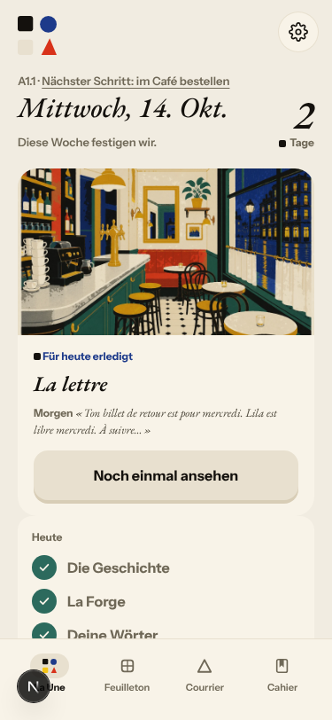
2. **Medium · #123 · «Dein Tag ist geschafft» after the last panel** (a1-de and b1-fr
   day 1, Q3). The rule, La Forge and the word cards still follow, and Home says «Für heute
   erledigt». 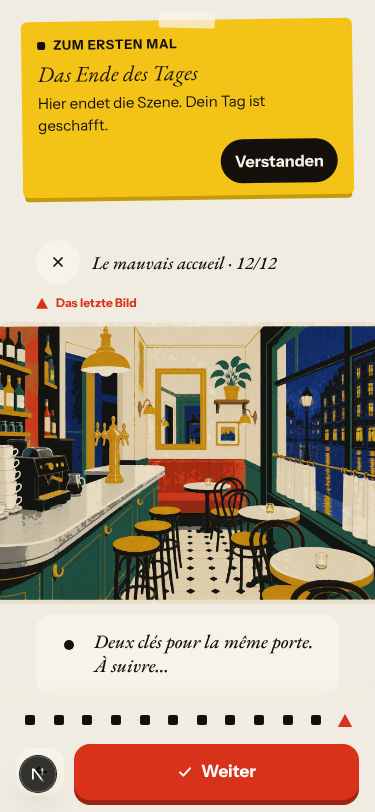
3. **Medium · #124 · Romy greets you in the teaser, then vanishes** (a1-de day 1, Q1/Q6).
   She is missing from the cast intro and the story, and comes back only in rule examples,
   Forge items and the B1 Courrier. Owner call: who greets new learners.
   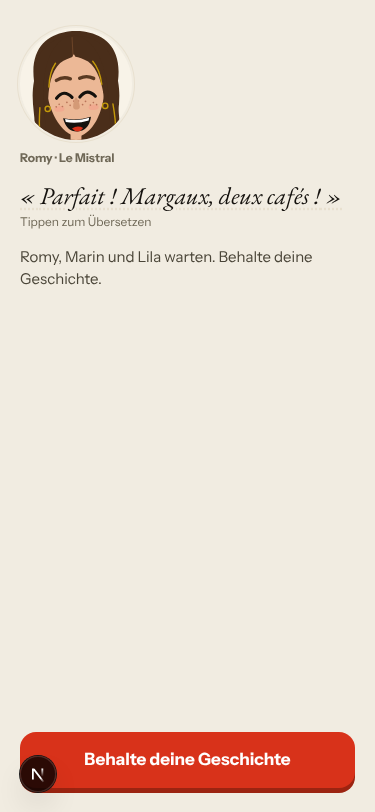 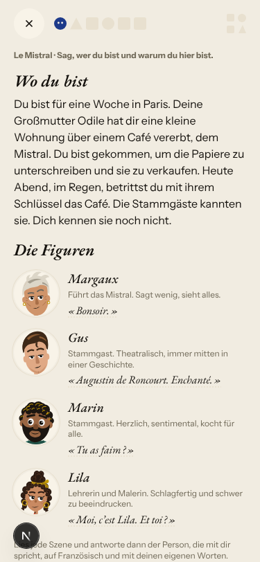
4. **Medium · #125 · a judgement miss crosses out the correct sentence** (a1-de day 1,
   Q9). The ladder also steps back from Stufe 2 to Stufe 1. 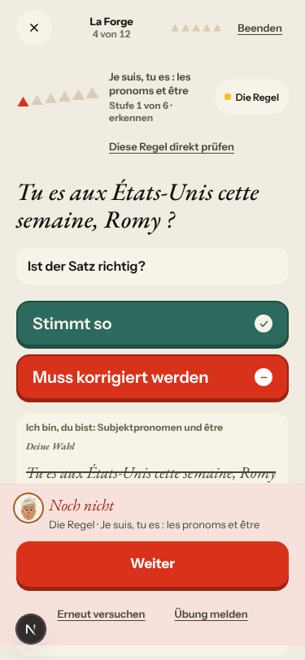
5. **Medium · #126 · «Sie sind …, Lila» means vous or ils** (a1-de days 1–2, Q10). In a du
   app, the learner reads formal you. 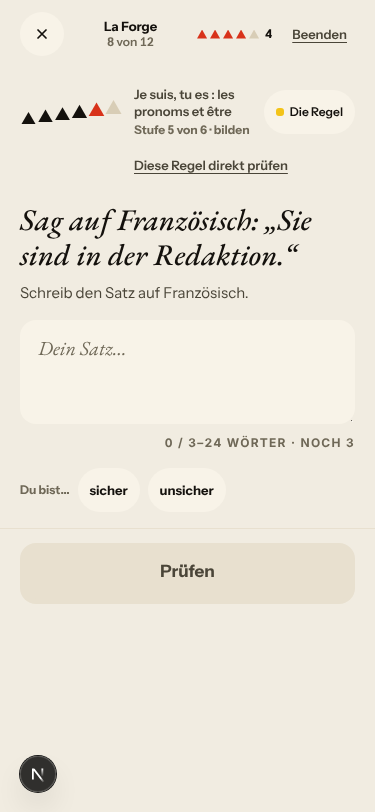
6. **Medium · #127 · B1 day 1: the rule is «tirée de la scène» but is not in it, and La Forge
   forges another rule** (b1-fr day 1, Q12/Q13). The day teaches double pronouns; La Forge forges
   the plus-que-parfait. 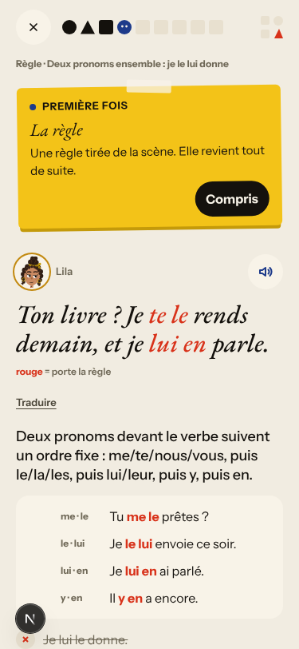 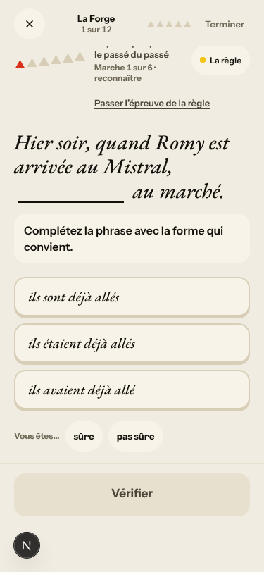
7. **Medium · #128 · French chrome mixes vous and tu on one screen** (b1-fr, Q11/Q6).
   Owner call: tu or vous. 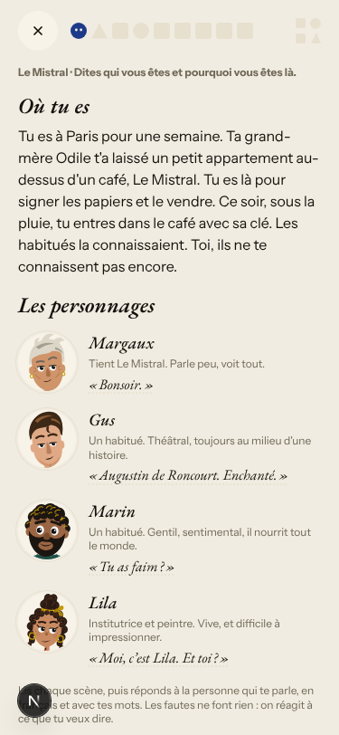
8. **Low · #129 · «Jeudi prochain, dix-huit heures.»** with no purpose (both personas,
   day 2, Q5). Story lane.

Seen again: #108 in a new form (Lila: «on visite l’appartement ? Toi et moi ?» then «Tu
n’entres pas ? Je comprends.», 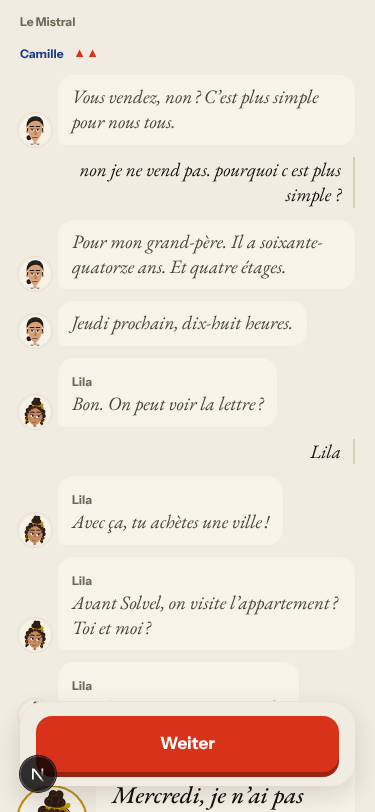), #110, #109, #106,
#86, #90, #88 (ladder steps back, and a Lexique counter that shrinks), #118 (bonus modal in
French in a German session), #117 (Margaux: tu in the scene, vous in the Courrier).

Not filed:
- In a fake run, La Forge's «bilden» and «frei anwenden» items cannot be checked («Die zweite
  Prüfung brach ab»). That is the stub.
- The Home date stays on the real date after `/clock`, which is a harness artifact.
- German «das Feuer darunter» (day 2 «Worum es geht») loses the French «le feu qu'il y a eu
  dessous». This is minor wording and goes with the next copy pass.
- Lila's «Pas comme ça, en tout cas.» stays as is, by the owner's decision on 13 Oct.

## Re-tests

| issue | result |
|---|---|
| #103 dead «Weiter: La Forge» after the rule check | fixed (screenshot on the issue), 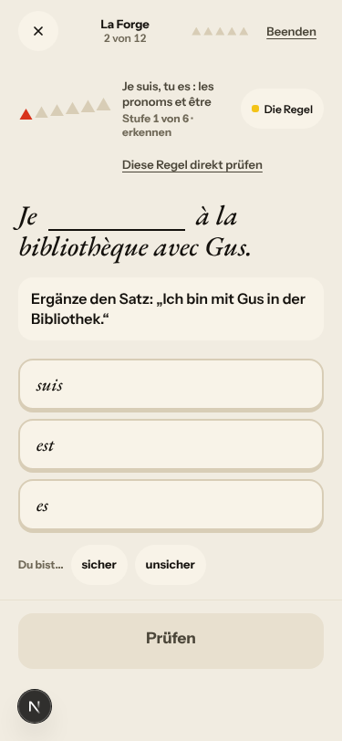; second exit filed as #122 |
| #104 day-2 repair of «Correct» | not reproduced |
| #105 closing beat plays twice | fixed, both personas |
| #107 Camille blank face, missing from cast intro | face fixed; still missing from the cast intro; back to `queue:ready` |
| #108 Lila turns down her own offer | changed form, still answers for the learner; stays `queue:ready` |
| #86, #90 | unchanged |
| #87, #93, #94, #114, #117, #119 | live-only or story engine; left to the live walk |

## Queue after triage

New: 6 `queue:ready` (#122, #123, #125, #126, #127, #129) and 2 `queue:owner` (#124,
#128). #107 moved back from `queue:pr` to `queue:ready`. Open `walk-finding` issues:
23 `queue:ready`, 4 `queue:owner`.

## Scripted walk

Not re-run tonight. The last nightly browser walk on main (13 Oct, `45297bb`) passed.
