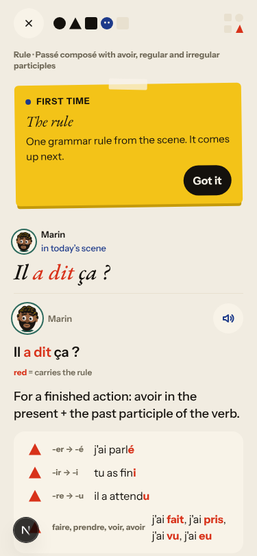
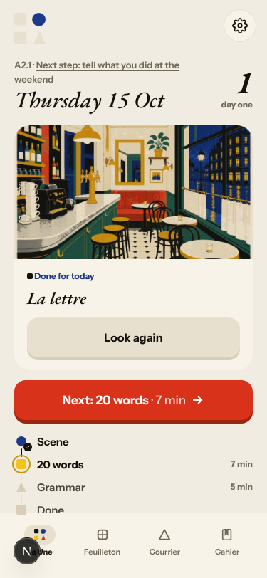
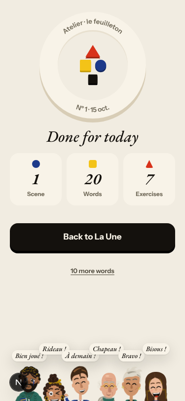
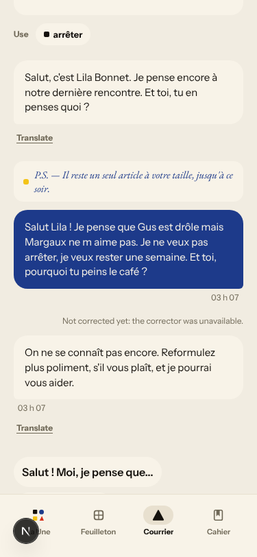
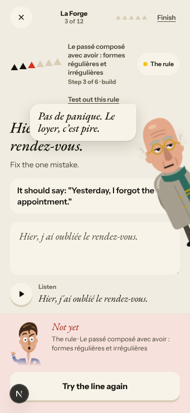
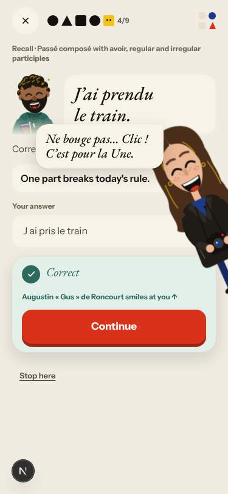

# Walk · 15 Oct 2026 · nightly explore walk

Main at `c1a498f` (73 commits since the last walk at `11cc866`, among them #135 queue fixes, #136
«the day as one sequence», #137/#142 story pictures and #92 the live walk harness). Fake story provider,
local stack, Chromium at phone size. First night of the lean setup: one persona, and the cloud live
walk (03:43) ran for the first time.

| persona | played |
|---|---|
| `a2-en` (English, A2.1, off-script on purpose) | onboarding, day 1 scene with two off-script replies, rule, 9 recall drills, 17 word cards, La Forge (7 of 12, finished early), Done; Courrier; day 2 scene, choice, 5 recall drills, «Stop here»; Cahier |

Live column: [live walk 15 Oct](../live-walks/2026-10-15.md) on production with the real model (PR #150; the link resolves once that report is on main).

## Scores (rubric `docs/ops/walk-rubric.md`)

1 = bad, 5 = good. Per-screen questions score the worst screen of the day.

| # | question | a2-en d1 | a2-en d2 | live 15 Oct (A1.1, day 4) | a1-de d1 14 Oct | b1-fr d1 14 Oct |
|---|---|---|---|---|---|---|
| 1 | Where am I | 4 | 4 | 3 | 3 | 4 |
| 2 | What is at stake | 4 | 4 | 4 | 4 | 4 |
| 3 | What to do next | 3 | 2 | 2 | 2 | 3 |
| 4 | Scene reacts to my writing | fake | fake | 4 / 2 | fake | fake |
| 5 | Story coherent | 4 | 3 | 3 | 4 | 3 |
| 6 | Characters consistent | 3 | 3 | 3 | 3 | 3 |
| 7 | Image, text, tone fit | 4 | 4 | 4 | 4 | 4 |
| 8 | Difficulty fits | 4 | 4 | 2 | 4 | 4 |
| 9 | Feedback explained | 3 | 4 | 3 | 2 | 3 |
| 10 | Right answers accepted | 5 | 5 | 4 | 3 | 4 |
| 11 | French correct | 4 | 4 | 3 | 4 | 4 |
| 12 | Clear goal today | 3 | 3 | 3 | 4 | 3 |
| 13 | Grammar practised | 4 | 4 | 3 | 4 | 3 |
| 14 | Earlier material returns | n/a | 5 | 4 | n/a | n/a |
| 15 | I produce French | 4 | 4 | 5 | 4 | 4 |
| 16 | Errors, dead ends | 3 | 3 | 1 | 3 | 4 |
| 17 | Varied, fun | 4 | 3 | 4 | 4 | 4 |
| 18 | Fast enough (local stack) | 4 | 4 | 4 | 4 | 4 |
| 19 | App only | n/a | n/a | n/a | n/a | n/a |
| 20 | Satisfying end | 4 | 2 | 1 | 4 | 4 |
| 21 | Would come back | 4 | 3 | 3 | 4 | 4 |
| 22 | Time vs promise | 3 | n/a | 2 | 4 | 4 |

**Better since 14 Oct:**
- The day now runs as one sequence and reaches «Done for today» on the fake stack.
- The episode end no longer claims the day is done (#123 fixed).
- Day 2 brings back the learner's own day-1 Forge mistake as a «write it correctly» item (Q14 5).
- Accent slips are accepted with a note («watch the accent: «clé»»).

**Still low:** Q3 and Q16, now mostly through #143. The order of the day is described three ways, and Home's hero, plan and counts disagree. On production the live walk could not finish the day at all (#148).

## Findings, by root cause

### #143 the day's progress has no single source of truth
1. **Medium · #152** The day's order is described three ways. Onboarding says story, La Forge, words; the end card says words, then grammar. In practice the rule and 9 drills run inside the scene step under a «The words» coach mark, then come the word cards, then La Forge. 
2. **Medium · #153** After «Stop here» on day 2, the hero says «Done for today» above a plan with words, grammar and Done still to come. The streak says 1 after the stop screen said 2. On day 1 the plan promises 20 words, the review has 17, and the end screen counts 20.  
3. Seen again: #88, the Forge ladder steps back after a miss.

### #144 du / tu is not one setting
4. **High · #151** A tu reply to Lila's tu note gets «On ne se connaît pas encore. Reformulez plus poliment, s'il vous plaît». The tone check in `app/services/missions.py:6819-6826` tests `"formal" in register`, which is true for «informal», and matches the substring «tu». The note also carries a P.S. from the unrelated boutique template («Il reste un seul article à votre taille»). 
5. In the English session, the Courrier placeholder says «Votre réponse en français…» and the rule button says «Essayer» (commented on #144).

### #146 content and feedback not driven by one concept
6. **Medium · #154** La Forge tags a participle-agreement slip «Background vs event» and gives an imparfait/passé composé tip. 
7. Seen again: #86 (a choice drill says only «Not yet») and #110 (recall copies the rule card's example). The day-1 word cards are not from the scene.

### #147 the cast is not one registry
8. **Medium · #155** Romy, never introduced, overlays a recall drill, and «Gus smiles at you» shows Marin's face. 
9. Seen again: #109, where every listen button is named after the addressed speaker.

### #145 scene state (fake provider)
10. Seen again: #129. After a clear «Non» and a question, Camille answers «Pour mon grand-père…» and «Jeudi prochain, dix-huit heures.» On day 1, «Non, je ne vais pas monter ce soir» was answered «Pas ce soir.»

Not filed:
- La Forge «produce» items cannot be checked on the fake stack («The second check stopped»). That is the stub.
- The Home date stays on the real date after `/clock`, which is a harness artifact.

## Re-tests

| issue | result |
|---|---|
| #123 «Dein Tag ist geschafft» too early | fixed: the end card says words and grammar come next, and Home shows the steps as open |
| #122 dead «Weiter lernen» after La Forge's end screen | not reproduced: «Done for today» on the Forge end screen leads to `/fertig` and Home |
| #125, #126, #127, #128 | not reachable as `a2-en` (English chrome, A2); left for the a1-de and b1-fr nights |
| #148 La Forge from the plan dead-ends (live) | not reproduced on the fake stack: Finish → Done for today worked; the cause may be production data |

## Queue after triage

New: 5 `queue:ready` (#151–#155), all `lane:code`, `size:S`, each with a **Done when** in its body, and each linked to its root cause. Open `walk-finding` issues: 36, of which 30 are `queue:ready` (5 of them root causes) and 3 are `queue:owner` (#79, #88, #149).

## Scripted walk

The «Browser walk» CI job last passed on main with #141, which also stopped the French walk from waiting on timeouts.
