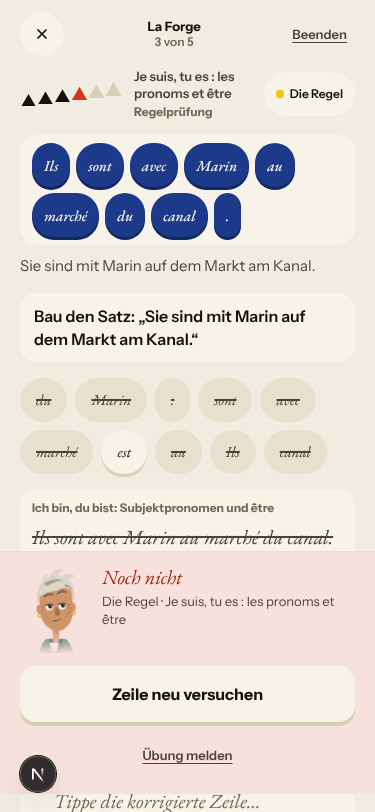
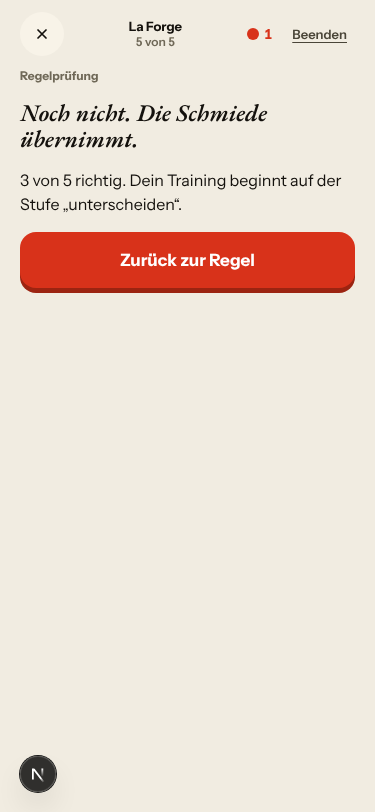
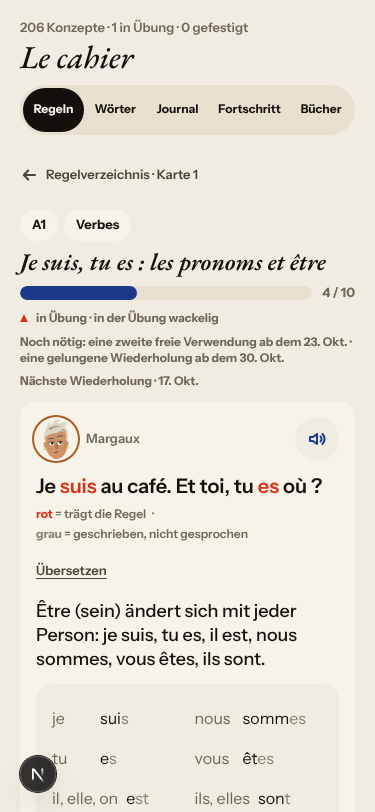
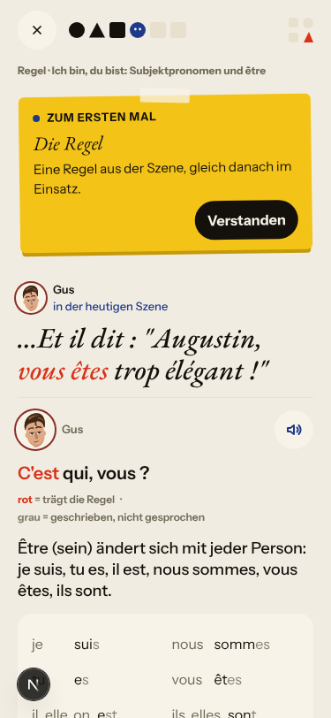
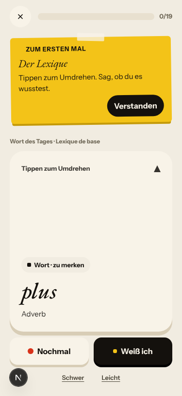
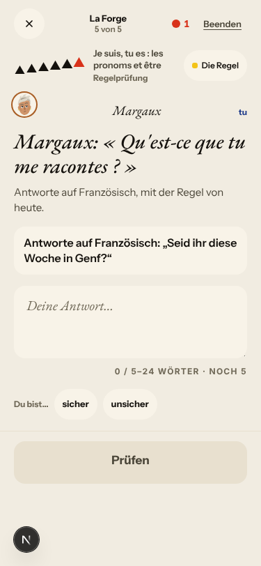
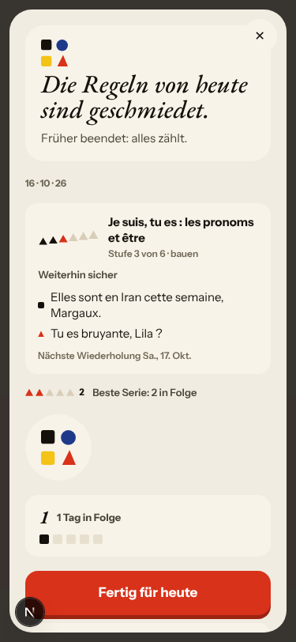

# Walk · 16 Oct 2026 · nightly explore walk

Main at `839aa76e` (14 commits since `c1a498f`, among them #159 «one day plan decides what is next»,
#158 register by whole word, #157 Forge judgement miss, #161 Forge Continue, #162–#165 story copy and
models). Fake story provider, local stack, Chromium at phone size, one persona.

| persona | played |
|---|---|
| `a1-de-fresh` (German, signs up through the UI) | teaser, sign-up, tour, day 1 scene with a clear «Non» and an off-script question, rule, 2 recall drills, 19 word cards, La Forge rule check (5 items) and La Forge (3 of 12, finished early), Done, Courrier |

Live column: [live walk 16 Oct](../live-walks/2026-10-16.md) on production with the real model
(branch `claude/live-walk-2026-10-16`), A1.1 day 5. Its findings (#166–#171) are not re-filed here.

## Scores (rubric `docs/ops/walk-rubric.md`)

1 = bad, 5 = good. Per-screen questions score the worst screen of the day.

| # | question | a1-de d1 16 Oct | a1-de d1 14 Oct | a2-en d1 15 Oct | live 16 Oct (A1.1, day 5) |
|---|---|---|---|---|---|
| 1 | Where am I | 4 | 3 | 4 | 4 |
| 2 | What is at stake | 4 | 4 | 4 | 4 |
| 3 | What to do next | 3 | 2 | 3 | 3 |
| 4 | Scene reacts to my writing | fake | fake | fake | 4 |
| 5 | Story coherent | 4 | 4 | 4 | 3 |
| 6 | Characters consistent | 3 | 3 | 3 | 2 |
| 7 | Image, text, tone fit | 4 | 4 | 4 | 2 |
| 8 | Difficulty fits | 4 | 4 | 4 | 4 |
| 9 | Feedback explained | 3 | 2 | 3 | 3 |
| 10 | Right answers accepted | 2 | 3 | 5 | 1 |
| 11 | French correct | 4 | 4 | 4 | 4 |
| 12 | Clear goal today | 4 | 4 | 3 | 3 |
| 13 | Grammar practised | 4 | 4 | 4 | 3 |
| 14 | Earlier material returns | n/a | n/a | n/a | 4 |
| 15 | I produce French | 4 | 4 | 4 | 5 |
| 16 | Errors, dead ends | 3 | 3 | 3 | 3 |
| 17 | Varied, fun | 4 | 4 | 4 | 4 |
| 18 | Fast enough (local stack) | 4 | 4 | 4 | 3 |
| 19 | App only | n/a | n/a | n/a | n/a |
| 20 | Satisfying end | 4 | 4 | 4 | 3 |
| 21 | Would come back | 4 | 4 | 4 | 4 |
| 22 | Time vs promise | 4 | 4 | 3 | 3 |

**Better since the last walks:**
- Onboarding, the episode-end card and Home all say scene, words, grammar (#159).
- After Done, Home shows every step done, and «Weiter: Grammatik» resumes La Forge at the right item.

**Lower:** Q10, because a correct word order is rejected in La Forge (#173). Together with live #166, that makes a new root cause, #174.

## Findings, by root cause

### #174 (new) a right answer is judged against one stored string
1. **High · #173** La Forge rejects «Ils sont avec Marin au marché du canal.», which is correct and follows the German order. It wants «Ils sont au marché du canal avec Marin.», strikes the learner's sentence through and cites the être rule. 
2. Children linked: #166 (live, case and period) and #93 (live, tutor). On the fake stack, «tu es jeune, marin» was accepted, so #166 sits in the live judging path.

### #143 the day's progress has no single source of truth
3. **Medium · #175** The rule check started from the day's La Forge («Diese Regel direkt prüfen») ends «Die Schmiede übernimmt», but its only button opens the Cahier, and the day is lost until Home.  
4. Still open: the rule and two recall drills come before the words, under a «Die Wörter» coach mark. «Schritt n von 6» runs 1, 2, 4, 5, 6 for a three-step plan. The plan says «20 Wörter», while the review and Done say 19.  

### #146 content and feedback not driven by one concept
5. **Medium · #176** A free-use item shows Margaux asking «Qu'est-ce que tu me racontes ?» while the task is «Seid ihr diese Woche in Genf?». Every miss adds «Benenne den Auslöser und wende dann die Zielform an.» 
6. Seen again on the fake stack: #169, where the recap says «Weiterhin sicher» after a miss and lists the missed sentence as a success.  Also #88 (ladder steps back), #86 («Noch nicht» on a recall choice that does contain a subject pronoun), and word cards mostly unrelated to the scene.
7. Seen again: #126, where «Sie sind …» prompts leave Elles/Ils to the tiles.

### #144 du / tu is not one setting
8. Margaux says tu in the scene and vous in the Courrier, the same split as live. «Essayer» appears in German chrome.

### #147 the cast is not one registry
9. Seen again: #124, where Romy greets in the teaser, is missing from the cast intro, and is then addressed in La Forge. Also #109, where every listen button in the reply thread is named «Gus anhören».

Not filed:
- La Forge free use and the Courrier say the check or correction was not available, which is the fake stub.
- Courrier times show UTC (03 h 10), already noted by the live walk.

## Re-tests

| issue | result |
|---|---|
| #152 day order described three ways (closed) | mostly fixed; the rest is noted on #143 |
| #153 Home «Done» with open steps | day 1: Home is consistent after Done; the plan's 20 against 19 words remains; day 2 «Stop here» not reached |
| #151 tone check substring | not conclusive: a tu reply to a vous note was not rejected; tu to tu was not reachable on day 1 |
| #166 lowercase, no period rejected (live) | not reproduced on the fake stack |
| #169 «Still proficient» after a miss (live) | reproduced on the fake stack |
| #125 judgement miss strikes the right sentence | not reached (no judgement miss); #173 shows the same strike-through for a word-order miss |

## Queue after triage

New: #173, #175 and #176 (`queue:ready`, `lane:code`, `size:S`, each with a **Done when**), plus root cause #174 (`size:M`). Open `walk-finding` issues: 39 `queue:ready`, 4 `queue:pr` (#125, #143, #151, #153) and 1 `queue:owner` (#134).

## Scripted walk

The «Browser walk» CI job last ran on main on 15 Oct (`c1a498f`, scheduled) and passed.
