# Walk · 17 Oct 2026 · nightly explore walk

Main at `2ebf1821` (15 commits since `839aa76e`, among them #185 «tu and du from one setting», #191 «one judge
for right and wrong», #178 a wrong tap says why, #181 cast intro and greetings, #184 listen buttons per speaker,
#183 A1 no longer handed the Papier). Fake story provider, local stack, Chromium at phone size, one persona.

| persona | played |
|---|---|
| `b1-fr-chrome` (French native chrome, B1.1) | day 1 scene, rule card, 2 recall drills, word cards and review, La Forge, Done, Courrier |

Live column: [live walk 17 Oct](../live-walks/2026-10-17.md) on production with the real model
(branch `claude/live-walk-2026-10-17`; the link resolves once that report is on main). Its findings (#193, #194)
are not re-filed here.

## Scores (rubric `docs/ops/walk-rubric.md`)

1 = bad, 5 = good. Per-screen questions score the worst screen of the day.

| # | question | b1-fr d1 17 Oct | a1-de d1 16 Oct | a2-en d1 15 Oct | live 17 Oct |
|---|---|---|---|---|---|
| 1 | Where am I | 4 | 4 | 4 | 3 |
| 2 | What is at stake | 4 | 4 | 4 | 4 |
| 3 | What to do next | 3 | 3 | 3 | 3 |
| 4 | Scene reacts to my writing | fake | fake | fake | 5 |
| 5 | Story coherent | 3 | 4 | 4 | 3 |
| 6 | Characters consistent | 3 | 3 | 3 | 3 |
| 7 | Image, text, tone fit | 4 | 4 | 4 | 3 |
| 8 | Difficulty fits | 4 | 4 | 4 | 4 |
| 9 | Feedback explained | 3 | 3 | 3 | 2 |
| 10 | Right answers accepted | 5 | 2 | 5 | 4 |
| 11 | French correct | 4 | 4 | 4 | 4 |
| 12 | Clear goal today | 4 | 4 | 3 | 3 |
| 13 | Grammar practised | 4 | 4 | 4 | 3 |
| 14 | Earlier material returns | n/a | n/a | n/a | 4 |
| 15 | I produce French | 4 | 4 | 4 | 5 |
| 16 | Errors, dead ends | 3 | 3 | 3 | 2 |
| 17 | Varied, fun | 4 | 4 | 4 | 4 |
| 18 | Fast enough (local stack) | 4 | 4 | 4 | 3 |
| 19 | App only | n/a | n/a | n/a | n/a |
| 20 | Satisfying end | 4 | 4 | 4 | 4 |
| 21 | Would come back | 4 | 4 | 4 | 4 |
| 22 | Time vs promise | 3 | 4 | 3 | 3 |

**Better since the last walks:**
- Q10: La Forge accepted lowercase and a typographic apostrophe after #191 (noted on #174).
- Camille is in the cast intro and says tu; each listen button names its own speaker (#184, #109 fixed).
  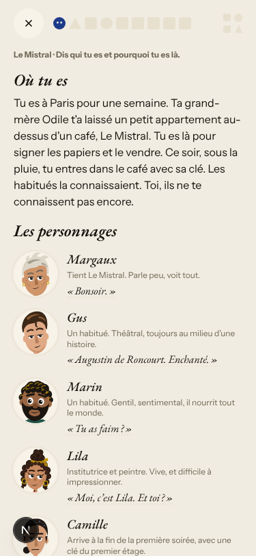 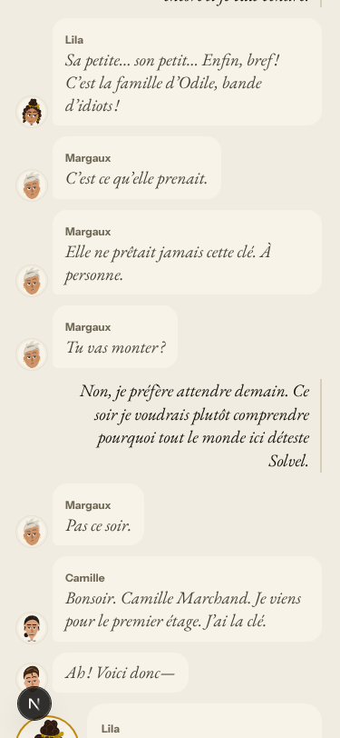
- The app chrome says tu consistently outside the drills (#128 closed).

**Lower:** Q5, because the rule card quotes a line that is not in the scene (#127 back to ready).
Q22, because the step counter says «Étape 9 sur 9» before the words and La Forge are done.

## Findings, by root cause

### #144 du / tu is not one setting
1. **Medium · #196 (new)** With French chrome, the drill instructions say vous («Corrigez», «Complétez»,
   «Remettez») while the rest of the app says tu, and La Forge shows English labels and an English task.
   #185 set the register for the chrome, but the drill templates carry their own strings.
   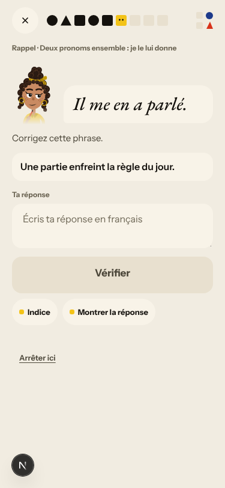 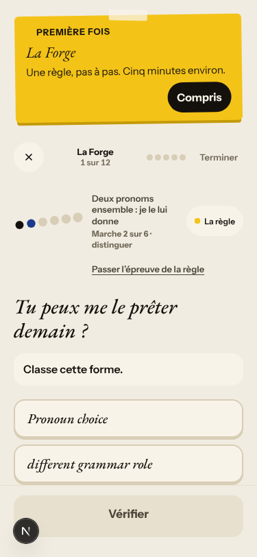 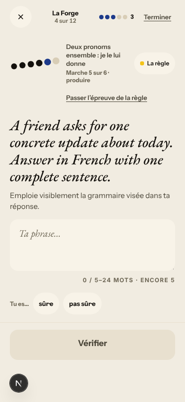
2. Romy writes vous in the Courrier (noted on #144). 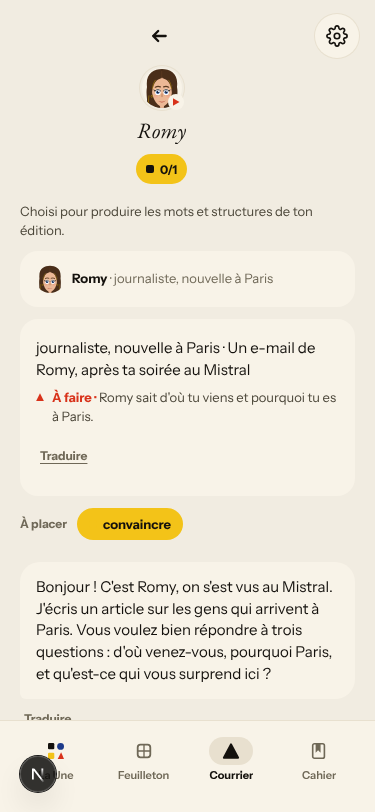

### #143 the day's progress has no single source of truth
3. **High · #197 (new)** The scripted Browser walk «en + B1» fails `day-completes` on main
   (16 Oct, `839aa76e`). See «Scripted walk» below.
4. Seen again: «Étape 9 sur 9» shows before the words and La Forge. The plan says 20 words, the review says
   «0 sur 18» and Done says 20 (noted on #143).
   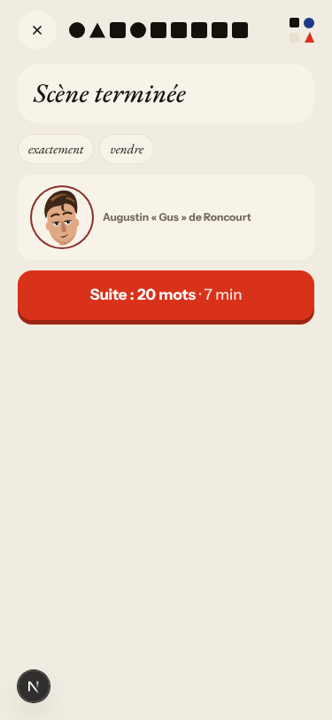 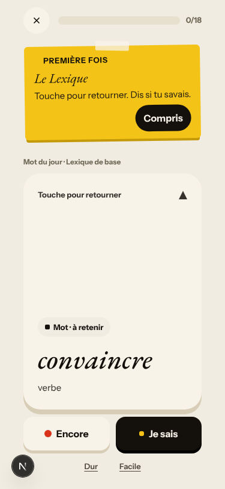 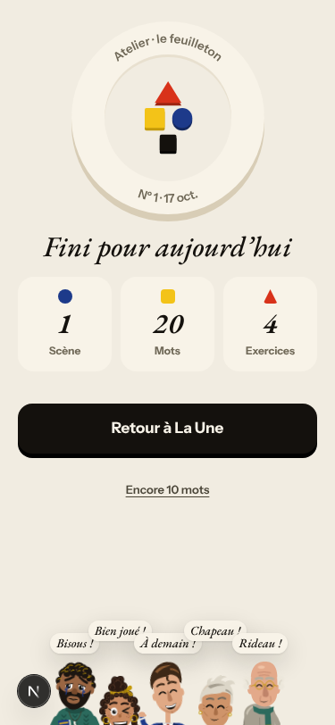

### #146 content and feedback not driven by one concept
5. **Medium · #127 (back to `queue:ready`)** The rule card «tirée de la scène» quotes a line that is not in the
   scene, and La Forge then drills the same rule from it. 
6. **Medium · #86 (back to `queue:ready`)** The recall choice drill offers only «Pas encore».
   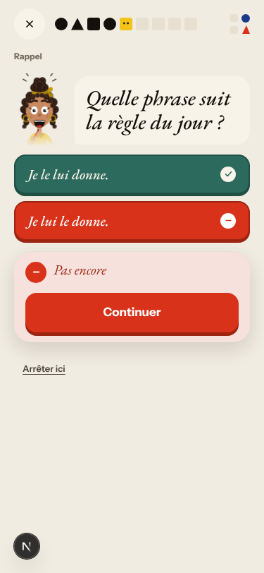
7. Seen again: #176, where a La Forge item carries two contradictory instructions and an off-cast «Marc».
   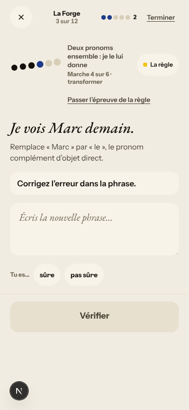 And #169, where the recap says «Toujours maîtrisée» on the
   first session.

### #147 the cast is not one registry
8. Romy's Courrier note says «on s'est vus au Mistral», a meeting the learner never had, and its P.S. speaks of
   Romy in the third person (noted on #147).

### #174 a right answer is judged against one stored string
9. No new miss on the fake stack; lowercase and the typographic apostrophe are now accepted (#191).

Not filed:
- La Forge free use and the Courrier say the check was not available, which is the fake stub.

## Re-tests

| issue | result |
|---|---|
| #128 French chrome mixes tu and vous | fixed outside the drills; closed, the drill part is #196 |
| #107 | fixed |
| #109 every listen button named after one speaker | fixed (#184) |
| #166 lowercase, no period rejected (live) | fixed on the fake stack after #191 |
| #86 recall choice offers only «not yet» | reproduced; back to `queue:ready` |
| #127 rule card quotes a line not in the scene | reproduced; back to `queue:ready` |
| #169 «still proficient» wording | reproduced on the first session |

## Queue after triage

New: #196 and #197 (`queue:ready`, `lane:code`, `size:S`, each with a **Done when**). Back to ready: #86, #127.
Open `walk-finding` issues: about 15 `queue:ready`, 1 `queue:owner` (#134), the rest `queue:pr`.

## Scripted walk

The «Browser walk» CI job last ran on main on 16 Oct (`839aa76e`) and failed: «en + B1» `FAIL day-completes` (#197).
