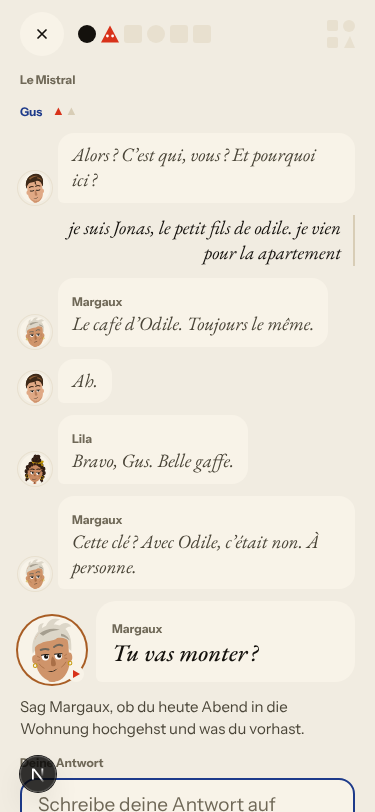
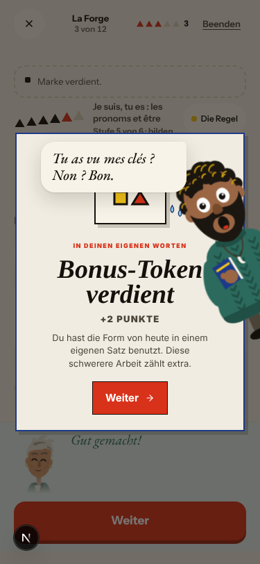
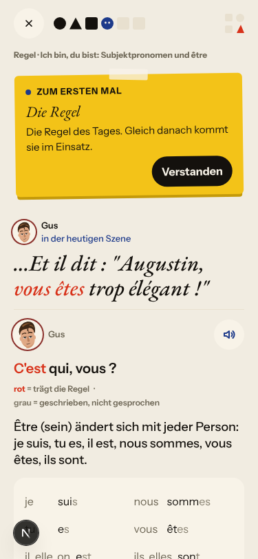
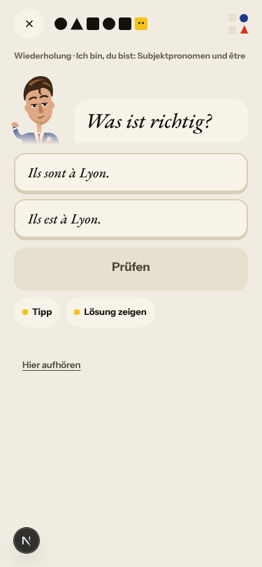
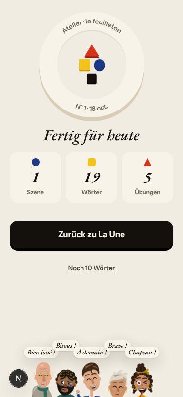
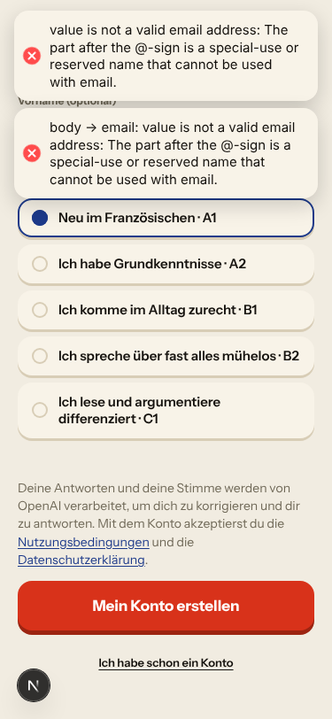
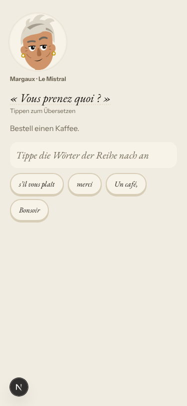

# Walk · 18 Oct 2026 · nightly explore walk

Main at `da3433f9` (8 commits since `2ebf1821`, among them #199 one cast registry, #203 recall choice says why and
the rule sticker stops claiming the scene, #202 «Sie (alle) sind», #208 correct only the part, #209 story memory
across days, #207 loop v2). Fake story provider, local stack, Chromium at phone size, one persona.

| persona | played |
|---|---|
| `a1-de-fresh` (German, signs up through the UI) | teaser, sign-up, tour, day 1 scene with a «non» and an off-script question, rule, 2 recall drills, 19 word cards, La Forge (5 of 12, finished early), Done, Home, Courrier |

Live column: [live walk 18 Oct](../live-walks/2026-10-18.md) on production with the real model
(PR #214, branch `claude/live-walk-2026-10-18`; the link resolves once that report is on main), A1.1 day 7.
Its findings (#211–#213) are not re-filed here. The 17 Oct column comes from report PR #198, still open.

## Scores (rubric `docs/ops/walk-rubric.md`)

1 = bad, 5 = good. Per-screen questions score the worst screen of the day.

| # | question | a1-de d1 18 Oct | b1-fr d1 17 Oct | a1-de d1 16 Oct | live 18 Oct (A1.1, day 7) |
|---|---|---|---|---|---|
| 1 | Where am I | 4 | 4 | 4 | 3 |
| 2 | What is at stake | 4 | 4 | 4 | 3 |
| 3 | What to do next | 3 | 3 | 3 | 3 |
| 4 | Scene reacts to my writing | fake | fake | fake | 5 |
| 5 | Story coherent | 4 | 3 | 4 | 3 |
| 6 | Characters consistent | 3 | 3 | 3 | 2 |
| 7 | Image, text, tone fit | 4 | 4 | 4 | 3 |
| 8 | Difficulty fits | 4 | 4 | 4 | 4 |
| 9 | Feedback explained | 4 | 3 | 3 | 3 |
| 10 | Right answers accepted | 5 | 5 | 2 | 5 |
| 11 | French correct | 4 | 4 | 4 | 4 |
| 12 | Clear goal today | 4 | 4 | 4 | 3 |
| 13 | Grammar practised | 4 | 4 | 4 | 3 |
| 14 | Earlier material returns | n/a | n/a | n/a | 4 |
| 15 | I produce French | 4 | 4 | 4 | 5 |
| 16 | Errors, dead ends | 3 | 3 | 3 | 2 |
| 17 | Varied, fun | 4 | 4 | 4 | 4 |
| 18 | Fast enough (local stack) | 4 | 4 | 4 | 4 |
| 19 | App only | n/a | n/a | n/a | n/a |
| 20 | Satisfying end | 4 | 4 | 4 | 3 |
| 21 | Would come back | 4 | 4 | 4 | 4 |
| 22 | Time vs promise | 3 | 3 | 4 | 3 |

**Better since the last walks:**
- Q5: the rule card quotes a real scene line («…Et il dit : "Augustin, vous êtes trop élégant !"», «C'est qui, vous ?»).
- Q9: a wrong tap in the recall choice now says why («Ils est à Lyon. → Ils sont à Lyon.» with the être forms).
- Q10: La Forge accepted «tu es italien, marin» with no capitals or question mark.
- The cast intro lists all five people from one source, Camille included, and the teaser no longer names Romy.

**Lower:** Q22, because the counter reads «Schritt 6 von 6» before the words and La Forge, and 20 words are promised but 19 are played.

## Findings, by root cause

### #147 the cast is not one registry
1. **Low · #217 (new)** In the reply thread Gus is «Gus» on the first line and «Augustin « Gus » de Roncourt» after, with two listen-button names. 

### #146 content and feedback not driven by one concept
2. **Low · #216 (new)** La Forge gives «In deinen eigenen Worten · Bonus» for a correction item («Korrigiere den einen Fehler»). 
3. Seen again: the recap says «Weiterhin sicher» on the first session (#169).

### #143 the day's progress has no single source of truth
4. Seen again (noted on #143): the rule and two recall drills come before the words, under a «Die Wörter» coach mark. The counter runs 2, 4, 5, «6 von 6» before the words and La Forge, «20 Wörter» opens «0/19», and Home then says «20 Wörter — erledigt».
      

### No shared root cause
5. **Low · #215 (new)** Sign-up with an address the server rejects shows the raw English validation message twice as toasts and leaves the E-Mail field unmarked. `authErrorMessage` in `pages/auth/signup.tsx` passes the 422 detail through verbatim. 

Not filed:
- The teaser has Margaux say «Vous prenez quoi ?» and the scene has her switch to «Tu vas monter ?» while Gus and Marin say vous. In the story the cast speaks to a stranger, so this reads as character, not chrome. 
- La Forge free use, the Courrier correction and Lila's generic note are the fake stub.
- La Forge's title stays French («Je suis, tu es : les pronoms et être») in German chrome, while the rule card is German. That's minor, and #110 already holds first-day polish.

## Re-tests

| issue | result |
|---|---|
| #86 recall choice offers only «not yet» (closed) | fixed: «Richtig» and «Noch nicht» with a reason |
| #127 rule card quotes a line not in the scene (closed) | fixed: both quotes are scene lines |
| #124 / #199 cast intro and teaser drift | fixed for the intro and teaser; display names still split (#217) |
| #174 right answer judged against one string | no right answer rejected on day 1 |
| #197 Browser walk «en + B1» fails `day-completes` (closed) | the 17 Oct run on `2ebf1821` passed |
| #169 «still proficient» wording | reproduced on the first session |
| #196 French drills say vous | not reachable with a German persona; left to the next b1-fr walk |

## Queue after triage

New: #215, #216 and #217 (`queue:ready`, `lane:code`, `size:S`, each with a **Done when**). Open `walk-finding` issues: 13 `queue:ready`, 1 `queue:owner` (#134), the rest `queue:pr`.

## Scripted walk

The «Browser walk» CI job last ran on main on 17 Oct (`2ebf1821`, scheduled) and passed.
